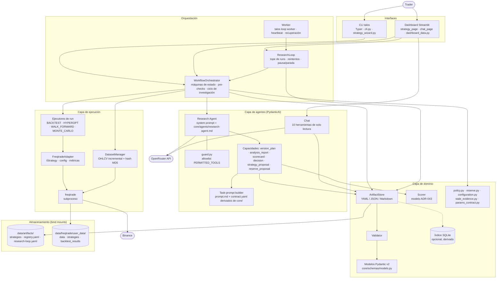
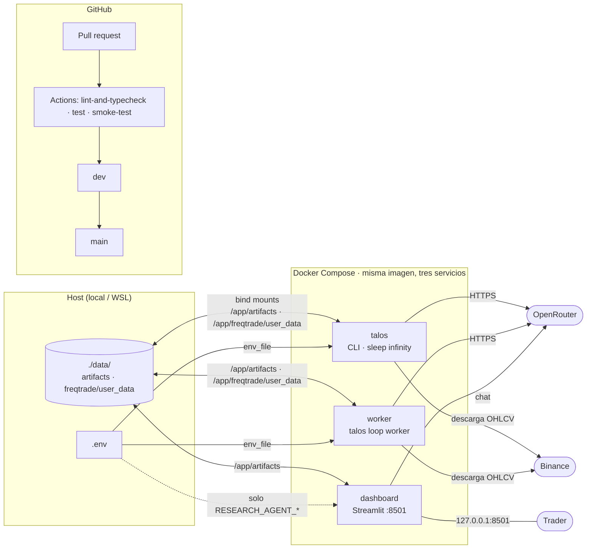
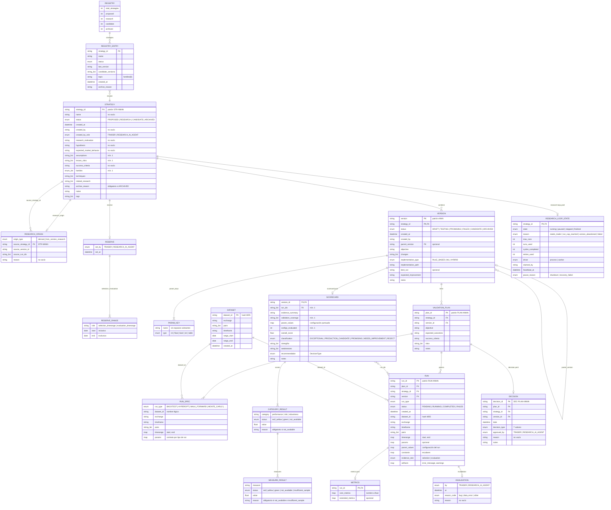

https://github.com/user-attachments/assets/ebd7f3be-7ae8-4554-8e44-87ec5deb56a5


## Índice

0. [Ficha del proyecto](#0-ficha-del-proyecto)
1. [Descripción general del producto](#1-descripción-general-del-producto)
2. [Arquitectura del sistema](#2-arquitectura-del-sistema)
3. [Modelo de datos](#3-modelo-de-datos)
4. [Interfaces: CLI y dashboard](#4-interfaces-cli-y-dashboard)
5. [Historias de usuario](#5-historias-de-usuario)
6. [Tickets de trabajo](#6-tickets-de-trabajo)
7. [Pull requests](#7-pull-requests)
8. [Metodología de desarrollo](#8-metodología-de-desarrollo)
9. [Uso de IA en el desarrollo (prompts)](#9-uso-de-ia-en-el-desarrollo-prompts)
10. [Resumen por módulos](#10-resumen-por-módulos)
11. [Planes post-MVP](#11-planes-post-mvp)

> **Sobre este documento.** Describe el estado de la rama `main` del repositorio de TALOS en el commit `97615a4` (19 de noviembre de 2026), que coincide con `dev`: el PR de promoción #232 acaba de fusionarse. Es la actualización de la versión de la entrega 1, que describía `main` en el commit `6dd5e78` (2 de septiembre de 2026). Todo lo que aquí se afirma se ha contrastado con el código, los tests o la configuración del repositorio. Los comandos que requieren Docker, red o una clave de LLM no se han ejecutado para este documento y se describen a partir de sus ficheros de configuración. Lo que falta por decidir está marcado como `[PENDIENTE]`.
>
> **Qué ha cambiado desde la entrega 1.** TALOS ya no es solo un CLI: tiene un **dashboard Streamlit** para el Trader (con chat sobre la estrategia seleccionada), un **bucle de investigación** (*research loop*) que repite ciclos del Research Agent con un tope de runs, y un **proceso worker** que lo ejecuta aunque no haya ningún comando abierto. Además de `BACKTEST`, ahora se ejecutan runs `HYPEROPT`, `WALK_FORWARD` y `MONTE_CARLO`; cada estrategia puede declarar una *reserva* de datos para puntuar sin sesgo de selección; y existe la demo E2E (`scripts/e2e_demo.py`), que se ejecuta también en CI. Los números pasan de 807 a 3 707 tests, y de 24 a 34 capacidades especificadas.
>
> **Adaptaciones respecto a la plantilla original.** TALOS no tiene API HTTP propia ni base de datos relacional. Por eso la sección 4 (antes «Especificación de la API») documenta las dos interfaces reales, el CLI y el dashboard, y la sección 1.3 muestra sesiones de terminal y la descripción del dashboard en lugar de capturas. Se han añadido las secciones 8 a 11.

---
## 0. Ficha del proyecto

### **0.1. Tu nombre completo:**

Luis Garcia Subirachs

### **0.2. Nombre del proyecto:**

TALOS — *Trading Analysis, Learning and Optimization System*

### **0.3. Descripción breve del proyecto:**

Framework de línea de comandos, inspirado en Specification-Driven Development, para investigar, validar y evolucionar estrategias de trading sistemático. Cada estrategia se trata como una hipótesis, cada versión como una implementación de esa hipótesis y cada ejecución (backtest) como evidencia. Un agente de IA de investigación (Research Agent) redacta versiones, informes de análisis, scorecards y propuestas de decisión, mientras que las decisiones estratégicas (iniciar una investigación, aprobar paper trading, pasar a producción, asignar capital) quedan reservadas al Trader humano.

### **0.4. URL del proyecto:**

No hay despliegue público. TALOS se ejecuta en local o en Docker (`global/environment.yaml` declara `vps.available: false`).

### 0.5. URL o archivo comprimido del repositorio

https://github.com/lgarcias/talos

El repositorio es **privado**.

---

## 1. Descripción general del producto

### **1.1. Objetivo:**

**Qué es.** TALOS organiza la investigación de estrategias de trading como un proceso reproducible, basado en evidencia y con gobernanza humana. El conocimiento no se acumula en notas sueltas, sino como *artefactos* estructurados (YAML, JSON y Markdown) validados contra esquemas Pydantic.

**Para quién.** Para el Trader, que es el único actor humano del sistema y no es un agente de IA (`docs/TALOS.md`).

**Qué valor aporta.** Los objetivos de diseño que fija la documentación del proyecto son:

- **Reproducibilidad:** cada ejecución registra un hash MD5 del conjunto de datos usado, y avisa si difiere del de una ejecución anterior equivalente (misma configuración, mismo tipo de run, pares, rango y parámetros; ADR-051). El `dataset_id` de un plan es un nombre lógico, no el hash.
- **Robustez:** una versión no se evalúa por un único backtest, sino contra la evidencia acumulada. El roadmap (`docs/roadmap/mvp-roadmap-v2.md` §9) lo justifica así: un backtest simple confirma que la estrategia funcionó en el pasado con esos datos, pero no prueba su robustez. Por eso ahora también hay runs de hyperopt, walk-forward y Monte Carlo.
- **Decisiones basadas en evidencia y sin sesgo de selección:** un scorecard determinista (Performance / Riesgo / Robustez) precede a cualquier decisión. La evidencia se acumula *por configuración* de parámetros (ADR-055), y una estrategia reserva un tramo de datos de evaluación que nunca sirve para elegir parámetros: solo los runs sobre ese tramo puntúan en el scorecard.
- **Rendimiento de la investigación (research throughput):** los pasos repetitivos (redactar el informe, puntuar, proponer, repetir el ciclo) los hace el agente, dentro de un bucle con tope de runs que sigue funcionando aunque el Trader cierre la terminal.
- **Decisiones gobernadas por humanos:** las acciones reservadas al Trader no son alcanzables por el agente, ni por el bucle, ni por el worker, y esto se comprueba con tests (ver 2.5).

**Modelo del dominio.**

```text
Strategy = Hipótesis        (qué comportamiento del mercado se cree explotable)
Version  = Implementación   (código IStrategy de Freqtrade que la materializa)
Run      = Evidencia        (una ejecución concreta y sus métricas)
```

Jerarquía de artefactos: `Strategy → Version → Validation Plan → Run`.

**Actores.**

| Actor | Tipo | Responsabilidades |
|---|---|---|
| Trader | Humano | Crear estrategias y aprobar su investigación (`PROPOSED → RESEARCH`), fijar la reserva de datos, arrancar, pausar y parar el bucle de investigación, invalidar runs erróneos, retirar estrategias, aprobar decisiones, paper trading y producción, y asignar capital |
| Research AI Agent | Agente de IA (LLM vía OpenRouter) | Crear versiones y planes de validación, analizar la evidencia, redactar la parte narrativa de los scorecards y los informes, proponer decisiones y una reserva de datos. Puede proponer nuevas estrategias en `PROPOSED`, pero solo como capacidad permitida y probada: ninguna capacidad en producción registra todavía esa herramienta. En el dashboard también responde preguntas en un chat de solo lectura |
| Platform Tools | Herramientas de TALOS: código Python determinista, sin LLM ni decisiones | Descarga de datos, ejecución de runs con Freqtrade, cálculo de métricas, hash del dataset y cálculo del scorecard. Son `DatasetManager`, `FreqtradeAdapter` y los ejecutores de run, `Scorer` y `WorkflowOrchestrator`. No toman decisiones: ejecutan lo que se les pide y registran el resultado |

**Platform Tools en lugar de un agente.** *Nota histórica:* el diseño original preveía un segundo agente LLM, el «Platform AI Agent» (la carta `core/agents/platform-agent.md` y el ADR-046 lo recuerdan). Durante el desarrollo se sustituyó por las Platform Tools: scripts Python que llaman a Freqtrade y calculan todo de forma determinista. El motivo es evitar que un agente invente datos o código en la parte que debe ser exacta. Hoy hay tres papeles bien separados:

| Parte | Quién la hace | Qué garantiza |
|---|---|---|
| **Cálculo y ejecución** | Platform Tools (`DatasetManager`, `FreqtradeAdapter`, ejecutores de run, `Scorer`) | Mismos datos y misma configuración producen el mismo resultado: cada run guarda el hash del dataset y una reejecución equivalente avisa si difiere. Ningún número del scorecard lo produce un modelo |
| **Parte creativa y decisiones** | Research Agent (LLM) | Propone versiones, planes y decisiones, y redacta los textos, pero **solo sobre evidencia ya calculada**: lee las métricas y el scorecard, no los genera. Su salida se valida antes de guardarse (secciones requeridas, código ejecutable) |
| **Decisiones estratégicas** | Trader (humano) | Aprobar, pasar a paper trading o producción y asignar capital |

**Reglas de gobernanza** (`global/governance/policy.yaml`): mínimo de 10 runs por versión, al menos 3 tipos de run distintos, y una revisión de estrategia cada 50 runs.

### **1.2. Características y funcionalidades principales:**

**Implementado en `main`** (cada punto se corresponde con una *capability* con spec en `openspec/specs/`):

| Funcionalidad | Comando / módulo | Descripción |
|---|---|---|
| Creación guiada de estrategias | `talos strategy new --from-template`; botón *Create strategy* del dashboard | Asistente interactivo (CLI) o formulario con Confirm/Cancel (dashboard); ambos validan contra `StrategyModel` y toda estrategia nace en `PROPOSED` |
| Ciclo de vida de estrategias | `talos strategy transition`; dashboard | Único camino autorizado para cambiar el estado de una estrategia; exige motivo al archivar |
| Reserva de datos | `talos strategy reserve` | El Trader declara un rango de *selección* y otro de *evaluación* reservado. Un run dentro del rango de evaluación se etiqueta como evidencia de evaluación, uno fuera de él como evidencia de selección, y uno que lo toca sin quedar dentro se rechaza antes de ejecutarse (ADR-055) |
| Versiones y planes de validación | `talos version new`, `talos version set-implementation`, `talos plan new` | Creación de versiones (`DRAFT`), de su `implementation.md` ejecutable y de planes con sus `run_specifications` |
| Generación por el agente | `talos version propose`, `WorkflowOrchestrator.propose_version` / `propose_plan` | El Research Agent genera una versión, su `implementation.md` y el plan de validación, con una puerta que rechaza los planes que los ejecutores no aceptarían (ADR-056) |
| Datos históricos | `talos dataset sync` | Descarga solo los datos OHLCV que faltan o están obsoletos (vía `freqtrade download-data`) y calcula un hash de reproducibilidad |
| Ejecución de runs | `talos run execute` | Extrae la clase `IStrategy`, genera la configuración y ejecuta Freqtrade para **BACKTEST, HYPEROPT, WALK_FORWARD** (fijo y con optimización por pliegues) y **MONTE_CARLO**; persiste run y métricas |
| Invalidación de runs | `talos run invalidate` | El Trader marca un run como erróneo (`bug`, `data_error`, `other`); queda en disco como historia pero no puntúa (ADR-055 §7) |
| Informe de análisis | `talos run analyze` | El Research Agent sintetiza toda la evidencia de un plan en `analysis-report.md` |
| Scorecard | `talos scorecard compute` | El `Scorer` calcula categorías y clasificación (modelo ADR-043, con la medida de drawdown de cola de Monte Carlo del ADR-057); el agente redacta la parte narrativa |
| Evidencia obsoleta | `talos version stale` | Indica si el scorecard de una versión sigue describiéndola (`fresh` / `stale` con motivos); se deriva al pedirlo, nunca se guarda |
| Ciclo de vida de versiones | `talos version advance` / `transition` | `DRAFT → TESTING → PROMISING/FAILED` según evidencia; archivado manual |
| Decisiones | `talos decision propose` / `approve`; dashboard | El agente propone una decisión coherente con el scorecard; solo el Trader la aprueba |
| Bucle de investigación | `ResearchLoop` (`research_loop.py`); controles del dashboard | Repite ciclos completos del agente hasta que hace falta al Trader, se agota el tope de runs o se abandona una versión; reintenta hasta 3 veces un ciclo fallido; puede pausarse, pararse y continuar |
| Worker | `talos loop worker`; servicio Compose `worker` | Proceso de larga duración que ejecuta los bucles que el Trader le entrega, se detiene limpiamente con `SIGTERM` y recupera un bucle cuyo proceso fue matado (ADR-059) |
| Dashboard | Servicio Compose `dashboard` (Streamlit) | Vistas de solo lectura de estrategias, versiones, runs, scorecards, informes y decisiones; acciones del Trader con confirmación; chat con el agente (ADR-054) |
| Asignación de runs segura entre procesos | `ArtifactStore.run_allocation_lock` (TALOS-143) | Un `fcntl.flock` por plan de validación serializa la asignación del id `RUN-XXXX` entre procesos que comparten los artefactos (dos sesiones `docker compose exec`, el dashboard, el worker). Espera hasta 10 s, se libera solo si el proceso muere y no se mantiene durante el backtest |
| Runs inmutables | `ArtifactStore.write_run` (TALOS-171) | Reescribir un run registrado no puede cambiar su configuración, su evidencia ni su identidad; solo cambian el estado, el `dataset_id` y los `artifacts`, y se puede añadir una invalidación |
| Registro global | `talos registry update` | Regenera `registry.yaml` a partir de lo que hay en disco |
| Validación del almacén | `talos store validate` | Revalida todos los artefactos de un árbol contra sus esquemas |
| Demo de aceptación E2E | `scripts/e2e_demo.py` | Recorre los ocho pasos del roadmap §8.3 a través del CLI real; en CI se ejecuta con dobles offline del agente y de los datos |

**Todavía no implementado** (verificado en el código):

- `CROSS_ASSET`, `PAPER_TRADING`, `TRAINING` e `INFERENCE_TEST` existen como valores del enum `RunType`, pero no tienen ejecutor: el registro de ejecutores (`RUN_EXECUTORS`) solo cubre los cuatro tipos de arriba.
- La transición `PROMISING → CANDIDATE` de una versión sigue sin implementarse: el orquestador la rechaza expresamente (`_CANDIDATE_DESCOPE_REASON`) aunque `walk_forward` y `monte_carlo`, que exige `policy.yaml`, ya tengan ejecutor. Una decisión `PROMOTE_CANDIDATE` es solo una propuesta que espera al Trader.
- El Research Agent no puede crear estrategias en un flujo real: la herramienta `propose_strategy` está implementada, permitida por la guarda y probada, pero ninguna capacidad en producción la registra en un agente (entrada de `docs/follow-ups.md`).
- Dos medidas del scorecard siguen sin poder calcularse, `ulcer_index` y `trade_risk_discipline`, porque Metrics aún no captura la curva de equity ni la secuencia de PnL por operación; el scorecard las marca `not_available` con ese motivo.
- Los *strategy reviews* se pueden persistir y el chat los lee (`get_strategy_review`), pero no hay comando ni agente que los genere.
- Paper trading, producción y asignación de capital: fuera del MVP (Fases posteriores del roadmap).
- Autenticación del dashboard y uso multiusuario: TALOS es de un solo usuario; el dashboard no tiene login y solo escucha en el *loopback* del host.
- Control de concurrencia más allá de la asignación de ids de run: la numeración de planes y versiones y la escritura simultánea de un mismo artefacto no están protegidas por ningún bloqueo. Mientras un bucle corre, el dashboard no ofrece acciones que inicien runs o creen planes sobre esa estrategia (regla de escritor único, ADR-059).

**Ejemplo de decisión de diseño relevante.** El modelo de lenguaje se limita al paso que requiere juicio (redactar el texto, elegir el experimento) y nunca calcula la evidencia en la que se apoya: por eso ese trabajo lo hacen las Platform Tools y no un agente. Todo lo que rodea al modelo es determinista y se prueba sin modelo: qué evidencia se reúne, qué peticiones se rechazan antes de llamar al modelo y si el resultado cumple la estructura exigida antes de persistirse. El bucle de investigación sigue el mismo principio: es código Python con un estado en disco (`research-loop.yaml`), no un agente que decide cuándo parar.

### **1.3. Diseño y experiencia de usuario:**

TALOS tiene dos interfaces para el Trader: el CLI `talos` (Typer, con ayuda y autocompletado del shell) y el **dashboard Streamlit**. El dashboard es una herramienta funcional de desarrollo y depuración para un único operador, no una interfaz de producto (ADR-054): importa el backend directamente, sin capa HTTP propia, y toda su lógica vive en `backend/talos/dashboard_data.py`, que no importa Streamlit y se prueba sin él.

> Las sesiones de terminal siguientes se han **ejecutado realmente** sobre el commit `97615a4`, con un directorio de artefactos temporal y datos ficticios (`Demo strategy`, textos «de ejemplo») que solo sirven para ilustrar el flujo.

**Punto de entrada (`talos --help`):**

```text
 Usage: talos [OPTIONS] COMMAND [ARGS]...

 TALOS CLI.

╭─ Commands ───────────────────────────────────────────────────────────────────╮
│ store      Artifact store operations.                                        │
│ strategy   Strategy artifact operations.                                     │
│ version    Version artifact operations.                                      │
│ plan       Validation plan artifact operations.                              │
│ run        Run artifact operations.                                          │
│ decision   Decision artifact operations.                                     │
│ scorecard  Scorecard artifact operations.                                    │
│ registry   Registry artifact operations.                                     │
│ dataset    Dataset operations.                                               │
│ loop       Research loop operations.                                         │
╰──────────────────────────────────────────────────────────────────────────────╯
```

**Flujo del Trader: crear una estrategia, aprobar su investigación, fijar su reserva y crear una versión.**

`talos strategy new --from-template` lanza un asistente que pregunta, por este orden: nombre, autor (por defecto `git config user.name`), motivación, hipótesis, comportamiento de mercado esperado, supuestos, riesgos conocidos, criterio de éxito, familia principal (y familias adicionales), técnicas, investigación relacionada, etiquetas y notas. Al terminar muestra el `strategy.yaml` resultante y pide confirmación:

```text
strategy_id: STR-0001
name: Demo strategy
status: PROPOSED
created_at: '2026-11-19T13:34:36.963999Z'
created_by: demo-user
created_by_role: TRADER
research_motivation: Motivo de ejemplo
hypothesis: Hipotesis de ejemplo
...
families:
- momentum
...
research_origin: null
reserve: null
...
Write strategies/STR-0001/strategy.yaml? [Y/n]:
talos strategy new: created STR-0001 at artifacts/strategies/STR-0001/strategy.yaml
```

```text
$ talos strategy list
STR-0001  PROPOSED  Demo strategy

$ talos strategy transition STR-0001 --to RESEARCH
talos strategy transition: STR-0001 PROPOSED -> RESEARCH

$ talos strategy reserve STR-0001 --selection 20240101-20240601 --evaluation 20240601-20240801
talos strategy reserve: STR-0001 reserve set by TRADER at 2026-11-19T13:34:32.354003+00:00: selection [2024-01-01, 2024-06-01), evaluation [2024-06-01, 2024-08-01)

$ talos version new STR-0001 --objective "Objetivo de ejemplo" --created-by demo-user
talos version new: created v001 at artifacts/strategies/STR-0001/versions/v001/version.yaml

$ talos version stale STR-0001 v001
no scorecard

$ talos registry update
talos registry update: indexed 1 strategy (0 proposed, 1 research, 0 candidate, 0 archived) at artifacts/registry.yaml

$ talos store validate artifacts/strategies
talos store validate: all artifacts valid.
```

**Errores guiados.** Las reglas de gobernanza se manifiestan como mensajes claros y códigos de salida distintos de cero:

```text
$ talos strategy transition STR-0001 --to ARCHIVED
talos strategy transition: --archive-reason is required to archive a strategy (--to ARCHIVED)
[exit=1]

$ talos run execute STR-0001 v001
talos run execute: STR-0001 v001 has no validation plan. Create one with `talos plan new` first.
[exit=1]

$ talos strategy new
talos strategy new: --from-template is required.
[exit=1]
```

*No se muestran sesiones de los comandos que usan el agente (`run analyze`, `scorecard compute`, `decision propose`, `version propose`) ni de los runs reales (`run execute`), porque requieren Docker, datos de Binance y una clave de OpenRouter. Su comportamiento se describe en la sección 4.*

**Dashboard (Streamlit).** Se sirve en `http://127.0.0.1:8501` (servicio Compose `dashboard`) y solo es accesible desde la máquina que ejecuta TALOS; para usarlo desde otro equipo se abre un túnel SSH (`docs/operations.md`). No tiene login. Está organizado así:

| Zona | Qué ofrece |
|---|---|
| **Barra lateral** | Botón *Create strategy* (abre un formulario con los campos obligatorios, el id que recibirá la estrategia y Confirm/Cancel); selector de estrategia; y un **bloque de estado** de la estrategia seleccionada que se refresca solo cada 10 s: estado del bucle de investigación, runs usados y tiempo desde el último cambio |
| **Página *Strategy*** (por defecto) | Vistas de solo lectura: estado, reserva y *review* de la estrategia; versiones con su implementación, su scorecard por categorías y su marca de evidencia obsoleta; planes de validación con sus runs (tipo, estado, métricas, configuración, rol de evidencia e invalidación); informe de análisis por plan; y decisión con su tipo, motivo, fecha y etiqueta de aprobación |
| **Acciones del Trader** (cada una con Confirm/Cancel) | *Create strategy*; *Approve* una decisión pendiente (igual que `talos decision approve`); *Move to RESEARCH* y *Archive* (con motivo), solo cuando la transición es legal; *Start research* sobre una estrategia `PROPOSED` (la pasa a `RESEARCH` y entrega su bucle al worker en un solo paso); y *Start / Pause / Stop / Continue* del bucle de investigación, con el `max_runs` pedido al arrancar (10 por defecto) |
| **Sección *Research loop*** | Estado del bucle (`running`, `paused`, `stopped`, `finished` y su motivo), runs usados frente al tope, último ciclo, y una línea *Worker:* que dice quién lo ejecuta (`worker <id>, last alive …`, `waiting for the worker` o `no live worker`). Mientras un bucle corre, la página no ofrece acciones que inicien runs o creen planes sobre esa estrategia |
| **Página *Chat*** | Conversación de varios turnos con el Research Agent sobre la estrategia seleccionada. El agente responde leyendo los artefactos reales con diez herramientas de solo lectura; **no tiene ningún camino de escritura**. Las conversaciones viven solo en la sesión y se guardan por estrategia |

Cada acción se comprueba de nuevo al confirmarla: si lo que se mostró ha cambiado mientras tanto, la página lo dice y no escribe nada. Un artefacto inválido se muestra como error de esa vista, no como traza, y el texto de los artefactos se renderiza literal (sin interpretar Markdown ni HTML).

### **1.4. Instrucciones de instalación:**

TALOS no usa base de datos: no hay migraciones ni semillas de datos. El único andamiaje inicial son los directorios de `./data/`, que crea un script. La guía completa para una máquina limpia (pensada para un Trader no desarrollador) está en `docs/quickstart.md`, y el uso diario en `docs/operations.md`.

#### Opción A — Docker (uso completo)

Es la única forma de ejecutar runs y descargar datos, porque Freqtrade solo está en la imagen de Docker (no es una dependencia de `backend/pyproject.toml`).

Requisitos: Docker con Compose, y una clave de API de [OpenRouter](https://openrouter.ai) para las operaciones del agente.

```bash
git clone https://github.com/lgarcias/talos.git && cd talos

# 1. Configuración
cp .env.example .env
#    Edita .env: RESEARCH_AGENT_API_KEY (por defecto es un valor de ejemplo no funcional).
#    HOST_UID / HOST_GID son opcionales: si faltan, los rellena scripts/dc con `id -u` / `id -g`.

# 2. Estructura de ./data/ (artefactos y datos de Freqtrade), con tu usuario como propietario
./scripts/setup-data-dirs.sh

# 3. Construir y arrancar los tres servicios
docker compose up -d --build

# 4. Comprobar
docker compose ps                               # talos, dashboard y worker en "Up"
docker compose exec talos freqtrade --version
docker compose exec talos talos --help
```

Tres servicios salen de la misma imagen:

| Servicio | Para qué | Comando | Puerto |
|---|---|---|---|
| `talos` | CLI: se mantiene vivo con `sleep infinity` y se invoca con `docker compose exec` | `sleep infinity` | — |
| `dashboard` | Dashboard Streamlit del Trader | `streamlit run backend/dashboard/app.py` | `127.0.0.1:8501` |
| `worker` | Ejecuta los bucles de investigación que el Trader arranca | `talos loop worker` | ninguno |

`scripts/dc` envuelve `docker compose`: comprueba que el daemon de Docker esté activo y rellena `HOST_UID`/`HOST_GID` cuando faltan, de modo que sirve de sustituto directo si no usas un `.env` por worktree.

Variables de entorno (`.env.example`):

| Variable | Uso | Valor por defecto |
|---|---|---|
| `HOST_UID`, `HOST_GID` | Usuario con el que corren los contenedores, para que los ficheros de `./data/` sean tuyos (opcionales) | `1000` / `1000` |
| `TALOS_ENV_FILE` | Ruta de un único fichero de entorno compartido entre worktrees, en lugar de `.env` (se define en el shell, no en el fichero) | `.env` |
| `RESEARCH_AGENT_MODEL` | Modelo LLM del Research Agent | `deepseek/deepseek-chat` |
| `RESEARCH_AGENT_BASE_URL` | Endpoint compatible con la API de OpenAI | `https://openrouter.ai/api/v1` |
| `RESEARCH_AGENT_API_KEY` | Clave de API | `sk-or-your-key-here` (no funcional) |

Los servicios `talos` y `worker` leen el fichero de entorno completo (`env_file`). El `dashboard`, en cambio, **no** recibe `env_file`: solo las tres variables `RESEARCH_AGENT_*` (que necesita el chat), porque es el proceso sin login y no debe ver el resto del entorno.

Uso dentro del contenedor:

```bash
docker compose exec talos talos dataset sync --pairs BTC/USDT --timeframe 15m --timerange 20240101-20240131
docker compose exec talos talos strategy list
docker compose logs worker          # qué hace el worker
```

Los artefactos se guardan en `./data/artifacts/` y los datos de Freqtrade en `./data/freqtrade/user_data/`, ambos montados desde el host (bind mounts), de modo que sobreviven a `docker compose down`. Para detener el `worker` sin perder un bucle en curso, el bucle se pausa solo con motivo `shutdown` al recibir `SIGTERM` (`stop_grace_period: 15m`).

*Nota: los pasos de la opción A se derivan de `Dockerfile`, `docker-compose.yml`, `.env.example`, `scripts/dc` y `docs/quickstart.md`; no se han ejecutado para este documento.*

#### Opción B — Desarrollo local sin Docker (tests, dashboard y comandos que no ejecutan Freqtrade)

Requisitos: [uv](https://docs.astral.sh/uv/) y Python 3.11–3.13 (el desarrollo se fija a 3.11, `backend/.python-version`, para que coincida con mypy y con CI).

```bash
cd backend
uv sync --locked          # instala las dependencias exactas de uv.lock
uv run talos --help       # el CLI
uv run pytest             # 3 707 tests; falla si la cobertura baja del 80 %
uv run ruff check .       # lint
uv run mypy .             # tipado estricto
TALOS_DASHBOARD_ARTIFACTS_ROOT=../data/artifacts uv run streamlit run dashboard/app.py   # el dashboard
```

Limitaciones de esta opción:

- `talos run execute` y `talos dataset sync` necesitan el binario `freqtrade`, que solo está en la imagen de Docker.
- Los comandos con agente (`run analyze`, `scorecard compute`, `decision propose`, `version propose`) y el chat necesitan `RESEARCH_AGENT_API_KEY` y `RESEARCH_AGENT_MODEL`. El CLI carga `.env` (o el fichero de `TALOS_ENV_FILE`) por sí mismo; una variable ya definida en el entorno tiene prioridad.
- Por defecto el CLI escribe en `./artifacts` (relativo al directorio actual); se cambia con `--artifacts-root`.

---
## 2. Arquitectura del Sistema

### **2.1. Diagrama de arquitectura:**



**Patrón y justificación.** Es una arquitectura en capas, centrada en artefactos y sin servidor HTTP propio: el CLI y el dashboard delegan en un orquestador, que coordina agentes, almacén y ejecución. El bucle de investigación y su worker se apoyan en el mismo orquestador y en un estado en disco. Los principios que la definen (`docs/architecture/current-design.md`, ADR-034) son:

- *El sistema de ficheros es la fuente de verdad.* Cualquier índice (SQLite) es derivado y prescindible. El dashboard y el worker **solo comparten estado a través de los ficheros** del bucle (ADR-059).
- *Los artefactos definen el conocimiento; el workflow define el proceso.* `core/` y `openspec/` son la especificación; `backend/` debe ajustarse a ellas, no al revés.
- *El LLM opera dentro de un cerco.* Las peticiones se rechazan antes de llamar al modelo y su salida se comprueba antes de guardarse.
- *Sin capa HTTP.* El dashboard importa el backend como módulos Python (ADR-054); la lógica de negocio nunca vive en los ficheros de Streamlit, de modo que extraer una API más adelante sería barato.

**Beneficios:** reproducibilidad y trazabilidad (todo queda en disco, versionable y copiable con `rsync`), poca infraestructura (una sola imagen de Docker con tres servicios), cambio de modelo o proveedor solo con variables de entorno, y un núcleo determinista y muy probado (97 % de cobertura).

**Sacrificios y déficits conocidos** (documentados en `docs/follow-ups.md` y el roadmap):

- Un solo usuario y concurrencia limitada: la asignación del id de un run está protegida entre procesos por un bloqueo de fichero (`flock`, TALOS-143), pero no hay más bloqueos. Una carrera entre CLI, dashboard y worker en cualquier otra operación se trata declarando el caso no soportado, no con un lock (decisión del 30 de octubre de 2026, PR #174), y hay una ventana TOCTOU conocida y aceptada en la numeración de planes y versiones.
- El dashboard no tiene autenticación: se publica solo en `127.0.0.1` y el acceso remoto es un túnel SSH. Es una herramienta de desarrollo, no un producto.
- Dependencia de Freqtrade: la imagen se fija a la versión `2026.3` por compatibilidad con Python `<3.14`; subir de versión exige revisar ese límite.
- La validación avanzada sigue incompleta: no hay ejecutores para `CROSS_ASSET` ni para paper trading, y una versión no puede llegar a `CANDIDATE`.
- Un ciclo del agente dura minutos (el ciclo medido en TALOS-111 tardó 728 s), por eso el worker admite un `stop_grace_period` de 15 minutos y recupera un bucle si su proceso muere a mitad de un paso.

### **2.2. Descripción de componentes principales:**

| Componente | Tecnología | Función |
|---|---|---|
| **CLI** (`talos`) | Python, Typer | 22 comandos agrupados en 10 subcomandos. No contiene lógica de negocio: valida entradas, delega en el orquestador y traduce errores a mensajes y códigos de salida |
| **Dashboard** | Streamlit | Páginas *Strategy* y *Chat*, barra lateral con estado autorrefrescante, y las únicas escrituras permitidas al Trader (creación, aprobación, transición y controles del bucle). Toda su lógica está en `talos/dashboard_data.py`, sin Streamlit |
| **WorkflowOrchestrator** | Python | Punto único de coordinación, sin HTTP. Contiene las máquinas de estado de estrategia y versión, el registro de ejecutores de run, el ciclo de investigación completo (`run_research_cycle`) y los pre-checks previos a cualquier llamada al modelo |
| **ResearchLoop** | Python | Repite ciclos sobre una estrategia con estado persistido (`research-loop.yaml`), tope de runs, reintentos y pausa/parada cooperativas. No ejecuta ninguna acción reservada al Trader |
| **Worker** | Python (`talos loop worker`) | Toma los bucles entregados (uno a la vez, por orden de arranque), mantiene un *heartbeat*, se detiene con `SIGTERM` pausando el bucle y recupera uno cuyo proceso fue matado |
| **Research Agent** | PydanticAI + OpenRouter | Agente cuyo *system prompt* es la carta `core/agents/research-agent.md`. Modelo configurable por `.env` |
| **Guard** | Python | Lista blanca (`PERMITTED_TOOLS`) de las herramientas que el agente puede registrar; una herramienta no listada falla al registrarse, antes de cualquier llamada al modelo |
| **Task-prompt builder** | Python + YAML | Ensambla cada prompt de tarea desde `core/` (secciones requeridas de `core/artifacts/*.md`, campos requeridos de `core/schemas/*.schema.yaml`) para no duplicar la especificación en el backend (ADR-050). Desde TALOS-206 los prompts del plan incluyen el contrato de `params` de cada tipo de run, generado desde los validadores |
| **Chat** | PydanticAI + 10 herramientas de lectura | Conversación sobre una estrategia; lee sus artefactos y no puede escribir nada |
| **ArtifactStore** | Python, PyYAML | Lee y escribe artefactos respetando el modelo de ámbitos (ADR-035); valida con Pydantic antes de persistir |
| **Scorer** | Python | Calcula categorías Performance / Riesgo / Robustez con umbrales de `scoring-config.yaml` (ADR-043, ADR-057), sin tocar código para ajustar |
| **DatasetManager** | Python | Inspección de datos locales, descarga incremental y hash MD5 del conjunto |
| **FreqtradeAdapter** y ejecutores | Python, Freqtrade | Extrae verbatim el bloque ```python``` de `implementation.md` como clase `IStrategy`, genera `config.json` y el fichero de parámetros del run, lanza Freqtrade como subproceso y parsea el resultado a `MetricsModel`. `hyperopt.py`, `walk_forward.py` y `monte_carlo.py` implementan los demás tipos de run |
| **Reserva, configuración y evidencia obsoleta** | Python | `reserve.py` decide el rol de evidencia de un run; `configuration.py` define cuándo dos `param_values` son la misma configuración; `stale_evidence.py` deriva si un scorecard sigue vigente (ADR-055) |
| **Modelos y esquemas** | Pydantic v2, JSON-Schema YAML | Contrato de todos los artefactos |
| **Índice SQLite** | `sqlite3` | Índice derivado de estrategias, versiones y runs. Está implementado pero es opcional: ni el CLI ni el dashboard lo activan |

### **2.3. Descripción de alto nivel del proyecto y estructura de ficheros**

```text
talos/
├─ README.md · AGENTS.md · CLAUDE.md      # puntos de entrada (humanos y agentes de IA)
├─ Dockerfile · docker-compose.yml · docker-compose.ci.yml · .env.example
├─ backend/
│   ├─ pyproject.toml · uv.lock · cosmic-ray.toml · mutation-shards/
│   ├─ talos/                             # paquete Python (ver sección 10)
│   │   ├─ cli.py · orchestrator.py · artifact_store.py · artifact_index.py
│   │   ├─ research_loop.py · research_loop_worker.py
│   │   ├─ dashboard_data.py · scorer.py · policy.py · reserve.py
│   │   ├─ configuration.py · active_configuration.py · stale_evidence.py · params_contract.py
│   │   ├─ dataset_manager.py · freqtrade_adapter.py · hyperopt.py · walk_forward.py · monte_carlo.py
│   │   ├─ strategy_wizard.py · validator.py · config.py · _bootstrap.py
│   │   └─ agents/                        # Research Agent, capacidades y chat
│   ├─ dashboard/                         # app.py · strategy_page.py · chat_page.py
│   └─ tests/                             # 69 ficheros test_*.py + fixtures/
├─ core/                                  # ESPECIFICACIÓN del framework
│   ├─ agents/        # cartas de los agentes
│   ├─ artifacts/     # definición de cada tipo de artefacto
│   ├─ workflows/     # strategy-research-workflow.md
│   ├─ schemas/       # *.schema.yaml + models.py (Pydantic)
│   └─ templates/     # plantillas por artefacto
├─ global/
│   ├─ environment.yaml                   # conocimiento del entorno de desarrollo
│   └─ governance/    # policy.yaml · scoring-config.yaml
├─ docs/
│   ├─ TALOS.md · CONVENTIONS.md · BACKEND.md · INFRASTRUCTURE.md · FRONTEND.md
│   ├─ quickstart.md · operations.md      # guías para el Trader
│   ├─ architecture/  # diseño + decisions/ (ADR-032 … ADR-059)
│   ├─ governance/    # especificación de scoring
│   ├─ roadmap/       # mvp-roadmap-v2.md y planes/informes fechados
│   ├─ examples/      # estrategia de ejemplo (STR-0001)
│   └─ follow-ups.md
├─ openspec/
│   ├─ config.yaml
│   ├─ specs/         # 34 capacidades especificadas
│   └─ changes/archive/   # 155 cambios archivados (propuesta, diseño, tareas)
├─ scripts/           # dc · setup-data-dirs.sh · e2e_demo.py · verify-ohlcv-persistence.sh · ci_offline/
├─ .github/           # workflows (CI, mutation testing, lint de títulos) · plantilla de PR
├─ .githooks/pre-commit
└─ .claude/           # comandos y skills del flujo de desarrollo con IA
```

Los datos de ejecución **no** viven en el repositorio: se guardan en `data/` (ignorado por git y montado desde el host):

```text
data/
├─ artifacts/
│   ├─ registry.yaml
│   ├─ .locks/                # bloqueos de asignación de runs (uno por plan), fuera de strategies/
│   └─ strategies/STR-XXXX/
│       ├─ strategy.yaml · strategy-review.md · research-loop.yaml
│       └─ versions/vXXX/
│           ├─ version.yaml · implementation.md · scorecard.json
│           └─ validation-plans/PLAN-XXXX/
│               ├─ validation-plan.yaml · analysis-report.md · decision.yaml
│               └─ runs/RUN-XXXX/
│                   └─ run.yaml · metrics.json
└─ freqtrade/user_data/
    ├─ data/binance/          # datos OHLCV
    ├─ strategies/            # una carpeta por run: su clase IStrategy y su fichero de parámetros
    ├─ configs/               # config.json generado para cada run
    ├─ backtest_results/      # resultados crudos de Freqtrade, por run
    ├─ hyperopt_results/      # resultados de hyperopt (por run y, en walk-forward, por pliegue)
    └─ monte_carlo_results/   # remuestreos de Monte Carlo, por run
```

El diseño sigue el **modelo de ámbitos de artefactos** (ADR-035, ampliado por ADR-038, 039 y 042): cada artefacto pertenece a exactamente un ámbito (Strategy, Version, Validation Plan o Run), y ese ámbito determina dónde se guarda. `research-loop.yaml` es estado de la plataforma en el ámbito Strategy, no un artefacto de `core/`.

### **2.4. Infraestructura y despliegue**



**Contenedores.** Tres servicios construidos desde la misma imagen, que parte de la imagen oficial de Freqtrade con la versión fijada (`2026.3`) e instala las dependencias con `uv sync --frozen` (`uv` `0.11.19`). Corren como usuario no root (`ftuser`; en Compose, `user: HOST_UID:HOST_GID`) y llevan `init: true`, de modo que *tini* reenvía `SIGTERM` al proceso:

- `talos`: el CLI. Su proceso principal es `sleep infinity` y se trabaja con `docker compose exec`.
- `dashboard`: Streamlit en el puerto `127.0.0.1:8501`, con *healthcheck* sobre `/_stcore/health`. Monta solo `./data/artifacts` (lectura y escritura, porque las acciones del Trader escriben ahí) y no recibe `env_file`.
- `worker`: `talos loop worker`, sin puerto. Monta los artefactos y `user_data` de Freqtrade y recibe el mismo `env_file` que `talos`. Su *healthcheck* lee un fichero de *heartbeat* que reescribe cada 10 s y falla si tiene más de 60 s. `stop_grace_period: 15m`.

No hay más servicios (ADR-054, ADR-059): Freqtrade corre dentro de `talos` y de `worker` como subproceso.

**Despliegue.** Actualmente es manual y local: `docker compose up -d --build`. No hay VPS ni despliegue continuo (el roadmap sitúa el pipeline completo de CI/CD en la Fase 3); `docs/quickstart.md` explica cómo instalarlo en un servidor Linux.

**Integración continua** (GitHub Actions):

| Workflow | Cuándo | Qué hace |
|---|---|---|
| `ci.yml` | Pull requests hacia `main` o `dev` | Tres jobs. `lint-and-typecheck` (`ruff check`, `mypy`); `test` (`pytest` con cobertura, falla por debajo del 80 %); y `smoke-test` (TALOS-69), que construye la imagen, levanta `talos` y `dashboard`, espera a que el dashboard responda y ejecuta la demo E2E completa con **dobles offline** del agente y de los datos de mercado: sin llamadas a un modelo, sin Binance y sin secretos. Python 3.11, dependencias con `uv sync --locked` |
| `pr-title-lint.yml` | Pull requests | El título debe empezar por `[TALOS-N]` |
| `mutation-testing.yml` | Mensual (día 1, 06:00 UTC) y manual | Mutation testing con `cosmic-ray` sobre `core/` y `backend/talos/`, repartido en seis *shards* en paralelo (TALOS-107) y un job final que combina las sesiones en una sola puntuación. Informa, no bloquea |

Las ramas `main` y `dev` están protegidas: se exige un pull request (sin número mínimo de aprobaciones), que los tres checks (`lint-and-typecheck`, `test` y `smoke-test`) estén en verde y que la rama esté al día con la base. La protección no se aplica a los administradores, y no se permiten *force pushes* ni borrados. Además, un hook local (`.githooks/pre-commit`) ejecuta `ruff` y `mypy` antes de cada commit.

**Flujo de ramas:** un worktree por ticket, creado desde `dev`; PR hacia `dev`; y promoción periódica de `dev` a `main` con otro PR. En Plane, un ticket pasa a *Ready* al fusionarse en `dev` y a *Done* cuando se promueve a `main`.

**Observación sobre la imagen.** La limitación señalada en la entrega 1 (`policy.py` y `scorecard.py` leen `global/governance/*.yaml` y la imagen no lo contenía) ya está resuelta: el `Dockerfile` copia `global/governance/` a la imagen.

### **2.5. Seguridad**

TALOS es una herramienta local de un solo usuario; su modelo de seguridad se centra en **impedir que el agente de IA, el bucle o el worker actúen fuera de su autoridad** y en la higiene de secretos y dependencias.

**Gobernanza humana aplicada por construcción** (riesgo R7 del roadmap, «gobernanza humana saltada por la automatización»):

- El agente solo puede registrar las herramientas de una lista blanca (`agents/guard.py`). Un nombre no listado lanza `ValueError` al registrarse.
- `WorkflowOrchestrator.propose_strategy` fija `status=PROPOSED` y `created_by_role=RESEARCH_AI_AGENT` *por ausencia de parámetro*: no existe ningún argumento con el que pedir otro valor.
- `create_strategy` rechaza cualquier estado inicial distinto de `PROPOSED`, de modo que no se puede «nacer» en `RESEARCH`.
- `transition_strategy` es el único camino que cambia el estado de una estrategia, y `PROPOSED → RESEARCH` solo se invoca desde el CLI o el dashboard del Trader.
- Las decisiones que persiste el agente llevan siempre `approved_by: RESEARCH_AI_AGENT`; `approve_decision` es el único camino hacia `TRADER`, y una decisión ya aprobada por el Trader no se reemplaza automáticamente.
- **El bucle y el worker no toman ninguna acción reservada al Trader** (requisitos de las specs `research-loop` y `research-loop-worker`): solo escriben el estado del bucle. Que un bucle pueda acabar porque «hace falta al Trader» es precisamente el mecanismo para devolverle el control.
- **El chat es de solo lectura:** lee los artefactos de una única estrategia con diez herramientas, valida los identificadores que le pasa el modelo y no tiene camino de escritura (ADR-054, decisión 4).
- Se verifica con tests en capas: inspección en tiempo de ejecución del esquema de herramientas del agente, un recorrido estático con `ast` de `talos/agents/` que prohíbe referencias a `WorkflowOrchestrator`, `transition_strategy`, `StrategyStatus` o `write_strategy`, y `test_dashboard_guard.py`, que comprueba que nada alcanzable por el agente puede aprobar una decisión ni cambiar el estado de una estrategia a través del dashboard.

**Dashboard:**

- Sin autenticación, **publicado solo en `127.0.0.1`**; el acceso remoto es un túnel SSH.
- No recibe `env_file`: únicamente las tres variables `RESEARCH_AGENT_*` que necesita el chat, de modo que el resto del entorno nunca llega a un proceso sin login.
- Cada acción del Trader se confirma y se **vuelve a comprobar al confirmarla**; un rechazo o un fallo se muestra como mensaje, nunca como traza.
- El texto de los artefactos y del chat se renderiza literal. Sus únicas escrituras son la creación de estrategias, la aprobación, la transición de estado y los controles del bucle.

**Validación de entradas y salidas:**

- Todo artefacto se valida con Pydantic inmediatamente antes de persistirse (`validator.py`). Los identificadores tienen patrón estricto (`STR-NNNN`, `vNNN`, `PLAN-NNNN`, `RUN-NNNN`) y los valores de parámetros deben ser finitos.
- La salida del LLM pasa por una comprobación de conformidad (secciones requeridas, y en el caso de las versiones, que el `implementation.md` sea ejecutable) antes de escribirse. La puerta del plan rechaza antes de ejecutar lo que los ejecutores rechazarían (ADR-056). Si falla, hay un reintento acotado.
- Se usa `yaml.safe_load` / `safe_dump`, y los subprocesos se lanzan con lista de argumentos, sin `shell=True`. El estado del bucle se escribe de forma atómica (fichero temporal y renombrado).

**Secretos y configuración:**

- La clave de API vive en `.env` (o en el fichero de `TALOS_ENV_FILE`, fuera del repositorio), ignorado por git; `.env.example` solo contiene un valor de ejemplo no funcional.
- Una variable vacía o solo con espacios falla con un error explícito, en vez de producir un 401 opaco en la primera llamada al modelo.
- El `Dockerfile` copia solo rutas concretas, así que `.env` no entra en la imagen; se inyecta en ejecución.

**Contenedor y dependencias:**

- Ningún contenedor corre como root. En CI, el contenedor `talos` de la prueba de humo no tiene red (`docker-compose.ci.yml`).
- Dependencias con rangos acotados y `uv.lock` (instalación con `--frozen` / `--locked`); imagen base y `uv` con versión fija.
- El hash MD5 de los datasets se declara `usedforsecurity=False`: es una huella de contenido, no un control de seguridad.

**Límites conocidos.** El CLI y el dashboard no autentican al usuario: el rol «Trader» es el de quien ejecuta el comando o llega al puerto local. No hay escaneo de dependencias ni de secretos automatizado en CI.

### **2.6. Tests**

**Resultado verificado** (`main` en `97615a4`, `uv run --locked pytest` en `backend/`): **3 707 tests pasan y 2 se omiten** (3 709 recogidos) en unos 2 min 30 s con cobertura (1 min 10 s sin ella), con **96,81 % de cobertura** (líneas y ramas; el umbral de fallo es 80 %, configurado en `addopts`). Los dos tests omitidos son uno que necesita la librería `talib`, ausente fuera de la imagen de Docker, y otro marcado con `skip` en `test_research_loop.py`.

**Organización.** 69 ficheros `test_*.py` en `backend/tests/` (más módulos de apoyo), con *fixtures* propias (no reutilizan `docs/examples/`, que puede desincronizarse de los modelos). Los tests que tocan el sistema de ficheros usan `tmp_path`.

| Tipo | Ejemplos |
|---|---|
| Modelos y esquemas | `test_models.py`, `test_schema_consistency.py` (coherencia entre los modelos Pydantic y los `*.schema.yaml`), `test_configuration.py` |
| Persistencia | `test_artifact_store.py`, `test_artifact_index.py`, `test_validator.py` |
| Lógica de dominio | `test_scorer.py`, `test_policy.py`, `test_orchestrator.py` (máquinas de estado y ciclo de investigación), `test_active_configuration.py`, `test_stale_evidence.py` |
| Ejecución | `test_freqtrade_adapter.py`, `test_dataset_manager.py`, `test_hyperopt.py`, `test_monte_carlo.py`, `test_walk_forward.py` |
| Bucle y worker | `test_research_loop*.py`, `test_dashboard_loop_controls.py`, `test_fail_orphan_run.py` |
| Agentes | `test_agent_guard.py`, `test_research_agent.py`, `test_version_plan.py`, `test_analysis_report.py`, `test_decision_proposal.py`, `test_chat.py`, `test_chat_read_tools.py`, `test_task_prompt_builder.py` (usan modelos simulados de PydanticAI, sin llamar a ningún LLM) |
| CLI | `test_cli.py` (con `CliRunner` de Typer), `test_cli_entrypoint.py` y `test_strategy_wizard.py` |
| Dashboard | `test_dashboard_app.py`, `test_dashboard_views.py`, `test_dashboard_actions.py`, `test_dashboard_guard.py`, `test_dashboard_chat.py`, `test_dashboard_start_research.py`, `test_dashboard_sidebar_status.py`… |
| Infraestructura y E2E | `test_e2e_demo.py`, `test_container_image_inputs.py`, `test_compose_env_file.py`, `test_dc_wrapper.py`, `test_ci_offline_fixtures.py`, `test_mutation_*.py` |

**Convención de calidad de los tests** (`docs/CONVENTIONS.md`): además de la cobertura, las aserciones deben fallar si el comportamiento probado se elimina. Los validadores y guardas necesitan al menos un test del camino *rechazado* que compruebe el error concreto. Las referencias a comandos, opciones y rutas de las guías de operación se comprueban con un test (`doc_references.py`), para que la documentación no se desincronice.

**Otras comprobaciones:**

- *Smoke test* en CI: demo E2E completa sobre la imagen real con dobles offline.
- *Mutation testing* mensual y repartido en seis shards (`cosmic-ray`) sobre `core/` y `backend/talos/`. Reporta la puntuación y los mutantes supervivientes sin bloquear. Los tests `test_mutation_shards.py` fijan los shards al alcance configurado.
- `scripts/verify-ohlcv-persistence.sh` comprueba, con Docker y datos reales de Binance, que los datos OHLCV sobreviven a un `docker compose down` / `up`. Es manual y no forma parte de `pytest`.
- Ejecuciones reales con un modelo de verdad (TALOS-111): el primer ciclo real del agente quedó documentado en `docs/roadmap/2026-09-26-talos-111-real-agent-cycle-report.md`.

---
## 3. Modelo de Datos

TALOS no usa una base de datos relacional: la fuente de verdad son ficheros (YAML/JSON/Markdown) organizados por ámbitos. Los modelos Pydantic de `core/schemas/models.py` definen su estructura, y los `*.schema.yaml` de `core/schemas/` la describen en formato de esquema. Los tests verifican que ambos coinciden (`test_schema_consistency.py`). Las novedades de esta entrega son la **reserva** de datos de la estrategia, las **claves de parámetros** de la versión, la **configuración** (`param_values`), el **rol de evidencia** y la **invalidación** de los runs (todo ello del ADR-055), y el **estado del bucle de investigación**.

### **3.1. Diagrama del modelo de datos:**



**Cómo leer el diagrama.**

- Los identificadores solo son únicos dentro de su ámbito. `RUN-0001` se repite en cada plan, y `PLAN-0001` en cada versión. Por eso el CLI exige siempre la ruta completa (`strategy_id`, `version`, `plan_id`, `run_id`). La identidad real de un run es esa cuádruple, y así la modela el índice SQLite.
- `RESEARCH_ORIGIN`, `RESERVE`, `RESERVE_RANGE`, `PARAM_KEY`, `INVALIDATION`, `RUN_SPEC`, `CATEGORY_RESULT` y `MEASURE_RESULT` no son ficheros propios: van embebidos dentro de `strategy.yaml`, `version.yaml`, `run.yaml`, `validation-plan.yaml` y `scorecard.json` respectivamente.
- `RESEARCH_LOOP_STATE` es **estado de la plataforma**, no un artefacto de `core/`: vive en `strategies/STR-XXXX/research-loop.yaml`, se escribe de forma atómica y es el único medio por el que el dashboard y el worker se comunican.
- `DATASET` (`DatasetModel`) se calcula en memoria con `DatasetManager.record_status`; el código actual no lo persiste como artefacto. Solo su `dataset_id` (el hash) queda registrado en los runs.
- `REGISTRY` está **derivado**: `talos registry update` lo regenera por completo a partir de lo que hay en disco. La marca de *evidencia obsoleta* de una versión tampoco se guarda: se deriva al pedirla.

**Índice SQLite (derivado y opcional).** `ArtifactIndex` define tres tablas:

| Tabla | Clave primaria | Columnas |
|---|---|---|
| `strategies` | `strategy_id` | `name`, `status`, `created_at`, `created_by`, `created_by_role` |
| `versions` | `(strategy_id, version)` | `status`, `created_at`, `created_by`, `implementation_type`, `best_run` |
| `runs` | `(strategy_id, version, plan_id, run_id)` | `run_type`, `status`, `created_at`, `dataset_id` (puede ser nulo mientras el run está `RUNNING`) |

Se puede reconstruir entero desde los ficheros (`ArtifactStore.rebuild_index`). El constructor de `ArtifactStore` acepta un `index_path` opcional, y ni el CLI ni el dashboard lo pasan, por lo que hoy el índice no se crea al usar TALOS.

### **3.2. Descripción de entidades principales:**

Todas las cadenas «no vacío» tienen `min_length=1`. Los opcionales que no se indican se serializan a su valor por defecto.

**`StrategyModel`** — `strategies/STR-XXXX/strategy.yaml`. Una hipótesis de mercado.

| Atributo | Tipo | Restricciones |
|---|---|---|
| `strategy_id` | string | PK. Patrón `^STR-[0-9]{4}$`, autonumerado |
| `name`, `research_motivation`, `hypothesis`, `expected_market_behavior`, `success_criteria`, `created_by` | string | Obligatorios, no vacíos |
| `status` | enum `StrategyStatus` | `PROPOSED`, `RESEARCH`, `CANDIDATE`, `ARCHIVED` |
| `created_at` | datetime | Obligatorio |
| `created_by_role` | enum | `TRADER` o `RESEARCH_AI_AGENT` |
| `assumptions`, `known_risks` | lista de string | Al menos 1 elemento |
| `families` | lista de enum `StrategyFamily` | Al menos 1. Valores: `trend_following`, `mean_reversion`, `breakout`, `momentum`, `market_making`, `statistical_arbitrage`, `arbitrage`, `volatility`, `event_driven`, `carry` |
| `techniques`, `related_research`, `tags` | lista de string | Opcionales |
| `research_origin` | `ResearchOrigin` | Opcional. Se usa cuando la estrategia se propone a partir de la investigación de una versión de otra |
| `reserve` | `ReserveModel` | Opcional (ADR-055 §5). Declarada una sola vez, vale para todas las versiones y planes |
| `archive_reason` | string | Obligatorio si `status = ARCHIVED` (validador del modelo) |
| `notes` | string | Opcional |

**`ReserveModel`** (embebido en la estrategia) — los datos reservados para puntuar una configuración aparte de los datos que la eligieron. Tiene `selection_timerange` y `evaluation_timerange` (cada uno un rango semiabierto `[start, end)`, con `start < end`), `set_by` (`TRADER` o `RESEARCH_AI_AGENT`) y `set_at`. Un validador del modelo rechaza que los dos rangos se solapen, y el modelo no admite campos desconocidos (`extra="forbid"`).

**`VersionModel`** — `versions/vXXX/version.yaml`. Una implementación de la hipótesis. Clave `(strategy_id, version)`.

| Atributo | Tipo | Restricciones |
|---|---|---|
| `version` | string | Patrón `^v[0-9]{3}$` |
| `strategy_id` | string | FK → estrategia. Patrón `STR-NNNN` |
| `status` | enum `VersionStatus` | `DRAFT`, `TESTING`, `PROMISING`, `FAILED`, `CANDIDATE`, `ARCHIVED` |
| `implementation_type` | enum | `RULE_BASED`, `ML`, `HYBRID` |
| `implementation_path` | string | Ruta del `implementation.md` |
| `param_keys` | lista de `ParamKeyModel` | Obligatorio. Los parámetros que declara la clase `IStrategy`: solo **nombre y tipo** (`int`, `float`, `bool`, `str`, `table`), nunca el valor (ADR-055 §1). Los nombres no pueden repetirse ni llevar espacios sobrantes |
| `parent_version` | string | Opcional. Versión previa en la que se basa |
| `objective`, `created_by`, `created_at` | string / datetime | Obligatorios |
| `changes` | lista de string | Opcional |
| `best_run`, `expected_improvement`, `notes` | string | Opcionales |

`implementation.md` es un Markdown narrativo sin esquema propio con **exactamente un** bloque ```python``` que contiene la clase `IStrategy` de Freqtrade; `FreqtradeAdapter` lo extrae literalmente (ADR-049). Al ejecutar un run, los parámetros que declara la clase se contrastan con `param_keys`; una discrepancia hace fallar el run.

**`ValidationPlanModel`** — `validation-plans/PLAN-XXXX/validation-plan.yaml`. El siguiente experimento a realizar.

| Atributo | Tipo | Restricciones |
|---|---|---|
| `plan_id` | string | Patrón `^PLAN-[0-9]{4}$` |
| `strategy_id`, `version_id` | string | FKs, con sus patrones |
| `objective`, `expected_outcomes`, `success_criteria` | string | Obligatorios |
| `run_specifications` | lista de `RunSpecModel` | Al menos 1. Cada elemento genera un run |
| `risks`, `notes` | lista / string | Opcionales |

**`RunSpecModel`** (embebido) — `run_type` (enum `RunType`: `BACKTEST`, `HYPEROPT`, `WALK_FORWARD`, `CROSS_ASSET`, `MONTE_CARLO`, `PAPER_TRADING`, `TRAINING`, `INFERENCE_TEST`), `dataset_id`, `exchange`, `timeframe`, `pairs`, `timerange` (mapa con `start` y `end`) y `params` opcional. Los `params` de cada tipo de run con ejecutor forman un **contrato único** que comparten `core/`, los ejecutores y la puerta del plan (ADR-056), de modo que un plan que el ejecutor rechazaría se rechaza antes de ejecutarse:

| Tipo de run | `params` |
|---|---|
| `BACKTEST` | ninguno: cualquier clave se rechaza |
| `HYPEROPT` | `epochs` (entero > 0), `spaces` (lista no vacía de nombres), `hyperopt_loss` (nombre de clase) y `random_state` (entero ≥ 0); todas obligatorias, y una clave desconocida se rechaza |
| `WALK_FORWARD`, modo `fixed` (por defecto) | `window_days` y `step_days` (enteros ≥ 1, con `step_days >= window_days`); `mode` es opcional y solo puede valer `fixed` |
| `WALK_FORWARD`, modo `optimize` (ADR-058) | `mode: optimize`, los días de cada pliegue (`is_days`, `embargo_days`, `oos_days`, `step_days`) y los parámetros de hyperopt de arriba |
| `MONTE_CARLO` | `n_resamples` (1 a 100 000), `seed` (entero ≥ 0) y `ruin_drawdown_pct` (entre 0 y 100); remuestrea las operaciones de un `BACKTEST` fuente del mismo plan o de la misma versión, con los mismos pares, timeframe y rango |

**`RunModel`** — `runs/RUN-XXXX/run.yaml`. Evidencia: una ejecución.

| Atributo | Tipo | Restricciones |
|---|---|---|
| `run_id` | string | Patrón `^RUN-[0-9]{4}$`, único dentro de su plan |
| `plan_id`, `strategy_id`, `version` | string | FKs |
| `run_type` | enum | Ver `RunSpecModel` |
| `status` | enum `RunStatus` | `PENDING`, `RUNNING`, `COMPLETED`, `FAILED` |
| `created_at` | datetime | Obligatorio |
| `dataset_id`, `exchange`, `timeframe`, `pairs`, `timerange`, `params` | — | Copiados de la especificación. `dataset_id` se sustituye por el hash calculado |
| `param_values` | mapa nombre → valor | Obligatorio. La **configuración** con la que se ejecutó el run: escalar (`bool`, `int`, `float`, `str`) o, en un parámetro `table`, un mapa de escalares. Los `float` deben ser finitos. La evidencia se acumula por configuración |
| `constants` | mapa → escalar | Valores fijos que no forman parte de la identidad de la configuración |
| `evidence_role` | enum | `selection` (por defecto) o `evaluation`, derivado de la reserva de la estrategia con una única función compartida por el ejecutor y la puerta del plan. Sin reserva todo run es `selection`; `HYPEROPT` y `WALK_FORWARD` con `mode: optimize` nunca son `evaluation` |
| `invalidation` | `InvalidationModel` | Opcional. Registro único y final: `by`, `at`, `reason_code` (`bug`, `data_error`, `other`) y `reason` no vacío. Nunca se revierte |
| `artifacts` | mapa string → string | Guarda `error_message`, `reproducibility_warning` o `metrics_error` |

**`MetricsModel`** — `runs/RUN-XXXX/metrics.json`. `run_id` (PK/FK), `core_metrics` (mapa nombre → float) y `extended_metrics` (opcional). Las claves dependen del tipo de run (ADR-056): por ejemplo, un run de Monte Carlo registra `drawdown_p95_pct` y uno de walk-forward registra `n_windows`, `profitable_windows` y `walk_forward_consistency`.

**`ScorecardModel`** — `versions/vXXX/scorecard.json`. Una por versión, recalculada con la evidencia **de una configuración**: los runs `COMPLETED` con métricas utilizables, de rol `evaluation`, no invalidados, de la configuración activa de la versión y creados desde que se fijó la reserva (ADR-055 §4 y §5). Como solo puntúan los runs de evaluación, **una estrategia sin reserva no puede puntuarse**: el scorecard se rechaza porque no hay ningún run de evaluación.

| Atributo | Tipo | Restricciones |
|---|---|---|
| `version_id` | string | Patrón `vNNN` |
| `run_ids` | lista de string | Al menos 1 |
| `param_values` | mapa | La configuración puntuada |
| `configs_evaluated` | entero | Al menos 1. Número de `param_values` distintos evaluados sobre la reserva (hace visible el coste de iterar, ADR-055 §5) |
| `evidence_summary`, `notes` | string | Redactado por el Research Agent |
| `validation_coverage` | lista de string | Al menos 1. Se ensambla de forma determinista a partir de los tipos de run |
| `scores` | mapa → `CategoryResult` | Al menos 1 categoría (`performance`, `risk`, `robustness`) |
| `overall_score` | float | Descriptivo; no decide por sí solo la clasificación |
| `classification` | enum | `EXCEPTIONAL`, `PRODUCTION_CANDIDATE`, `PROMISING`, `NEEDS_IMPROVEMENT`, `REJECT` |
| `recommendation` | enum `DecisionType` | Redactado por el agente |
| `strengths`, `weaknesses` | lista de string | Opcionales |

`CategoryResult`: `status` (`red`/`yellow`/`green`/`not_available`), `value`, `reason` (obligatorio si `not_available`) y `measures` (al menos 1). `MeasureResult`: `status` (añade `insufficient_sample`), `value` y `reason` (obligatorio si `not_available` o `insufficient_sample`). La categoría toma el peor estado de sus medidas (no una media), de modo que una categoría mala no se compensa con otra buena (ADR-043). Los runs de selección, los invalidados y los de otra configuración quedan fuera del scorecard, pero se cuentan y se declaran en sus `notes`.

**`DecisionModel`** — `validation-plans/PLAN-XXXX/decision.yaml`. Una por plan; `decision_id` se deriva como `DEC-<plan_id>`.

| Atributo | Tipo | Restricciones |
|---|---|---|
| `decision_type` | enum `DecisionType` | `CONTINUE_RESEARCH`, `CREATE_NEW_PLAN`, `CREATE_NEW_VERSION`, `ABANDON_VERSION`, `PROMOTE_CANDIDATE`, `PROPOSE_NEW_STRATEGY`, `REQUEST_TRADER_REVIEW` |
| `approved_by` | enum | `TRADER` o `RESEARCH_AI_AGENT` |
| `reason` | string | No vacío |
| `date`, `plan_id`, `strategy_id`, `version_id`, `notes` | — | Con sus patrones |

**`ResearchLoopState`** — `strategies/STR-XXXX/research-loop.yaml`. Estado del bucle de investigación de una estrategia (`research_loop.py`). Campos principales: `state` (`running`, `paused`, `stopped`, `finished`), `reason` al terminar (`needs_trader`, `run_cap_reached`, `version_abandoned`, `failed`), `max_runs` y `runs_used` (el tope se comprueba antes de cada ciclo), `cycles_completed`, `retries_used` (hasta 3 por ciclo que falla), `next_version`, `last_cycle` (resultado del último ciclo), y los campos de la entrega al worker: `driver` (`process` o `worker`), `claimed_by`, `claimed_at`, `heartbeat_at` y `pause_reason` (`shutdown` o `recovery_failed`). Una reclamación sin *heartbeat* durante más de 300 s se considera de un worker muerto y se recupera.

**`RegistryModel`** — `registry.yaml`. Resumen global, derivado. Contiene `strategies` (lista de `RegistryEntry`) y `summary` (contadores por estado). Cada `RegistryEntry` tiene `strategy_id`, `name`, `status`, `last_version`, `candidate_versions` (lista, porque el ciclo de vida permite varios candidatos), `topic` (`families[0]`), `created_at` y `archive_reason`.

**`DatasetModel`** — `dataset_id` (hash MD5 de exchange, timeframe, pares y velas del rango), `exchange`, `pairs`, `timeframe`, `timerange` (`DateRange` con `start` y `end`) y `created_at`. Se calcula en memoria.

**Configuración de gobernanza** (no son entidades de datos, pero condicionan el comportamiento):

- `global/governance/policy.yaml`: mínimo de runs, tipos de validación mínimos, frecuencia de reviews, requisitos de candidato y autoridad humana.
- `global/governance/scoring-config.yaml`: umbrales `yellow`/`green` y tamaño mínimo de muestra por medida, pesos de categoría, bandas de puntuación y tolerancia a categorías en rojo (una en rojo → `NEEDS_IMPROVEMENT`; dos o más → `REJECT`).

---
## 4. Interfaces: CLI y dashboard

TALOS no expone una API HTTP propia: `docs/FRONTEND.md` y el roadmap descartan FastAPI para el MVP. Sus interfaces públicas son el CLI `talos`, cuya documentación equivale a la que en otros proyectos se hace con OpenAPI, y el dashboard Streamlit (ADR-054), que llama al mismo orquestador como módulo Python. La opción `--artifacts-root` (por defecto `artifacts`) está disponible en todos los comandos que leen o escriben artefactos.

### Resumen de comandos

22 comandos en 10 grupos.

| Comando | Argumentos y opciones principales | Efecto |
|---|---|---|
| `store validate` | `[PATH]` (por defecto `artifacts/strategies`) | Revalida todos los artefactos del árbol |
| `strategy new` | `--from-template` (obligatorio; sin él sale con error) | Asistente interactivo; crea una estrategia en `PROPOSED` |
| `strategy list` | — | Lista id, estado y nombre |
| `strategy show` | `STRATEGY_ID` | Muestra el `strategy.yaml` |
| `strategy transition` | `STRATEGY_ID --to ESTADO [--archive-reason TEXTO]` | Cambia el estado de la estrategia |
| `strategy reserve` | `STRATEGY_ID --selection YYYYMMDD-YYYYMMDD --evaluation YYYYMMDD-YYYYMMDD` | Fija o reemplaza la reserva de datos de la estrategia en nombre del Trader (inicio inclusivo, fin exclusivo) |
| `version new` | `STRATEGY_ID --objective TEXTO [--created-by] [--parent-version]` | Crea una versión en `DRAFT` |
| `version set-implementation` | `STRATEGY_ID VERSION PATH` | Guarda un Markdown como `implementation.md` y registra los `param_keys` de su bloque Python; solo mientras la versión es `DRAFT` y no tiene runs |
| `version propose` | `STRATEGY_ID` | El Research Agent propone una versión `DRAFT`, su `implementation.md` y su primer plan; la estrategia debe estar en `RESEARCH` |
| `version advance` | `STRATEGY_ID VERSION` | Aplica la transición de estado que dicta la evidencia, si la hay |
| `version stale` | `STRATEGY_ID VERSION` | Dice si el scorecard sigue describiendo la versión: imprime `no scorecard`, `fresh` o `stale` más un motivo por línea (código de salida 0 en los tres casos) |
| `version transition` | `STRATEGY_ID VERSION --to ESTADO` | Solicita una transición manual (las legales son `→ ARCHIVED`) |
| `plan new` | `STRATEGY_ID VERSION --objective --expected-outcomes --success-criteria [--run JSON]… [--risk]… [--notes]` | Crea un plan de validación |
| `run execute` | `STRATEGY_ID VERSION` | Ejecuta el siguiente run del plan más reciente (backtest, hyperopt, walk-forward o Monte Carlo) |
| `run analyze` | `STRATEGY_ID VERSION PLAN_ID RUN_ID` | Genera o actualiza `analysis-report.md` (usa el agente) |
| `run invalidate` | `STRATEGY_ID VERSION PLAN_ID RUN_ID --reason-code {bug\|data_error\|other} --reason TEXTO` | Invalida un run `COMPLETED` o `FAILED` en nombre del Trader; es definitivo |
| `scorecard compute` | `STRATEGY_ID VERSION` | Calcula `scorecard.json` (usa el agente) |
| `decision propose` | `STRATEGY_ID VERSION` | Propone una decisión (usa el agente) |
| `decision approve` | `STRATEGY_ID VERSION PLAN_ID` | Registra la aprobación del Trader |
| `registry update` | — | Regenera `registry.yaml` |
| `dataset sync` | `--pairs PAR… --timeframe TF --timerange YYYYMMDD-YYYYMMDD` | Descarga solo los datos que faltan |
| `loop worker` | `[--poll-seconds N] [--heartbeat-file RUTA]` | Ejecuta el worker del bucle de investigación hasta recibir `SIGTERM` |

El bucle de investigación no tiene un comando propio para arrancarlo: se arranca desde el dashboard (o como operación Python `ResearchLoop.start`) y lo ejecuta el worker.

### Detalle de cuatro comandos representativos

#### `talos strategy transition` — gobernanza del ciclo de vida

```text
talos strategy transition STRATEGY_ID --to {PROPOSED|RESEARCH|CANDIDATE|ARCHIVED} [--archive-reason TEXTO]
```

Es el único camino autorizado para cambiar el estado de una estrategia (el dashboard llama a la misma operación del orquestador). Transiciones legales:

| Desde | Hacia |
|---|---|
| `PROPOSED` | `RESEARCH`, `ARCHIVED` |
| `RESEARCH` | `ARCHIVED` |
| `CANDIDATE` | `ARCHIVED`, `RESEARCH` |
| `ARCHIVED` | (terminal) |

`RESEARCH → CANDIDATE` no es una orden del Trader: la máquina de estados la reserva como su única transición automática, pero hoy ningún código la aplica, porque ninguna versión llega a `CANDIDATE` (sección 1.2). Comprobaciones, por este orden: (1) la transición es legal; (2) `--archive-reason` solo se admite con `--to ARCHIVED`; (3) archivar exige un motivo no vacío.

| Resultado | Salida | Código |
|---|---|---|
| Éxito | `talos strategy transition: STR-0001 PROPOSED -> RESEARCH` | 0 |
| Estrategia inexistente | `talos strategy transition: STR-0009 not found.` | 1 |
| Transición ilegal | Error que nombra ambos estados | 1 |
| Archivar sin motivo | `--archive-reason is required to archive a strategy (--to ARCHIVED)` | 1 |

#### `talos run execute` — ejecución real de un run

```text
talos run execute STRATEGY_ID VERSION
```

Toma el plan de validación **más reciente** de la versión y recorre sus `run_specifications` cuyo tipo tiene un ejecutor registrado (`BACKTEST`, `HYPEROPT`, `WALK_FORWARD` y `MONTE_CARLO`); cada invocación ejecuta la siguiente, indexada por los runs ya registrados en ese plan. Por cada invocación:

1. Contrasta los parámetros que declara la clase `IStrategy` con los `param_keys` de la versión y lee la reserva de la estrategia. Si no coinciden, o si el rango del run toca el rango de evaluación sin quedar dentro, **falla antes de escribir nada** (no se consume ni un número de run).
2. Registra un run en estado `RUNNING`, con su `param_values`, sus `constants` y el `evidence_role` derivado de la reserva.
3. Sincroniza solo los datos que faltan (`DatasetManager.sync`) y calcula el hash del dataset; si no coincide con el de un run anterior equivalente (misma configuración, mismo tipo y mismos parámetros), guarda un aviso de reproducibilidad. El aviso no falla el run.
4. Extrae la clase `IStrategy`, genera `config.json` y el fichero de parámetros, y lanza Freqtrade como subproceso (una ejecución para un backtest; una por ventana en un walk-forward fijo; tres por pliegue en uno con optimización).
5. Si termina bien, el run queda `COMPLETED` y se parsean las métricas a `metrics.json`. Si el parseo falla, el run sigue `COMPLETED` y el error se anota en `artifacts["metrics_error"]`.
6. Si falla cualquier paso posterior al registro, el run queda `FAILED` con el mensaje en `artifacts["error_message"]`; la excepción no se propaga.

| Resultado | Salida | Código |
|---|---|---|
| Éxito | `talos run execute: created RUN-0001 (status=COMPLETED)` | 0 |
| Fallo del run | `talos run execute: RUN-0001 FAILED: <motivo>` | 1 |
| Sin plan de validación | `... has no validation plan. Create one with talos plan new first.` | 1 |
| Plan sin ninguna especificación ejecutable | Error explícito, sin escribir nada | 1 |

#### `talos decision approve` — aprobación del Trader

```text
talos decision approve STRATEGY_ID VERSION PLAN_ID
```

Cambia `approved_by` de `RESEARCH_AI_AGENT` a `TRADER` en el `decision.yaml` del plan. Es el único camino hacia `approved_by: TRADER` (el botón *Approve* del dashboard invoca la misma operación). Este comando **no modifica** el estado de ninguna estrategia ni versión: los cambios de estado se aplican aparte con `strategy transition` y `version transition`.

| Resultado | Salida | Código |
|---|---|---|
| Éxito | `talos decision approve: STR-0001 v001 PLAN-0001 approved_by=TRADER` | 0 |
| Sin decisión para ese plan | `... not found.` | 1 |
| Ya aprobada | `... is already approved.` | 1 |

#### `talos loop worker` — ejecutar los bucles de investigación

```text
talos loop worker [--artifacts-root RUTA] [--poll-seconds N] [--heartbeat-file RUTA]
```

Es el proceso de larga duración que el servicio Compose `worker` ejecuta. Cada `--poll-seconds` (5 por defecto; debe ser finito y mayor que cero) escanea los estados de bucle y toma, de uno en uno y por orden de arranque, los que el Trader le entregó o que quedaron pausados por un apagado; reescribe cada 10 s el fichero de *heartbeat* (la base de su *healthcheck*); y mantiene viva la reclamación del bucle que ejecuta. Un bucle `running` cuya reclamación lleva más de 300 s sin latir se considera de un worker muerto: el worker lo recupera y registra el intento matado, marcando como fallido el run que quedó a medias.

Al recibir `SIGTERM` (`docker compose stop`), termina el intento en curso, **pausa el bucle con motivo `shutdown`** y sale con código 0. Un estado de bucle ilegible se registra y se salta, y el worker solo escribe el estado del bucle: no puede aprobar ni cambiar el estado de ninguna estrategia.

| Resultado | Salida | Código |
|---|---|---|
| Parada limpia con `SIGTERM` | (sin salida; bucle pausado con `shutdown`) | 0 |
| `--poll-seconds` no finito o ≤ 0 | `talos loop worker: --poll-seconds must be a finite number greater than zero.` | 1 |

### Dashboard: acciones que escriben

Aparte de las vistas de solo lectura (sección 1.3), el dashboard solo puede escribir por cuatro caminos (creación, aprobación, transición de estado y controles del bucle), todos con Confirm/Cancel y todos delegando en las operaciones del orquestador o del bucle que ya usa el CLI:

| Acción | Operación que invoca | Equivalente en CLI |
|---|---|---|
| *Create strategy* | `create_strategy` (estado `PROPOSED`, `created_by_role=TRADER`) | `strategy new` |
| *Approve* una decisión | `approve_decision` | `decision approve` |
| *Move to RESEARCH* / *Archive* | `transition_strategy` | `strategy transition` |
| *Start research* (combina transición y bucle) | `transition_strategy` + entrega del bucle al worker | `strategy transition` y arranque del bucle |
| *Start / Pause / Stop / Continue* | `ResearchLoop.start`, `pause`, `stop`, `resume` | — |

Al confirmar, cada acción se vuelve a comprobar contra el estado en disco: si cambió mientras la confirmación estaba abierta, no se escribe nada y se muestra el motivo.

---
## 5. Historias de Usuario

Tres historias de usuario tomadas de los tickets de Plane del proyecto (`TALOS-XXX`), una de backend, una de frontend y una sobre la gestión de datos en ficheros, traducidas al español con sus identificadores, rutas y términos técnicos intactos (el texto original está en inglés). Sustituyen a las de la entrega 1. Cada una sigue el formato «Como… quiero… para…», con criterios de aceptación en Gherkin (caminos feliz, casos límite y errores), una Definición de Hecho y una comprobación INVEST. Las tres están ya implementadas y fusionadas en `dev`.

### **Historia de Usuario 1 (backend) — TALOS-209**

**Research loop: el agente abandona una versión con un motivo y el bucle continúa con otra versión**

**Épica:** Unattended research loop from the dashboard (TALOS-198)

**Historia.** Como Trader, quiero que el Research Agent pueda dejar de investigar una versión y decir por qué, y que el bucle siga con otra versión de la estrategia, para que el bucle termine con un motivo declarado y no gaste el tope de runs en una versión que no puede mejorar.

**Descripción.** Decisión D5 del Trader (13 de noviembre de 2026): rendirse es el tipo de decisión ya existente `ABANDON_VERSION` con un motivo (sin cambios en `core/`); el Trader decide sobre la versión; el bucle continúa con otras versiones en curso, y cuando no queda ninguna decide el Trader. Hoy una decisión `ABANDON_VERSION` no impide otro ciclo sobre esa versión, porque cualquier tipo de decisión cierra su plan, así que hace falta una guarda. Los motivos de fin del bucle eran `needs_trader`, `run_cap_reached` y `failed`; esta historia añade uno para «no queda ninguna versión». Una versión abandonada la archiva el Trader: el bucle nunca archiva.

**Alcance.**

- El paso de decisión del Research Agent puede proponer `ABANDON_VERSION` con su motivo, fundado en la falta repetida de mejora o en el presupuesto de reintentos agotado (guía en el *brief* de la decisión).
- Una guarda: ningún ciclo añade un plan a una versión cuya última decisión es `ABANDON_VERSION` (delta a `workflow-orchestrator`).
- Tras esa decisión, el bucle continúa con otra versión de la estrategia que siga en curso (`DRAFT`, `TESTING` o `PROMISING`), elegida con una regla determinista: la de número más alto sin `ABANDON_VERSION` como última decisión. Si no queda ninguna, termina con el nuevo motivo `version_abandoned`.
- OpenSpec: deltas a `research-loop`, `decision-proposal` y `workflow-orchestrator`, sincronizados en el mismo commit que el código.

**Fuera de alcance.** Un tipo de decisión nuevo; que el agente elija la versión siguiente (la regla es determinista); que el bucle apruebe, archive o promueva (acciones del Trader); el reintento en sí (otra historia, TALOS-208); cualquier cambio en `core/`.

**Dependencias.** TALOS-200 (el bucle) y TALOS-208 (reintento de un ciclo fallido). No bloquea a ninguna.

**Criterios de aceptación.**

1. **[Feliz]** **Dada** una versión con reintentos agotados y sin mejora en sus scorecards, **cuando** se ejecuta el paso de decisión, **entonces** se escribe una decisión `ABANDON_VERSION` cuyo razonamiento declara el motivo.
2. **[Feliz]** **Dada** una estrategia con `v001` abandonada y `v002` en `TESTING`, **cuando** el ciclo termina con `ABANDON_VERSION` sobre `v001`, **entonces** el siguiente ciclo se ejecuta sobre `v002` y el bucle sigue `running`.
3. **[Feliz]** **Dado** que la única versión en curso está abandonada, **entonces** el bucle termina con motivo `version_abandoned`, conserva los contadores y no se escribe ninguna aprobación, archivo ni promoción.
4. **[Límite]** **Dada** una versión cuya última decisión es `ABANDON_VERSION`, **cuando** se llama a `run_research_cycle` con esa versión, **entonces** se rechaza nombrando la versión y la decisión, y no se escribe nada.
5. **[Límite]** **Dadas** `v002` y `v003` en curso y `v001` abandonada, **entonces** el siguiente ciclo se ejecuta sobre `v003`.
6. **[Límite]** Una versión en `FAILED`, `CANDIDATE` o `ARCHIVED` no se selecciona nunca.
7. **[Error]** **Dado** que el proveedor del modelo falla mientras el agente decide, **entonces** el ciclo se marca como fallido nombrando el paso, no queda ningún fichero de decisión y la versión no se trata como abandonada.
8. **[Error]** **Dada** una decisión `ABANDON_VERSION` sin motivo, **entonces** se rechaza y no se escribe nada.

**Definición de Hecho.** Tests escritos primero, sin red, sobre árboles `tmp_path` con un ciclo simulado y modelos de prueba del agente, cubriendo todos los escenarios y fijando la regla de selección. `uv run pytest` en verde con el umbral de cobertura del 80 %, `ruff check .` y `mypy .` limpios. Cambio de OpenSpec propuesto, auditado (`story-audit`), revisado de forma adversarial y archivado, con las specs sincronizadas en el mismo commit. `docs/operations.md` describe la decisión de abandono, la regla de selección y el nuevo motivo de fin. Sin cambios en `core/` ni secretos; hallazgos aplazados a `docs/follow-ups.md`. Commit convencional `feat(TALOS-XXX): …`, CI en verde y PR enlazado al ticket.

**Origen.** Plan TALOS-201 (ticket E2) de `docs/roadmap/2026-11-13-talos-201-research-loop-remaining-tickets-plan.md`; decisión D5 del Trader del 13 de noviembre de 2026; seguimiento (13) de TALOS-199; épica TALOS-198.

**Preparación de la implementación** (tal como se planteó antes de implementar). Afectados: `backend/talos/orchestrator.py` (la guarda), `backend/talos/research_loop.py` (la selección de la siguiente versión y el motivo `version_abandoned`), la capacidad de decisión del agente y su *brief*, y los specs `research-loop`, `decision-proposal` y `workflow-orchestrator`. Había que comprobar qué hace `ABANDON_VERSION` sobre el estado de la versión: el texto de la decisión dice «archivar la versión actual», pero no se sabía si cambia el estado o solo registra la intención. En la implementación solo registra la intención: archivar sigue siendo del Trader.

**Comprobación INVEST.**

- **Independiente:** razonable: depende del bucle y del reintento, ya fusionados, y no bloquea nada.
- **Negociable:** están abiertos la forma de la regla de selección (la recomendada es la versión en curso de número más alto) y el reparto de la guía en el *brief*.
- **Valiosa:** confirmada: evita gastar el tope de runs en una versión sin salida y devuelve el control al Trader con un motivo.
- **Estimable:** sí, con el alcance y los escenarios acotados.
- **Pequeña:** es el punto débil: el propio ticket la califica de «media a grande» y fija la costura de división: «guarda y motivo de fin» frente a «selección de la siguiente versión».
- **Testable:** sí: ocho escenarios con resultados observables sobre ficheros y estados.

### **Historia de Usuario 2 (frontend) — TALOS-214**

**Dashboard: iniciar, pausar, parar y continuar un bucle de investigación con Confirm/Cancel**

**Épica:** Unattended research loop from the dashboard (TALOS-198)

**Historia.** Como Trader, quiero iniciar un bucle con `max_runs` y pausarlo, pararlo y continuarlo desde el dashboard, con el mismo paso Confirm/Cancel que el resto de acciones, para llevar a cabo la investigación sin usar el CLI.

**Descripción.** El ADR-054 (decisión 4) permite que el dashboard ejecute acciones del Trader por los mismos caminos del orquestador que el CLI. El patrón vigente (TALOS-134, TALOS-145 y `docs/FRONTEND.md`) es un botón y después Confirm / Cancel, con a lo sumo una confirmación abierta a la vez, el sujeto leído de nuevo al confirmar y rechazado si cambió desde que se mostró, y un rechazo que explica el motivo y no escribe nada. Ninguna lógica vive en los ficheros de Streamlit: la contiene `backend/talos/dashboard_data.py`. TALOS-200 define `start(strategy, max_runs)`, `pause`, `stop`, `resume` y `status`, y valida `max_runs` (cero o negativo se rechaza) y el estado de la estrategia (si no está en `RESEARCH`, se rechaza). El worker (TALOS-212) es quien ejecuta un bucle iniciado; el ADR-059 fija la regla de escritor único: mientras un bucle corre, las acciones que inician runs o crean planes sobre esa estrategia no están soportadas.

**Alcance.**

- Funciones en `dashboard_data.py` que llaman a las operaciones del bucle y devuelven valores para mostrar o un mensaje de rechazo; botones *Start* (con una entrada `max_runs`), *Pause*, *Stop* y *Continue*, visibles solo donde el estado del bucle los permite, cada uno tras Confirm / Cancel.
- El estado se lee de nuevo al confirmar y la acción se rechaza si ya no es la mostrada; la confirmación se cierra cuando cambia la estrategia o el estado del bucle.
- `max_runs` lo valida el bucle, no la página.
- Mientras el bucle de la estrategia corre, la página no ofrece otras acciones que inicien runs o creen planes sobre ella.
- Un bucle iniciado sin worker vivo queda `running` sin que nada lo ejecute: la vista de estado lo muestra (*no live worker*) y la confirmación de *Start* dice que el worker debe estar en marcha.
- OpenSpec: delta a `dashboard`, sincronizado en el mismo commit; `docs/FRONTEND.md` actualizado.

**Fuera de alcance.** Ejecutar el bucle (lo hace el worker); cualquier acción reservada al Trader por parte del bucle; que el chat gane un camino de escritura (ADR-054, decisión 4); el autorrefresco; iniciar un bucle sobre una estrategia que no está en `RESEARCH`.

**Dependencias.** TALOS-210 (vista de estado), TALOS-212 (worker) y TALOS-200 (el bucle). Bloquea TALOS-215 (comprobación con Docker; hoy figura como *Cancelled* en Plane). Relacionada con ADR-054, TALOS-134 y TALOS-145.

**Criterios de aceptación.**

1. **[Feliz]** **Dada** `STR-0001` en `RESEARCH` sin bucle, **cuando** el Trader pulsa *Start*, introduce `max_runs` 10 y confirma, **entonces** el bucle se inicia con `max_runs` 10 mediante la operación `start` del bucle y se muestra su estado.
2. **[Feliz]** **Dado** un bucle `running`, **cuando** el Trader lo pausa y confirma, **entonces** el bucle se pausa tras el paso en curso; **cuando** pulsa *Continue* y confirma, **entonces** se reanuda con sus contadores guardados.
3. **[Feliz]** **Cuando** el Trader para un bucle `running` o `paused` y confirma, **entonces** el bucle queda `stopped` y conserva sus contadores.
4. **[Límite]** **Cuando** el Trader pulsa *Cancel* en cualquier confirmación, **entonces** no se escribe nada y la confirmación se cierra.
5. **[Límite]** **Dado** un bucle `stopped` o `finished`, **entonces** *Continue* no se ofrece y *Start* sí.
6. **[Límite]** **Dado** que otra sesión paró el bucle después de abrirse la confirmación, **cuando** el Trader confirma *Pause*, **entonces** se rechaza nombrando el estado actual y no se escribe nada.
7. **[Límite]** Mientras el bucle corre, la página no ofrece ninguna otra acción que inicie runs o cree planes para esa estrategia.
8. **[Error]** **Dado** `max_runs` cero o negativo, **entonces** se muestra el rechazo del bucle que nombra `max_runs` y no se escribe nada.
9. **[Error]** **Dado** que la estrategia no está en `RESEARCH`, **entonces** *Start* muestra el rechazo del bucle que nombra el estado.
10. **[Error]** **Dado** que ya corre un bucle sobre la estrategia, **entonces** *Start* muestra el rechazo del bucle que nombra el bucle en marcha.
11. **[Error]** **Dado** que no hay worker vivo, **entonces** la confirmación de *Start* indica que el worker debe estar en marcha y el estado muestra «no live worker».
12. **[Error]** Si el fichero de Streamlit llamara a algo distinto de funciones de `dashboard_data` para el bucle, falla la guarda estática.

**Definición de Hecho.** Tests escritos primero, sin red, sobre árboles `tmp_path`; funciones de `dashboard_data` probadas por unidad para cada escenario y guarda estática ampliada. `uv run pytest` en verde con el umbral del 80 %, `ruff check .` y `mypy .` limpios. Cambio de OpenSpec propuesto, auditado, revisado de forma adversarial y archivado, con el spec `dashboard` sincronizado en el mismo commit. `docs/FRONTEND.md` actualizado y una prueba real a mano en el stack local con Docker y el worker en marcha (a cargo del Trader). Sin cambios en `core/` ni secretos; hallazgos aplazados a `docs/follow-ups.md`. Commit `feat(TALOS-XXX): …`, CI en verde y PR enlazado al ticket.

**Origen.** Plan TALOS-201 (ticket D2 del dashboard) de `docs/roadmap/2026-11-13-talos-201-research-loop-remaining-tickets-plan.md`; ADR-054 (decisión 4) y ADR-059; épica TALOS-198.

**Preparación de la implementación.** Afectados: `backend/talos/dashboard_data.py` (lógica y mensajes), `backend/dashboard/strategy_page.py` (botones y confirmaciones, solo para pintar), el test de guarda del dashboard y los docs `dashboard` y `FRONTEND.md`. Había que comprobar el patrón de confirmación existente, los mensajes de rechazo del bucle y cómo se sabe que el worker está vivo; la recomendación era usar la marca de propietario del ticket de recuperación (TALOS-213) y, mientras no existiera, declarar el requisito solo en la confirmación de *Start*. En la versión fusionada, la vista de estado muestra «no live worker» a partir de la antigüedad de la reclamación del bucle.

**Comprobación INVEST.**

- **Independiente:** parcial: depende de la vista de estado, del worker y del bucle, todos ya fusionados antes de empezarla.
- **Negociable:** abiertos la presentación de los botones y cómo se detecta el worker vivo.
- **Valiosa:** confirmada: sin ella el Trader solo puede lanzar la investigación desde el CLI, y el bucle sin interfaz no cumple el objetivo de la épica.
- **Estimable:** sí: reutiliza un patrón ya implementado dos veces (TALOS-134 y 145).
- **Pequeña:** sí: cuatro acciones sobre un patrón existente, con la lógica en un módulo ya probado.
- **Testable:** sí: doce escenarios, la guarda estática y una comprobación manual final.

### **Historia de Usuario 3 (datos en ficheros) — TALOS-171**

**Artifact Store: un run ya registrado no puede reescribirse en su configuración ni en su evidencia**

**Épica:** Configuration identity and selection-bias evidence (TALOS-153, ADR-055)

**Historia.** Como Trader, quiero que el almacén rechace cualquier reescritura de los campos de configuración y de evidencia de un run registrado, para que la inmutabilidad que promete `run.md` se cumpla en el código y no solo en el documento.

**Descripción.** `core/artifacts/run.md` («Lifecycle Notes») dice que, una vez registrado un run, `param_values`, `constants` y `evidence_role` no cambian jamás; la plataforma solo reescribe el registro mientras ejecuta (de `RUNNING` a `COMPLETED`/`FAILED`, con `dataset_id` y `artifacts`), y el registro de invalidación es lo único que se añade después (TALOS-156). Hoy `ArtifactStore.write_run` valida el modelo y sobrescribe `run.yaml` sin condiciones. Como el almacén es un árbol de ficheros YAML, sin base de datos que aplique restricciones, esa garantía solo puede darla el código de escritura.

**Alcance.**

- `write_run` sobre un `run.yaml` existente rechaza, con un `ValueError` que nombra el campo, cualquier cambio de `param_values` (comparado con la igualdad de TALOS-161), de `constants`, de `evidence_role` y de los campos de identidad y especificación del run (`run_id`, `plan_id`, `strategy_id`, `version`, `run_type`, `created_at`, `exchange`, `timeframe`, `pairs`, `timerange`, `params`).
- Rechaza quitar o cambiar una invalidación existente; añadirla donde no había es válido.
- `status`, `dataset_id` y `artifacts` siguen siendo escribibles. La guarda cubre solo los campos de configuración: no rechaza que el estado retroceda (por ejemplo, `COMPLETED → RUNNING`).
- Delta de spec a `artifact-store` («Write a run artifact»).

**Fuera de alcance.** La operación de invalidación, sus permisos y avisos; las reglas de transición de estado (incluido rechazar un estado que retrocede: se propondría aparte si resulta un problema real); cualquier cosa fuera de `write_run`.

**Dependencias.** TALOS-161 (igualdad de `param_values`). Relacionada con TALOS-167 y TALOS-170, cuyas reescrituras `RUNNING → final` deben pasar la guarda, y con la operación de invalidación posterior, que escribe a través de ella.

**Decisiones del Trader (25 de octubre de 2026).** Decisión 3: Ola 2. OQ-14: la guarda se limita a los campos de configuración y evidencia; un estado que retrocede no se rechaza en esta historia.

**Criterios de aceptación.**

1. **[Feliz]** **Dado** `RUN-0001` registrado `RUNNING` con `param_values` `{"fast_ma": 19}`, **cuando** se reescribe `COMPLETED` con `dataset_id` `"aaa"` y `artifacts` `{}`, **entonces** la escritura tiene éxito.
2. **[Límite]** **Dado** `RUN-0001` registrado con `{"fast_ma": 19}`, **cuando** se reescribe con `{"fast_ma": 19.0}`, **entonces** la escritura tiene éxito (una igualdad numérica no es un cambio).
3. **[Límite]** **Dado** `RUN-0001` `COMPLETED` sin invalidación, **cuando** se reescribe con una invalidación `{by: TRADER, at: 2026-10-16T09:00:00Z, reason_code: bug, reason: "stoploss overridden"}`, **entonces** la escritura tiene éxito.
4. **[Límite]** **Dado** `RUN-0001` registrado `COMPLETED`, **cuando** se reescribe `RUNNING` con todos los campos de configuración sin cambios, **entonces** la escritura tiene éxito (el estado no está protegido).
5. **[Error]** (*Scenario Outline*) **Dado** `RUN-0001` registrado con `param_values` `{"fast_ma": 19}`, `evidence_role` `selection` y una invalidación de `TRADER`, **cuando** se reescribe con cada uno de estos cambios, **entonces** un `ValueError` nombra el campo y el `run.yaml` en disco queda intacto:

| Cambio | Campo nombrado |
|---|---|
| `param_values` `{"fast_ma": 21}` | `param_values` |
| `evidence_role` `evaluation` | `evidence_role` |
| `constants` `{"RSI_SCALE": 50}` | `constants` |
| fin de `timerange` 2024-02-01 | `timerange` |
| invalidación eliminada | `invalidation` |
| motivo de la invalidación cambiado | `invalidation` |

6. **[Límite]** **Dado** que no existe `run.yaml` para `RUN-0002`, **cuando** se escribe, **entonces** la escritura tiene éxito (la primera escritura de un run nuevo).

**Definición de Hecho.** Tests escritos primero, sin red, en `backend/tests/test_artifact_store.py`, revisando todos los tests existentes que reescriben un run. `uv run pytest` con el umbral de cobertura, `ruff` y `mypy` limpios. Cambio de OpenSpec propuesto, auditado y archivado, con `artifact-store` sincronizado en el mismo commit. Punto 2 del seguimiento de TALOS-155 marcado como resuelto. Sin cambios en `core/`. Commit `feat(TALOS-XX): …`, PR `[TALOS-XX] feat: …` y CI en verde.

**Origen.** ADR-055 (§3 y §7); `core/artifacts/run.md`; seguimiento de TALOS-155 (punto 2); épica TALOS-153; decisiones del Trader del 25 de octubre de 2026.

**Preparación de la implementación.** Afectados: `backend/talos/artifact_store.py` (`write_run`), `backend/tests/test_artifact_store.py` y el spec `artifact-store`. Había que comprobar que las reescrituras `RUNNING → final` de `execute_run` (TALOS-167 y TALOS-170) pasan la guarda y que la comparación de `param_values` usa la misma regla de igualdad que el resto de la plataforma.

**Comprobación INVEST.**

- **Independiente:** casi: solo necesita la igualdad de configuraciones (TALOS-161), anterior a ella.
- **Negociable:** el alcance de la guarda está acotado por decisión del Trader (OQ-14); es negociable el mensaje de error exacto.
- **Valiosa:** confirmada: sin ella la evidencia de un run podría reescribirse sin dejar rastro, y todo el scorecard por configuración (ADR-055) descansa en que eso no ocurra.
- **Estimable:** sí: una función de escritura y una tabla de casos.
- **Pequeña:** sí: cabe holgadamente en un día, con una sola función afectada.
- **Testable:** sí: seis escenarios, uno de ellos con tabla de seis casos prohibidos, y la comprobación de que el fichero en disco queda intacto.

---

## 6. Tickets de Trabajo

Los tickets se gestionan con el servicio Plane (similar a Linear). Plane incluye un MCP para acceder a los tickets desde Claude Code e integrar la gestión de los tickets con el desarrollo, además Plane no tiene las limitaciones por cantidad de tickets de Linear.

A fecha de este documento el proyecto va por el ticket **TALOS-222**. Los tickets se agrupan en épicas; las de esta etapa son las siguientes. Los tickets de dashboard TALOS-219 (crear estrategia), 220 (iniciar investigación) y 222 (bloque de estado en la barra lateral), y el ADR TALOS-194, se crearon sin épica padre en Plane:

| Épica | Alcance | Tickets destacados |
|---|---|---|
| TALOS-52 · Research Agent | El agente y sus capacidades (versión y plan, informe, scorecard, decisión), con la guarda de autoridad | Completada (PR #108) |
| TALOS-127 · Dashboard | Dashboard Streamlit del Trader: esqueleto, vistas y acciones con confirmación (ADR-054) | TALOS-132 (esqueleto), 133 (vistas), 134 (acciones), 145 (transiciones de estado) |
| TALOS-128 · Research Agent Chat | Chat de consulta de solo lectura en el dashboard, sin camino de escritura | TALOS-135, 136, 146 (página de chat) |
| TALOS-129 · Tipos de run | Ejecutores y contratos de `HYPEROPT`, `WALK_FORWARD` y `MONTE_CARLO`, y su puntuación (ADR-056, 057, 058) | TALOS-138, 139, 140, 148, 193, 196 |
| TALOS-198 · Research loop | Bucle de investigación, worker y recuperación, con sus controles en el dashboard (ADR-059) | TALOS-200 (bucle), 208 (reintentos), 209 (abandono), 211 (ADR-059), 212 (worker), 213 (recuperación), 214 (controles del dashboard) |

El estado de un ticket en Plane sigue un recorrido manual (`In Progress` → `Ready` → `Done`): pasa a *Ready* cuando su PR se fusiona en `dev`, y a *Done* cuando `dev` se promueve a `main`. La integración automática entre GitHub y Plane se retiró el 18 de agosto de 2026, así que el código de ticket en el título del PR es solo una convención de trazabilidad.

---
## 7. Pull Requests

El proyecto lleva 232 PRs (hasta el momento de redactar esto), incluidos los PRs periódicos de promoción de `dev` a `main`. Se documentan tres, elegidos por representar facetas distintas: gobernanza, ejecución y calidad. Después se resumen los más recientes.

Convención de títulos, obligatoria y comprobada por CI: `[TALOS-N] tipo: descripción`.

### Pull Request 1 — Impedir que el agente inicie una investigación

**[#101 · TALOS-59](https://github.com/lgarcias/talos/pull/101)** `[TALOS-59] feat: guard the Research Agent from starting research`

| | |
|---|---|
| Ramas | `talos-59` → `dev` |
| Fechas | Abierto el 2026-08-30 13:03 UTC, fusionado el mismo día 14:03 UTC |
| Tamaño | +2618 / −21 líneas, 19 ficheros, 2 commits |
| Revisión | Copilot (comentarios) |

**Qué hace.** Convierte el riesgo R7 del roadmap («gobernanza humana saltada por la automatización», crítico) en una garantía *estructural* en lugar de una instrucción en el prompt del agente:

- `agents/guard.py`: lista blanca `PERMITTED_TOOLS` y `guard.tool(agent)`, único camino de registro de herramientas.
- `WorkflowOrchestrator.propose_strategy`: fija `PROPOSED` y `RESEARCH_AI_AGENT` por ausencia de parámetros.
- `agents/strategy_proposal.py`: la herramienta `propose_strategy`, ligada a un `callable` estrecho, nunca al orquestador ni al almacén.
- `create_strategy` rechaza cualquier estado inicial distinto de `PROPOSED`.
- Nueva capability especificada: `research-agent-authority-guard`.

**Verificación.** 619 tests pasan con 95,55 % de cobertura (27 tests nuevos, 16 de ellos en `test_agent_guard.py`), `ruff` y `mypy` limpios, `openspec validate --strict` correcto. Pasó `story-audit` (antes de implementar) y `adversarial-review` (después): los cuatro hallazgos «a corregir antes de finalizar» se resolvieron en la propia rama. El PR incluye una tabla que enlaza cada criterio de aceptación con los tests que lo prueban.

**Deuda registrada.** La herramienta `propose_strategy` está implementada y probada, pero ninguna capacidad en producción la registra todavía en un agente real. Queda anotado en `docs/follow-ups.md`.

### Pull Request 2 — Ejecutar un backtest real con Freqtrade

**[#67 · TALOS-45](https://github.com/lgarcias/talos/pull/67)** `[TALOS-45] feat: execute a real backtest via the Freqtrade subprocess`

| | |
|---|---|
| Ramas | `dev` → `main` (PR de promoción; contiene este ticket) |
| Fechas | Abierto el 2026-08-09, fusionado el 2026-08-10 |
| Tamaño | +1485 / −59 líneas, 17 ficheros, 4 commits |
| Revisión | Copilot (2 revisiones) y autorrevisión (2) |

**Qué hace.**

- `FreqtradeAdapter.run_backtest(...)`: lanza `freqtrade backtesting` como subproceso contra la clase `IStrategy` ya extraída (TALOS-43) y el `config.json` ya generado (TALOS-44), resolviendo el nombre real de la clase con `ast` en lugar de usar el del fichero.
- Implementa `WorkflowOrchestrator.execute_run`, que antes era un *stub*: registra el run en `RUNNING` y lo cierra como `COMPLETED` o `FAILED` con el mensaje de error capturado.
- `talos run execute` informa del resultado real y devuelve un código de salida que los scripts pueden usar.

**Hallazgo de `story-audit`, corregido antes de implementar.** Recorrer todas las especificaciones de un plan sin filtrar habría lanzado `freqtrade backtesting` contra especificaciones `HYPEROPT` o `WALK_FORWARD`, generando un run que declaraba algo distinto de lo ejecutado. Se restringió la selección a las de tipo `BACKTEST`.

**Fuera de alcance (tickets propios ya creados).** Parseo de métricas (TALOS-46), persistencia de resultados crudos (TALOS-47) y avisos de reproducibilidad por hash del dataset (TALOS-48).

**Verificación.** 404 tests pasan con 95,66 % de cobertura; `ruff` y `mypy` limpios. Los tests cubren: invocación correcta con el nombre de clase resuelto, errores de subproceso y de lanzamiento, requisitos previos ausentes, cero o varias subclases de `IStrategy`, selección y ciclado de especificaciones, y códigos de salida del CLI.

### Pull Request 3 — Cobertura de tests y protección de ramas en CI

**[#76 · TALOS-68](https://github.com/lgarcias/talos/pull/76)** `[TALOS-68] feat: run pytest with coverage in CI`

| | |
|---|---|
| Ramas | `talos-68` → `dev` |
| Fechas | Abierto el 2026-08-17 23:14 UTC, fusionado el 2026-08-18 08:01 UTC |
| Tamaño | +621 / −17 líneas, 18 ficheros, 7 commits |
| Revisión | Copilot (comentarios) y autorrevisión (6) |

**Qué hace.**

- Añade el job `test` a `.github/workflows/ci.yml`, junto a `lint-and-typecheck`, y activa la cobertura de ramas en `pyproject.toml`. El umbral del 80 % ya existía.
- Limita cuándo corre CI: solo en pull requests hacia `main` o `dev`, de forma que iterar en una rama de ticket no consume CI.
- Documenta en `docs/CONVENTIONS.md` el flujo de un worktree por ticket, y aplica protección de ramas en `main` y `dev` (PR obligatorio y checks en verde; hoy exige los tres checks, también `smoke-test`, y la rama al día con la base, sección 2.4).
- Añade el hook local `.githooks/pre-commit` (`ruff` + `mypy`) como bucle de retroalimentación rápido.

**Verificación.** 451 tests, 95 % de cobertura con ramas. Se reprodujeron a mano un test fallido y un fallo del umbral de cobertura (`--cov-fail-under=100`) para comprobar que `pytest` devuelve un código distinto de cero. Se confirmó con `gh api` que la protección de ramas estaba activa.

### PRs recientes y promoción a `main`

El flujo de trabajo es un PR por ticket hacia `dev`, y de vez en cuando un PR de promoción de `dev` a `main`: GitHub registra 18 con «promote dev to main» en el título, los últimos #175, #196, #207, #227 y #232. Al principio del proyecto, antes de que existiera esa cadencia, cada ticket se fusionaba en `main` mediante un PR desde `dev` (por ejemplo el #67). Los últimos cuatro tickets fusionados antes de la última promoción:

| PR | Ticket | Qué aporta |
|---|---|---|
| #228 | TALOS-219 | El dashboard crea una estrategia desde un formulario con Confirm/Cancel |
| #229 | TALOS-220 | El dashboard inicia la investigación de una estrategia `PROPOSED` y muestra el estado del worker; `start_research` rechaza una estrategia que no esté en `PROPOSED` |
| #230 | TALOS-221 | Los valores de parámetros conservan su tipo declarado en la frontera con Freqtrade; se rechaza un entero que un `float` no puede representar exactamente |
| #231 | TALOS-222 | Bloque de estado en la barra lateral, con autorrefresco y tiempo desde el último cambio; una estrategia que desaparece o una fecha de modificación fuera de rango ya no lanzan excepciones |

**#232 · [TALOS-222] chore: promote dev to main** reúne esos cuatro PRs (59 ficheros, +6 660 / −233 líneas) y es el que deja `main` y `dev` en el commit `97615a4`. El PR anterior de promoción (#227) reunió diecinueve PRs (los tickets TALOS-199 a 218, salvo el 215: el bucle de investigación, el worker y sus controles en el dashboard).

---

## 8. Metodología de desarrollo

TALOS se desarrolla con **Specification-Driven Development**: primero se especifica, después se implementa, y el código debe ajustarse a la especificación, no al revés. Una regla añadida desde la entrega 1: cada cambio de código actualiza la spec de OpenSpec que lo define **en el mismo commit**; la spec es el contrato, no una documentación que llega después.

**Fuentes de verdad** (`AGENTS.md`, `docs/CONVENTIONS.md`):

| Qué | Dónde | Papel |
|---|---|---|
| Modelo de dominio y procesos | `core/`, `docs/` | Especificación del framework |
| Cambios en la plataforma | `openspec/` | Cada cambio pasa por propuesta, diseño y tareas antes de implementarse. 34 capacidades vigentes y 155 cambios archivados |
| Decisiones de arquitectura | `docs/architecture/decisions/` | ADR-032 a ADR-059, numerados y con estado (Accepted, Proposed, Superseded). Los más recientes: ADR-054 (dashboard Streamlit), ADR-055 (identidad de configuración y sesgo de selección), ADR-056 a 058 (contratos de los tipos de run) y ADR-059 (worker del bucle) |
| Guías para el Trader | `docs/quickstart.md`, `docs/operations.md` | Instalación y operación; un test comprueba que los comandos, opciones y rutas que citan existen de verdad |
| Trabajo pendiente y riesgos aceptados | `docs/follow-ups.md`, `docs/roadmap/` | No vinculante; los ADR y las specs mandan |

Las decisiones que dependen del Trader (aceptar un ADR, fijar umbrales de scoring, el alcance de un ticket) se le consultan y quedan registradas con fecha en el propio ADR.

**Ciclo de un ticket** (skill `talos-ticket`, en `.claude/skills/`; el texto de los cinco skills originales está en `prompts.md` §2):

1. Worktree aislado por ticket, creado desde `dev` (`manage-worktree`).
2. Propuesta OpenSpec: `proposal.md`, `design.md`, `tasks.md`. La redacta un subagente con el modelo de razonamiento más potente («enrutado por modelos», TALOS-101).
3. `story-audit`: auditoría de la propuesta *antes* de implementar.
4. Implementación en TDD, con las tareas ordenadas como pares test + código (Red → Green → Refactor). Un cambio de proceso posterior (TALOS-87) verifica mecánicamente que el test falla (Red) antes de marcarlo como Verde.
5. `adversarial-review`: revisión adversarial y de solo lectura del resultado, contra su propia spec y las reglas del proyecto, también en un subagente con el modelo más potente.
6. Archivo del cambio y sincronización de las specs vigentes; y actualización de `docs/follow-ups.md` (se añaden las entradas nuevas y se cierran las resueltas).
7. Parada obligatoria para confirmación humana antes de `git push` y de abrir el PR.
8. PR hacia `dev`, solicitando la revisión de GitHub Copilot y, en paralelo, una revisión propia (`code-review`) acotada al diff del ticket contra `dev`. El pipeline espera a Copilot sin preguntar (hasta 25 minutos) y sigue con su propia revisión si Copilot no responde.
9. **Triage de los hallazgos** de ambas revisiones: se verifica cada uno contra el código; si es real y está en el diff del ticket se corrige (test primero) en el mismo PR; si es real pero ajeno al ticket va a `docs/follow-ups.md`; y si necesita una decisión de producto o alcance, se detiene y se pregunta. Cada hilo de Copilot recibe respuesta (corregido, no es real, o aplazado).
10. El Trader revisa y fusiona el PR: el pipeline nunca aprueba ni fusiona. Tras fusionar en `dev`, `talos-ready` confirma el merge, sincroniza `dev`, elimina el worktree y la rama del ticket y pasa el ticket a *Ready* en Plane.
11. Promoción periódica de `dev` a `main` con otro PR; entonces los tickets pasan a *Done*.

**Puertas de calidad:**

| Puerta | Cuándo | Qué exige |
|---|---|---|
| Pre-commit local | Antes de cada commit | `ruff check` y `mypy` |
| CI en PR | Al abrir un PR hacia `main` o `dev` | Tres jobs: `lint-and-typecheck` (ruff y mypy estricto), `test` (pytest con cobertura ≥ 80 %) y `smoke-test` (la demo E2E con dobles sin red). Un workflow aparte, `pr-title-lint`, comprueba el formato `[TALOS-N]` del título; no es un check obligatorio de la protección de ramas |
| Protección de ramas | Al fusionar | PR obligatorio, los tres checks en verde y rama actualizada respecto a la base |
| Revisión por IA | En cada PR | Copilot y `code-review`, con triage explícito de cada hallazgo |
| Mutation testing | Mensual, en seis shards | Puntuación de mutación, informativa |
| Criterio de calidad de tests | Autorrevisión y revisión | Las aserciones deben fallar si el comportamiento desaparece |

**Trazabilidad.** Los tickets se gestionan en Plane (`TALOS-XXX`). Cada commit lleva el código de ticket como ámbito (`feat(TALOS-14): ...`) y cada PR lo lleva en el título, de modo que `git log --grep` enlaza el historial con los tickets.

---

## 9. Uso de IA en el desarrollo (prompts)

La IA interviene en TALOS en dos planos distintos: como **producto** (el Research Agent y su chat, descritos en las secciones 1 y 2) y como **herramienta de desarrollo** (asistentes de código y agentes que ayudan a construirlo). Esta sección trata del segundo. Los prompts y los skills utilizados están recogidos en [`prompts.md`](prompts.md):

| Dónde | Contenido |
|---|---|
| `prompts.md` §1 | Cadena de tres prompts de sistema para pasar de la idea al backlog: (1) estratega de producto, que genera el PRD modular; (2) arquitecto de sistemas, que produce el plano técnico; (3) *Technical Taskmaster*, que descompone cada épica en historias INVEST y tickets para el proceso OpenSpec y TDD |
| `prompts.md` §2 | Los siete *skills* de Claude Code del flujo de desarrollo, con su texto íntegro vigente: `talos-ticket` (con su fichero de apoyo `plane-steps.md`), `talos-ready`, `story-audit`, `adversarial-review`, `manage-worktree`, `refine-ticket` y `audit-docs` (los dos últimos son de usuario) |

Además de esos siete, el repositorio incluye los de OpenSpec (`openspec-propose`, `openspec-apply-change`, `openspec-archive-change`, `openspec-explore` y `openspec-sync-specs`) y comandos `/opsx:*` y `/talos:*`.

Otros usos de IA verificables en el repositorio:

- **Revisión de PRs con GitHub Copilot.** Los PRs documentados en la sección 7 (#67, #76 y #101) recibieron una revisión de Copilot, además de la autorrevisión. Copilot no se dispara solo al abrir el PR: el pipeline `talos-ticket` la solicita, y desde entonces la reciben así los PRs de ticket (los #228 a #231 la tienen).
- **Auditoría y revisión adversarial con IA** dentro del ciclo de cada ticket (`story-audit` antes de implementar, `adversarial-review` después), descritas en la sección 8. Las dos tareas de más razonamiento corren en un subagente con el modelo más potente.
- **Ejecuciones reales del propio Research Agent.** El primer ciclo contra un LLM real (TALOS-111) quedó documentado con las secuencias de llamadas a herramientas, los tokens, la latencia y los hallazgos; su medición (un ciclo tardó 728 s) se usó para dimensionar el tiempo de parada del worker.
- **Instrucciones para agentes en el propio repositorio:** `AGENTS.md` (punto de entrada canónico, con la documentación obligatoria y las reglas de operación) y `CLAUDE.md`, que lo referencia.

---
## 10. Resumen por módulos

Estado de `backend/talos/`, `backend/dashboard/` y `core/` en `main` (`97615a4`). La cobertura es la de la ejecución de `pytest` descrita en 2.6 (líneas y ramas; total 96,81 %). La columna «Spec» remite a `openspec/specs/<nombre>/spec.md`.

### Dominio (`core/`)

| Módulo | Responsabilidad | Cobertura |
|---|---|---|
| `core/schemas/models.py` | Modelos Pydantic v2 y enums de todos los artefactos (ver sección 3), incluidos reserva, `param_keys`, configuración e invalidación | 100 % |
| `core/schemas/*.schema.yaml` | Esquemas de cada artefacto; los tests comprueban su coherencia con los modelos | — |
| `core/artifacts/*.md` | Definición de cada tipo de artefacto: propietario, ámbito y plantilla de secciones | — |
| `core/templates/*` | Plantillas instanciables por artefacto | — |
| `core/agents/*.md` | Cartas de los agentes. La del Research Agent es su *system prompt* | — |
| `core/workflows/strategy-research-workflow.md` | Proceso canónico (6 pasos) y máquinas de estado de estrategia y versión | — |

### Backend (`backend/talos/`)

| Módulo | Responsabilidad | Spec | Cobertura |
|---|---|---|---|
| `cli.py` | Definición de los 22 comandos Typer. Valida entradas, delega y traduce errores. Sin lógica de negocio. Carga el fichero de entorno al arrancar | `cli` | 91 % |
| `strategy_wizard.py` | Asistente interactivo de `strategy new`: pregunta, valida una vez y reintenta solo los campos fallidos. Independiente de Typer | `cli` | 90 % |
| `orchestrator.py` | `WorkflowOrchestrator`: punto único de coordinación. Máquinas de estado, registro de ejecutores de run, `execute_run`, `analyze_run`, `propose_version` / `propose_plan`, `run_research_cycle` y su reintento, `compute_scorecard`, `advance_version`, `propose_decision`, `approve_decision`, `set_reserve`, `invalidate_run`, `chat` | `workflow-orchestrator`, `version-lifecycle-transitions` | 99 % |
| `research_loop.py` | `ResearchLoop`: estado persistido del bucle, tope de runs, reintentos, pausa/parada/continuar, `scan`/`claim`/`recover` para el worker | `research-loop` | 95 % |
| `research_loop_worker.py` | Worker: toma bucles de uno en uno, *heartbeat*, apagado limpio con `SIGTERM` y recuperación | `research-loop-worker` | 94 % |
| `dashboard_data.py` | Toda la lógica del dashboard sin importar Streamlit: opciones del selector, contexto de la estrategia seleccionada, vistas, acciones del Trader y bloque de estado | `dashboard` | 99 % |
| `artifact_store.py` | Persistencia por ámbitos (ADR-035): lectura, escritura, listado y numeración de estrategias, versiones, planes, runs, métricas, scorecards, decisiones, informes y registro | `artifact-store` | 98 % |
| `artifact_index.py` | Índice SQLite derivado (`strategies`, `versions`, `runs`); nunca es fuente de verdad | `artifact-store` | 94 % |
| `validator.py` | Revalida un modelo con Pydantic justo antes de persistirlo | `artifact-store` | 100 % |
| `scorer.py` | Modelo ADR-043: medidas con umbrales, categoría = peor de sus medidas, puntuación global descriptiva y clasificación. Configurable en `scoring-config.yaml` | `scorer` | 99 % |
| `policy.py` | Carga y valida `policy.yaml` con `extra="forbid"`, de modo que una errata falla en voz alta | `version-lifecycle-transitions` | 100 % |
| `reserve.py` | Función pura que deriva el `evidence_role` de un run a partir de la reserva (compartida por el ejecutor y la puerta del plan) | `workflow-orchestrator` | 100 % |
| `configuration.py`, `active_configuration.py` | Serialización canónica de `param_values`, igualdad de configuraciones y configuración activa de una versión | `configuration-identity` | 100 % |
| `stale_evidence.py` | Deriva la marca de evidencia obsoleta de una versión sin guardar nada | `stale-evidence` | 100 % |
| `params_contract.py`, `run_description.py` | Contrato de `params` por tipo de run y su descripción para los prompts, generada desde los validadores | `workflow-orchestrator`, `research-agent-task-prompt-assembly` | 97 % / 100 % |
| `dataset_manager.py` | Inspección de datos OHLCV locales, descarga incremental vía `freqtrade download-data` y hash MD5 del conjunto | `dataset-manager` | 95 % |
| `freqtrade_adapter.py` | Extracción literal de `IStrategy`, generación de `config.json` y del fichero de parámetros, ejecución en subproceso y parseo a `MetricsModel`, con resultados crudos por run | `freqtrade-adapter` | 96 % |
| `hyperopt.py`, `walk_forward.py`, `monte_carlo.py` | Ejecutores de los tipos de run `HYPEROPT`, `WALK_FORWARD` (fijo y con optimización) y `MONTE_CARLO` | `freqtrade-adapter` | 99 % / 100 % / 100 % |
| `config.py` | Constantes compartidas (rutas por defecto alineadas con los bind mounts, URL del proveedor LLM) | `container-runtime` | 100 % |
| `_bootstrap.py` | Pone la raíz del repositorio en `sys.path` para importar `core.schemas`, y expone `REPO_ROOT` | `python-packaging` | 88 % |

### Dashboard (`backend/dashboard/`)

| Módulo | Responsabilidad |
|---|---|
| `app.py` | Punto de entrada: listado, barra lateral (crear, selector, bloque de estado de 10 s) y navegación entre páginas |
| `strategy_page.py` | Página *Strategy*: vistas de solo lectura y acciones del Trader (aprobar, transiciones, controles del bucle) |
| `chat_page.py` | Página *Chat* sobre la estrategia seleccionada |

Estos ficheros solo pintan y recogen entradas; las reglas viven en `dashboard_data.py` (que está dentro de la medición de cobertura, a diferencia de ellos).

### Agentes (`backend/talos/agents/`)

| Módulo | Responsabilidad | Spec | Cobertura |
|---|---|---|---|
| `research_agent.py` | Construye el agente PydanticAI con el modelo de `RESEARCH_AGENT_*`. Falla con un error claro si falta la clave o el modelo | `research-agent`, `agent-env-configuration` | 100 % |
| `guard.py` | Lista blanca de herramientas del agente; rechaza en registro cualquier herramienta no listada | `research-agent-authority-guard` | 100 % |
| `strategy_proposal.py` | Herramienta `propose_strategy`: crea estrategias solo en `PROPOSED` | `research-agent-authority-guard` | 100 % |
| `reserve_proposal.py` | El agente propone una reserva de datos para una estrategia | `research-agent-authority-guard`, `workflow-orchestrator` | 86 % |
| `version_plan.py` | Genera una versión `DRAFT`, su `implementation.md` ejecutable y el plan de validación, con la puerta que rechaza lo que los ejecutores rechazarían | `version-and-validation-plan-generation` | 96 % |
| `analysis_report.py` | Sintetiza la evidencia acumulada de un plan en `analysis-report.md` | `analysis-report-generation` | 98 % |
| `scorecard.py` | Reúne la evidencia de la configuración activa, invoca al `Scorer` y pide al agente la parte narrativa | `scorecard-generation` | 98 % |
| `decision.py` | Resuelve el plan que cierra la decisión y propone una coherente con el scorecard; también cierra un plan fallido | `decision-proposal` | 94 % |
| `chat.py`, `chat_read_tools.py` | Chat de varios turnos con diez herramientas de solo lectura sobre los artefactos de una estrategia | `research-agent-chat`, `research-agent-read-tools` | 100 % / 95 % |
| `platform_warnings.py` | Avisos de la plataforma al Trader (un literal numérico suelto en la lógica de la versión; un run invalidado por el agente), que salen en las `notes` del scorecard y en el informe de análisis (ADR-055) | — | 100 % |
| `section_gate.py` | Comprobación de conformidad de secciones, compartida por las capacidades de generación | `research-agent-task-prompt-assembly` | 100 % |
| `research/tasks/builder.py` | Ensambla el prompt de cada tarea desde `core/` (secciones y campos requeridos) y falla antes de llamar al modelo si algo está incompleto | `research-agent-task-prompt-assembly` | 100 % |
| `research/tasks/*/` y `research/prompts/` | Paquetes por tarea (`prompt.md` + `contract.yaml`) para `analysis-report`, `scorecard`, `decision` y `failed-plan-decision`, y las plantillas de versión/plan, reparación del plan, reserva y chat | `research-agent-task-prompt-assembly` | 100 % (`loader.py`) |

### Infraestructura y calidad

| Elemento | Responsabilidad | Spec |
|---|---|---|
| `Dockerfile` | Imagen sobre `freqtradeorg/freqtrade:2026.3` con `uv`, el backend, el dashboard y la configuración de gobernanza | `container-runtime` |
| `docker-compose.yml` | Servicios `talos`, `dashboard` y `worker` con bind mounts, usuario del host y *healthchecks* | `container-orchestration` |
| `docker-compose.ci.yml` | Variante de CI: el contenedor `talos` sin red | `container-orchestration` |
| `scripts/dc` | Envoltorio de `docker compose`: comprueba el daemon y rellena `HOST_UID`/`HOST_GID` | `container-orchestration` |
| `scripts/setup-data-dirs.sh` | Crea el árbol `./data/` con el propietario correcto | `host-data-scaffolding` |
| `scripts/verify-ohlcv-persistence.sh` | Comprueba que los datos OHLCV sobreviven a un reinicio del contenedor | `persistence-verification` |
| `scripts/e2e_demo.py` | Demo de aceptación de ocho pasos a través del CLI real | `e2e-demo` |
| `scripts/ci_offline/` | Dobles offline del agente y de los datos de mercado para la prueba de humo de CI | `e2e-demo` |
| `backend/tests/test_sprint4_scenarios.py` | Los cuatro escenarios de extremo a extremo del Research Agent, con un doble de PydanticAI, sin credenciales ni red | `sprint4-agent-scenario-suite` |
| `.github/workflows/ci.yml` | Lint, tipado, tests y prueba de humo en PRs hacia `main` y `dev` | `ci-pipeline` |
| `.github/workflows/pr-title-lint.yml` | Exige `[TALOS-N]` en el título del PR | `contribution-conventions` |
| `.github/workflows/mutation-testing.yml` | Mutation testing mensual en seis shards, no bloqueante | `mutation-testing-spotcheck` |
| `docs/quickstart.md`, `docs/operations.md` | Guías de instalación y operación para el Trader, con test de referencias | `operator-documentation` |
| `backend/pyproject.toml` y `uv.lock` | Dependencias acotadas y fijadas; `ruff`, `mypy` estricto y `pytest` con cobertura | `python-packaging`, `code-quality-tooling` |

---

## 11. Planes post-MVP

Líneas de evolución previstas. Salvo las que son una intención del autor, proceden de las fases posteriores del roadmap (`docs/roadmap/mvp-roadmap-v2.md` §9) o de carencias verificadas en el código. Desde la entrega 1 se ha completado el primer paso de la antigua primera línea (un frontend básico) y se han cerrado los antiguos puntos 2 (nuevos tipos de run, en parte) y 6 (demo E2E).

**1. Observabilidad del agente y producto web**

El dashboard Streamlit ya permite ver y operar TALOS, pero es una herramienta de desarrollo para un solo usuario, sin autenticación. Siguen pendientes una vista de lo que el agente hace por dentro (qué herramientas invoca, con qué evidencia y con qué resultado) y, a largo plazo, la interfaz web (Next.js) y el backend FastAPI de la Fase 3 del roadmap, con autenticación y varios usuarios. `docs/FRONTEND.md` mantiene la prohibición de un `frontend/` o de FastAPI mientras el roadmap no se actualice. Al pasar a varios usuarios habría que ampliar los bloqueos (hoy solo cubren la asignación de ids de run) y resolver el control y la auditoría del coste de los modelos, que hoy se dan por diferidos (TALOS-62).

**2. Resto de tipos de run**

Ya se ejecutan `BACKTEST`, `HYPEROPT`, `WALK_FORWARD` y `MONTE_CARLO`. Quedan `CROSS_ASSET` (validación cruzada entre activos) y los tipos de las fases posteriores (`PAPER_TRADING`, `TRAINING`, `INFERENCE_TEST`). Además, la transición de una versión a `CANDIDATE` sigue sin ser alcanzable: hay que revisar `candidate_requirements` de `policy.yaml` frente a lo que los ejecutores ya producen.

**3. Revisiones de estrategia automáticas**

Generación de la revisión periódica (una cada 50 runs, según `policy.yaml`) con hallazgos, versiones candidatas, riesgos y nuevas propuestas. El almacén ya persiste el `strategy-review.md` y el chat y el dashboard lo leen, pero no hay comando ni capacidad del agente que lo genere.

**4. Base de conocimiento entre estrategias**

Índice vectorial sobre los informes de análisis, un servidor MCP para exponerlo a cualquier LLM y un agente de conocimiento que responda a preguntas como «qué ha funcionado en mercados bajistas». Los `analysis-report.md` ya se redactan pensando en ser buscables semánticamente (Fase 4 del roadmap).

**5. Ejecución en vivo con gobernanza humana**

Paper trading con Freqtrade, reglas de asignación de capital y gestión de cartera (Fase 5 del roadmap). La aprobación del paso a paper trading, a producción y de la asignación de capital seguirá siendo exclusiva del Trader.

**6. Despliegue y operación continua**

Despliegue en un VPS con CI/CD completo (hoy el despliegue es manual y local), y activación del índice SQLite, que existe pero ni el CLI ni el dashboard usan. También una demo en vídeo grabada del dashboard con datos de demostración, una vez cerrada la épica del bucle de investigación (TALOS-198, que sigue *In Progress* en Plane; su último ticket, la comprobación real del bucle en Docker, TALOS-215, está *Cancelled*, de modo que esa evidencia documentada no existe todavía).
