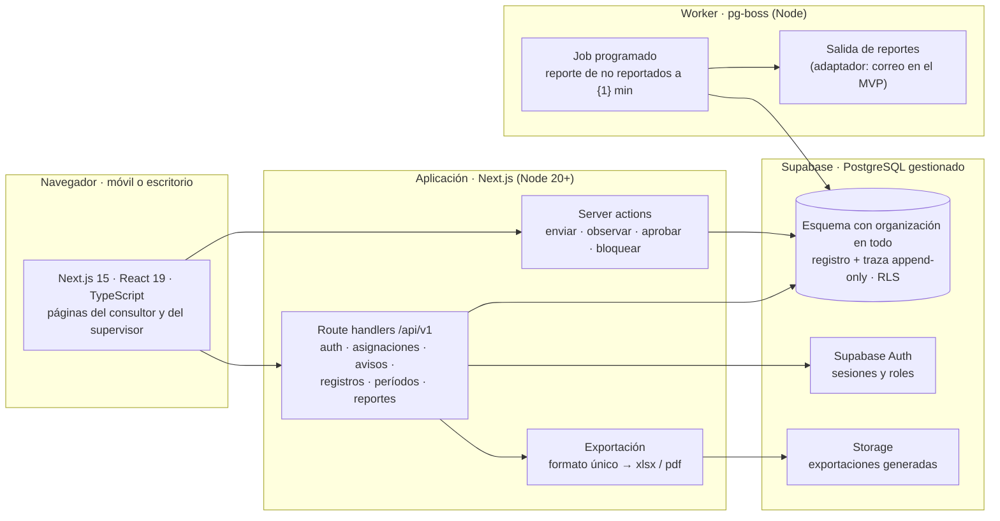
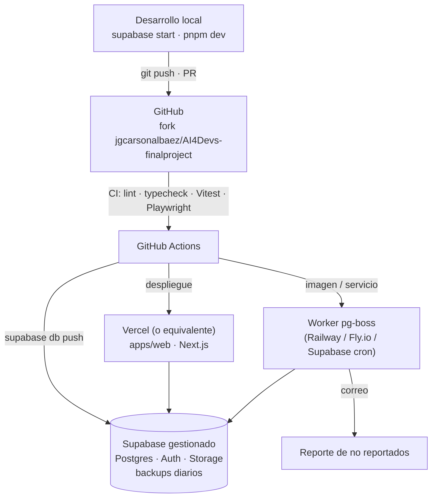
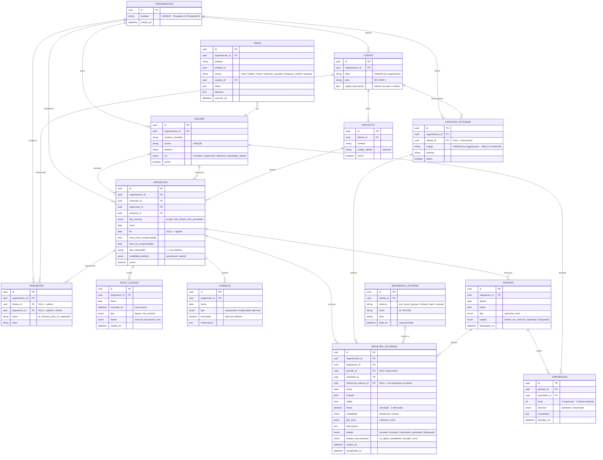

## Índice

0. [Ficha del proyecto](#0-ficha-del-proyecto)
1. [Descripción general del producto](#1-descripción-general-del-producto)
2. [Arquitectura del sistema](#2-arquitectura-del-sistema)
3. [Modelo de datos](#3-modelo-de-datos)
4. [Especificación de la API](#4-especificación-de-la-api)
5. [Historias de usuario](#5-historias-de-usuario)
6. [Tickets de trabajo](#6-tickets-de-trabajo)
7. [Pull requests](#7-pull-requests)

> **Entrega 1 — Documentación técnica (sábado 17/10/2026).** Este documento cubre las secciones 0 a 6. La sección 7 y los apartados que dependen de código en marcha (1.3 imágenes, 1.4 instalación, 2.6 tests ejecutados) se declaran como pendientes y se completan en las entregas 2 y 3. Lo que este documento deja fuera está dicho de forma explícita en cada apartado: un hueco declarado es una decisión; un hueco callado es un descuido.
>
> **Anonimización.** El proyecto es una herramienta interna real de dos empresas de consultoría. Los clientes aparecen como `Cliente A` … `Cliente I` con alias estables; no se nombran personas, contratos ni códigos de proyecto reales.

---

## 0. Ficha del proyecto

### **0.1. Tu nombre completo:**

Jaime Guillermo Carson Albáez

### **0.2. Nombre del proyecto:**

**Controlador de Tiempo** — presencia, actividad y respaldo de facturación para consultores asignados a clientes.

### **0.3. Descripción breve del proyecto:**

Herramienta interna para empresas de *staff augmentation* que asignan consultores a clientes. Resuelve dos dolores distintos con un solo registro: **saber antes que el cliente** si un consultor no llegó o no se conectó (presencia), y **sustentar la factura** con actividad imputada, aprobada y trazable (actividad). Sustituye tres modelos que hoy conviven sin hablarse: plantillas Excel de asistencia, un reporte de imputación por porcentaje y un catálogo de actividades en HTML sin implementar.

### **0.4. URL del proyecto:**

Pendiente — no hay despliegue en la entrega 1 (100 % documentación). Se publica en la entrega 2.

### 0.5. URL o archivo comprimido del repositorio

https://github.com/jgcarsonalbaez/AI4Devs-finalproject — fork del repositorio oficial; rama de esta entrega: `feature/entrega-1-JC`.

---

## 1. Descripción general del producto

### **1.1. Objetivo:**

**Para quién.** Dos empresas de consultoría (Proveedor A y Proveedor B) que asignan consultores a bancos y entidades financieras bajo contratos con horario comprometido. El **usuario primario es el consultor asignado**; el supervisor y la dirección consumen lo que él registra.

**Qué dolor resuelve.** La necesidad apareció en tres clientes y no es de un proyecto: es capacidad operativa central del servicio. Son dos dolores con exigencias distintas:

| | Presencia y puntualidad | Actividad |
|---|---|---|
| **Por qué duele** | *«Nos enteramos por el cliente de que un recurso no asistió o no se conectó.»* Costo de reputación | Sin sustento de actividad no se puede facturar. En uno de los países donde se opera es exigencia legal |
| **Qué necesita** | Detección **oportuna** — hoy, no al cierre de la quincena | Evidencia con trazabilidad y aprobación |
| **Si falla** | Se pierde reputación | No se factura |

**El reencuadre que guía el diseño:** el primer dolor **no es de registro, es de detección**. Una hoja de horas que se llena al cierre del período deja que el cliente siga avisando primero. El producto es *saberlo antes que el cliente*; el registro es el subproducto.

**Qué valor aporta.** Un solo acto de registro alimenta un **formato único de reporte** que contiene lo que los cuatro formatos actuales necesitaban, con tres conformidades (consultor · supervisor · contraparte del cliente) y período bloqueado. Y un **reporte programado de no reportados** que convierte el silencio de un consultor en una llamada del supervisor dentro de la primera hora.

**Qué no es.** No es un motor de facturación (se factura por otra vía; el sistema produce el respaldo). No es un sistema de notificaciones en tiempo real (eso es capacidad futura, con su tubería dejada).

### **1.2. Características y funcionalidades principales:**

**Alcance del MVP — nueve capacidades:**

1. **Aviso de llegada** — un solo toque: *«llegué a mi lugar de trabajo»* o *«me conecté sin problemas»*. Es distinto del registro de actividad y ocurre en otro momento: a la llegada, sin tener que pensar todavía en qué se va a trabajar. *Separar los dos actos quita la fricción justo donde se necesita la señal.*
2. **Reporte de no reportados** — `{1}` minutos después de la hora de inicio comprometida se emite la lista de quienes no han dado aviso, para que el supervisor los contacte. `{1}` es un parámetro.
3. **Registro de actividad** — qué hizo el consultor, imputado al catálogo y, cuando aplique, a una referencia del cliente. Desde el teléfono o la computadora, en segundos.
4. **Asignaciones** — consultor + cliente + proyecto, con el **horario comprometido tomado del contrato** del cliente (no se inventa: los contratos vigentes lo fijan en 8:00–17:00, lunes a viernes).
5. **Catálogo de actividades** — transversales `GEN-01` a `GEN-05` (reuniones, documentación, incidencias, transferencia, gestión) más las fases propias de cada cliente.
6. **Revisión y aprobación del supervisor** — con ida y vuelta para correcciones y **bloqueo del período** una vez aprobado.
7. **Formato único de reporte** — encabezado · detalle diario · ausencias justificadas (no facturables) · resumen (horas por actividad, por referencia del cliente con porcentaje *calculado*, subtotales por quincena, ordinarias y extras) · conformidad con tres firmas.
8. **Trazabilidad** — quién avisó, registró, corrigió, aprobó y cuándo. Nada aprobado se modifica sin dejar rastro.
9. **Exportación completa a archivo** — la red de seguridad que el Excel daba gratis: si el sistema falla en el cierre del mes, se factura igual.

**Fuera de alcance del MVP, explícito:** notificación en tiempo real y escalamiento · recordatorios · conectores de lectura y escritura con las herramientas del cliente · evidencia desde repositorios · aprobación del cliente dentro del sistema · multi-empresa y cobro del servicio · migración del histórico · indicadores y tableros · app nativa · geolocalización · motor de facturación.

**Capacidades anticipadas con su tubería dejada en el MVP.** La regla: *una tubería es un punto de extensión —un campo, una interfaz genérica o un estado—, no una funcionalidad a medias; si hay que probarla, no es tubería*. Dos **no se pueden postergar** porque obligarían a migrar datos: la **organización** en todo registro y la **referencia externa genérica** (sistema · clave · título · fecha de lectura) en lugar de texto libre. Las demás (sincronización con la herramienta del cliente, fuente del aviso, aprobación multinivel, tipo de recurso, país y reglas de facturación, modalidad) son campos o estados que ya viven en el modelo de datos de la sección 3.

**Decisión de stack (17/10/2026, Dirección):** Next.js + React + TypeScript + Supabase (PostgreSQL) + pg-boss — **el mismo stack del sistema de talento humano que la empresa ya opera**, para que lo mantenga el mismo equipo con las mismas plantillas de migración y para que el Controlador pueda integrarse en ese sistema sin reescribir. Principio que acompaña la decisión: *incorporar la tecnología que beneficie al proyecto cuando aparezca, sin convertirse en una mezcolanza; lo mejor que se pueda pagar.*

**Supuestos declarados en esta entrega** (puntos que quedaron abiertos en la revisión operativa del alcance y se fijan aquí de forma provisional; se tachan y reemplazan cuando se decidan):

| Supuesto | Valor provisional | Dónde se cambia |
|---|---|---|
| Canal del reporte de no reportados | Correo electrónico al supervisor de la asignación | Un adaptador de salida; el reporte no sabe por dónde viaja |
| Valor y ámbito de `{1}` | 60 minutos, global | Tabla `parametro` con ámbito global · cliente · asignación |
| Cómo se obliga el registro | Reglamento interno de la empresa; la cláusula contractual se evalúa aparte | Fuera del sistema |
| Primer cliente en adoptarlo | `Cliente A`, que arranca sin histórico que migrar | Configuración |

### **1.3. Diseño y experiencia de usuario:**

> **Pendiente de imágenes y vídeo** — se incorporan en la entrega 2, cuando exista interfaz. Aquí se documenta el recorrido que esa interfaz tiene que cumplir, porque es una restricción de diseño y no una aspiración.

**Restricción que manda sobre todo lo demás:** el consultor no gana nada registrando —el valor lo cobran las empresas—. Si el incentivo es externo (reglamento o contrato), la adopción depende por completo de que registrar **no cueste nada**. Por eso la fricción mínima es restricción, no deseo.

**Recorrido del consultor (web adaptada al teléfono):**

1. Abre la aplicación a la llegada. La pantalla principal muestra **un solo botón grande** con dos variantes según su modalidad del día: *«Llegué»* / *«Me conecté»*. Un toque, confirmación, cierra. Tiempo objetivo: **menos de 5 segundos**.
2. Durante el día o al cierre, **registra actividad**: fecha precargada, entrada tomada del aviso, salida, actividad del catálogo (lista corta, la última usada primero), referencia del cliente opcional, descripción breve. Tiempo objetivo: **menos de 60 segundos por registro**.
3. Al cierre del período ve su quincena, la **envía** al supervisor y recibe observaciones si las hay.

**Recorrido del supervisor:**

1. A `{1}` minutos de la hora de inicio recibe el **reporte de no reportados** de sus asignaciones: lista corta con nombre, cliente y teléfono. Contacta. Anota el motivo en el sistema (queda trazado).
2. Al cierre del período **revisa** los registros, **observa** lo que haya que corregir (vuelve al consultor), **aprueba** y **bloquea**.
3. **Exporta** el reporte único en el formato que acompaña la factura.

**Lo que la interfaz no hace:** no pide al consultor datos que el sistema ya sabe (cliente, proyecto, horario), no obliga a decidir la actividad en el momento del aviso, y no muestra a un consultor nada de otro.

### **1.4. Instrucciones de instalación:**

> **Pendiente — aplica desde la entrega 2.** No hay código en esta entrega. El objetivo fijado para entonces: `pnpm install`, un `.env.local` desde `.env.example` con las variables de Supabase, `supabase start` para la base local (Postgres en contenedor, idéntico al gestionado), `supabase db reset` para migraciones y semillas, y `pnpm dev` para levantar la aplicación y el worker de jobs. Sin diferencias de dialecto entre local y producción.

---

## 2. Arquitectura del Sistema

### **2.1. Diagrama de arquitectura:**



**Patrón: aplicación Next.js modular + worker de jobs sobre Postgres** — una sola aplicación con módulos por capacidad (`asignaciones`, `avisos`, `registros`, `periodos`, `reportes`, `catalogo`), lógica de negocio en route handlers y server actions, y un proceso aparte de **pg-boss** (cola de trabajos sobre la misma base) para lo programado. Se eligió por tres razones:

- **Es el stack que la empresa ya opera.** El sistema de talento humano de la casa está hecho exactamente así (Next.js + Supabase + pg-boss, migraciones SQL controladas, Vitest y Playwright). Lo mantiene el mismo equipo, con los mismos agentes y plantillas; y el Controlador de Tiempo está pensado para integrarse en ese sistema a largo plazo — en el mismo stack eso es mover carpetas, en otro es reescribir.
- **El modelo de datos es lo caro, y aquí es Postgres puro.** Las tuberías del MVP (organización, referencia externa, estados de sincronización y aprobación) viven en migraciones SQL portables, con el patrón de migración controlada ya probado en casa. La segregación por organización se refuerza con **RLS** (row-level security) en la base, no solo en el código.
- **El job programado ya tiene solución probada.** El reporte de no reportados es la pieza menos trivial del MVP; pg-boss ya resuelve jobs programados y reintentos en el sistema de talento, sobre la misma base de datos, sin infraestructura adicional.

**Sacrificios que implica:** dependencia de dos proveedores gestionados (Vercel o equivalente para Next.js, Supabase para la base) — lock-in moderado y ya aceptado en casa; lo atado es auth, RLS y storage, no las migraciones. El worker es un segundo proceso a desplegar. Y la lógica de negocio hay que mantenerla disciplinada en módulos de servicio, porque Next.js no la impone.

### **2.2. Descripción de componentes principales:**

| Componente | Tecnología | Responsabilidad |
|---|---|---|
| **API y acciones de servidor** | Next.js 15 (App Router), TypeScript, route handlers `/api/v1`, server actions, validación con `zod`, cliente `@supabase/ssr` | Autorización por rol y **por organización en toda consulta** (doblada por RLS en la base), reglas de negocio (horas, estados del período, bloqueo), un solo formato de respuesta `{ data }` |
| **Worker de jobs** | `pg-boss` como proceso Node aparte, sobre la misma base Postgres | Reporte de no reportados: a `{1}` minutos de cada hora de inicio comprometida, consulta las asignaciones activas del día sin aviso y emite el reporte; reintentos y bloqueo de concurrencia los da pg-boss |
| **Salida de reportes** | Interfaz `CanalDeSalida` con una implementación: correo (Resend o SMTP vía Nodemailer) | El job no sabe por dónde viaja el reporte; la tubería para Slack/WhatsApp/push es una segunda implementación |
| **Exportación** | Generación de `xlsx` (ExcelJS) y `pdf` (react-pdf, ya usado en casa) del formato único; archivo guardado en Supabase Storage | La red de seguridad: todo lo aprobado sale a archivo |
| **Frontend** | React 19 dentro de Next.js, Tailwind 4, `lucide-react`; móvil primero | Pantalla de aviso de un toque, registro de actividad, bandeja del supervisor, exportación |
| **Autenticación** | Supabase Auth (correo + contraseña; magic link opcional) con sesiones servidas por `@supabase/ssr` | Roles en tabla `USUARIO`; políticas RLS leen el rol y la organización del usuario autenticado |
| **Base de datos** | Supabase · PostgreSQL 16, local con `supabase start` y gestionado en producción | Esquema versionado en `supabase/migrations/` con el patrón de migración controlada; `organizacion_id` en todas las tablas de negocio; tabla `traza` append-only; RLS activo |
| **Especificación viva** | OpenSpec (`openspec/specs/<capability>/spec.md`) | La verdad de cada capability vive en la spec; el README de cada capability enlaza, no repite |
| **Guardarraíles del repositorio** | Hooks de Claude Code en `.claude/hooks/` | `datos-que-no-salen` (bloquea secretos, correos reales y `.env` en commits, con registro fechado) y `readme-al-dia` (un verbo HTTP nuevo exige README de la capability) |

### **2.3. Descripción de alto nivel del proyecto y estructura de ficheros**

Estructura prevista (misma convención que el proyecto de referencia del curso, para que el harness se traslade tal cual):

```
AI4Devs-finalproject/
├── readme.md · prompts.md              # esta entrega
├── CLAUDE.md · AGENTS.md               # instrucciones del harness (reglas de proceso)
├── .claude/                            # hooks, skills y settings del agente
│   └── hooks/datos-que-no-salen.sh
├── openspec/                           # especificación viva (fuente de verdad)
│   ├── specs/<capability>/spec.md
│   └── changes/
├── docs/
│   ├── prd/                            # PRD y alcance aprobado
│   ├── capabilities/<nombre>/README.md # qué rutas existen y dónde está implementada cada regla
│   ├── adr/                            # decisiones de arquitectura
│   ├── seguridad/registro-de-bloqueos.md
│   └── evals/                          # mediciones del harness
├── apps/
│   ├── web/                            # Next.js 15 (App Router)
│   │   ├── app/(consultor)/ · app/(supervisor)/ · app/api/v1/
│   │   ├── src/{modules/<capability>,components,lib}
│   │   └── tests/{unit,e2e}            # Vitest · Playwright
│   └── worker/                         # pg-boss: reporte de no reportados, exportaciones
├── packages/
│   └── database/                       # cliente Supabase tipado y tipos generados del esquema
├── supabase/
│   ├── migrations/                     # SQL con el patrón de migración controlada
│   ├── validaciones/                   # validación 1 a 1 de solo lectura por objeto
│   └── seed.sql
├── pnpm-workspace.yaml · package.json  # monorepo pnpm (misma convención que el sistema de talento)
└── Makefile                            # setup · start · test · help
```

**Monorepo pnpm por aplicación y paquete**, la misma convención del sistema de talento de la casa, y **patrón de carpetas por capability** dentro de `apps/web/src/modules/`: cada capacidad del MVP (avisos, registros, periodos, reportes…) tiene su spec, su README y sus tests nombrados igual, de modo que se pueda leer la spec y saber qué falta.

### **2.4. Infraestructura y despliegue**



- **Dos proveedores gestionados, los mismos que usa el sistema de talento:** Supabase para base de datos, auth y storage (un proyecto por entorno: `ct-dev`, `ct-live`), y Vercel o equivalente para la aplicación Next.js. **El worker de pg-boss** necesita un proceso que corra siempre: candidatos Railway o Fly.io (o `pg_cron` de Supabase disparando una función, si el costo lo justifica) — se decide en la entrega 2 por costo.
- **Base de datos gestionada con backups diarios.** El riesgo *«sin red»* (una caída en el cierre del mes es no facturar) se mitiga con dos cosas: la exportación completa a archivo dentro del MVP, y el backup del proveedor.
- **Secretos** solo en variables de entorno de los proveedores (`SUPABASE_SERVICE_ROLE_KEY` nunca llega al navegador); jamás en el repositorio — el hook `datos-que-no-salen` lo impide en el commit y deja línea en el registro.
- **Despliegue:** merge a `main` → CI en verde → `supabase db push` aplica las migraciones pendientes con el patrón de migración controlada (cada objeto verifica su propia existencia antes y después, con mensaje propio, no el del motor; la validación 1 a 1 de solo lectura se imprime al final) → despliegue de la aplicación y del worker.

### **2.5. Seguridad**

| Práctica | Cómo se aplica |
|---|---|
| **Autenticación** | Supabase Auth con sesiones servidas por `@supabase/ssr`; sesión obligatoria en toda ruta y acción de negocio; la clave de servicio solo vive en el servidor y en el worker |
| **Autorización por rol y por organización, en dos capas** | Roles `consultor` · `supervisor` · `direccion` · `aprobador_cliente` (este último es tubería, sin acceso en el MVP). **Toda consulta filtra por `organizacion_id` en el código, y RLS en Postgres lo vuelve a exigir** aunque el código falle: es la frontera que el día que entre un segundo proveedor impide que A vea las horas de B |
| **Un consultor solo ve lo suyo** | El supervisor ve sus asignaciones; la dirección, su organización |
| **Trazabilidad inalterable** | Tabla `traza` append-only (sin `UPDATE` ni `DELETE` por diseño): quién avisó, registró, corrigió, aprobó, cuándo, y el antes/después |
| **Períodos bloqueados** | Un período aprobado no admite cambios por la API; corregir exige reabrir con traza |
| **Datos personales** | Mínimos: nombre, correo corporativo, teléfono de contacto. Sin cédula ni datos sensibles. Los reportes exportados no llevan más que lo que el cliente necesita para dar conformidad |
| **Secretos y datos que no salen** | Hook `PreToolUse` que bloquea commits con claves reconocibles, correos de dominios reales o ficheros `.env`, y escribe una línea fechada en `docs/seguridad/registro-de-bloqueos.md` — bloquear sin registrar protege pero no demuestra |
| **Validación en el borde** | `zod` en cada route handler y server action; nunca se vuelca el cuerpo de una petición sobre un registro (el fallo por omisión más frecuente del código generado es la asignación masiva) |
| **Documentación anonimizada** | Alias de clientes estables en todo lo que sale del repositorio interno |

### **2.6. Tests**

> **Pendiente de ejecución — aplica desde la entrega 2.** Se documenta aquí el plan, que es parte de la arquitectura.

- **Unitarios (Vitest):** cálculo de horas y subtotales por quincena; derivación del porcentaje por referencia del cliente; regla de «no reportado» (asignación activa, día laborable del horario comprometido, sin aviso a `{1}` minutos); transiciones de estado del período.
- **De integración (Vitest contra Supabase local):** un test por escenario de la spec sobre una base reiniciada con `supabase db reset`; cubren autorización por organización en las dos capas (código y RLS: un consultor de A no lee registros de B ni con una consulta directa), bloqueo de período y trazabilidad.
- **End-to-end del flujo principal (Playwright):** aviso → registro → envío → observación → corrección → aprobación → bloqueo → exportación.
- **Evaluación del harness:** medir con línea base que las reglas del `CLAUDE.md` que importan (README al día, datos que no salen) se cumplen — y convertir en hook lo que la medición demuestre que no se cumple como texto.

---

## 3. Modelo de Datos

### **3.1. Diagrama del modelo de datos:**



### **3.2. Descripción de entidades principales:**

**Dos decisiones de esquema que no se pueden postergar** (obligarían a migrar datos si se agregaran después):

- **`organizacion_id` en toda tabla de negocio** (`USUARIO`, `CLIENTE`, `ASIGNACION`, `REGISTRO_ACTIVIDAD`, `TRAZA`, `PARAMETRO`, `CATALOGO_ACTIVIDAD`). Es la frontera de segregación: el MVP la usa con dos organizaciones; el día que el cliente use el sistema para recursos de otros proveedores, cada uno ve solo lo suyo sin tocar el esquema.
- **`REFERENCIA_EXTERNA` como entidad**, no texto libre. Un registro imputa a *sistema · clave · título · fecha de lectura*. Así una imputación aprobada no pierde significado si el cliente cambia o borra su ticket después (el reporte de agosto sigue diciendo lo que decía en agosto), y el conector de lectura futuro solo rellena esta tabla.

| Entidad | Para qué | Claves y restricciones | Relaciones |
|---|---|---|---|
| **ORGANIZACION** | La empresa que presta el servicio (Proveedor A, Proveedor B). Tubería multi-empresa | `id` PK · `nombre` UNIQUE NOT NULL | 1:N con casi todo |
| **USUARIO** | Consultores, supervisores, dirección; `aprobador_cliente` existe como rol pero sin acceso en el MVP | `correo` UNIQUE · `rol` NOT NULL · `organizacion_id` FK NOT NULL | N:1 organización; 1:N asignaciones (como consultor y como supervisor); 1:N aprobaciones y trazas |
| **CLIENTE** | A quién se asignan los consultores. Alias estable | `alias` UNIQUE por organización · `pais` NOT NULL · `reglas_facturacion` JSON (tubería: p. ej. sustento de tareas obligatorio) | 1:N proyectos, referencias externas, fases del catálogo, parámetros |
| **PROYECTO** | Destino de la asignación dentro del cliente | `cliente_id` FK NOT NULL · `codigo_cliente` opcional | 1:N asignaciones |
| **CATALOGO_ACTIVIDAD** | `GEN-01…05` transversales (`cliente_id` NULL) y fases propias por cliente | `codigo` UNIQUE por organización · `activo` | 1:N registros |
| **ASIGNACION** | El contrato operativo: consultor + supervisor + proyecto + **horario comprometido** (viene del contrato del cliente, no se inventa) | FKs NOT NULL · `hora_inicio_comprometida` NOT NULL · CHECK `fin IS NULL OR fin >= inicio` · `tipo_recurso` (tubería de cobro) | 1:N avisos, registros, ausencias, períodos |
| **AVISO_LLEGADA** | La señal de un toque. **No es el registro de actividad** | UNIQUE (`asignacion_id`, `fecha`) · `marcado_en` NOT NULL (hora exacta: es la tubería de la notificación en tiempo real) · `fuente` (tubería: `repositorio` cuando se lea evidencia pasiva) | N:1 asignación |
| **REGISTRO_ACTIVIDAD** | Qué hizo, cuánto, imputado a qué. Un solo acto alimenta todo el reporte | `horas` calculado de `entrada`/`salida` · CHECK `salida > entrada` · `estado` NOT NULL (máquina de estados: borrador → enviado → observado/aprobado → bloqueado) · `estado_sincronizacion` (tubería: `no_aplica` en el MVP) | N:1 asignación, actividad, período; N:1 referencia externa opcional |
| **REFERENCIA_EXTERNA** | Copia fechada de lo leído del cliente | UNIQUE (`cliente_id`, `sistema`, `clave`) · `leido_en` NOT NULL | 1:N registros |
| **AUSENCIA** | Vacaciones, incapacidad, permiso — **no facturables**; exigencia de un contrato vigente | UNIQUE (`asignacion_id`, `fecha`) · `facturable` DEFAULT false | N:1 asignación |
| **PERIODO** | La unidad que se envía, aprueba y bloquea | UNIQUE (`asignacion_id`, `desde`) · `estado` NOT NULL · `bloqueado_en` NULL hasta bloqueo | 1:N registros, aprobaciones |
| **APROBACION** | Cada decisión sobre un período, por nivel. El nivel 2 (cliente) es tubería | UNIQUE (`periodo_id`, `nivel`, `aprobador_id`, `decidido_en`) · `decision` NOT NULL | N:1 período, aprobador |
| **PARAMETRO** | `{1}` y otros valores con ámbito global → cliente → asignación (el más específico gana) | UNIQUE (`clave`, `organizacion_id`, `cliente_id`, `asignacion_id`) | N:1 organización; opcional cliente y asignación |
| **TRAZA** | Evidencia. Append-only: sin `UPDATE`/`DELETE` | `ocurrido_en` NOT NULL · `antes`/`despues` JSON · índice por (`entidad`, `entidad_id`) | N:1 usuario, organización |

**Cálculos que no se capturan:** `horas` se deriva de entrada y salida; el **porcentaje por referencia del cliente** del reporte se deriva de la imputación (nunca se teclea); los subtotales por quincena y el total de extras salen de `tipo_hora` y `PERIODO`.

---

## 4. Especificación de la API

Tres endpoints principales del flujo, en OpenAPI 3.1 (extracto). Todas las rutas bajo `/api/v1`, con `Authorization: Bearer <token>`, y **filtradas por la organización del usuario autenticado**.

```yaml
openapi: 3.1.0
info:
  title: Controlador de Tiempo — API
  version: 0.1.0
paths:
  /api/v1/avisos:
    post:
      summary: Aviso de llegada — un toque
      description: Registra que el consultor llegó o se conectó hoy en su asignación activa. Idempotente por (asignación, fecha).
      requestBody:
        required: true
        content:
          application/json:
            schema:
              type: object
              required: [asignacionId, tipo]
              properties:
                asignacionId: { type: string, format: uuid }
                tipo: { type: string, enum: [llegue, me_conecte] }
      responses:
        "201":
          description: Aviso creado
          content:
            application/json:
              schema: { $ref: "#/components/schemas/Envelope_Aviso" }
        "200": { description: Ya existía un aviso hoy; se devuelve el existente }
        "401": { description: Sin sesión }
        "404": { description: La asignación no existe o no pertenece a la organización del usuario }
        "422": { description: Validación — tipo inválido o asignación inactiva }

  /api/v1/registros:
    post:
      summary: Registro de actividad
      requestBody:
        required: true
        content:
          application/json:
            schema:
              type: object
              required: [asignacionId, fecha, entrada, salida, actividadId, modalidad]
              properties:
                asignacionId: { type: string, format: uuid }
                fecha: { type: string, format: date }
                entrada: { type: string, example: "08:05" }
                salida: { type: string, example: "17:10" }
                actividadId: { type: string, format: uuid }
                referenciaExternaId: { type: string, format: uuid, nullable: true }
                modalidad: { type: string, enum: [presencial, remoto] }
                tipoHora: { type: string, enum: [ordinaria, extra], default: ordinaria }
                descripcion: { type: string, maxLength: 500 }
      responses:
        "201":
          description: Registro creado en estado borrador, con horas calculadas
          content:
            application/json:
              schema: { $ref: "#/components/schemas/Envelope_Registro" }
        "409": { description: El período de esa fecha está aprobado o bloqueado }
        "422": { description: salida ≤ entrada, actividad inactiva o referencia de otro cliente }

  /api/v1/reportes/no-reportados:
    get:
      summary: Reporte de no reportados
      description: Asignaciones activas del día, en jornada laborable, sin aviso de llegada transcurrida {1} minutos desde la hora de inicio comprometida. Solo supervisores y dirección; acotado a la organización del usuario.
      parameters:
        - { name: fecha, in: query, required: false, schema: { type: string, format: date }, description: "Por defecto, hoy" }
        - { name: clienteId, in: query, required: false, schema: { type: string, format: uuid } }
      responses:
        "200":
          content:
            application/json:
              schema:
                type: object
                properties:
                  data:
                    type: array
                    items: { $ref: "#/components/schemas/NoReportado" }
        "403": { description: El rol consultor no accede a este reporte }

components:
  schemas:
    Aviso:
      type: object
      properties:
        id: { type: string, format: uuid }
        asignacionId: { type: string, format: uuid }
        fecha: { type: string, format: date }
        marcadoEn: { type: string, format: date-time }
        tipo: { type: string, enum: [llegue, me_conecte] }
        fuente: { type: string, enum: [manual, repositorio, otro] }
    Registro:
      type: object
      properties:
        id: { type: string, format: uuid }
        fecha: { type: string, format: date }
        entrada: { type: string }
        salida: { type: string }
        horas: { type: number, example: 8.5 }
        actividad: { type: object, properties: { codigo: { type: string, example: "GEN-01" }, nombre: { type: string } } }
        estado: { type: string, enum: [borrador, enviado, observado, aprobado, bloqueado] }
    NoReportado:
      type: object
      properties:
        asignacionId: { type: string, format: uuid }
        consultor: { type: object, properties: { nombre: { type: string }, telefono: { type: string } } }
        cliente: { type: string, example: "Cliente A" }
        horaInicioComprometida: { type: string, example: "08:00" }
        minutosDeRetraso: { type: integer, example: 63 }
    Envelope_Aviso: { type: object, properties: { data: { $ref: "#/components/schemas/Aviso" } } }
    Envelope_Registro: { type: object, properties: { data: { $ref: "#/components/schemas/Registro" } } }
```

**Ejemplo — aviso de llegada:**

```http
POST /api/v1/avisos
Authorization: Bearer <token>
Content-Type: application/json

{ "asignacionId": "7f1c…", "tipo": "me_conecte" }
```

```json
{ "data": { "id": "a9e2…", "asignacionId": "7f1c…", "fecha": "2026-10-19",
            "marcadoEn": "2026-10-19T13:04:12Z", "tipo": "me_conecte", "fuente": "manual" } }
```

---

## 5. Historias de Usuario

El backlog del MVP tiene **cinco historias must-have** (aviso de llegada · reporte de no reportados · registro de actividad · revisión, aprobación y bloqueo del período · exportación del formato único) y **dos should-have** (ausencias justificadas · imputación a referencia del cliente). Se documentan las tres principales.

**Historia de Usuario 1 — Aviso de llegada en un toque**

> **Como** consultor asignado a un cliente, **quiero** avisar con un solo toque que llegué a mi lugar de trabajo o que me conecté, **para** que mi empresa lo sepa antes que el cliente sin que yo tenga que detenerme a pensar en qué voy a trabajar.

*Criterios de aceptación (declarativos, nivel de negocio):*
- Dado que tengo una asignación activa hoy, cuando abro la aplicación veo un único botón con la opción que corresponde a mi modalidad del día; al tocarlo, el aviso queda registrado con la hora exacta y recibo confirmación. **Objetivo: menos de 5 segundos** desde abrir hasta confirmar.
- Dado que ya avisé hoy, cuando vuelvo a tocar, no se crea un segundo aviso: veo el que ya existe.
- Dado que no tengo asignación activa hoy (fin de semana, asignación terminada), no veo el botón y veo por qué.
- El aviso **no** me pide actividad, proyecto ni descripción — eso es otro acto, en otro momento.
- **Fuera de esta historia:** verificar que de verdad llegué (el aviso es una declaración, no una verificación: el sistema detecta el silencio, no la falsedad).

*Criterios INVEST:* independiente de las demás · negociable en la forma del botón, no en el tiempo objetivo · valiosa por sí sola (es la mitad del primer dolor) · estimable (un endpoint idempotente y una pantalla) · pequeña (1–2 días) · testable (los cuatro criterios son comprobables sin saber de la implementación).

**Historia de Usuario 2 — Reporte de no reportados a `{1}` minutos**

> **Como** supervisor de consultores asignados, **quiero** recibir a `{1}` minutos de la hora de inicio comprometida la lista de quienes no han avisado, **para** contactarlos y saber qué ocurrió antes de que el cliente me lo diga.

*Criterios de aceptación:*
- Dado un día laborable de la asignación, cuando transcurren `{1}` minutos desde su hora de inicio comprometida sin aviso, el consultor aparece en el reporte de ese día con nombre, cliente, hora comprometida, minutos de retraso y teléfono de contacto.
- Dado que el consultor avisó dentro de los `{1}` minutos, **no** aparece.
- Dado que el consultor tiene una ausencia justificada registrada para ese día, **no** aparece.
- El reporte llega por el canal configurado (**supuesto del MVP: correo al supervisor**) y queda consultable en la aplicación.
- Cuando contacto al consultor, puedo anotar el motivo; la anotación queda trazada con quién y cuándo.
- `{1}` es un parámetro con valor global y posibilidad de valor por cliente o por asignación (**supuesto del MVP: 60 minutos, global**).
- **Fuera de esta historia:** escalamiento automático, recordatorio al consultor antes de vencer `{1}`, notificación en tiempo real. Sus tuberías —hora exacta del aviso, parámetro con ámbito— quedan en esta historia.

**Historia de Usuario 3 — Revisar, aprobar y bloquear el período**

> **Como** supervisor, **quiero** revisar los registros de actividad de la quincena de cada consultor, observar lo que haya que corregir, aprobar y bloquear el período, **para** que lo que acompaña la factura sea exacto y no cambie después.

*Criterios de aceptación:*
- Dado un período enviado por el consultor, veo sus registros con horas calculadas, subtotales por quincena y horas extra separadas.
- Puedo **observar** un registro con un comentario; el período vuelve al consultor, que corrige y reenvía. Todo el ida y vuelta queda trazado.
- Puedo **aprobar** el período; al aprobarlo queda **bloqueado**: ningún registro de ese período admite cambios por la aplicación.
- Dado un período bloqueado, si hace falta corregirlo, debo **reabrirlo** explícitamente y la reapertura queda trazada con motivo.
- Desde el período aprobado puedo **exportar el formato único** (archivo), con las tres conformidades y el período bloqueado impreso.
- **Fuera de esta historia:** la conformidad del cliente dentro del sistema (el nivel 2 de aprobación existe en el modelo, sin acceso externo en el MVP).

---

## 6. Tickets de Trabajo

**Ticket 1 — Backend · Job programado del reporte de no reportados**

| | |
|---|---|
| **Título** | Implementar el job `no-reportados` y el endpoint `GET /api/v1/reportes/no-reportados` |
| **Historia** | HU-2 |
| **Descripción** | Un job de **pg-boss** en `apps/worker`, programado con expresión cron por cada hora de inicio comprometida distinta del día, que al cumplirse `hora_inicio_comprometida + {1} minutos` consulta, por cada asignación activa con jornada laborable hoy, si existe `AVISO_LLEGADA` para (asignación, hoy). Si no existe y no hay `AUSENCIA` para ese día, incluye la asignación en el reporte del día. El reporte se persiste (para consultarlo por API) y se emite por la interfaz `CanalDeSalida` (implementación `CorreoSupervisor`). El route handler `GET /api/v1/reportes/no-reportados` devuelve el reporte del día o de una fecha, acotado a la organización y, para supervisores, a sus asignaciones. |
| **Criterios de aceptación técnicos** | (1) La resolución de `{1}` sigue el orden asignación → cliente → global en `PARAMETRO`. (2) El job es idempotente: pg-boss con clave única por (fecha, hora de inicio) impide que dos ejecuciones dupliquen el reporte o el correo. (3) Un consultor con aviso a las 08:59, `{1}` = 60 minutos e inicio 08:00 **no** aparece; uno con aviso a 09:01 **sí**, con `minutosDeRetraso` = 61. Con `{1}` = 30 minutos, el de 08:59 **sí** aparece con 59. (4) El rol `consultor` recibe 403. (5) Un supervisor de la organización A no ve asignaciones de B aunque conozca el id — comprobado en el código y con una consulta directa bajo RLS. |
| **Tareas** | Migración de `PARAMETRO` · servicio `resolverParametro` · servicio `calcularNoReportados(fecha)` en `packages/` compartido con tests unitarios de los casos límite (fin de semana, asignación que empieza hoy, ausencia) · job pg-boss con `singletonKey` y reintentos · interfaz `CanalDeSalida` + `CorreoSupervisor` (plantilla) · route handler con validación `zod` · tests de integración contra Supabase local · README de la capability `reportes` y spec OpenSpec al día (regla del repositorio) |
| **Definición de hecho** | Tests unitarios y de integración en verde · `pnpm lint` y `pnpm typecheck` limpios · spec y README de la capability actualizados en el mismo PR · el hook `datos-que-no-salen` no bloqueó nada (o su línea de registro está commiteada) |
| **Estimación** | M (2 días) |
| **Prioridad** | Must — es la mitad del primer dolor |

**Ticket 2 — Frontend · Pantalla de aviso de llegada (móvil primero)**

| | |
|---|---|
| **Título** | Pantalla principal del consultor con el botón de aviso de un toque |
| **Historia** | HU-1 |
| **Descripción** | Al autenticarse un usuario con rol `consultor`, la ruta `/` muestra su asignación activa de hoy y un único botón grande cuya etiqueta depende de la modalidad del día (*«Llegué»* / *«Me conecté»*); al tocarlo llama a `POST /api/v1/avisos` y muestra confirmación con la hora. Si ya avisó, muestra el aviso existente y la hora. Si no hay asignación activa hoy, muestra el motivo. Diseño para teléfono: botón a ancho completo, alto mínimo 64 px, sin scroll para llegar a él. |
| **Criterios de aceptación técnicos** | (1) Desde pantalla de inicio hasta confirmación: una sola interacción, sin modal intermedio. (2) Doble toque o reintento tras fallo de red no crea dos avisos (el backend es idempotente; el botón se deshabilita mientras hay petición en vuelo). (3) Estado `offline`: el botón muestra que no hay conexión en lugar de fallar en silencio. (4) Accesible: etiqueta del botón legible por lector de pantalla; contraste AA. (5) La pantalla no muestra ningún dato de otro consultor. |
| **Tareas** | Componente `AvisoLlegadaButton` · página `app/(consultor)/page.tsx` · server action `registrarAviso` (o llamada al route handler) con manejo de 200/201/404/422 · estados vacío / ya avisado / sin asignación / error de red · estilos móvil primero con Tailwind · pruebas de componente (Vitest + Testing Library) para los cuatro estados · captura de pantalla para la sección 1.3 del README |
| **Definición de hecho** | `pnpm lint` y `pnpm build` limpios · pruebas de componente en verde · captura añadida al README · revisado en un teléfono real |
| **Estimación** | S (1 día) |
| **Prioridad** | Must |

**Ticket 3 — Base de datos · Esquema inicial con las dos tuberías obligatorias**

| | |
|---|---|
| **Título** | Migraciones iniciales: `ORGANIZACION`, `USUARIO`, `CLIENTE`, `PROYECTO`, `CATALOGO_ACTIVIDAD`, `ASIGNACION`, `AVISO_LLEGADA`, `REGISTRO_ACTIVIDAD`, `REFERENCIA_EXTERNA`, `AUSENCIA`, `PERIODO`, `APROBACION`, `PARAMETRO`, `TRAZA` |
| **Historias** | Todas (es el cimiento); HU-1, HU-2 y HU-3 dependen de él |
| **Descripción** | Crear el esquema de la sección 3 en Supabase (PostgreSQL) con migraciones SQL en `supabase/migrations/`, en el orden de dependencias, usando la **plantilla de migración controlada** que la empresa ya tiene (bloques `DO $$ … RAISE NOTICE / RAISE EXCEPTION $$`). **Dos decisiones que no se negocian:** `organizacion_id NOT NULL` con FK en toda tabla de negocio, y `REFERENCIA_EXTERNA` como tabla propia (nunca texto libre en el registro). `TRAZA` es append-only: se revocan `UPDATE` y `DELETE` al rol `authenticated`. **RLS activo** en toda tabla de negocio con políticas que leen la organización y el rol del usuario autenticado. Semillas (`supabase/seed.sql`): dos organizaciones, el catálogo transversal `GEN-01…05`, un `Cliente A` con un proyecto, un supervisor, dos consultores con asignación 08:00–17:00 L–V, y el parámetro global `minutos_para_no_reportado = 60`. |
| **Criterios de aceptación técnicos** | (1) Cada migración sigue el patrón de **migración controlada**: para tablas, si existe → mensaje propio y abortar; crear; verificar que existe → *«creada exitosamente»* o mensaje de error propio. Para índices, constraints y políticas, recrear. **El mensaje lo escribimos nosotros, nunca el motor.** (2) Un script de validación de solo lectura en `supabase/validaciones/` muestra `esperado / encontrado / estado` por objeto (14 tablas, sus UNIQUE y CHECK, y las políticas RLS). (3) `CHECK salida > entrada` en `REGISTRO_ACTIVIDAD`; UNIQUE (`asignacion_id`, `fecha`) en `AVISO_LLEGADA` y `AUSENCIA`. (4) Un `UPDATE` sobre `TRAZA` con el rol `authenticated` falla. (5) Con un usuario de la organización A autenticado, `select * from registro_actividad` no devuelve filas de B. (6) `supabase db reset` + semillas deja la base lista para los tests de integración. |
| **Tareas** | 14 migraciones en orden · enums como tipos Postgres o CHECK · índices por (`organizacion_id`), (`asignacion_id`, `fecha`), (`entidad`, `entidad_id`) · políticas RLS por tabla · revocación de permisos en `TRAZA` · `seed.sql` · script de validación 1 a 1 · tipos generados (`supabase gen types`) en `packages/database` · ADR-0001 «organización en todo registro» y ADR-0002 «referencia externa como entidad» |
| **Definición de hecho** | `make setup` en una máquina limpia (`supabase start` + `db reset`) termina en verde con la validación 1 a 1 impresa · ADRs commiteados · los tests de integración de HU-1 pueden correr sobre esta base |
| **Estimación** | M (2 días) |
| **Prioridad** | Must — bloquea los otros dos |

---

## 7. Pull Requests

> **No aplica en la entrega 1** — no hay desarrollo todavía. Se documentarán en la entrega final los tres PR principales del proyecto (previsiblemente: esquema inicial, flujo de aviso + reporte de no reportados, y aprobación + exportación).

**Pull Request 1**

**Pull Request 2**

**Pull Request 3**
