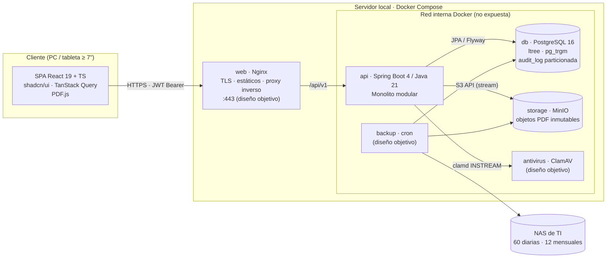
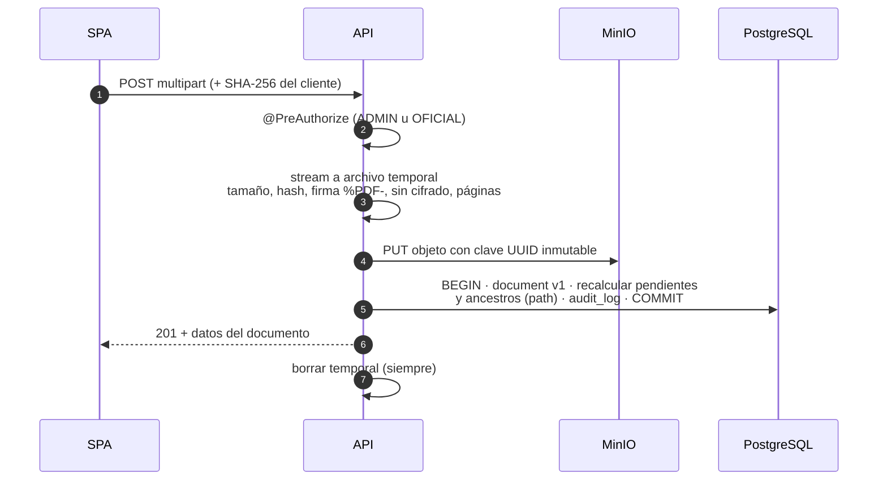
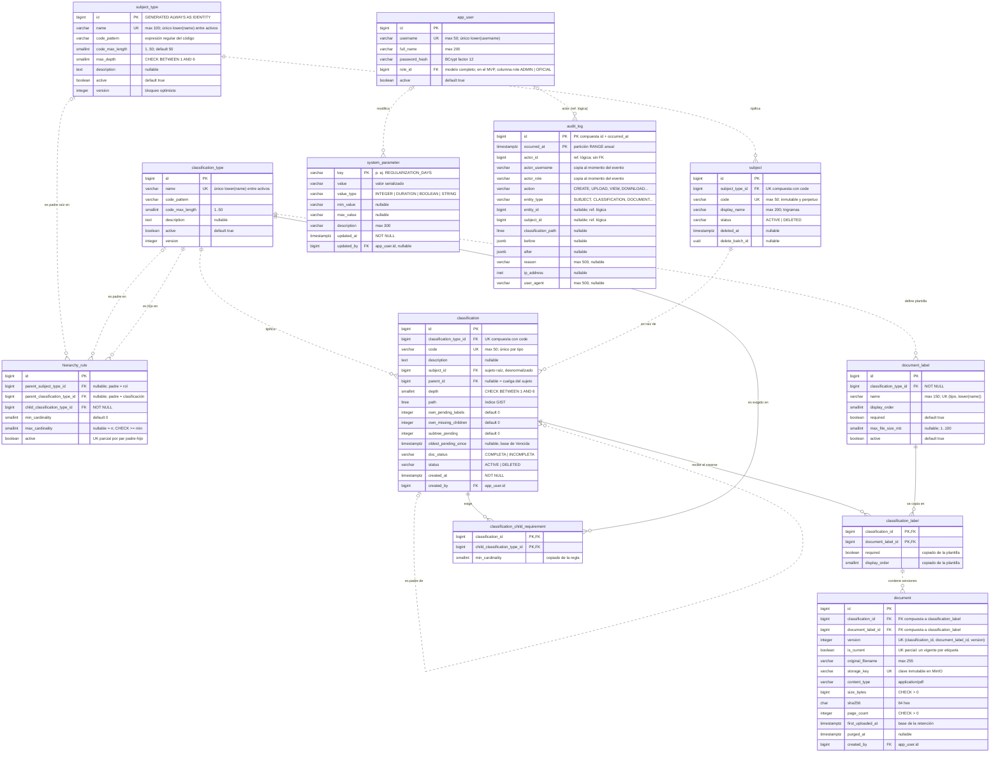

## Índice

0. [Ficha del proyecto](#0-ficha-del-proyecto)
1. [Descripción general del producto](#1-descripción-general-del-producto)
2. [Arquitectura del sistema](#2-arquitectura-del-sistema)
3. [Modelo de datos](#3-modelo-de-datos)
4. [Especificación de la API](#4-especificación-de-la-api)
5. [Historias de usuario](#5-historias-de-usuario)
6. [Tickets de trabajo](#6-tickets-de-trabajo)
7. [Pull requests](#7-pull-requests)

---

## 0. Ficha del proyecto

### **0.1. Tu nombre completo:**

Diego Javier Ruiz Vintimilla

### **0.2. Nombre del proyecto:**

Gestión Documental de Sujetos y Clasificaciones (repositorio `GestionDocumental`).

### **0.3. Descripción breve del proyecto:**

Gestor de expedientes documentales configurable por el propio negocio. Un **sujeto** (por ejemplo, el socio 1) tiene un árbol de **clasificaciones** de hasta 6 niveles (crédito 123 → garantía), y cada clasificación exige documentos PDF por **etiqueta**. El sistema calcula automáticamente el estado documental (**Completa**, **Incompleta** o **Vencida**), lo propaga a los ancestros y registra en una bitácora inmutable cada carga, visualización y descarga. Reemplaza el esquema actual de carpetas compartidas, que no garantiza estructura homogénea, control de acceso por documento ni trazabilidad.

La versión entregada es un **MVP recortado** (esqueleto funcional de extremo a extremo, tickets TK-01 a TK-13) que cubre el recorrido central del PRD en 34 horas-hombre; el resto está documentado como deuda o fuera de alcance en `docs/tickets.md`.

### **0.4. URL del proyecto:**

https://github.com/diegojavinti2183/GestionDocumental

> No hay despliegue público: según la decisión confirmada en `docs/tickets.md` (§1, punto 7), la entrega es **local con Docker Compose**, sin Nginx ni TLS. El sistema se levanta en `http://localhost:5173` siguiendo la sección [1.4](#14-instrucciones-de-instalación).

### 0.5. URL o archivo comprimido del repositorio

https://github.com/diegojavinti2183/GestionDocumental

> El repositorio es privado

---

## 1. Descripción general del producto

### **1.1. Objetivo:**

**Propósito.** Que la documentación de respaldo de cada operación (un crédito, una inversión, un contrato) viva en una estructura homogénea, configurable por el negocio y trazable, en lugar de en carpetas de red nombradas a criterio de cada analista.

**Qué soluciona** (PRD, «Contexto y problema»):

- **Estructura inconsistente:** dos créditos del mismo producto no guardan los mismos documentos, por lo que auditoría no puede verificar la completitud de forma automática. El producto define etiquetas documentales obligatorias u opcionales por tipo de clasificación y calcula Completa/Incompleta.
- **Falta de control de acceso por documento y de trazabilidad:** toda lectura, descarga y escritura queda registrada en una bitácora de auditoría.
- **Dependencia de TI para cambiar la estructura:** el administrador define roles de sujeto, jerarquías de hasta 6 niveles y etiquetas sin desplegar código (meta: alta de un nuevo tipo de clasificación en ≤ 10 min).

**Para quién:**

| Persona | Uso principal |
|---|---|
| **Oficial** (usuario operativo) | Crea sujetos y clasificaciones con su código único y carga los PDF en la etiqueta correspondiente |
| **Administrador** | Configura el modelo, usuarios, roles y parámetros; realiza la purga |
| **Supervisor** | Revisa las operaciones incompletas y vencidas |
| **Auditor** | Consulta la bitácora |

**Métricas de éxito del PRD (metas a 6 meses):** ≥ 95 % de clasificaciones sin pendientes, ≤ 15 s para localizar y abrir un documento, 100 % de escrituras, visualizaciones y descargas con registro de auditoría íntegro.

**Anti-objetivos:** no es un gestor de flujos de aprobación, ni un motor de firma electrónica, ni el sistema maestro de datos del sujeto.

### **1.2. Características y funcionalidades principales:**

**Incluidas en la versión entregada (TK-01 a TK-13):**

| Funcionalidad | Descripción | Ticket |
|---|---|---|
| Inicio de sesión y roles | Login con JWT de acceso (15 min, BCrypt factor 12) y dos roles fijos, `ADMIN` y `OFICIAL`; alta de usuarios por API | TK-03 |
| Modelo configurable sembrado | Tipo de sujeto `Socio`, tipos `Credito` y `Garantia`, reglas de jerarquía y etiquetas por migración, con consulta de solo lectura | TK-04 |
| Sujetos | Crear y listar sujetos con código validado por el patrón del tipo, único y perpetuo | TK-05 |
| Clasificaciones | Crear nodos bajo un sujeto o bajo otro nodo; al crearlos copian la plantilla de etiquetas (*snapshot*) | TK-06 |
| Árbol del expediente | Carga perezosa por nivel, migas de pan, URL que refleja la ruta y navegación por teclado | TK-07 |
| Estado documental | Completa/Incompleta recalculado en la misma transacción, con propagación a los ancestros y texto «N de M obligatorios» | TK-08 |
| Carga de PDF | Validación del binario real (tamaño, SHA-256, firma `%PDF-`, sin cifrado, páginas), almacenamiento en MinIO y auditoría; botón y arrastre, barra de progreso y causa concreta del rechazo | TK-09 |
| Visor y descarga | Visor PDF embebido con JavaScript del PDF deshabilitado y descarga con nombre original; cada acción queda en `audit_log` (`VIEW`, `DOWNLOAD`) | TK-10 |
| Estado Vencida | Se calcula al leer cuando `oldest_pending_since + REGULARIZATION_DAYS` es anterior a ahora; muestra «Vencida · N días de atraso» | TK-13 |
| Parámetros del sistema | Lectura de `system_parameter` (plazo de regularización 10 días, tamaño máximo 25 MB) | TK-12 |
| Verificación integral | Prueba E2E con Playwright (escritorio y tableta) y README de arranque | TK-11 |

**Fuera de alcance de esta entrega** (previstas en el PRD, ver `docs/tickets.md` §6): permisos por tipo y por etiqueta, antivirus, token de renovación, bloqueo por intentos, baja/reubicación/reactivación de nodos, reemplazo y versionado de documentos, búsqueda global, bandeja de incompletas, pantallas de configuración del modelo, edición de parámetros, consulta de la bitácora y purga.

### **1.3. Diseño y experiencia de usuario:**

La interfaz es una SPA responsive (PC y tableta ≥ 600 px) con shadcn/ui. Recorrido de la persona usuaria, tal como lo reproduce la prueba E2E:

1. **Inicio de sesión.** Formulario de usuario y contraseña; ante credenciales inválidas el mensaje no revela cuál de los dos falló. **[PENDIENTE: captura de la pantalla de login.]**
2. **Listado de sujetos.** Tabla con el botón **Nuevo sujeto**: se elige el tipo (`Socio`), el código (`1`) y un nombre visible. **[PENDIENTE: captura del listado y del formulario.]**
3. **Expediente del sujeto.** Árbol con carga perezosa y migas de pan (sujeto › crédito › garantía); la URL refleja la ruta y se puede compartir o recargar. Se recorre con flechas, `Home` y `End`. **[PENDIENTE: captura del árbol.]**
4. **Crear la clasificación.** Con **Agregar** se crea un `Credito` con código `123`; aparece como **Incompleta · 3 pendientes** y **0 de 3 obligatorios**, con las etiquetas «Documento de identificacion», «Solicitudes de credito» y «Documentos firmados». **[PENDIENTE: captura del detalle Incompleta.]**
5. **Cargar documentos.** En cada etiqueta, **Cargar** (o arrastrar el PDF) con barra de progreso y, ante un rechazo, mensaje con la causa concreta (demasiado grande, no es PDF, cifrado, hash distinto). Al cargar el tercero, el crédito pasa a **Completa**. **[PENDIENTE: captura de la carga y del estado Completa.]**
6. **Ver y descargar.** **Ver** abre el visor PDF embebido; **Descargar** entrega el archivo con su nombre original. Ambas acciones quedan registradas en la bitácora.
7. **Garantía hija.** Al crear una `Garantia` sin su documento, la garantía y el crédito vuelven a **Incompleta · 1 pendiente**: el estado se propaga a los ancestros.
8. **Vencida.** Pasado el plazo de regularización, los nodos Incompleta muestran **Vencida · N días de atraso** con ícono y texto (no solo color).

**Principios de interacción** (PRD): el árbol es el mapa; lo que falta se ve primero; estados explícitos de carga, vacío, error y sin permiso (nunca una pantalla en blanco); objetivos táctiles de al menos 44 px; accesible por teclado con foco visible.

**[PENDIENTE: enlace al videotutorial o capturas, si se desea adjuntarlos.]**

### **1.4. Instrucciones de instalación:**

Requisitos: JDK 21, Node.js (`^20.19.0`, `^22.12.0` o `>=24`), Docker con Compose v2. Maven no hace falta instalarlo (Maven Wrapper). Puertos en `127.0.0.1`: 5434 (PostgreSQL), 9000/9001 (MinIO), 8080 (backend), 5173 (frontend).

Desde la raíz del repositorio:

```bash
# 1. (Opcional) variables de entorno; los valores por defecto del perfil local coinciden con .env.example
cp .env.example .env          # PowerShell: Copy-Item .env.example .env

# 2. PostgreSQL 16 y MinIO
docker compose up -d
docker compose ps             # db debe aparecer "healthy"

# 3. Backend (perfil local obligatorio). Flyway aplica las migraciones V1 a V9 y siembra el modelo
cd backend
SPRING_PROFILES_ACTIVE=local ./mvnw spring-boot:run
#   PowerShell: $env:SPRING_PROFILES_ACTIVE = "local"; .\mvnw.cmd spring-boot:run
#   Comprobación: http://localhost:8080/actuator/health -> {"status":"UP"}

# 4. Frontend (otra terminal)
cd frontend
npm install
npm run dev                   # abrir http://localhost:5173
```

- **Migraciones y semillas:** Flyway las ejecuta al arrancar el backend (`V1` extensiones, `V2` usuarios, `V3`–`V4` modelo y su semilla Socio → Crédito → Garantía, `V5` sujeto, `V6` clasificación, `V7` parámetros, `V8` documento y auditoría, `V9` `oldest_pending_since`). El backend crea el bucket `documents` en MinIO si no existe.
- **Usuario inicial:** el backend crea un `ADMIN` si no existe ninguno (`APP_BOOTSTRAP_ADMIN_USERNAME=admin`, `APP_BOOTSTRAP_ADMIN_PASSWORD=Admin-local-dev-2026`; valores solo para desarrollo).
- **Swagger UI** (solo perfil `local`): http://localhost:8080/swagger-ui.html
- **Pruebas:** `./mvnw verify` (requiere Docker, usa Testcontainers), `npm run lint && npm run typecheck && npm run test:run && npm run build`, y E2E con `npx playwright install chromium` y `npm run e2e`.
- **Empezar de cero:** `docker compose down -v`.

> **Avisos:** no cargar documentos reales (el adaptador antivirus no analiza nada) y no exponer la aplicación fuera de `localhost` (sin permisos por tipo ni etiqueta).

---

## 2. Arquitectura del Sistema

### **2.1. Diagrama de arquitectura:**

La solución es una **aplicación web de tres capas** (presentación, lógica, datos) organizada como un **monolito modular en capas** en el backend, expuesto a una **SPA** mediante una **API REST**. El diseño objetivo del PRD es on-premise con Docker Compose y Nginx como único punto de entrada; en la versión entregada solo se despliegan `db` y `storage` (ver 2.4).



**Patrones aplicados** (`docs/architecture.md` §3):

- *Cliente-servidor de 3 capas*, *SPA + API REST* y *monolito modular en capas* (`controller → service → repository → entity`).
- *Reverse proxy / Gatekeeper*: todo binario entra y sale por el backend; MinIO nunca se expone.
- *Metadata-driven / Type Object*: la estructura documental es un dato configurable (`subject_type`, `classification_type`, `document_label`), no código.
- *Adjacency List + Materialized Path* (`parent_id` + `path ltree`), *snapshot* de plantillas al crear el nodo, *agregados precalculados*, *soft delete* con lote de cascada, *versionado inmutable* de objetos y *audit log append-only*.
- *Ports & Adapters* puntual (`StorageService`, `AntivirusClient`) y *RBAC* con JWT sin estado.

**Por qué esta arquitectura:**

1. El volumen es pequeño y predecible (~30 usuarios concurrentes, ~200 PDFs/mes, ~60 GB a 10 años): un monolito es la opción de menor coste total.
2. La consistencia es un requisito de negocio: el estado del padre debe cambiar en la misma transacción que la carga del hijo, y si falla la auditoría la operación se revierte. Una única base transaccional lo hace trivial.
3. La estructura debe ser configurable sin despliegue (metadata-driven).
4. Docker Compose da un despliegue reproducible sin la carga operativa de Kubernetes.
5. El patrón Gatekeeper garantiza que ninguna lectura o descarga escape a la verificación de permisos ni a la bitácora.
6. `ltree` resuelve subárboles y migas con una consulta indexada (p95 ≤ 500 ms por nivel) sin CTE recursivas.

**Beneficios:** autoservicio del modelo, consistencia fuerte, trazabilidad íntegra, seguridad en profundidad, rendimiento suficiente con poca infraestructura, historia preservada, bajo coste operativo, portabilidad del almacén e interfaz única para PC y tableta.

**Sacrificios y déficits:** punto único de fallo (meta de 99,5 % en horario laboral, no alta disponibilidad; RPO ≤ 24 h, RTO ≤ 4 h), escalado solo vertical, el backend es cuello de botella de binarios (decisión deliberada a favor de la trazabilidad), complejidad del modelo metadata-driven, desnormalización de agregados (un bug deja contadores incorrectos; mitigado con pruebas de integración y, a futuro, reconciliación nocturna), reubicación costosa, snapshot no retroactivo, acoplamiento a PostgreSQL, búsqueda limitada a códigos y nombres y sin modo offline.

### **2.2. Descripción de componentes principales:**

| Componente | Tecnología | Responsabilidad |
|---|---|---|
| **SPA** | React 19, TypeScript (`strict`), Vite, React Router, TanStack Query, React Hook Form + Zod, shadcn/ui (Radix + Tailwind v4), react-pdf (PDF.js), Sonner | Interfaz, árbol accesible (`TreeView` propio sobre `Collapsible`), formularios validados, carga con SHA-256 en cliente (`crypto.subtle`) y visor |
| **API** | Java 21, Spring Boot 4, Spring Web, Spring Security (OAuth2 Resource Server, JWT HS256, BCrypt 12), Spring Data JPA/Hibernate, Jakarta Validation, MapStruct, springdoc-openapi | Lógica de negocio, seguridad (`@PreAuthorize`), auditoría en la misma transacción y orquestación de archivos; errores en RFC 7807 |
| **Base de datos** | PostgreSQL 16 con `ltree` y `pg_trgm`, Flyway | Metadatos, modelo configurable, agregados de completitud y bitácora `audit_log` particionada por año e inmutable |
| **Almacén de objetos** | MinIO (API S3; SDK S3 de AWS) | Binarios PDF con clave UUID inmutable por versión |
| **Servicios de negocio** | `AuthService`, `UserService`, `ModelQueryService`, `SubjectService`, `ClassificationService`, `TreeQueryService`, `CompletenessService`, `OverdueCalculator`, `DocumentService`, `DocumentContentService`, `ParameterService`, `AuditService` | `CompletenessService` recalcula pendientes y propaga a ancestros bloqueando de la raíz a la hoja con reintento ante `40P01`/`40001`; `DocumentService` valida (`PdfValidator`, Apache PDFBox), sube a MinIO y registra la versión y la auditoría |
| **Puertos y adaptadores** | `StorageService` (adaptador MinIO) y `AntivirusClient` (adaptador sin análisis, `app.antivirus.enabled=false`) | Aíslan la infraestructura del negocio |
| **Pruebas** | JUnit 5, Mockito, AssertJ, Testcontainers (PostgreSQL y MinIO), JaCoCo (80 %); Vitest, React Testing Library, MSW, vitest-axe; Playwright | Unitarias, integración y E2E |
| **Observabilidad** | Spring Boot Actuator | `/actuator/health` e `info` |

**Flujo crítico: carga de un documento**



### **2.3. Descripción de alto nivel del proyecto y estructura de ficheros**

```text
GestionDocumental/
├── backend/            API REST: Spring Boot 4, Java 21, JPA, Flyway, Spring Security (JWT), MapStruct
│   └── src/main/
│       ├── java/com/company/app/
│       │   ├── controller/   capa de presentación (REST)
│       │   ├── service/      lógica de negocio y transacciones
│       │   ├── repository/   Spring Data JPA
│       │   ├── entity/       entidades JPA
│       │   ├── dto/          records de entrada y salida (por funcionalidad)
│       │   ├── mapper/       MapStruct
│       │   ├── security/     JWT, filtros y autorización
│       │   ├── exception/    excepciones de dominio y GlobalExceptionHandler
│       │   ├── storage/      puerto StorageService y adaptador MinIO
│       │   ├── audit/        AuditService
│       │   └── config/       configuración
│       └── resources/db/migration/   migraciones Flyway V1 a V9
├── frontend/           SPA: React 19, TypeScript, Vite, Tailwind v4, shadcn/ui
│   ├── src/features/   código por funcionalidad
│   ├── src/locales/    textos en español (i18n)
│   └── e2e/            pruebas Playwright (chromium y tablet)
├── docs/               PRD, arquitectura, modelo de datos, estándares, historias, backlog y tickets
├── openspec/           un change por ticket (proposal, design, tasks, specs)
├── docker-compose.yml  PostgreSQL 16 y MinIO para desarrollo local
├── .env.example        variables de ejemplo (solo desarrollo)
└── AGENTS.md           contexto del proyecto para asistentes de IA
```

El backend sigue una **arquitectura en capas** (`controller → service → repository → entity`) con DTO y mappers; el frontend se organiza **por funcionalidad** (`features/*`). El desarrollo se condujo con **OpenSpec** (un change por ticket) y revisión con el agente `code-reviewer`.

### **2.4. Infraestructura y despliegue**

**Diseño objetivo (PRD):** servidor local con Docker Compose y seis servicios; solo `web` (Nginx, TLS 1.2+, HSTS) expone el puerto 443, el resto vive en la red interna de Docker.

| Servicio | Tecnología | Expuesto |
|---|---|---|
| `web` | Nginx: SPA compilada, TLS, proxy inverso, rate-limit de `/auth/login` | Sí (443) |
| `api` | Spring Boot 4 / Java 21 | No |
| `db` | PostgreSQL 16 + `ltree` + `pg_trgm` | No |
| `storage` | MinIO | No |
| `antivirus` | ClamAV | No |
| `backup` | `pg_dump` + réplica incremental de MinIO al NAS (60 diarias, 12 mensuales) | No |

**Alcance entregado:** según `docs/tickets.md` (decisión 7), la entrega es **local**. `docker-compose.yml` levanta solo `db` y `storage`, publicados en `127.0.0.1`; el backend (`mvnw spring-boot:run`) y el frontend (`npm run dev`, con proxy de `/api` hacia `localhost:8080`) se ejecutan en la máquina. No incluye Nginx, TLS, ClamAV ni respaldos.

**Proceso de despliegue (local):** `docker compose up -d` → arranque del backend con perfil `local` (Flyway aplica las migraciones y siembra el modelo; se crea el bucket) → `npm run dev`. El detalle está en la sección [1.4](#14-instrucciones-de-instalación).

### **2.5. Seguridad**

Prácticas implementadas en la versión entregada:

- **Autenticación:** contraseñas con BCrypt (factor 12), mínimo 12 caracteres, JWT de acceso de 15 min (`sub`, `role`, `iat`, `exp`, `iss`, `jti`; nunca permisos) con clave HS256 de ≥ 256 bits desde variable de entorno. El login no revela si falló el usuario o la contraseña; un usuario desactivado no puede entrar.
- **Autorización:** Spring Security *stateless* con denegación por defecto y `@PreAuthorize` por rol (`ADMIN`, `OFICIAL`); el rol se lee de la base de datos en cada petición (caché de 30 s). Ejemplo: `POST /users` devuelve 403 a un `OFICIAL`. Errores 401/403 en `ProblemDetail`.
- **Token solo en memoria** en el frontend: no se guarda en `localStorage`.
- **Validación de archivos:** tamaño, SHA-256 contra el enviado por el cliente, firma `%PDF-` (no se confía en la extensión), rechazo de PDF cifrado y recorrido de páginas reales con tope de 10 000. El archivo se procesa en un temporal (nunca `getBytes()`) que se borra siempre.
- **Acceso a binarios:** siempre a través del backend; MinIO nunca se expone y las claves de objeto no se devuelven al cliente. Descargas con `Content-Disposition` RFC 5987 (sin inyección de cabeceras), `nosniff` y `no-store`, y límite de descargas simultáneas (503 `DOWNLOAD_BUSY`).
- **Auditoría inmutable:** `audit_log` solo concede `INSERT` y `SELECT`, con triggers que impiden `UPDATE`, `DELETE` y `TRUNCATE` (también en cada partición). Cada carga, visualización y descarga se registra con usuario, versión, fecha, IP y agente en la misma transacción; si falla la auditoría no se entrega el archivo.
- **Inyección y XSS:** consultas parametrizadas vía JPA; React escapa por defecto y el visor PDF corre con el JavaScript del documento deshabilitado, sin CDN.
- **Secretos:** variables de entorno y `.env.example`; `.env` no se versiona y `toString` de las propiedades sensibles no expone secretos.
- **Errores:** `GlobalExceptionHandler` con RFC 7807; el 500 no expone *stack trace*.
- **Red:** el perfil `local` escucha solo en `127.0.0.1` y Docker publica puertos solo en loopback.

**Recortes de seguridad aceptados** (no apto para producción): sin antivirus (no cargar documentos reales), sin token de renovación ni cookie `HttpOnly`, sin bloqueo por intentos ni historial de contraseñas, sin permisos por tipo y etiqueta (cualquier `ADMIN` u `OFICIAL` ve y descarga cualquier documento), la aplicación y Flyway comparten el mismo rol de base de datos, sin Nginx ni TLS y sin respaldos.

### **2.6. Tests**

Cifras de la última verificación (PR #5 y #6): backend `./mvnw clean verify` con **455 tests**, 0 fallos y 1 omitido intencionado (cobertura mínima JaCoCo del 80 % en `service`, `validation` y `security`); frontend con **195 tests** y `lint`, `typecheck` y `build` correctos; E2E en `chromium` y `tablet`.

- **Unitarias (JUnit 5, Mockito, AssertJ):** `AuthService` (éxito, contraseña errónea, usuario inexistente e inactivo), `PdfValidator` (válido, texto renombrado a `.pdf`, cifrado, justo en el límite y 1 byte por encima), cálculo de completitud (0, 1 y todas las etiquetas; las opcionales no afectan) y de Vencida con `Clock` fijo (exactamente 10 días: no vencida; 10 días y 1 segundo: vencida; 11 días: 1 día de atraso).
- **Integración (Testcontainers con PostgreSQL y MinIO reales):** las migraciones aplican y los `CHECK` rechazan una profundidad 0 o 7 y una regla con dos padres; carga correcta con estado actualizado y evento de auditoría; propagación a 3 niveles y concurrencia sobre los mismos ancestros sin interbloqueo; tras ver y descargar existen dos eventos de auditoría.
- **Web (`@WebMvcTest`):** 401 sin token, 403 con rol insuficiente y 200/201 correcto; 404, 409 y 500 del `GlobalExceptionHandler`.
- **Frontend (Vitest, React Testing Library, MSW, vitest-axe):** formulario de login, `TreeView` (expandir, estados, teclado, sin violaciones de accesibilidad), carga con progreso y error, visor (carga, error y liberación del `blob`) y `StatusBadge` Vencida (texto, ícono y plural).
- **E2E (Playwright):** contra el sistema real, login → socio → crédito → «Incompleta · 3 pendientes» → carga de 3 PDF sintéticos → «Completa» → visor con PDF real → descarga con nombre original → garantía vacía que devuelve el crédito a Incompleta. Comprueba además la autorización del despacho asíncrono (200 con token y 401 sin él), ausencia de errores de consola y que en tableta no hay scroll horizontal y los botones miden al menos 44 px.

---

## 3. Modelo de Datos

### **3.1. Diagrama del modelo de datos:**

El modelo completo definido en `docs/data-model.md` tiene **19 tablas** en cuatro dominios: **definición** (`subject_type`, `classification_type`, `hierarchy_rule`, `document_label`), **instancia** (`subject`, `classification`, `classification_label`, `classification_child_requirement`, `document`), **seguridad** (`app_user`, `password_history`, `refresh_token`, `role`, `permission`, `role_permission`, `role_classification_permission`, `role_label_permission`) y **operación y auditoría** (`system_parameter`, `audit_log`). El siguiente diagrama muestra el núcleo documental, de parámetros y de auditoría.

> En el MVP entregado el rol es una columna de `app_user` (`ADMIN` u `OFICIAL`, con `CHECK`), sin las tablas `role`, `permission` y matrices de permisos (`docs/tickets.md`, TK-03).



Las columnas de auditoría (`created_at`, `created_by`, `updated_at`, `updated_by`) y de baja (`deleted_by`, `delete_reason`, `delete_batch_id`) están en todas las tablas de configuración e instancia; las columnas `*_by` son FK hacia `app_user.id` y no se dibujan como relaciones para no saturar el diagrama.

### **3.2. Descripción de entidades principales:**

**Plano de definición** (lo que configura el administrador; en el MVP se siembra por migración):

| Entidad | Descripción | Restricciones y reglas clave |
|---|---|---|
| `subject_type` | Rol de un sujeto (Socio, Cliente, Proveedor): patrón y longitud del código y **profundidad máxima** de su árbol | PK `id`; `max_depth` entre 1 y 6 (`ck_subject_type_depth`); no puede bajar de la profundidad de los nodos existentes; nombre único entre activos (`uq_subject_type_name`, `lower(name)`) |
| `classification_type` | Clase de nodo (Crédito, Garantía) con patrón de código | Nombre único entre activos; si tiene instancias se desactiva en vez de borrarse (409) |
| `hierarchy_rule` | Qué tipo puede colgar de qué padre (un rol **o** una clasificación) y con qué cardinalidad (`0..1`, `1..1`, `0..n`, `1..n`) | FK a `subject_type`, `classification_type` (padre) y `classification_type` (hijo); exactamente un padre (`ck_rule_one_parent`); `ck_cardinality`; una regla activa por par padre-hijo (`uq_rule_*`); sin ciclos; cambios no retroactivos |
| `document_label` | Casilla documental de un tipo (plantilla), obligatoria u opcional | FK `classification_type_id`; máximo 50 por tipo; nombre único dentro del tipo; `max_file_size_mb` 1..100 (nulo = parámetro global) |

**Plano de instancia** (lo que capturan los usuarios):

| Entidad | Descripción | Restricciones y reglas clave |
|---|---|---|
| `subject` | Persona o entidad en un rol (`Socio 1`) | FK `subject_type_id`; `uq_subject_code` (`subject_type_id`, `code`): código único por tipo y perpetuo; `ck_code_length` 1..50; baja lógica con `delete_batch_id` |
| `classification` | Nodo del árbol en cualquier nivel (`Crédito 123`, `Garantía 555`): lista de adyacencia (`parent_id`) + ruta materializada (`path ltree`) | FK `classification_type_id`, `subject_id`, `parent_id` (nula = nivel 1); `uq_classification_code`; `ck_depth` (1..6) y `ck_depth_parent`; contadores `own_pending_labels`, `own_missing_children`, `subtree_pending` con `ck_counters`; `doc_status` coherente con `subtree_pending` (`ck_doc_status`); `oldest_pending_since` con `ck_oldest_pending_coherence`. **Vencida no se guarda**: se calcula al leer |
| `classification_label` | *Snapshot* de las etiquetas de la plantilla que recibió el nodo | PK compuesta (`classification_id`, `document_label_id`), relación **identificadora** con `classification` y `document_label`; garantiza que solo se cargue en etiquetas que el nodo tiene |
| `classification_child_requirement` | *Snapshot* de la cardinalidad mínima de cada regla vigente | PK compuesta (`classification_id`, `child_classification_type_id`); base de `own_missing_children` |
| `document` | Metadatos de cada versión de un PDF; el binario vive en MinIO bajo `storage_key` | FK compuesta `fk_document_node_label` a `classification_label`; `uq_document_current` (un vigente por etiqueta, índice parcial); `uq_document_version`; `uq_document_storage_key`; `ck_document_sha256` (`^[0-9a-f]{64}$`); `ck_document_version` (`version >= 1`, `size_bytes > 0`, `page_count > 0`) |

**Seguridad, operación y auditoría:**

| Entidad | Descripción | Restricciones y reglas clave |
|---|---|---|
| `app_user` | Usuario local con un único rol | `uq_app_user_username` (`lower(username)`); nunca se borra (`active`); `password_hash` BCrypt 12 |
| `system_parameter` | Parámetros editables con tipo y rango | PK `key`; `value_type` con `CHECK` (`INTEGER`, `DURATION`, `BOOLEAN`, `STRING`); semilla `REGULARIZATION_DAYS = 10` (rango 1 a 365) y `DEFAULT_MAX_FILE_SIZE_MB = 25` |
| `audit_log` | Bitácora inmutable de escrituras, lecturas, descargas y eventos de seguridad | PK compuesta (`id`, `occurred_at`); particionada por año (`PARTITION BY RANGE`) con partición `DEFAULT`; **sin FK** a propósito (sobrevive a la purga y evita coste en inserción); solo `INSERT`/`SELECT` y triggers de inmutabilidad |
| *Modelo completo* | `role`, `permission`, `role_permission`, `role_classification_permission`, `role_label_permission`, `password_history`, `refresh_token` | Definidas en `data-model.md` §2.3; permisos sin herencia entre tipos; los tipos nuevos nacen sin permisos para los roles existentes. No implementadas en el MVP |

**Relaciones y borrado.** Casi todas las FK son `ON DELETE RESTRICT`: en el plano de instancia la eliminación es siempre lógica y en el de configuración un objeto solo se borra si nada depende de él (el servicio traduce el error a 409). Solo los datos técnicos (`password_history`, `refresh_token`) y las matrices de permisos de un rol se borran en cascada.

**Índices principales:** `ix_classification_path` (GIST sobre `path`: subárboles, ancestros y agregados), `ix_classification_parent` (parcial; carga perezosa de hijos, p95 ≤ 500 ms), `ix_classification_incomplete` (parcial por `oldest_pending_since`), índices de trigramas (`pg_trgm`) en códigos, nombres y nombres de archivo, y `ix_audit_*` por entidad, sujeto, actor, ruta y BRIN por fecha.

**Dominios de valores:** `subject.status` y `classification.status` ∈ {`ACTIVE`, `DELETED`}; `classification.doc_status` ∈ {`COMPLETA`, `INCOMPLETA`}; estado de etiqueta (calculado) ∈ {`PENDIENTE`, `CARGADA`, `PURGADA`}. Se usa `varchar` + `CHECK` en lugar de `ENUM` de PostgreSQL para simplificar las migraciones.

---

## 4. Especificación de la API

Base `/api/v1`, autenticación con `Authorization: Bearer <JWT>` y errores conformes a RFC 7807 (`application/problem+json`). La documentación se genera con springdoc-openapi (Swagger UI en `/swagger-ui.html` con el perfil `local`). Endpoints principales:

### 4.1. `POST /auth/login` — iniciar sesión

```yaml
openapi: 3.0.3
info:
  title: Gestión Documental API
  version: v1
paths:
  /api/v1/auth/login:
    post:
      summary: Inicia sesión con usuario local
      description: Devuelve un JWT de acceso de 15 minutos. Pública.
      tags: [Auth]
      requestBody:
        required: true
        content:
          application/json:
            schema:
              type: object
              required: [username, password]
              properties:
                username: { type: string, maxLength: 50 }
                password: { type: string, maxLength: 200 }
      responses:
        '200':
          description: Sesión iniciada
          content:
            application/json:
              schema:
                type: object
                properties:
                  accessToken: { type: string }
                  tokenType: { type: string, example: Bearer }
                  expiresIn: { type: integer, format: int64, description: Segundos de vigencia }
                  user: { type: object }
        '401':
          description: Credenciales inválidas (no revela si falló el usuario o la contraseña)
```

Ejemplo de petición: `{ "username": "admin", "password": "Admin-local-dev-2026" }` → `200 OK` con `{ "accessToken": "<jwt>", "tokenType": "Bearer", "expiresIn": 900, "user": { ... } }`.

### 4.2. `POST /classifications/{id}/labels/{labelId}/document` — cargar un PDF en una etiqueta

```yaml
paths:
  /api/v1/classifications/{id}/labels/{labelId}/document:
    post:
      summary: Carga el PDF de una etiqueta vacía (versión 1)
      description: >
        Valida tamaño, SHA-256, firma %PDF-, ausencia de cifrado y páginas; almacena el objeto en MinIO,
        recalcula el estado documental de la clasificación y sus ancestros y registra la auditoría en la
        misma transacción.
      tags: [Documents]
      security: [{ bearerAuth: [] }]      # roles ADMIN u OFICIAL
      parameters:
        - { name: id, in: path, required: true, schema: { type: integer, format: int64 } }
        - { name: labelId, in: path, required: true, schema: { type: integer, format: int64 } }
      requestBody:
        required: true
        content:
          multipart/form-data:
            schema:
              type: object
              required: [file, sha256]
              properties:
                file: { type: string, format: binary }
                sha256: { type: string, pattern: '^[0-9a-f]{64}$' }
      responses:
        '201': { description: Documento almacenado (DocumentResponse) }
        '403': { description: Rol no permitido }
        '404': { description: Clasificación o etiqueta inexistente }
        '409': { description: DOCUMENT_ALREADY_EXISTS (la etiqueta ya tiene documento) }
        '413': { description: DOCUMENT_TOO_LARGE }
        '415': { description: DOCUMENT_NOT_PDF }
        '422': { description: DOCUMENT_ENCRYPTED, DOCUMENT_HASH_MISMATCH o DOCUMENT_INVALID }
        '503': { description: STORAGE_UNAVAILABLE }
```

Ejemplo: `multipart/form-data` con `file=pagare_credito_123.pdf` y `sha256=<64 hex>` →

```json
201 Created
{
  "id": 12,
  "classificationId": 7,
  "documentLabelId": 3,
  "version": 1,
  "originalFilename": "pagare_credito_123.pdf",
  "sizeBytes": 4194304,
  "sha256": "9f86d081884c7d659a2feaa0c55ad015a3bf4f1b2b0b822cd15d6c15b0f00a08",
  "pageCount": 12,
  "uploadedBy": "admin",
  "uploadedAt": "2026-11-24T10:15:30Z"
}
```

Ejemplo de error: un archivo de texto renombrado a `.pdf` → `415` con `application/problem+json` y `code: DOCUMENT_NOT_PDF`.

### 4.3. `GET /classifications/{id}` y `GET /documents/{id}/download`

```yaml
paths:
  /api/v1/classifications/{id}:
    get:
      summary: Detalle de una clasificación con sus etiquetas y su estado documental
      tags: [Classifications]
      security: [{ bearerAuth: [] }]
      parameters:
        - { name: id, in: path, required: true, schema: { type: integer, format: int64 } }
      responses:
        '200':
          description: >
            Etiquetas con estado PENDIENTE o CARGADA (y su documento vigente), requiredTotal,
            requiredLoaded, docStatus, overdue y overdueDays.
        '404': { description: Clasificación inexistente }
  /api/v1/documents/{id}/download:
    get:
      summary: Descarga el PDF y registra DOWNLOAD en la bitácora
      description: >
        Entrega en flujo (StreamingResponseBody) con Content-Disposition RFC 5987. La auditoría se
        registra antes de entregar. GET /documents/{id}/content es su equivalente en línea (VIEW).
      tags: [Documents]
      security: [{ bearerAuth: [] }]
      responses:
        '200': { description: Archivo PDF, content: { application/pdf: { schema: { type: string, format: binary } } } }
        '404': { description: Documento inexistente, dado de baja o purgado }
        '503': { description: STORAGE_UNAVAILABLE o DOWNLOAD_BUSY (con Retry-After) }
```

Ejemplo de respuesta de `GET /classifications/{id}` (crédito 123 recién creado, según `PRD.md`, «Ejemplo: crear una clasificación»):

```json
{
  "id": 7,
  "code": "123",
  "type": "Credito",
  "labels": [
    { "name": "Documento de identificacion", "required": true, "status": "PENDIENTE" },
    { "name": "Solicitudes de credito",      "required": true, "status": "PENDIENTE" },
    { "name": "Documentos firmados",         "required": true, "status": "PENDIENTE" }
  ],
  "docStatus": "INCOMPLETA",
  "overdue": false,
  "completeness": { "required": 3, "completed": 0 }
}
```

> Los demás endpoints del MVP: `GET /subject-types`, `/classification-types`, `/hierarchy-rules`, `/classification-types/{id}/labels`, `POST/GET /subjects`, `POST /subjects/{id}/classifications`, `POST /classifications/{id}/children`, `GET /subjects/{id}/classifications`, `GET /classifications/{id}/children`, `GET /classifications/{id}/breadcrumb`, `GET /parameters` (solo `ADMIN`) y `POST /users` (solo `ADMIN`). Los códigos de error siguen la tabla del PRD: 400, 401, 403, 404, 409, 413, 415, 422 y 503.

---

## 5. Historias de Usuario

> Historias del backlog de Linear (equipo DIE), con criterios de aceptación en formato Given/When/Then y estimación en talla de camiseta. Fuente: `docs/user-stories.md`, derivadas de `docs/PRD.md` v1.4.

**Historia de Usuario 1 — DIE-17 · Cargar un PDF en una etiqueta** (Epic E4 · Gestión documental · origen PRD: HU-11 · `module:documents` · `type:feature` · `size:L`)

> **Como** oficial, **quiero** cargar un PDF en una etiqueta, **para** respaldar la operación.

Criterios de aceptación:

1. **Given** el crédito «123» y la etiqueta «Documentos firmados» vacía, **When** cargo «pagare_credito_123.pdf» de 4 MB, **Then** el sistema valida que sea un PDF real por su firma binaria, no por su extensión.
2. **Given** esa carga válida, **When** se confirma, **Then** se almacena como versión 1 con hash SHA-256, tamaño, autor y fecha, y la etiqueta pasa de «Pendiente» a «Cargada».
3. **Given** un archivo que supera el límite de la etiqueta (por defecto 25 MB), o que no es PDF válido, o está cifrado con contraseña, o con amenaza detectada, **When** lo cargo, **Then** el sistema rechaza la carga con un mensaje que nombra la causa concreta.
4. **Given** que el antivirus no está disponible, **When** cargo un archivo, **Then** la carga no se confirma y puede reintentarse.
5. **Given** un rol sin el permiso «cargar» sobre esa etiqueta, **When** abre el crédito, **Then** no ve la acción Cargar; si invoca la acción, recibe 403.

*Estimación L:* cuatro validaciones de archivo, verificación de integridad y manejo explícito del fallo del antivirus; incluye la experiencia de carga en PC y tableta. *Implementada en el MVP* (TK-09) salvo los criterios 4 y 5, que dependen del antivirus y de los permisos por etiqueta (fuera de alcance).

**Historia de Usuario 2 — DIE-33 · Estado Completa/Incompleta de la operación** (Epic E3 · Gestión de clasificaciones)

> **Como** oficial, **quiero** que la operación se marque como Incompleta mientras falten documentos en sus etiquetas obligatorias o hijos obligatorios, y que pase a Completa en cuanto se carguen, **para** saber qué expedientes están pendientes.

Criterios de aceptación (de `docs/user-stories.md`):

1. **Given** el crédito «123» con 2 de 3 etiquetas obligatorias cargadas, **When** abro la clasificación, **Then** muestra «Incompleta» con alerta, «2 de 3 obligatorios» y la etiqueta faltante resaltada; las opcionales no alertan.
2. **Given** un crédito completo con una garantía hija con su etiqueta obligatoria vacía, **When** consulto ambos, **Then** ambos son «Incompleta · 1 pendiente», y al cargar el documento pasan a «Completa» en la misma operación.
3. **Given** un crédito «Incompleta» solo por una garantía hija con etiqueta obligatoria vacía, **When** la garantía se da de baja o se reubica a otro crédito, **Then** el crédito original se recalcula y pasa a «Completa» *(asumido en el backlog)*.
4. **Given** un crédito con un hijo obligatorio aún no creado, **When** lo consulto, **Then** figura «Incompleta» con ese hijo obligatorio como pendiente.

*Alcance entregado (TK-08):* criterios 1 y 2. Los criterios 3 y 4 (recálculo ante baja y reubicación, hijos obligatorios no creados) quedaron fuera.

**Historia de Usuario 3 — DIE-34 · Estado Vencida por plazo de regularización** (Epic E3 · Gestión de clasificaciones)

> **Como** oficial, **quiero** que una operación incompleta se resalte como Vencida al superar el plazo de regularización, **para** priorizar los expedientes más atrasados.

Criterios de aceptación (según `docs/tickets.md` TK-13):

1. **Given** un plazo de 10 días y el crédito «124» creado el 2026-10-01 e incompleto, **When** lo consulto el 2026-10-12, **Then** aparece como «Vencida · 1 día de atraso».
2. **Given** un crédito de 60 días y Completo, **When** hoy se le agrega una garantía con etiqueta vacía, **Then** pasa a Incompleta pero **no** a Vencida: el plazo cuenta desde la creación de la garantía (no retroactivo).
3. **Given** un crédito Vencido, **When** recibe el documento faltante, **Then** pasa a Completa y deja de resaltarse; un crédito completo nunca aparece como Vencido.

*Buenas prácticas de producto aplicadas:* el plazo es un parámetro del sistema (`REGULARIZATION_DAYS`, por defecto 10, rango 1 a 365) y no una constante; el estado no se persiste sino que se calcula al leer; la interfaz no comunica el estado solo por color (texto e ícono).

---

## 6. Tickets de Trabajo

> Fuente: `docs/tickets.md` (plan de 34 hh; calibración 1 punto ≈ 0,5 hh; sin referencias al backlog completo de 144 tickets). Cada uno se implementó como un change de OpenSpec y está en estado **Hecho**.

**Ticket 1 — Backend: TK-09 · Cargar PDF en una etiqueta (versión 1) con validación y almacenamiento**

**Descripción**

- **Propósito:** respaldar la operación con su documento es el objetivo del producto (DIE-17). Debe ser seguro: se valida el binario real y nunca se confía en la extensión.
- **Detalles específicos:**
  - Migración `V8__create_document_and_audit.sql`: `document` con FK compuesta a `classification_label`, `uq_document_current`, `uq_document_version`, `uq_document_storage_key` y `ck_document_sha256`; `audit_log` particionada por año con partición `DEFAULT`, trigger de inmutabilidad y `GRANT` solo de `INSERT` y `SELECT`.
  - Puertos `StorageService` (adaptador MinIO, claves UUID inmutables) y `AntivirusClient` (adaptador **sin análisis**, activado por `app.antivirus.enabled=false`).
  - `PdfValidator` en este orden: tamaño (límite de la etiqueta, 25 MB por defecto), SHA-256 contra el enviado por el cliente, firma `%PDF-`, sin cifrado y número de páginas (Apache PDFBox).
  - `DocumentService.upload`: recibe multipart en archivo temporal (nunca `getBytes()`), valida, sube a MinIO y abre una transacción corta que guarda la versión 1, invoca `CompletenessService` y registra auditoría con `AuditService`. El temporal se borra siempre.
  - `POST /classifications/{id}/labels/{labelId}/document` con `@PreAuthorize` por rol.

**Criterios de aceptación**

- *Expectativas:*
  - Cargar `pagare_credito_123.pdf` de 4 MB en «Documentos firmados» lo guarda como versión 1 con hash, tamaño, autor y fecha, y la etiqueta pasa de «Pendiente» a «Cargada».
  - Se rechazan, con la causa concreta: archivo que supera el límite (413), archivo que no es PDF aunque se llame `.pdf` (415), PDF cifrado (422) y hash distinto (422).
  - Si falla la subida a MinIO no queda ninguna fila de `document`; si falla la auditoría se revierte toda la operación.
  - Una etiqueta que ya tiene documento rechaza la carga (409), porque el reemplazo (DIE-18) está fuera de alcance.
- *Pruebas de validación:*
  - Unitarias de `PdfValidator` con archivos de prueba (válido, texto renombrado a `.pdf`, cifrado, justo en el límite y 1 byte por encima).
  - Integración con Testcontainers (PostgreSQL y MinIO): carga correcta, estado documental actualizado y evento de auditoría presente.

**Prioridad:** Crítica · Must · **Estimación:** L · 8 puntos · 4 hh · **Etiquetas:** `funcionalidad` · `backend` · `seguridad` · `module:documents` · **Sprint:** S3 (martes 24/11).

**Comentarios y notas:** recorte de seguridad deliberado: sin antivirus (**no cargar documentos reales**); el puerto permite sustituir el adaptador sin tocar el negocio. Es el ticket con más riesgo de desborde. Fuera de alcance: reemplazo (DIE-18), carga múltiple (DIE-19) y baja de documentos (DIE-21).

**Enlaces:** DIE-17 · `backend-standards.md` (manejo de archivos, transacciones) · `architecture.md` §2.4 · `data-model.md` §4.5.

**Ticket 2 — Frontend: TK-07 · Árbol del expediente con carga perezosa y migas de pan**

**Descripción**

- **Propósito:** el usuario debe llegar al nodo por contexto sin cargar todo el árbol (DIE-22). Es la pantalla principal del producto.
- **Detalles específicos:**
  - `TreeView` sobre `Collapsible` con roles `tree`/`treeitem`/`group`, `aria-expanded`, `aria-level` y navegación por teclado (flechas, `Home`, `End`); carga al expandir con TanStack Query; `StatusBadge` en cada nodo.
  - Migas de pan con `Breadcrumb`; la URL refleja la ruta (`/sujetos/:subjectId/...`) para compartirla y recargarla.
  - Estados de carga (`Skeleton`), vacío y error en cada nivel.
  - Backend de apoyo: `GET /subjects/{id}/classifications` (primer nivel), `GET /classifications/{id}/children` (un nivel por petición, paginado, proyección ligera) y `GET /classifications/{id}/breadcrumb` (ancestros por `path @>`), sin N+1.

**Criterios de aceptación**

- *Expectativas:*
  - Al expandir un nodo se cargan solo sus hijos directos.
  - La miga de pan muestra la ruta completa (sujeto › crédito › garantía) y recargar la URL vuelve al mismo nodo.
  - El árbol se opera solo con teclado y el foco es visible.
- *Pruebas de validación:*
  - Integración de los endpoints con un árbol de 4 niveles.
  - Componente `TreeView` (expandir, estados, navegación por teclado) con `vitest-axe` sin violaciones.
  - `EXPLAIN` para comprobar que `children` usa `ix_classification_parent` y que la expansión cumple p95 ≤ 500 ms en el volumen de desarrollo.

**Prioridad:** Alta · Must · **Estimación:** M · 5 puntos · 2,5 hh · **Etiquetas:** `funcionalidad` · `frontend` · `backend` · `UI` · `accesibilidad` · `module:search` · **Sprint:** S2 (lunes 23/11).

**Comentarios y notas:** recortes: sin filtro por rol, sin virtualización y sin el panel deslizable (`Sheet`) bajo 1024 px. Riesgo: el `TreeView` accesible es la pieza más delicada; si se desborda, entregar primero la expansión por ratón y dejar el teclado para la reserva.

**Enlaces:** DIE-22 · `frontend-standards.md` (árbol del expediente, accesibilidad) · `data-model.md` §4.6.

**Ticket 3 — Base de datos: TK-04 · Modelo configurable sembrado (Socio → Crédito → Garantía) con consulta de solo lectura**

**Descripción**

- **Propósito:** las historias DIE-5, 6 y 7 piden pantallas de administración del modelo. Con el presupuesto disponible se **siembra** el modelo del ejemplo del negocio por migración, para poder construir sujetos, clasificaciones y documentos sin perder el carácter configurable del esquema.
- **Detalles específicos:**
  - `V3__create_model_definition.sql`: `subject_type`, `classification_type`, `hierarchy_rule` y `document_label` con las restricciones de `data-model.md` (`ck_subject_type_depth`, `ck_rule_one_parent`, `ck_cardinality`, únicos por nombre activo y por par padre-hijo).
  - `V4__seed_example_model.sql`: tipo de sujeto `Socio` (patrón `^[0-9]{1,10}$`, profundidad máxima 4); tipos `Credito` y `Garantia`; reglas `Socio→Credito (0..n)` y `Credito→Garantia (0..n)`; etiquetas de `Credito`, todas obligatorias y en este orden: «Documento de identificacion», «Solicitudes de credito» y «Documentos firmados»; una etiqueta obligatoria para `Garantia`, «Documento de Garantia».
  - Entidades y repositorios JPA, mappers MapStruct y endpoints `GET /subject-types`, `/classification-types`, `/hierarchy-rules` y `/classification-types/{id}/labels`.
  - La validación de ciclos y de profundidad por CTE recursiva **no se implementa**: la configuración solo cambia por migración revisada.

**Criterios de aceptación**

- *Expectativas:*
  - Tras arrancar, los `GET` devuelven el modelo sembrado, con las etiquetas en su orden.
  - Los datos cumplen las restricciones (profundidad 1..6, cardinalidades, regla con un solo padre).
  - Los endpoints exigen sesión (cualquier rol).
- *Pruebas de validación:*
  - `@DataJpaTest` + Testcontainers: las migraciones `V3` y `V4` aplican y los `CHECK` rechazan una profundidad 0 o 7 y una regla con dos padres.
  - `@WebMvcTest`: respuesta correcta con token y 401 sin token.

**Prioridad:** Alta · Must · **Estimación:** M · 5 puntos · 2,5 hh · **Etiquetas:** `tarea` · `backend` · `modelo de datos` · `module:model` · **Sprint:** S1 (domingo 22/11).

**Comentarios y notas:** deuda: las pantallas de DIE-5, 6, 7 y 8 (tipos, reglas, plantilla y desactivación) quedan para después; mientras tanto cambiar el modelo exige una migración nueva (nunca editar una aplicada). El nombre «Documento de Garantia» lo confirmó el líder técnico el 22/11/2026 (el PRD no lo fija).

**Enlaces:** DIE-5, 6, 7 · `data-model.md` §1.2, §2.1, §4.1 · `PRD.md` (ejemplo Socio → Crédito → Garantía).

---

## 7. Pull Requests

> Pull requests del repositorio https://github.com/diegojavinti2183/GestionDocumental, todas fusionadas en `main`. Cada una incluye revisión con el agente `code-reviewer`, limitaciones conocidas y verificación.

**Pull Request 1 — [#3](https://github.com/diegojavinti2183/GestionDocumental/pull/3) · feat: carga de PDF en una etiqueta con almacenamiento y auditoría (TK-09)**

Tercer incremento del MVP (+4 669 / −120 líneas, 71 ficheros), con su change de OpenSpec `add-document-upload`.

- **Backend:** migración `V8` (`document` con FK compuesta y un solo vigente por etiqueta; `audit_log` particionada por año con triggers de inmutabilidad para `UPDATE`, `DELETE` y `TRUNCATE`, también en cada partición); `POST /api/v1/classifications/{id}/labels/{labelId}/document`; `PdfValidator` (tamaño, SHA-256 en streaming, firma `%PDF-`, sin cifrado y páginas reales con tope de 10 000); `DocumentService` sube a MinIO **antes** de abrir la transacción y, si falla la base de datos, borra el objeto; errores con `code` estable (413, 415, 422, 409, 404 y 503 `STORAGE_UNAVAILABLE`).
- **Frontend:** botón «Cargar» y arrastrar y soltar, SHA-256 con `crypto.subtle`, barra de progreso y mensaje con la causa del rechazo; accesibilidad (foco, botones de 44 px, región de estado).
- **Revisión (`code-reviewer`):** sin hallazgos críticos; corregidos los cinco altos (particiones de `audit_log`, `TRUNCATE` en particiones, validación de páginas, 503 y timeouts del almacenamiento, pruebas de `storage` y `antivirus`).
- **Verificación:** backend `clean verify` con 370 tests y frontend con 163 tests, todos en verde. **No cargar documentos reales** hasta integrar el antivirus.

**Pull Request 2 — [#5](https://github.com/diegojavinti2183/GestionDocumental/pull/5) · feat: plazo de regularización y estado Vencida (TK-13)**

Quinto incremento del MVP (+1 662 / −109 líneas, 51 ficheros), con su change `add-overdue-status`.

- **Backend:** migración `V9` (`oldest_pending_since`, *backfill*, `CHECK ck_oldest_pending_coherence` e índice parcial `ix_classification_incomplete`). **Vencida no se guarda**: se calcula en lectura (`OverdueCalculator`) con el `Clock` inyectable (comparación estricta, UTC) y el plazo `REGULARIZATION_DAYS`. `overdue` y `overdueDays` llegan en el detalle, en los hijos y en el primer nivel del sujeto, sin N+1.
- **Desviación de diseño documentada:** en lugar de fijar `oldest_pending_since` con `Clock.instant()` al pasar a Incompleta, se implementó la semántica del PRD («días de atraso del más antiguo»): es el `created_at` más antiguo de los nodos activos del subárbol con pendientes propios, recalculado en la misma transacción con un único `UPDATE`.
- **Frontend:** `StatusBadge` Vencida (`destructive`, ícono y plural), alerta de «Expediente vencido» y estado accesible en todos los nodos del árbol; corrección de raíz de un test intermitente de la carga.
- **Verificación:** backend con 455 tests (1 omitido intencionado) y frontend con 195 tests, tres ejecuciones seguidas. Limitación: baja, reubicación y reactivación (aún inexistentes) deberán llamar a `refreshOldestPendingSince`.

**Pull Request 3 — [#6](https://github.com/diegojavinti2183/GestionDocumental/pull/6) · test: E2E del recorrido central, README de arranque y cierre del plan (TK-11)**

Cierre del plan (+943 / −11 líneas, 24 ficheros), con su change `add-e2e-verification`; con este PR están hechos TK-01 a TK-13.

- **E2E con Playwright (`frontend/e2e/`):** proyectos `chromium` y `tablet`; recorre login → socio → crédito → «Incompleta» → carga de 3 PDF → «Completa» → visor → descarga → garantía vacía que devuelve el crédito a Incompleta. Comprueba la autorización del despacho asíncrono, la ausencia de errores de consola y, en tableta, que no hay scroll horizontal y los botones miden al menos 44 px. Es idempotente (códigos únicos por ejecución) y exige credenciales explícitas contra hosts no locales.
- **Documentación:** `README.md` reescrito (avisos de seguridad, requisitos, arranque en PowerShell y bash, recorrido de demostración, pruebas y deuda), `.gitattributes` y `backend/mvnw` con bit de ejecución.
- **Verificación:** E2E dos veces seguidas con exit 0 en ambos proyectos; frontend con 195 tests; la E2E no descubrió defectos del sistema. Limitaciones: solo Chromium y el *trace* de Playwright contiene la contraseña tecleada.

> Otras PR fusionadas: [#1](https://github.com/diegojavinti2183/GestionDocumental/pull/1) (base, login, modelo, sujetos, clasificaciones y árbol, TK-01 a TK-07), [#2](https://github.com/diegojavinti2183/GestionDocumental/pull/2) (parámetros y estado documental, TK-12 y TK-08), [#4](https://github.com/diegojavinti2183/GestionDocumental/pull/4) (visualizar y descargar documentos, TK-10) y [#7](https://github.com/diegojavinti2183/GestionDocumental/pull/7) (archivado de los 13 changes de OpenSpec).
