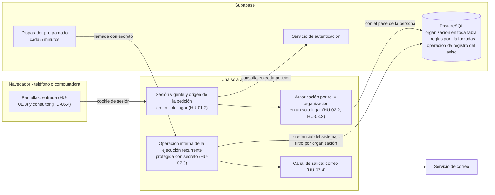
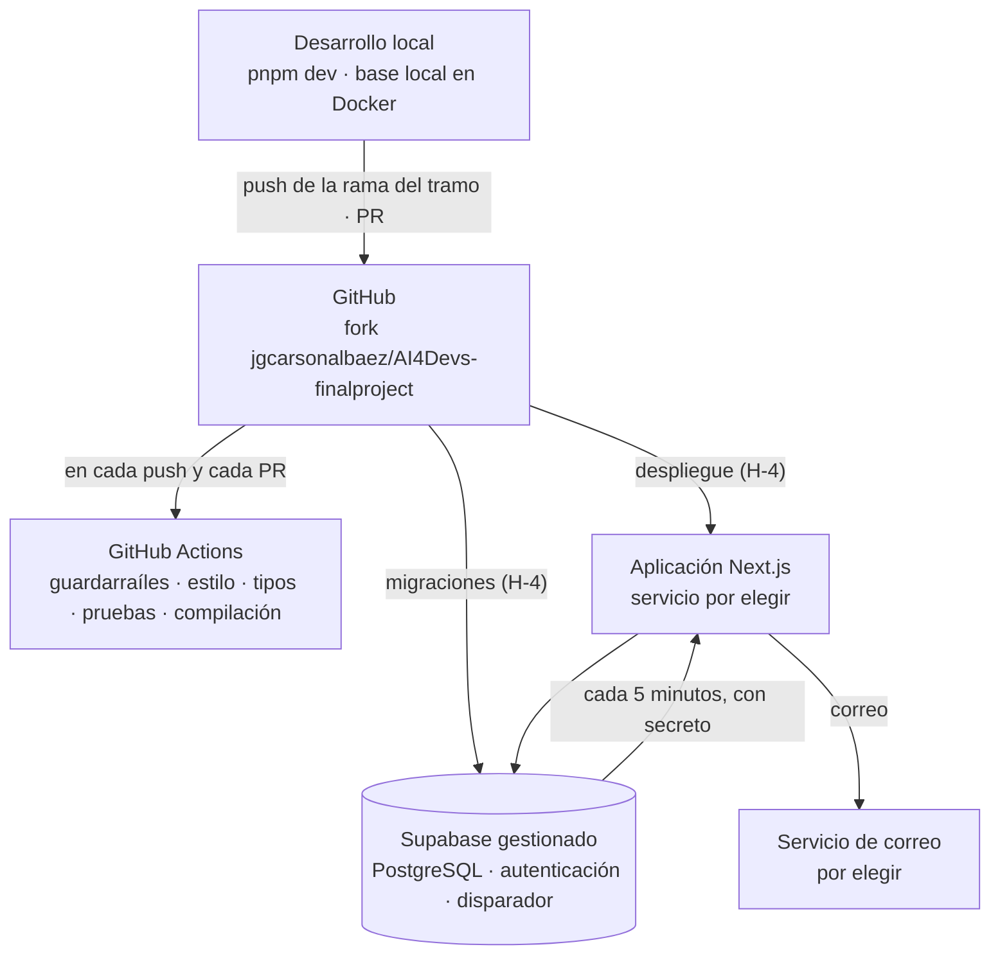
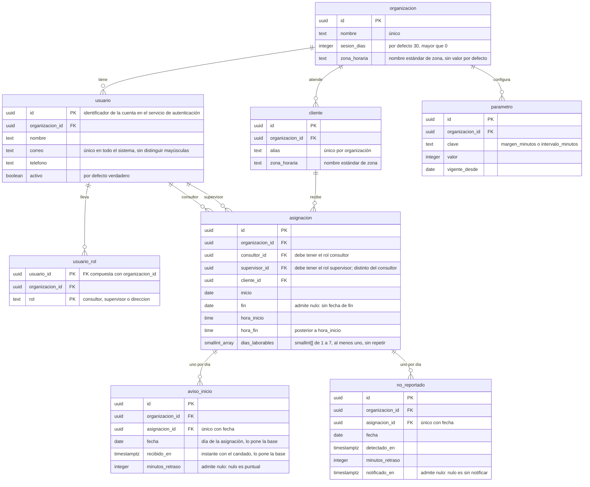

## Índice

0. [Ficha del proyecto](#0-ficha-del-proyecto)
1. [Descripción general del producto](#1-descripción-general-del-producto)
2. [Arquitectura del sistema](#2-arquitectura-del-sistema)
3. [Modelo de datos](#3-modelo-de-datos)
4. [Especificación de la API](#4-especificación-de-la-api)
5. [Historias de usuario](#5-historias-de-usuario)
6. [Tickets de trabajo](#6-tickets-de-trabajo)
7. [Pull requests](#7-pull-requests)

> **Estado al miércoles 25/11/2026.**
>
> - **Lo que ya está construido:** la estructura de la aplicación (Next.js, ticket H-2), la integración continua en verde en el fork, el harness (reglas de `CLAUDE.md`, hook de datos que no salen, plantilla de migración controlada, verificador de referencias) y la **especificación aprobada** (D-89): `openspec/specs/acceso/spec.md`, `openspec/specs/aviso-inicio/spec.md` y `openspec/specs/no-reportados/spec.md`, con **32 requisitos y 141 escenarios**, tras siete rondas de revisión adversarial. (Al aprobarse eran 134; los cinco posteriores los agregaron D-103 y la ronda 1 de revisión del tramo 4, las dos del 25/11/2026.) Construido después: en la base, la organización con su regla de separación (HU-03.1, tramo 2), el usuario con su correo y su organización (HU-01.1, tramo 3) y el cliente, la asignación y el aviso de inicio, que nadie edita ni quita (HU-06.1, tramo 4); en el código, el filtro por organización en un solo lugar (HU-03.2, tramo 3) y la sesión vigente, entrar y cerrar (HU-01.2, tramo 4). Todavía no hay pantallas: llegan con HU-01.3.
> - **Tramo 2 (HU-03.1):** la primera tabla de la base, `organizacion`, con su regla de separación forzada, y la **comprobación de estructura**, que corre en cada cambio y falla si una tabla de negocio nace sin organización o sin su regla. Hasta el tramo 3 la regla no deja ver nada a nadie: todavía no existe la tabla de usuarios de la que sale la organización de quien consulta (D-100). Todavía no hay pantallas.
> - **Lo que se construye para la entrega:** un recorte del MVP con 23 tickets en 11 tramos (`docs/trazabilidad/05-Tickets/Recorte-Entrega-20261119-v4.md`, decisiones D-73 a D-75). Una persona entra con su cuenta, el consultor avisa su inicio con un toque y, al vencer el margen, cada supervisor recibe un correo con los suyos que no avisaron. Todo queda separado por organización y por rol, y desplegado. Meta interna: sábado 05/12/2026 (D-75). Entrega: miércoles 09/12/2026 (R-1).
> - **Cómo se trabaja:** cada tramo se construye en su propia rama y vuelve por un pull request dentro del fork, con su revisión adversarial guardada (D-90).
> - **De dónde sale cada cosa:** `docs/trazabilidad/README.md` reúne el registro de decisiones (D-1 a D-105), el PRD, el backlog, los tickets y todas las revisiones. **Si este README y la especificación difieren, manda la especificación.**
> - **Anonimización.** El proyecto es una herramienta interna real de dos empresas de consultoría. Los clientes aparecen como `Cliente A` … `Cliente I`, con alias estables, y las empresas como Proveedor A y Proveedor B. No se nombran personas, contratos ni códigos de proyecto reales (R-5, RNF-8). La única excepción es el autor del proyecto, en dos lugares: la ficha 0.1, porque la plantilla del curso lo pide (D-92), y los metadatos de cada commit (D-98). El historial conserva además el usuario de la máquina en las rutas de la primera versión de un pull request, como riesgo aceptado (D-97). Esta excepción es posterior al PRD v8 y manda sobre su RNF-8 hasta el PRD v9 (D-99).

---

## 0. Ficha del proyecto

### **0.1. Tu nombre completo:**

Jaime Guillermo Carson Albáez

### **0.2. Nombre del proyecto:**

**Controlador de Tiempo** — presencia, actividad y respaldo de facturación para consultores asignados a clientes.

### **0.3. Descripción breve del proyecto:**

Herramienta interna para empresas de *staff augmentation* que asignan consultores a clientes. Resuelve dos dolores distintos con un solo registro: **saber antes que el cliente** si un consultor no ha empezado a trabajar (presencia), y **sustentar la factura mensual** con actividad imputada por proyecto, aprobada y trazable (actividad). Sustituye tres modelos que hoy conviven sin hablarse: plantillas Excel de asistencia, un reporte de imputación por porcentaje y un catálogo de actividades en HTML sin implementar.

### **0.4. URL del proyecto:**

Pendiente. La aplicación se despliega en el último tramo, con el ticket H-4, que además comprueba tres cosas: que un correo de ejemplo llega a un buzón, que avisar toma menos de 5 segundos con sesión vigente, y que las pruebas del servicio de autenticación se repiten contra el servicio gestionado. La especificación le encarga además comprobar el límite de intentos de entrada y **qué dirección ve el servicio** (riesgos aceptados de `openspec/specs/acceso/spec.md`, D-72). El recorte v4 todavía no lo lista: se agrega a H-4 en los tickets v5, que se escriben antes del tramo 8 (D-99).

### 0.5. URL o archivo comprimido del repositorio

https://github.com/jgcarsonalbaez/AI4Devs-finalproject — fork del repositorio oficial; rama de la entrega: `feature/entrega-1-JC`. Desde el tramo 2, cada tramo llega a esa rama por su propio pull request (D-90).

---

## 1. Descripción general del producto

### **1.1. Objetivo:**

**Para quién.** Dos empresas de consultoría (Proveedor A y Proveedor B) que asignan consultores a bancos y entidades financieras bajo contratos con horario comprometido. El **usuario primario es el consultor asignado**; el supervisor y la dirección usan lo que él registra (PRD v8, sección 2).

**Qué dolor resuelve.** La necesidad apareció en tres clientes. Son dos dolores distintos (PRD v8, sección 1):

| | Presencia y puntualidad | Actividad |
|---|---|---|
| **Por qué duele** | Nos enteramos **por el cliente** de que un consultor no asistió o no se conectó. Cuesta reputación | Sin sustento de actividad no se puede facturar. En uno de los países donde se opera es exigencia legal |
| **Qué necesita** | Detección oportuna: hoy, no al cierre del mes | Evidencia con trazabilidad y aprobación |
| **Si falla** | Se pierde reputación | No se factura |

**El reencuadre que guía el diseño:** el primer dolor **no es de registro, es de detección**. Una hoja de horas que se llena al cierre deja que el cliente siga avisando primero. El producto es *saberlo antes que el cliente*; el registro es el subproducto.

**Qué valor aporta.** El silencio de un consultor se convierte en una lista con nombre y teléfono **al vencer el margen**, para llamar antes de que llame el cliente. **La llamada es para saber si la persona está bien** (D-62): el producto detecta el silencio para cuidar a la persona y al servicio, no para vigilar. Para el consultor, avisar cuesta un toque y es un acto separado del registro de actividad.

**Qué no es.** No es un motor de facturación: produce el respaldo, y se factura por otra vía. Tampoco es un sistema de notificaciones en tiempo real.

### **1.2. Características y funcionalidades principales:**

**El MVP completo tiene siete capacidades** (PRD v8, sección 4): acceso con cuenta propia y separación entre organizaciones · aviso de inicio en un toque · reporte de no reportados, con anotación del motivo y resumen final · registro de actividad por proyecto · envío del período mensual y aprobación en un solo paso · formato único de reporte exportable a Excel · trazabilidad.

**Lo que se construye para la entrega del 09/12/2026** es el hilo de punta a punta del primer dolor (D-73):

| Capacidad | Qué hace en esta entrega | Especificación |
|---|---|---|
| **Entrar con cuenta propia** | Entrar y cerrar sesión. La sesión dura `sesion_dias` días (30 de inicio) y la controla el sistema, no el servicio de autenticación (D-69). Mismo mensaje para cualquier credencial incorrecta (HU-01.CA-3). Una cuenta desactivada no entra ni sigue usando su sesión | `openspec/specs/acceso/spec.md` |
| **Roles y separación** | Tres roles —consultor, supervisor y dirección—, y una persona puede tener más de uno (D-56). Ninguna organización ve a otra, tampoco la dirección. Lo ajeno responde igual que si no existiera (D-67) | `openspec/specs/acceso/spec.md` |
| **Aviso de inicio** | Un botón, «Inicio de Actividades», con el cliente de la asignación que toca. Queda la hora en que el sistema recibe el toque, no la del teléfono (D-55). Un aviso por asignación y día, que no se edita ni se quita. Puntual o llegada tardía, con sus minutos | `openspec/specs/aviso-inicio/spec.md` |
| **Reporte de no reportados** | Cada 5 minutos el sistema clasifica a quien no avisó al vencer el margen (60 minutos de inicio) y envía a cada supervisor **un solo correo** con los suyos. El correo lleva seis datos: fecha, nombre, cliente, hora comprometida, minutos de retraso y teléfono | `openspec/specs/no-reportados/spec.md` |

**Lo que se difiere de la entrega**, con lo que lo cubre mientras tanto (recorte v4, sección 2). Diferido no es descartado: los ocho tickets siguen en el plan completo.

| Ticket | Qué se difiere | Qué lo cubre mientras tanto |
|---|---|---|
| HU-01.4, HU-01.5 | Enlace para fijar la contraseña y «olvidé mi contraseña» | Las cuentas nacen con los datos de arranque (H-3), con la contraseña ya fijada |
| HU-02.3 | Pantalla de inicio según rol | El consultor llega a su pantalla de aviso; quien no tiene asignación ve un mensaje simple |
| HU-07.6 | Bordes de la clasificación: dos asignaciones el mismo día, consultor desactivado, concurrencia | Los datos de demostración no traen esos casos. La regla del aviso posterior sí entra y se prueba en HU-06.3 y HU-07.1 |
| HU-07.7 | Suplencia de la dirección cuando el supervisor está desactivado | No hay suplencia. Lo que no salió entra en el correo siguiente, porque el correo lleva lo que está sin notificar de las últimas 24 horas |
| HU-07.8 | Escenarios de punta a punta del correo | La entrega del correo se comprueba a mano en el despliegue (H-4) |
| HU-10.1, HU-10.2 | Consulta por fecha en pantalla | El supervisor se entera por el correo |

**Del MVP completo quedan para después** el registro de actividad, el período y su aprobación, la exportación a Excel, la anotación del motivo, el resumen final y las pantallas de consulta. Lo que salió del MVP y lo que lo cubre mientras tanto está en 26 filas, cada una con su decisión, en la sección 4 del PRD (`docs/trazabilidad/03-PRD/PRD-MVP-Controlador-de-Tiempo-20261119-v8.md`).

**Los dos parámetros del reporte**, uno de cada uno por organización (RF-14): el **margen** (minutos desde la hora de inicio comprometida; 60 de inicio) y el **intervalo** (minutos entre ejecuciones; 5 de inicio, mínimo 5 y múltiplo de 5). Un cambio rige desde el día siguiente (HU-07.CA-13). En esta entrega no hay operación para cambiarlos (HU-11).

**Decisión de stack (17/10/2026, R-2):** Next.js + React + TypeScript + Supabase (PostgreSQL), el mismo stack del sistema de talento humano que la empresa ya opera, para que lo mantenga el mismo equipo. Una sola aplicación desplegada, sin procesos aparte (R-3, D-27).

**Riesgos aceptados, a la vista.** El PRD tiene 15, de RA-1 a RA-15, cada uno con lo que lo cubre mientras tanto. Los que tocan esta entrega:
- el sistema garantiza que el correo sale, no que se lee a tiempo (RA-3);
- el aviso es una declaración, no una verificación (RA-5);
- tras una caída, o si se pierde la confirmación del servicio de correo, puede salir un correo repetido (RA-6, D-82);
- el límite de intentos de entrada es por dirección IP y no por cuenta (RA-10);
- un margen que vence pasada la medianoche no se reporta (RA-12);
- tras una caída que cruza la medianoche, lo del día anterior no se reporta, y nada lo avisa mientras tanto (D-94, D-96). Es posterior al PRD v8 y manda sobre su RNF-4 hasta el PRD v9.

### **1.3. Diseño y experiencia de usuario:**

**Cuándo se ven las pantallas.** Los tramos 2 a 4 no tienen pantalla: construyen la base, las reglas y la sesión. La **pantalla de entrada** llega en el tramo 5 (HU-01.3) y la **pantalla del consultor**, con el botón de aviso, en el tramo 9 (HU-06.4). Las imágenes y el vídeo se agregan aquí cuando existan.

**Restricción que manda sobre todo lo demás:** el consultor no gana nada registrando; el valor lo cobran las empresas. Si el incentivo es externo, la adopción depende de que registrar **no cueste nada** (D-3, D-4). Por eso la fricción mínima es restricción de diseño, no deseo.

**Recorrido del consultor** (aplicación web pensada primero para el navegador del teléfono, RNF-2):

1. Abre la aplicación. Con sesión vigente ya está dentro (HU-01.CA-6).
2. Ve **un solo botón**, «Inicio de Actividades», y el cliente de la asignación que toca (HU-06.CA-1, CA-9).
3. Lo toca. Ve la confirmación con la hora del aviso en la zona horaria del cliente (HU-06.CA-2, CA-12). Objetivo: **menos de 5 segundos** desde que abre la aplicación (HU-06.CA-14), que se comprueba por observación en el despliegue (H-4).
4. Si el aviso no llegó a registrarse, lo ve y puede reintentar; nunca ve una confirmación de un aviso que no existe (HU-06.CA-11).
5. Si no tiene asignación pendiente, ve el motivo (HU-06.CA-8). Si hoy salió en el reporte, no ve nada que se lo diga (HU-06.CA-15, D-62).

**Recorrido del supervisor:** al vencer el margen recibe un correo con sus supervisados que no avisaron, y llama. Solo recibe a los que él supervisa (HU-07.CA-8).

**Lo que la interfaz no hace:** no pide proyecto, actividad ni descripción al avisar (HU-06.CA-10); no deja cambiar ni quitar un aviso (HU-06.CA-13); no muestra a un consultor nada de otro.

### **1.4. Instrucciones de instalación:**

**Lo que funciona hoy** (Node 22 y pnpm; es la versión con que corre la integración continua. `package.json` admite Node 20 o superior, pero con la 20 no se ha probado):

```bash
pnpm install --frozen-lockfile
pnpm dev
```

Las mismas comprobaciones que corre la integración continua (`.github/workflows/ci.yml`):

```bash
pnpm lint && pnpm typecheck && pnpm test && pnpm build
```

```bash
python3 tests/harness/prueba-datos-que-no-salen.py
python3 tests/harness/prueba-instalar-guardarrailes.py
python3 tests/harness/prueba-verificar-referencias.py
python3 scripts/verificar-referencias.py --base origin/feature/entrega-1-JC
```

Sin `--base`, el verificador no comprueba que las copias de `docs/trazabilidad/` sigan iguales; la integración continua sí lo hace, contra la rama base.

Al clonar en una máquina nueva se instalan los hooks de git con `bash scripts/instalar-guardarrailes.sh`; los pasos que siguen están en `CLAUDE.md`, sección 8.

**La base local** (desde HU-03.1). Corre en Docker, con la herramienta `supabase` (probada con la versión 2.109.1, la misma que usa la integración continua). El script levanta solo la base, el servicio de autenticación y la API, y aplica las migraciones de `supabase/migrations`:

```bash
bash scripts/base/levantar-base.sh
```

Lo que corre la integración continua sobre la base, en el mismo orden:

```bash
python3 tests/base/prueba-scripts-base.py
python3 scripts/base/correr-validaciones.py
python3 scripts/base/comprobar-estructura.py
python3 tests/base/prueba-comprobacion-estructura.py
python3 tests/base/prueba-validacion-organizacion.py
python3 tests/base/prueba-acceso-organizacion.py
python3 tests/base/prueba-usuario.py
python3 tests/base/prueba-validacion-usuario.py
python3 tests/base/prueba-sesion.py
python3 tests/base/prueba-validacion-sesion.py
python3 tests/base/prueba-aviso-modelo.py
python3 tests/base/prueba-validacion-aviso-modelo.py
python3 tests/base/prueba-validacion-vigencia-del-pase.py
```

Y, en el mismo trabajo, la única prueba que pasa por el cliente oficial del servicio: la sesión con cookies reales contra la base local (HU-01.2). Necesita la base levantada, así que `pnpm test` la salta; la integración continua la corre aquí, donde la base está arriba.

```bash
CT_BASE_LOCAL=1 pnpm vitest run tests/integration/sesion.test.ts
```

Para volver a aplicar las migraciones desde cero, con la base ya levantada: `supabase db reset` (borra los datos de la base local, que son solo de prueba). Los datos de arranque llegan en `supabase/seed.sql` con H-3.

---

## 2. Arquitectura del Sistema

### **2.1. Diagrama de arquitectura:**



Hoy existe la aplicación base (H-2). Cada caja dice el ticket que la construye.

**Patrón: una sola aplicación, con la separación garantizada en la base** (R-3, D-27). La regla de cada tabla no vive solo en el código: la base tiene en toda tabla de negocio la organización y una regla por fila que deja ver y cambiar solo lo de la organización de quien consulta, sea cual sea su rol, forzada también para el dueño de la tabla (`openspec/specs/acceso/spec.md`, «Separación por organización en la base»). Se eligió así por tres razones:

- **Lo caro es el modelo de datos, y aquí es PostgreSQL.** Las reglas de separación viven en migraciones SQL con el patrón de migración controlada (`openspec/plantillas/migracion-controlada.sql`), y una comprobación de estructura falla si una tabla nace sin su organización o sin su regla (HU-03.1).
- **Un pase se puede usar para consultar la base directamente**, sin pasar por el servidor. Por eso la base exige las mismas condiciones que el servidor: usuario activo y sesión vigente.
- **Es el stack que la empresa ya opera** (R-2), y un solo despliegue es un solo frente que mantener y asegurar.

**Cómo se registra el aviso.** Comprobar qué asignación toca, la fecha, la hora y la clasificación ocurre en **una sola operación de la base**, que se llama con la sesión de la persona (decisión 25 de D-86). La operación deduce de esa sesión quién es el consultor; toma el candado de la asignación, el mismo que toma la clasificación; y toma un solo instante con el candado. Nadie más puede insertar avisos, tampoco la credencial del sistema: la base se lo niega por permiso (decisión 32 de D-86). Así no se puede avisar por otra persona, por otra asignación ni con otra hora (`openspec/specs/aviso-inicio/spec.md`, «Registrar el aviso»).

**Cómo trabaja el reporte de no reportados.** Un disparador programado llama cada 5 minutos a una operación interna, protegida con un secreto propio (E-6). La operación procesa cada organización cuyo intervalo corresponde, una por una: si una falla, las demás siguen. Clasifica a quien no avisó al vencer el margen, guarda un no reportado por asignación y día, y envía a cada supervisor un solo correo con lo que está sin notificar de las últimas 24 horas. Como esa vía usa la credencial del sistema, que no pasa por las reglas de la base, **la separación por organización la pone el código**, en un solo lugar (`openspec/specs/no-reportados/spec.md`).

**Lo que falta comprobar al construir.** La especificación deja cinco comprobaciones, cada una con su salida escrita (D-89):
- la cookie de sesión (HU-01.2);
- el correo de la cuenta y el cambio de correo (HU-01.1, dos comprobaciones);
- que la base pueda consultar si una sesión sigue abierta (HU-03.1);
- que el disparador programado pueda llamar con un secreto guardado en su almacén (HU-07.3).

**Sacrificios.** Depender de proveedores gestionados: lo atado es la autenticación, las reglas por fila y el disparador, no las migraciones. El servicio donde se despliega la aplicación y el servicio de correo no están elegidos todavía; se fijan en el despliegue (H-4).

### **2.2. Descripción de componentes principales:**

| Componente | Tecnología | Responsabilidad | Estado |
|---|---|---|---|
| **Aplicación web** | Next.js 15, React 19, TypeScript, Tailwind 4 (`package.json`) | Pantallas y operaciones del servidor. Una sola aplicación desplegada (R-3) | Existe la base (H-2) |
| **Sesión** | Cookie de sesión que gestiona el cliente oficial del servicio de autenticación (D-23) | En cada petición y en un solo lugar: el servicio reconoce la sesión (D-76), el usuario está activo y no pasaron más de `sesion_dias` días (D-69). Rechaza la petición que cambia datos si no viene del propio sitio | HU-01.2 |
| **Autorización** | Código del servidor | Qué puede cada rol, en un solo lugar. Lo ajeno responde como inexistente; la operación no permitida, con un mensaje en español | HU-02.2, HU-03.2 |
| **Base de datos** | PostgreSQL en Supabase | Organización en toda tabla de negocio, reglas por fila forzadas, reglas por rol, operación de registro del aviso con su propio dueño, disparadores que impiden editar o quitar un aviso o un no reportado | HU-03.1, HU-01.1, HU-02.1, HU-06.1, HU-07.1 |
| **Ejecución recurrente** | Operación interna de la aplicación, llamada por el disparador programado de Supabase con un secreto | Clasifica y envía; su respuesta trae conteos por organización, sin datos de personas | HU-07.3 |
| **Canal de salida** | Interfaz con una sola implementación: el correo, solo texto sin formato | El proceso no sabe por dónde viaja el reporte | HU-07.4 |
| **Especificación viva** | OpenSpec (`openspec/specs/`) | La verdad de cada capacidad; un cambio de comportamiento empieza por cambiarla | Aprobada (D-89) |
| **Guardarraíles** | `.claude/hooks/datos-que-no-salen.py`, hooks de git, `scripts/verificar-referencias.py` | El hook detiene en la máquina el commit con secretos o nombres reales; el verificador falla en la integración continua si una cita apunta a algo que no existe. **Límite:** la integración continua no revisa con el hook el contenido subido, y lo que llega por `merge` no pasa por él | Existen |

### **2.3. Descripción de alto nivel del proyecto y estructura de ficheros**

**Lo que existe hoy:**

```
AI4Devs-finalproject/
├── readme.md · prompts.md              # documentación de la entrega
├── CLAUDE.md                           # reglas de proceso del repositorio
├── .claude/hooks/datos-que-no-salen.py # bloquea secretos, nombres y dominios reales
├── .github/workflows/ci.yml            # guardarraíles, aplicación y base, en cada cambio
├── app/                                # Next.js (App Router): página provisional de H-2
├── lib/
│   ├── datos/separacion.ts             # el único lugar por el que el código consulta la base (HU-03.2)
│   └── sesion/                         # sesión vigente, entrar y cerrar; reglas y cliente oficial (HU-01.2)
├── openspec/
│   ├── specs/{acceso,aviso-inicio,no-reportados}/spec.md
│   └── plantillas/migracion-controlada.sql
├── supabase/
│   ├── config.toml                     # base local
│   ├── migrations/                     # una migración por tabla, con la plantilla controlada (desde HU-03.1)
│   ├── validaciones/                   # validación 1 a 1 de solo lectura por migración
│   └── comprobaciones/estructura.sql   # comprobación de estructura (HU-03.1)
├── docs/
│   ├── trazabilidad/                   # decisiones, PRD, backlog, tickets y revisiones (D-91)
│   ├── revisiones/                     # revisión adversarial de cada pull request (D-90)
│   └── seguridad/registro-de-bloqueos.md
├── scripts/
│   ├── instalar-guardarrailes.sh       # instala los hooks de git
│   ├── verificar-referencias.py        # integridad referencial (D-91)
│   ├── referencias.txt                 # su configuración
│   └── base/                           # levantar la base local, validar y comprobar la estructura
├── tests/
│   ├── harness/                        # pruebas de los guardarraíles
│   ├── base/                           # pruebas de la base, contra la base local
│   ├── unit/                           # pruebas del código, sin base (Vitest)
│   └── integration/                    # el código con el cliente oficial y la base local
└── package.json · pnpm-lock.yaml · tsconfig.json · vitest.config.ts · eslint.config.mjs
```

**Lo que se agrega, y quién lo crea:**

```
supabase/seed.sql         # H-3: dos organizaciones, los tres roles, un consultor con dos asignaciones
app/ (pantallas)          # HU-01.3 (entrada) y HU-06.4 (consultor)
```

La organización interna del código del servidor se decide en el primer ticket que la necesita y se documenta aquí en su pull request. Hasta ahora: las consultas a la base, en `lib/datos/` (HU-03.2), y la sesión, en `lib/sesion/` (HU-01.2). La autorización por rol (HU-02.2) y las reglas del aviso (HU-06.2) todavía no tienen lugar.

### **2.4. Infraestructura y despliegue**



- **Integración continua (H-2), en verde en el fork.** Dos trabajos: los guardarraíles (pruebas del hook, del instalador y del verificador de referencias, y el propio verificador sobre el repositorio) y la aplicación (estilo, tipos, pruebas y compilación). Una tarea termina cuando está en verde en el fork, no cuando el archivo quedó escrito (`CLAUDE.md`, sección 6).
- **Despliegue (H-4), en el tramo 10.** Aplicación y base en servicios gestionados, con sus tres comprobaciones (recorte v4, sección 3).
- **Secretos** solo en las variables del servidor y en el almacén de secretos del disparador; nunca en el repositorio ni en el navegador (E-6). El hook `datos-que-no-salen` lo impide en el commit.
- **Respaldo diario** (RNF-5): que el plan contratado lo incluya se comprueba al desplegar; no se da por hecho.

### **2.5. Seguridad**

| Práctica | Cómo se aplica | Origen |
|---|---|---|
| **Sesión** | Se comprueba en cada petición, en el servidor y en un solo lugar: el servicio de autenticación la reconoce como abierta, el usuario está activo y no pasaron más de `sesion_dias` días desde la entrada. Si falla algo, la sesión se cierra | D-69, D-76, HU-01.CA-5 |
| **Mensaje único al entrar** | Credenciales incorrectas dan el mismo mensaje exista o no la cuenta | HU-01.CA-3 |
| **Peticiones de otro sitio** | Se rechaza toda petición que cambie datos, o que entre o cierre sesión, si no viene del propio sitio. Ninguna página se muestra dentro de un marco de otro sitio. La cookie no la lee el código de la página, va sin dominio y, desplegada, solo por conexión cifrada | `openspec/specs/acceso/spec.md` |
| **Separación por organización, en dos capas** | En la base, regla por fila restrictiva en toda tabla de negocio, forzada también para el dueño. En el código, filtro en un solo lugar. Lo ajeno responde como inexistente | HU-03.CA-1 a CA-3, D-67 |
| **Reglas por rol en la base** | El consultor ve lo suyo y **no ve sus no reportados**; el supervisor, lo de las asignaciones que supervisa; la dirección, su organización. Ninguna persona cambia ninguna tabla en esta entrega: el aviso lo inserta solo la operación de registro | HU-02.CA-1 a CA-8 y CA-10, D-62 |
| **Comprobación de estructura** | Corre en la integración continua y falla si una tabla de negocio no tiene organización o regla, si las personas pueden omitir las reglas (también con `TRUNCATE`, que la plataforma da por defecto y no pasa por ellas), o si una vista o una función se salta las reglas sin estar en la lista cerrada (`supabase/comprobaciones/estructura.sql`) | HU-03.1, decisión 37 de D-88 |
| **Matriz de permisos** | Una fila por operación del código y una columna por situación, con un caso permitido y uno rechazado por celda. Falla si una operación no tiene fila | HU-02.4 |
| **Aviso inalterable** | Un disparador rechaza editarlo o quitarlo, para cualquier rol | HU-06.CA-13, D-49 |
| **No reportado inalterable** | Solo puede pasar su marca de notificado de vacía a un instante, una vez; ni el sistema lo quita | D-80 |
| **Ejecución recurrente** | Solo con su secreto, comparado sin que importe cuántos caracteres coinciden; la sesión de una persona no sirve; su respuesta no devuelve datos de personas | E-6 |
| **Correo** | Solo texto sin formato, con seis datos; nada de lo que traen los datos se interpreta como enlace o formato | HU-07.CA-17, RNF-6 |
| **Datos que no salen** | El hook detiene el commit con secretos, nombres o dominios reales, ficheros `.env` o binarios que no sean imágenes, y deja una línea en `docs/seguridad/registro-de-bloqueos.md`. La lista de nombres reales vive fuera del repositorio, que es público | R-5, RNF-8 |
| **Integridad referencial** | `scripts/verificar-referencias.py` falla si, en un documento vivo, una cita apunta a una ruta, decisión, requisito, criterio o ticket que no existe. En la integración continua falla además si una copia de `docs/trazabilidad/` cambió, cambió de tipo o desapareció frente a la rama base (el registro de decisiones, derivado, se pone al día por diseño). Comprueba las citas que hay, no si falta alguna; los documentos que revisa están en `scripts/referencias.txt` | D-91, D-97 |

### **2.6. Tests**

**Lo que existe y corre hoy** en la integración continua:

| Prueba | Qué comprueba | Casos |
|---|---|---|
| `tests/harness/prueba-datos-que-no-salen.py` | Que el hook detiene lo que debe y deja pasar lo que debe, en sus tres modos | 231 |
| `tests/harness/prueba-instalar-guardarrailes.py` | Que el instalador deja los hooks de git puestos y que funcionan | 52 |
| `tests/harness/prueba-verificar-referencias.py` | Que el verificador de referencias detecta cada tipo de cita rota: un caso positivo y uno negativo por regla, y un negativo por cada familia de identificador | 64 |
| `scripts/verificar-referencias.py` | Que toda cita de los documentos vivos resuelve, y que ninguna copia de `docs/trazabilidad/` cambió frente a la base | — |
| `tests/base/prueba-scripts-base.py` | Sin base: qué salida de la comprobación se acepta y cuál no (sin resumen, cero tablas, líneas mal formadas), que cada migración tenga su validación, y que un fichero que falta se informe con mensaje propio; y que el `main()` de cada script use de verdad esas piezas | 18 |
| `scripts/base/correr-validaciones.py` | Que cada migración tiene su validación con el mismo nombre, y que dejó sus objetos hechos como dice la especificación: la validación 1 a 1 de `supabase/validaciones/` | 5 validaciones, 72 filas |
| `scripts/base/comprobar-estructura.py` | Que toda tabla de negocio tiene organización y su regla, que nada se salta las reglas y que las personas no tienen `TRUNCATE`, `TRIGGER` ni `REFERENCES`; falla si no recorrió ninguna tabla | — |
| `tests/base/prueba-comprobacion-estructura.py` | Que la comprobación de estructura detecta cada falla: un caso que pasa y uno que falla por regla, leídos con el mismo analizador que usa la integración continua; incluye un rol de las personas que puede asumir, directo o en dos saltos, otro que omite las reglas, y una pertenencia que no deja asumirlo, que no es falla | 35 |
| `tests/base/prueba-validacion-organizacion.py` | Que la validación de `organizacion` da exactamente sus 20 filas, sin repetidas, y marca cada desvío de la especificación en su fila: al menos un desvío por fila | 31 |
| `tests/base/prueba-acceso-organizacion.py` | Con datos: la base sabe si la sesión del pase sigue abierta, y dice no con la sesión de otra cuenta, sin identificador de sesión, con otro rol o pasado su fin (aunque pase entre dos consultas de la misma transacción), y sí con un fin futuro; una consulta ya empezada conserva su respuesta (riesgo aceptado, D-102), acotada por el tiempo máximo de consulta de los roles de la API; `es_mi_organizacion` responde no a una cuenta sin usuario, para cualquier valor, y aun con una regla permisiva que deja todo, la restrictiva no deja ver ni crear; nadie ve ni cambia una organización, por la API ni por SQL con su rol; las constraints de la tabla | 40 |
| `tests/base/prueba-usuario.py` | Con datos (HU-01.1): el correo del usuario es el de su cuenta y es único sin distinguir mayúsculas; quien no puede leer las cuentas recibe un rechazo con mensaje nuestro; la persona no cambia el correo de su cuenta y la credencial del sistema sí (D-103); `es_mi_organizacion` responde sí solo con usuario activo, sesión abierta y dentro de `sesion_dias` desde la entrada con contraseña; cada persona ve su usuario y su organización y no los de otra; la corrección de un error de captura en dos pasos; el instante exacto del plazo y un día de 24 horas aunque cambie el horario; la sesión se renueva con el bloqueo de D-103 instalado; una entrada con contraseña cuyo momento no se puede leer hace vencer la sesión (D-105) | 43 |
| `tests/base/prueba-validacion-usuario.py` | Que la validación de `usuario` da exactamente sus 26 filas y marca cada desvío de la especificación en su fila: al menos un desvío por fila | 30 |
| `tests/base/prueba-sesion.py` | Con el pase real (HU-01.2): cada persona lee su propio usuario y su organización, y no los de un compañero ni los de otra organización; no cambia ni inserta nada; deja de verlos al desactivarse, al pasar el plazo (con dos entradas cuenta la más antigua, D-104) y al cerrar; cerrar con alcance local deja inservible ese pase y no cierra las demás sesiones; una entrada con contraseña ilegible o con un momento en el futuro hace vencer la sesión (D-105 y hallazgo G de la ronda 1 del tramo 4) | 24 |
| `tests/base/prueba-validacion-sesion.py` | Que la validación de la sesión da sus 7 filas y marca cada desvío: una regla permisiva de más, permisos de escribir, lectura para quien no tiene sesión | 11 |
| `tests/base/prueba-aviso-modelo.py` | Con datos (HU-06.1): zona horaria y alias del cliente; vigencia, horario, días laborables, supervisor distinto y organización común de la asignación; un aviso por asignación y día; nadie edita, quita ni vacía avisos, tampoco el dueño de la tabla, y ninguna identidad del sistema en servicio los inserta. Cada rechazo exige su motivo exacto; y hasta dónde llega esa garantía: el dueño de la tabla puede apagar el disparador antes de escribir, y ninguna identidad del sistema en servicio puede | 56 |
| `tests/base/prueba-validacion-aviso-modelo.py` | Que la validación del modelo del aviso da sus 15 filas y marca cada desvío en su fila —incluidos un permiso de lectura y una regla permisiva para quien no tiene sesión—, y que la lectura por rol que trae HU-02.1 no la rompe | 25 |
| `tests/base/prueba-validacion-vigencia-del-pase.py` | Que la validación de la vigencia del pase da sus 4 filas y marca cada desvío: el plazo que deja de ser `stable` o que las personas pueden llamar, la regla de la organización con los privilegios de quien la llama, y los dos defectos que encontró la ronda 1 del tramo 4 vueltos a poner a propósito | 8 |
| `tests/unit/separacion.test.ts` | Sin base (HU-03.2): toda consulta del código sale filtrada por la organización de quien pregunta; lo ajeno, lo inexistente y un identificador mal formado responden igual (D-67); un error de la base no se disfraza de «no existe»; ningún archivo de código del repositorio consulta tablas o funciones de la base por fuera de `lib/datos/separacion.ts`; el mensaje de error es fijo y un identificador en mayúsculas sigue siendo propio. Desde HU-01.2, la lectura del propio usuario | 22 |
| `tests/unit/sesion.test.ts` | Sin base, con reloj controlado (HU-01.2): el momento de entrada (el más antiguo, D-104), el plazo de 24 horas por día con el instante exacto, el origen de la petición, las marcas de la cookie, y entrar, cerrar y sesión vigente con un cliente falso. Desde la ronda 1 del tramo 4: el momento ilegible que hace vencer la sesión (D-105), el momento futuro, la marca de conexión cifrada leída del esquema, el cierre que el servicio rechaza y la entrada fallida que deja el navegador sin sesión. Desde su revisión interna: el cierre que no se afirma sin comprobarlo y el servicio caído que no corta la sesión de quien ya estaba dentro | 55 |

El paso de pruebas de la aplicación (`pnpm test`) corre las pruebas de `tests/unit/`. El código de la aplicación empezó en el tramo 3 con `lib/datos/separacion.ts` (HU-03.2). `tests/integration/sesion.test.ts` (7 casos, uno de ellos para que la integración continua no pueda saltarse la suite y quedar en verde) necesita la base levantada: `pnpm test` la salta, y la corre el trabajo de la base en la integración continua (sección 1.4).

**Cómo se escriben las de la aplicación** (D-26, `CLAUDE.md` secciones 3 y 4). En reglas de negocio y permisos, las pruebas van antes del código: el primer commit del ticket son las pruebas fallando y el segundo el código que las hace pasar. Cada pieza tiene un caso que pasa y uno que se rechaza. La IA propone los casos límite desde la especificación, la Dirección los aprueba o agrega, y el prompt queda en `prompts.md`.

| Tipo | Qué cubre | Tickets |
|---|---|---|
| **Unitarias (Vitest, reloj controlado)** | Asignación pendiente y cuál toca, puntual o tardío en el instante exacto, clasificación con el ejemplo de inicio 08:00, margen 60 e intervalo 5 | HU-06.2, HU-07.2 |
| **De integración, contra una base reiniciada** | Cada operación con su sesión y su organización; consultas directas a la base con cada rol | HU-06.3, HU-07.3, HU-07.4 |
| **Estructura y permisos** | Comprobación de estructura en cada cambio; matriz rol por operación; separación con dos organizaciones en las dos capas | HU-03.1, HU-02.4, HU-03.3 |
| **De punta a punta de la clasificación** | 08:59, 09:00, 09:02, sin aviso y caída, con reloj controlado | HU-07.5 |
| **A mano, en el despliegue** | El correo llega a un buzón; avisar toma menos de 5 segundos; pruebas del servicio de autenticación contra el gestionado | H-4 |

**Pendiente de decidir:** D-26 prevé además una prueba de punta a punta de las pantallas, en el navegador, sobre el flujo recortado. Ningún ticket del recorte la tiene todavía.

---

## 3. Modelo de Datos

### **3.1. Diagrama del modelo de datos:**

Son las ocho tablas que define la especificación aprobada para esta entrega. Las del MVP completo (proyecto, catálogo, registro de actividad, período, traza) nacen con sus historias.



### **3.2. Descripción de entidades principales:**

**Reglas para todas las tablas** (`openspec/specs/acceso/spec.md`, Datos): toda columna es NOT NULL salvo las que dicen «admite nulo». Toda tabla lleva `organizacion_id` salvo `organizacion`. Las tablas hijas llegan a su asignación con una llave foránea compuesta (`asignacion_id`, `organizacion_id`), para que la base no admita una fila de una organización colgada de otra (D-19).

| Tabla | Qué es | Reglas que la base garantiza | Ticket |
|---|---|---|---|
| `organizacion` | Cada empresa que usa el sistema | Nombre único; `sesion_dias` mayor que 0, 30 por defecto; zona horaria propia, de la lista estándar, que da la fecha de hoy para sus parámetros (D-81). Al crearla, un disparador le crea un margen de 60 y un intervalo de 5 | HU-03.1 (tabla, construida) · HU-07.1 (disparador) |
| `usuario` | Una persona con cuenta | Su `id` es el de la cuenta en el servicio de autenticación. Un correo, una cuenta, una organización (D-66) | HU-01.1 |
| `usuario_rol` | Los roles de cada persona; puede tener más de uno | Solo `consultor`, `supervisor` y `direccion` (D-56). Quien supervisa o dirige y tiene asignación propia lleva también el rol `consultor` (decisión 36 de D-88) | HU-02.1 |
| `cliente` | El cliente al que se asigna un consultor | Alias único por organización; zona horaria propia, que da el día de cada asignación | HU-06.1 |
| `asignacion` | Une a un consultor con un cliente, con su horario | Horario dentro de un mismo día (R-7). No se quita el rol a quien supervisa o tiene una asignación que no ha terminado | HU-06.1 |
| `aviso_inicio` | El toque del consultor | Uno por asignación y día. La fecha, la hora y los minutos los pone la base. Nadie lo edita ni lo quita. Solo lo inserta la operación de registro | HU-06.1, HU-06.3 |
| `parametro` | Margen e intervalo de cada organización, con la fecha desde la que rigen | Margen mayor que 0; intervalo de 5 o más y múltiplo de 5. Único por organización, clave y fecha | HU-07.1 |
| `no_reportado` | Quien no avisó al vencer el margen | Uno por asignación y día. Nadie lo quita ni lo cambia, tampoco el sistema, salvo su marca de notificado, una vez (D-80) | HU-07.1 |

---

## 4. Especificación de la API

Las operaciones de esta entrega y su contrato, según la especificación aprobada. **Las rutas concretas y su descripción en OpenAPI se escriben en el ticket que construye cada operación** (HU-01.2, HU-06.3 y HU-07.3), en su mismo pull request, y entonces se agregan aquí. Hoy no existen: escribirlas antes sería inventar nombres.

| Operación | Quién la usa | Qué recibe | Qué responde | Especificación |
|---|---|---|---|---|
| **Entrar** | Persona sin sesión | Correo y contraseña | Crea la sesión en una cookie. Ante credenciales incorrectas, el mismo mensaje exista o no la cuenta. Una cuenta desactivada no entra | `openspec/specs/acceso/spec.md`, «Entrar con cuenta activa» y «Mensaje único ante credenciales incorrectas» |
| **Cerrar sesión** | Persona con sesión | — | Cierra la sesión en el servicio; el pase anterior deja de servir | «Cerrar la sesión» |
| **Registrar el aviso** | Consultor con sesión | **Dos datos:** la asignación y el día que la pantalla le ofreció. Nada más: si viene la hora, la persona o un proyecto, se ignora | Una de seis respuestas: el aviso que ya existía · la pantalla quedó vieja · el aviso registrado · cuál asignación toca · el motivo por el que no está pendiente · igual que si no existiera, si no es suya | `openspec/specs/aviso-inicio/spec.md`, «Registrar el aviso» |
| **Ejecución recurrente** (interna) | Solo el disparador programado, con su secreto | — | Conteos por organización: no reportados nuevos, correos enviados, fallidos y vencidos sin notificar, más los tiempos de la ejecución. Ningún dato de personas | `openspec/specs/no-reportados/spec.md`, «Ejecución recurrente» y «Protección de la ejecución recurrente» |

Reglas que valen para todas, salvo la entrada y la ejecución recurrente (`openspec/specs/acceso/spec.md`):
- exigen sesión vigente;
- rechazan una petición que cambie datos si viene de otro sitio;
- responden «no existe» ante un dato ajeno;
- responden con un mensaje en español ante una operación que el rol no permite.

---

## 5. Historias de Usuario

Tres de las seis historias detalladas del backlog (`docs/trazabilidad/04-Backlog/Backlog-MVP-Controlador-de-Tiempo-20261118-v5.md`). Los criterios se citan con su número; su texto completo está en el backlog.

**Historia de Usuario 1 — HU-06 · Avisar el inicio de actividades en un toque**

> **Como** consultor asignado a un cliente, **quiero** avisar con un solo toque que empecé a trabajar, **para** que mi empresa lo sepa antes que el cliente sin que yo tenga que pensar en qué voy a trabajar.

| Criterio | Qué pide |
|---|---|
| HU-06.CA-1 | Con una asignación pendiente hoy, un único botón «Inicio de Actividades», igual para toda modalidad |
| HU-06.CA-2 | El aviso queda con la hora en que el sistema recibe el toque, no la del teléfono, y se confirma con esa hora |
| HU-06.CA-3 | Un toque repetido no crea otro aviso: muestra el que ya existe |
| HU-06.CA-5 | El instante exacto del vencimiento del margen cuenta como puntual: con inicio 08:00 y margen 60, un aviso a las 09:00 es puntual |
| HU-06.CA-8 | Sin asignación pendiente no hay botón y se ve el motivo |
| HU-06.CA-11 | Si el aviso no llega a registrarse, se ve y se puede reintentar; nunca una confirmación falsa |
| HU-06.CA-14 | Menos de 5 segundos desde abrir la aplicación hasta la confirmación. **En parte:** se comprueba por observación en el despliegue (H-4) |
| HU-06.CA-15 | Quien salió en el reporte no ve nada que se lo diga |

Entran los 15 criterios. **Fuera de esta historia:** verificar que de verdad empezó, porque el aviso es una declaración (RA-5); el recordatorio y la aplicación móvil (D-36); avisar por otra persona; horarios que cruzan la medianoche (D-41).

**Historia de Usuario 2 — HU-07 · Recibir la lista de no reportados al vencer el margen**

> **Como** supervisor, **quiero** recibir al vencer el margen la lista de quienes siguen sin avisar, **para** llamarlos y saber si están bien, antes de que el cliente me lo diga.

Ejemplo que usan los criterios: inicio 08:00, margen 60, intervalo 5. El margen vence a las 09:00 y la primera ejecución posterior es la de las 09:05.

| Criterio | Qué pide |
|---|---|
| HU-07.CA-1 | Sin aviso, entra en el reporte en la primera ejecución posterior al vencimiento: a las 09:05 |
| HU-07.CA-2 | Nombre, cliente, hora comprometida, minutos de retraso y teléfono; en el ejemplo, 65 minutos |
| HU-07.CA-4 | Quien avisó después del margen pero antes de la ejecución no entra, y queda como llegada tardía |
| HU-07.CA-5 | Un solo correo por supervisor con todos sus no reportados |
| HU-07.CA-7 | Sin nada nuevo, ningún correo |
| HU-07.CA-8 | Solo los que él supervisa |
| HU-07.CA-15 | El reporte queda generado con un retraso máximo de un intervalo. **En parte:** consultarlo en pantalla espera a HU-10. **Límite declarado (RNF-3, D-86):** el plazo lo cumple el momento de la detección; al intervalo se suman el retraso del disparador y lo que tarde la llamada en llegar a cada organización, sin tope, y queda anotado en el registro de la ejecución |

**Lo que no se comprueba en esta entrega** (recorte v4): HU-07.CA-12 (suplencia), CA-16, CA-18, CA-19 y CA-20 (bordes). HU-07.CA-10 entra en parte: entra la regla y no los escenarios de punta a punta. La fecha se suma a los cinco datos del correo porque un correo puede traer no reportados de dos días (excepción aprobada en D-84).

**Historia de Usuario 3 — HU-03 · Ninguna organización ve a otra**

> **Como** dirección de una empresa, **quiero** que los datos de mi organización queden separados de los de cualquier otra, **para** que la información de mis clientes y de mi gente no la vea un tercero.

| Criterio | Qué pide |
|---|---|
| HU-03.CA-1 | En cualquier lista o reporte solo aparecen datos de mi organización, sea cual sea mi rol |
| HU-03.CA-2 | La dirección tampoco cruza la frontera |
| HU-03.CA-3 | Un dato de otra organización responde igual que si no existiera, aunque se conozca su dirección exacta |
| HU-03.CA-4 | El correo de no reportados trae solo personas y clientes de mi organización |

HU-03.CA-5, CA-6 y CA-7 dependen de historias que no entran en esta entrega (HU-17, HU-05 y HU-11).

---

## 6. Tickets de Trabajo

**Convenciones** (`docs/trazabilidad/05-Tickets/Tickets-MVP-Controlador-de-Tiempo-20261118-v4.md`, sección 1). El identificador `HU-nn.n` deriva de su historia; los de habilitación llevan `H-n`. Un número no se reutiliza ni se renumera. Cada tipo tiene su Definition of Done. Talla: lo que una persona construye en media jornada como máximo; S ≈ 2 horas, M ≈ 4 horas.

**Ticket 1 · Base de datos — HU-03.1**

| Campo | Contenido |
|---|---|
| **Qué** | Organización en toda tabla de negocio y regla de la base que la filtra para cualquier rol. Entrega además la **comprobación de estructura**: recorre todas las tablas de negocio que existan, falla si alguna no tiene organización o no tiene regla, y corre en cada cambio desde este ticket |
| **Tipo · talla · tramo** | Migración/DB · M · tramo 2 |
| **Criterios** | HU-03.CA-1, CA-2, CA-3 |
| **Depende de** | H-1 y H-2 (cerrados) |
| **Especificación** | `openspec/specs/acceso/spec.md`, «Separación por organización en la base»; decisión 37 de D-88 (vistas y funciones) |
| **Definition of Done** | Parte de la plantilla de migración controlada, con mensajes de éxito y de error propios · validación de solo lectura, uno a uno, con esperado, encontrado y estado, que comprueba también que el objeto está hecho como dice la especificación · pruebas escritas primero · revisión adversarial del tramo guardada (D-74) |
| **Por comprobar al construir** | Que la base pueda consultar si la sesión que nombra el pase sigue abierta en el servicio. Si no puede, la especificación se corrige antes de escribir el código, y la decisión vuelve a la Dirección |
| **Crea** | `supabase/migrations` y `supabase/validaciones` |

**Ticket 2 · Backend — HU-06.3**

| Campo | Contenido |
|---|---|
| **Qué** | Registrar el aviso: con la hora en que el sistema lo recibe, sin pedir nada más, sin duplicar si se repite; sin forma de editarlo ni quitarlo |
| **Tipo · talla · tramo** | Endpoint/API · M · tramo 8 |
| **Criterios** | HU-06.CA-2, CA-3, CA-6, CA-7, CA-10, CA-13 |
| **Depende de** | HU-06.2 (regla de la asignación pendiente), HU-02.2 (autorización) y HU-02.4 (matriz de permisos) |
| **Especificación** | `openspec/specs/aviso-inicio/spec.md`, «Registrar el aviso», «Un aviso por asignación y día», «Puntual o llegada tardía», «El aviso no se edita ni se quita» |
| **Ajuste del recorte** | La petición no dice de quién es; la asignación y el día que nombra solo se registran si son la que toca y el día en curso (recorte v4, sección 3). La especificación precisa quién escribe: una operación de la base llamada con la sesión de la persona (decisión 25 de D-86) |
| **Definition of Done** | Exige sesión y filtra por organización y por rol · las entradas se validan · un error devuelve un mensaje propio, en español · pruebas de integración contra una base reiniciada · agrega su fila a la matriz rol por operación (HU-02.4), con un caso permitido y uno rechazado |

**Ticket 3 · Frontend — HU-06.4**

| Campo | Contenido |
|---|---|
| **Qué** | Pantalla del consultor, primero para teléfono: botón único con el cliente, confirmación con la hora, motivo cuando no hay botón, aviso de fallo con reintento, y nada que diga que fue reportado |
| **Tipo · talla · tramo** | Frontend · M · tramo 9 |
| **Criterios** | HU-06.CA-1, CA-2, CA-8, CA-9, CA-11, CA-14, CA-15 |
| **Depende de** | HU-06.3 (registrar el aviso) y HU-01.3 (pantalla de entrada) |
| **Especificación** | `openspec/specs/aviso-inicio/spec.md`, «Pantalla del consultor», «Motivo cuando no hay botón», «Cuál asignación toca» |
| **Definition of Done** | Se usa bien desde el teléfono · textos en español · estados de carga, de error y de vacío a la vista · horas en la zona horaria del cliente de la asignación · la confirmación se muestra solo con la respuesta del servidor |

**Los 23 tickets de la entrega, por tramo** (recorte v4, sección 4). Dentro de un tramo, ningún ticket depende de otro del mismo tramo.

| Tramo | Tickets | Qué queda funcionando | Estado |
|---|---|---|---|
| 0 | H-2, HU-01.6 | Integración continua en verde; el servicio de autenticación probado | ✅ Cerrado. HU-01.6 en local; lo del servicio gestionado se repite en H-4 |
| 1 | H-1 | Especificación inicial refutada y aprobada | ✅ Cerrado (D-89) |
| 2 | HU-03.1 | Organizaciones en la base y comprobación de estructura | ✅ Cerrado (pull request #2) |
| 3 | HU-01.1, HU-03.2 | Usuarios; filtro por organización en el código | ✅ Cerrado (pull request #3) |
| 4 | HU-01.2, HU-06.1 | Sesión; modelo del aviso | Construido; vuelve por su pull request |
| 5 | HU-01.3, HU-02.1, HU-06.2 | Se puede entrar; roles en la base; regla del aviso | Siguiente |
| 6 | H-3, HU-02.2, HU-07.1 | Datos de prueba; autorización; modelo del no reportado | |
| 7 | HU-02.4, HU-03.3, HU-07.2 | Permisos y separación probados; núcleo del reporte | |
| 8 | HU-06.3, HU-07.3 | El aviso se registra y el reporte se genera | |
| 9 | HU-06.4, HU-07.4, HU-07.5 | El consultor avisa; sale el correo; clasificación probada de punta a punta | |
| 10 | H-4 | Desplegado, con sus tres comprobaciones | |

**Suma:** 2 + 1 + 1 + 2 + 2 + 3 + 3 + 3 + 2 + 3 + 1 = 23. Tallas: 5 S y 18 M, unas 82 horas de construcción, sin contar la revisión de cada tramo (recorte v4, sección 5).

---

## 7. Pull Requests

**Cómo se trabaja desde el tramo 2** (D-90, `CLAUDE.md` sección 6):

1. Cada tramo se construye en su propia rama, que sale de `feature/entrega-1-JC`.
2. Al cerrar el tramo, una ronda de revisión adversarial con un modelo distinto al que escribió el código (D-28, D-74). La revisión y su respuesta se guardan en `docs/revisiones/<rama>-ronda<N>.md` y `docs/revisiones/<rama>-ronda<N>-respuesta.md`. Cada observación se cierra de una de tres formas, con su razón: se corrige, se acepta como riesgo o se descarta.
3. El pull request vuelve a `feature/entrega-1-JC` dentro del fork, con la integración continua en verde. La Dirección lo aprueba y lo une.
4. El mismo pull request pone al día este README y `prompts.md` (D-91).

**Hasta el tramo 1 no hubo pull requests de trabajo:** H-2 y H-1 se hicieron en commits directos a `feature/entrega-1-JC`. Lo dice D-90, que nació justo por eso.

Se documentarán aquí tres de los pull requests de la construcción, cada uno con cuántas observaciones tuvo su revisión y cómo se cerraron.

**Pull Request 1 — tramo 2, HU-03.1 (`tramo-2/hu-03.1-organizacion` → `feature/entrega-1-JC`)**

Qué trae: la tabla `organizacion` con su regla de separación restrictiva y forzada, apoyada en `es_mi_organizacion`, que hasta el tramo 3 responde siempre «no» (D-100); `sesion_abierta()`, que comprueba en la base que la sesión del pase sigue abierta; la validación 1 a 1 de la migración y la comprobación de estructura, que corren en la integración continua con la base levantada; y cuatro pruebas con su caso que pasa y su caso que se rechaza.

Revisión adversarial: cuatro rondas (las tres primeras con dos corridas unidas, la cuarta corta, con una), **37 observaciones distintas, ninguna crítica** (13, 10, 8 y 6). Cierre: **35 corregidas**, **1 corregida con un riesgo aceptado** por la Dirección (D-102: una consulta ya empezada conserva su respuesta de `sesion_abierta()`, acotada por el tiempo máximo de consulta) y **1 límite declarado** (el normalizador de una prueba no entiende comentarios anidados; daría un rojo de más, nunca un verde de más); ninguna descartada. Nacieron además D-101 (la puerta del tramo 8 pide qué dice H-4) y un control del agente para responder cada ronda. Lo que se aprendió: desde la ronda 2, casi todo lo que se encontró nació de las correcciones de la ronda anterior. Las revisiones y sus respuestas están en `docs/revisiones/tramo-2-hu-03.1-organizacion-ronda1-corrida1.md` y siguientes.

**Pull Request 2 — tramo 4, HU-01.2 y HU-06.1 (`tramo-4/hu-01.2-hu-06.1-sesion-aviso` → `feature/entrega-1-JC`)**

Qué trae: en el código, las reglas de la sesión en un solo lugar —entrar, cerrar y «sesión vigente», con sus tres condiciones comprobadas en cada petición— y el cliente oficial del servicio con las marcas de la cookie que pone el sistema; en la base, la migración que deja a cada persona leer su propio usuario y su propia organización, y el modelo del aviso: cliente con su zona horaria, asignación con horario, días laborables y vigencia, y el aviso de inicio, uno por asignación y día, que nadie edita ni quita. Con sus pruebas primero, en rojo, y la única prueba que pasa por el cliente oficial, que desde este tramo corre también en la integración continua.

Revisión adversarial: **una ronda con dos corridas unidas, 10 observaciones distintas (6 altas, 4 medias), ninguna crítica.** Cierre: **7 corregidas** y **3 corregidas con un límite declarado** (el cierre que el servicio no confirma, la prueba del cliente oficial que sigue necesitando la base levantada, y hasta dónde llega la inmutabilidad del aviso: el dueño de la tabla puede apagar el disparador antes de escribir); ninguna descartada. Dos de las observaciones eran criterio y no defecto, y las decidió la Dirección: nació **D-105** —si alguna entrada con contraseña del pase trae un momento que no se puede leer, la sesión vence— y la prueba con el cliente oficial pasó a la integración continua. Lo que se aprendió: ninguna observación de esta ronda nació de una corrección de otra —fue la primera y única—, pero las correcciones generaron **11 observaciones nuevas, 2 altas**, que cazaron el motor de la base y una revisión interna antes de pagar otra ronda; una de ellas era una premisa falsa sobre la biblioteca del servicio que habría llegado al cliente. La lección queda escrita: cuando una corrección depende de cómo se comporta una dependencia, se lee su código antes de declarar el límite. Las revisiones y la respuesta están en `docs/revisiones/tramo-4-hu-01.2-hu-06.1-sesion-aviso-ronda1-corrida1.md` y siguientes.

**Pull Request 3**

Pendiente.
