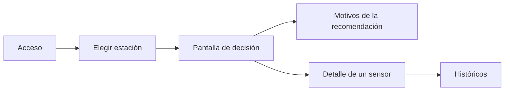
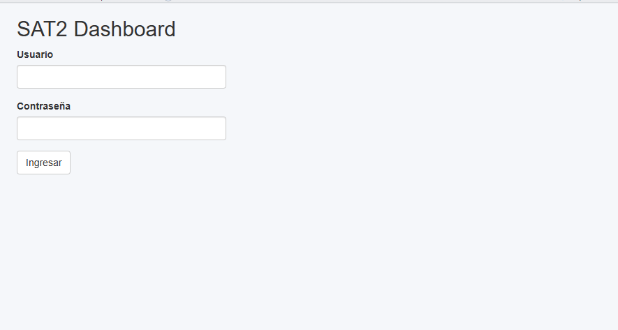
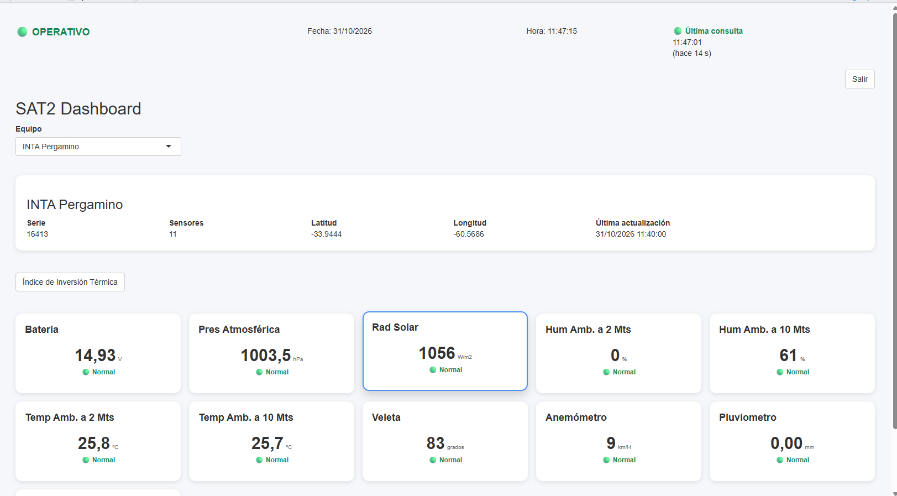
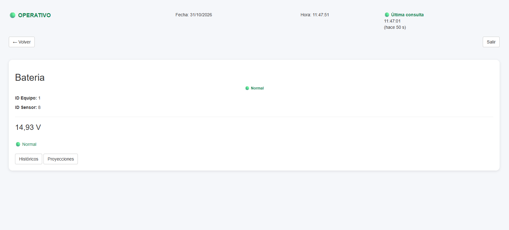
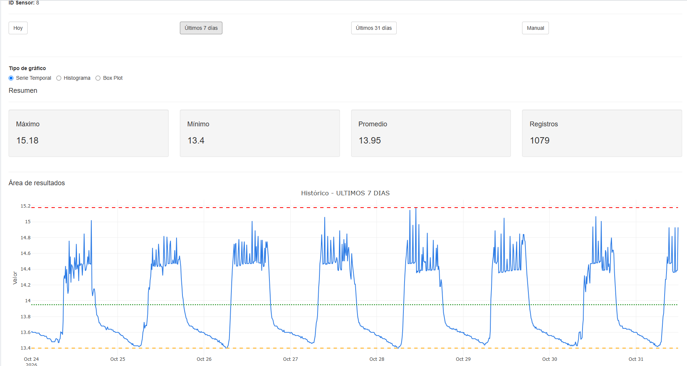
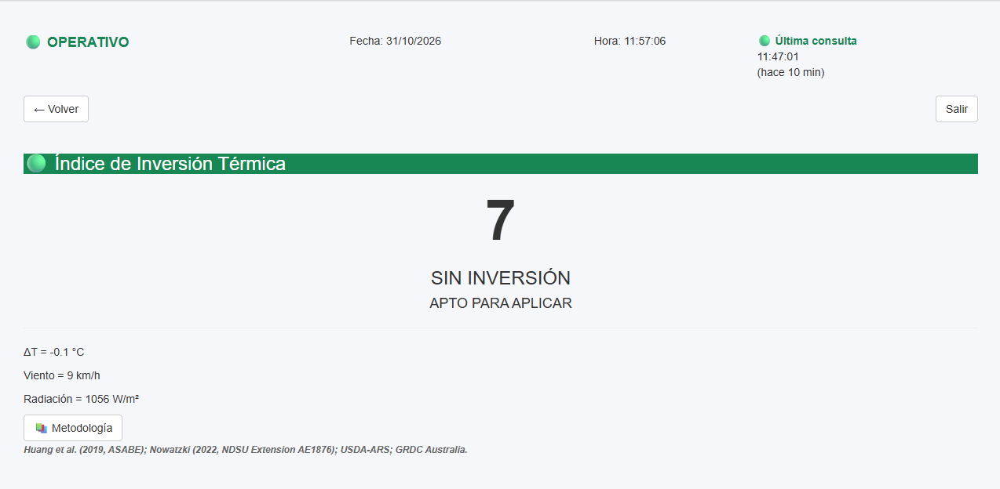
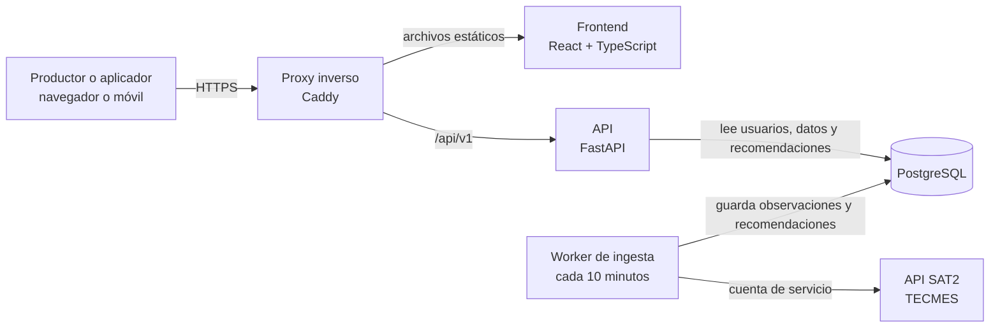
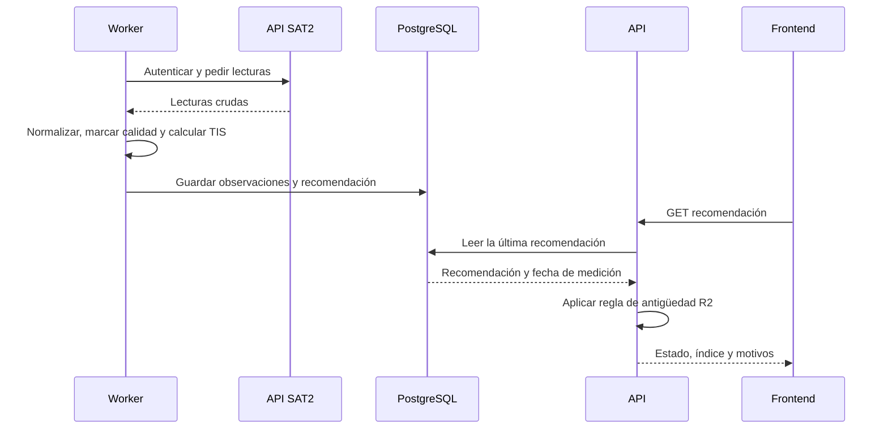
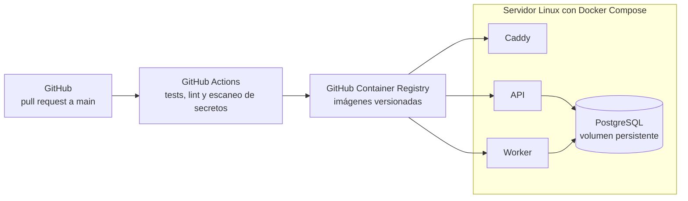
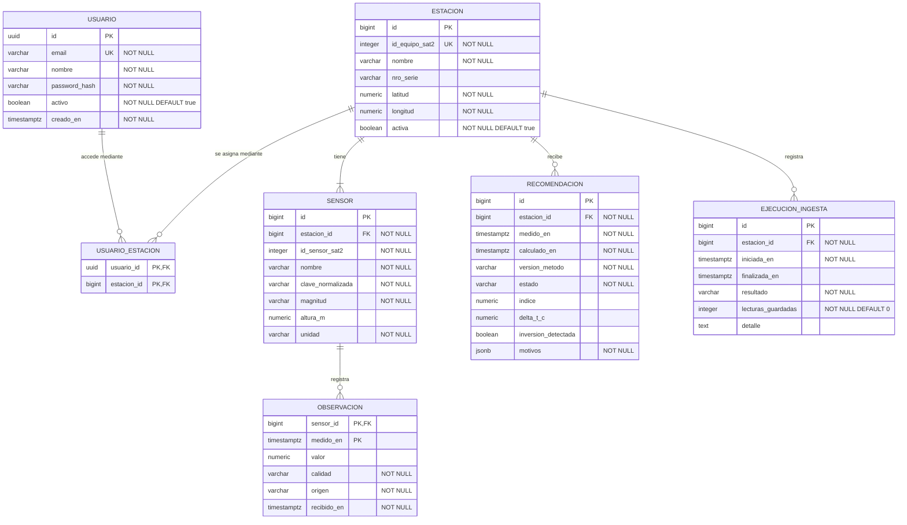

## Índice

0. [Ficha del proyecto](#0-ficha-del-proyecto)
1. [Descripción general del producto](#1-descripción-general-del-producto)
2. [Arquitectura del sistema](#2-arquitectura-del-sistema)
3. [Modelo de datos](#3-modelo-de-datos)
4. [Especificación de la API](#4-especificación-de-la-api)
5. [Historias de usuario](#5-historias-de-usuario)
6. [Tickets de trabajo](#6-tickets-de-trabajo)
7. [Pull requests](#7-pull-requests)

> **Estado de este documento (Entrega 1):** describe el diseño del MVP que se construirá para la Entrega 2. Todavía no hay código del MVP en este repositorio, por lo que la instalación, el despliegue y los tests figuran como planificados.

---

## 0. Ficha del proyecto

### **0.1. Tu nombre completo:**

Pablo Guillermo Di Nanno

### **0.2. Nombre del proyecto:**

Weather Track

### **0.3. Descripción breve del proyecto:**

Aplicación web adaptable a escritorio y móvil que transforma los datos de una estación meteorológica en una recomendación clara sobre si conviene aplicar fitosanitarios en este momento.

### **0.4. URL del proyecto:**

El MVP todavía no está desplegado; su URL se publicará con la Entrega 2. El acceso al prototipo de validación se comparte por un canal privado cuando se solicita.

### **0.5. URL o archivo comprimido del repositorio**

https://github.com/dinannopabloguillermo/AI4Devs-finalproject-temp

---

## 1. Descripción general del producto

### **1.1. Objetivo:**

**Problema.** Aplicar fitosanitarios durante una inversión térmica aumenta el riesgo de deriva: el aire estable puede mantener el producto suspendido y trasladarlo fuera del lote. Las estaciones meteorológicas ya miden las variables necesarias, pero entregan valores sueltos. Quien debe decidir tiene que interpretarlos por su cuenta, sin saber si los datos están actualizados o son confiables.

**Para quién.** Productores agropecuarios y aplicadores que trabajan en la zona de influencia de una estación. El caso inicial es la estación INTA Pergamino, con sensores de temperatura y humedad a 2 m y 10 m, viento y radiación solar, entre otros.

**Pregunta que responde.** "¿Puedo aplicar ahora en esta estación sin riesgo de deriva?"

| Qué introduce el usuario | Qué le devuelve el sistema |
|---|---|
| Correo y contraseña | Acceso a las estaciones que tiene asignadas |
| Estación | Condiciones actuales, antigüedad del dato y calidad de cada lectura |
| Nada adicional: la evaluación se calcula sola cada 10 minutos | Recomendación, índice TIS y motivos en lenguaje claro |
| Sensor y rango de fechas | Serie histórica con máximo, mínimo, promedio y cantidad de registros |

**Origen.** El proyecto nació en un ámbito laboral, creció como servicio profesional y se integra aquí como tesis de graduación.

### **1.2. Características y funcionalidades principales:**

#### Alcance del MVP

| ID | Funcionalidad | Descripción |
|---|---|---|
| F1 | Acceso | Inicio y cierre de sesión con cuentas propias de Weather Track. Las cuentas las crea un administrador; no hay registro público. |
| F2 | Estación | Selección entre las estaciones asignadas al usuario. |
| F3 | Condiciones actuales | Una tarjeta por sensor con valor, unidad, calidad del dato y antigüedad. |
| F4 | Recomendación | Estado de aplicación, índice TIS (Índice de Inversión Térmica), diferencia térmica y motivos. |
| F5 | Históricos | Serie por sensor de hasta 31 días, con resumen estadístico. |
| F6 | Ingesta automática | Proceso programado que cada 10 minutos obtiene datos, los normaliza, los guarda y calcula la recomendación. |

#### Reglas de la recomendación

El índice TIS va de 0 a 100 y combina cuatro factores:

`TIS = 0,50 × temperatura + 0,25 × viento + 0,15 × radiación + 0,10 × humedad`

En este documento, ΔT significa siempre `T10m − T2m`.

| Factor | Regla (de 0 a 100) |
|---|---|
| Temperatura | ΔT ≤ 0: 0. ΔT ≥ 3 °C: 100. En el medio, `ΔT / 3 × 100` |
| Viento (km/h) | ≤ 1: 100. ≤ 3: 90. ≤ 5: 70. ≤ 8: 40. ≤ 12: 20. Mayor: 0 |
| Radiación (W/m²) | ≤ 0: 100. ≤ 50: 90. ≤ 100: 75. ≤ 250: 50. ≤ 500: 20. Mayor: 0 |
| Humedad (promedio de 2 m y 10 m) | ≥ 90 %: 100. ≥ 80 %: 80. ≥ 60 %: 50. Menor: 20 |

| Índice | Estado base |
|---|---|
| 0 a 20 | `APTO` |
| Más de 20 y hasta 40 | `PRECAUCION` |
| Más de 40 y hasta 60 | `RIESGO_DERIVA` |
| Más de 60 | `NO_APLICAR` |

Las siguientes reglas se aplican en este orden sobre el estado base:

| ID | Regla | Resultado |
|---|---|---|
| R1 | Falta o es inválida alguna de las seis lecturas (T2m, T10m, HR2m, HR10m, viento o radiación) | `DATOS_INSUFICIENTES`, sin índice |
| R2 | La medición tiene más de 30 minutos de antigüedad al consultarla | `DATOS_INSUFICIENTES`, con motivo `DATOS_DESACTUALIZADOS` |
| R3 | ΔT > 0 | Nunca `APTO`: como mínimo `PRECAUCION`, con motivo `INVERSION_DETECTADA` |
| R4 | Alguna lectura es sospechosa (por ejemplo, más de 25 puntos de diferencia de humedad entre 2 m y 10 m) | Nunca `APTO`: como mínimo `PRECAUCION`, con motivo `DATO_SOSPECHOSO` |

La recomendación es **orientativa** y la pantalla lo indica siempre. Los pesos y umbrales provienen del prototipo y su validación agronómica está prevista para la Entrega 2. No reemplaza el criterio de un profesional ni la etiqueta del producto.

### **1.3. Diseño y experiencia de usuario:**



La **pantalla de decisión** es el centro de la experiencia. Muestra primero el estado de aplicación con su color, debajo los motivos y el aviso de que es orientativa, y al final las tarjetas de sensores. Se actualiza sola cada 60 segundos. Si los datos no son vigentes, el estado pasa a `DATOS_INSUFICIENTES` y explica por qué.

Las siguientes capturas son del **prototipo de validación**, no del MVP. Sirven como referencia de la interfaz y conservan el nombre anterior de la app. En particular, el MVP cambia la lógica de la pantalla del índice según las reglas R1 a R4.

| Pantalla | Captura |
|---|---|
| Acceso |  |
| Panel de sensores |  |
| Detalle de un sensor |  |
| Históricos |  |
| Índice de Inversión Térmica |  |

### **1.4. Instrucciones de instalación:**

> **Planificado.** Estos pasos describen la instalación prevista para la Entrega 2. Todavía no se pueden ejecutar, porque el código del MVP no existe en este repositorio.

Requisitos previstos: Git y Docker con Docker Compose.

```bash
git clone https://github.com/dinannopabloguillermo/AI4Devs-finalproject-temp.git
cd AI4Devs-finalproject-temp
cp .env.example .env
docker compose up --build -d
docker compose exec api alembic upgrade head
docker compose exec api python -m app.semillas
```

- `.env` contendrá la conexión a la base, el secreto de sesión y la cuenta de servicio de SAT2. Nunca se versiona.
- Las semillas crearán una estación y un usuario de demostración con datos ficticios.
- El modo `SAT2_MODO=simulado` permitirá probar el sistema sin credenciales reales.
- La aplicación quedará disponible en `http://localhost:8080` y la documentación de la API en `http://localhost:8080/api/docs`.

### **1.5. Prototipo de validación**

Existe una aplicación en R Shiny, en un repositorio privado, creada para probar la lógica y la interfaz con datos reales. Permitió validar la lectura de datos de SAT2, las tarjetas por sensor, los históricos y una primera versión del índice TIS. **No es la base de código del MVP**: el MVP se construye nuevo con la arquitectura de la sección 2.

### **1.6. Evolución futura (fuera del MVP)**

- Niveles de uso diferenciados con roles: público general, sector productivo e investigación.
- Más índices: Delta T psicrométrico, déficit de presión de vapor, evapotranspiración de referencia, grados-día, horas de mojado foliar, heladas y acumulados.
- Predicción a corto y mediano plazo, y seguimiento de fenómenos macroclimáticos como El Niño.
- Humedad de suelos, que requiere una fuente de datos adicional.
- Agentes de IA dentro del producto para ingesta y análisis.
- Migración a un repositorio y una operación de producción empresarial. Este repositorio es académico y esa migración no forma parte de este trabajo.

### **1.7. IA en el ciclo de vida**

| Fase | Uso de IA | Estado |
|---|---|---|
| Análisis | Ingeniería inversa del prototipo con OpenSpec y Claude Code, y contraste entre la documentación de la API y sus respuestas reales | Realizado |
| Diseño | Definición del MVP, arquitectura, modelo de datos, API, historias y tickets de este documento con Claude Code, con revisión y decisión humana | Realizado |
| Implementación | Desarrollo guiado por especificaciones con OpenSpec y Claude Code | Planificado (Entrega 2) |
| Pruebas | Generación de tests a partir de los criterios de aceptación y de la tabla de la sección 2.6, con revisión humana | Planificado (Entrega 2) |

Los prompts reales están en [prompts.md](prompts.md).

---

## 2. Arquitectura del Sistema

### **2.1. Diagrama de arquitectura:**



**Patrón.** Monolito modular con arquitectura en capas y un worker separado, ambos sobre el mismo código de dominio. El usuario nunca consulta SAT2 de forma directa: lee lo que el worker ya guardó y validó.

**Por qué esta arquitectura.** Es lo más simple que resuelve lo que el prototipo no resolvía:

| Necesidad | Cómo se resuelve |
|---|---|
| Datos siempre actualizados, aunque nadie tenga la pantalla abierta | El worker trabaja de forma independiente de la sesión del usuario |
| No manejar credenciales de SAT2 de los usuarios | Cuentas propias y una única cuenta de servicio en el servidor |
| Históricos rápidos y sin consultas repetidas a un tercero | Datos normalizados en PostgreSQL |
| Regla de seguridad del TIS fácil de probar | Motor de cálculo como función pura, sin dependencias de red ni de base de datos |

**Beneficios.** Se puede construir en 20 días por una sola persona, el despliegue es simple y cada capa se prueba por separado.

**Sacrificios.**
- Si SAT2 no responde, no hay datos nuevos. La regla R2 evita que se muestre una recomendación vieja como vigente.
- Tener un solo servidor implica un punto único de falla, aceptable para un MVP.
- La latencia del dato depende del ciclo de 10 minutos, que coincide con la frecuencia de las mediciones.
- Se reescribe la lógica ya probada en R, a cambio de una base mantenible y con tests.

**Alternativas descartadas.** Evolucionar Shiny, porque la sesión queda ligada a la pestaña y no resuelve la ingesta en segundo plano. Microservicios, porque agregan complejidad operativa sin beneficio a esta escala.

### **2.2. Descripción de componentes principales:**

| Componente | Tecnología | Responsabilidad |
|---|---|---|
| Frontend | React, TypeScript, Vite, Plotly.js | Pantallas de acceso, decisión, detalle e históricos. Consulta la API cada 60 segundos. |
| API | Python, FastAPI, Pydantic, SQLAlchemy | Autenticación, control de acceso por estación y lectura de datos. Aplica la regla R2 al responder. |
| Worker de ingesta | Python, APScheduler, httpx | Sincroniza el catálogo, obtiene lecturas, normaliza, marca la calidad y dispara el cálculo. Registra cada ejecución. |
| Motor de recomendación | Python, sin dependencias externas | Función pura que recibe lecturas y devuelve índice, estado y motivos. Lo usa el worker. |
| Base de datos | PostgreSQL 16, Alembic | Usuarios, estaciones, sensores, observaciones, recomendaciones e historial de ingesta. |
| Proxy inverso | Caddy | HTTPS, entrega de estáticos y enrutamiento hacia la API. |



### **2.3. Descripción de alto nivel del proyecto y estructura de ficheros**

> **Planificado.** Hoy el repositorio solo contiene la documentación y `docs/prototipo/`.

```text
AI4Devs-finalproject-temp/
├── backend/
│   ├── app/
│   │   ├── api/          # Rutas HTTP y esquemas de entrada y salida
│   │   ├── dominio/      # Motor de recomendación y reglas de calidad
│   │   ├── ingesta/      # Cliente SAT2, normalización y tareas programadas
│   │   ├── datos/        # Modelos y repositorios de base de datos
│   │   └── semillas.py   # Datos de demostración
│   ├── migraciones/      # Migraciones de Alembic
│   └── tests/
├── frontend/
│   └── src/
│       ├── pantallas/    # Acceso, decisión, detalle e históricos
│       ├── componentes/  # Tarjetas, estado y gráficos
│       └── servicios/    # Cliente de la API
├── openspec/             # Especificaciones vivas y cambios
├── docs/                 # Capturas y documentación pública
├── docker-compose.yml
├── .env.example
├── prompts.md
└── readme.md
```

El backend sigue una arquitectura en capas: `api` y `ingesta` dependen de `dominio` y `datos`, y `dominio` no depende de ninguna otra capa.

### **2.4. Infraestructura y despliegue**

> **Planificado.** Se implementa en la Entrega 2. El proveedor concreto del servidor se elegirá entonces.



**Proceso de despliegue:**

1. Toda pull request ejecuta tests, lint y escaneo de secretos.
2. Al fusionar en `main` se construyen las imágenes con la etiqueta del commit.
3. El servidor descarga esas imágenes, aplica las migraciones y reinicia los servicios.
4. Para revertir, se vuelve a desplegar la etiqueta anterior.
5. La base de datos tiene una copia de seguridad diaria.

### **2.5. Seguridad**

> **Planificado.** Prácticas que se incorporarán al MVP.

| Práctica | Aplicación |
|---|---|
| Secretos fuera del código | Variables de entorno y `.env.example` sin valores reales. Escaneo con Gitleaks en cada pull request. |
| Credenciales de terceros aisladas | La cuenta de servicio de SAT2 solo existe en el worker. Nunca llega al navegador ni a la API de lectura. |
| Contraseñas | Solo se guarda un hash con Argon2id; la contraseña nunca se conserva en memoria de sesión. |
| Sesión | Token firmado de corta duración en cookie `HttpOnly`, `Secure` y `SameSite`. |
| Autorización | Todas las rutas se protegen en el servidor. Un usuario solo accede a sus estaciones; de lo contrario recibe 403. |
| Abuso | Límite de intentos de inicio de sesión. |
| Transporte | HTTPS obligatorio y CORS restringido al dominio de la aplicación. |
| Entrada | Validación con Pydantic y consultas parametrizadas por el ORM. |
| Registros | Sin contraseñas ni tokens en los logs. |
| Datos de prueba | Datos de ejemplo y de prueba ficticios, sin copias de respuestas con credenciales. |

### **2.6. Tests**

> **Planificado.** Todavía no se ejecutó ninguno, porque el código no existe.

| Nivel | Herramienta | Qué cubre |
|---|---|---|
| Unitario | pytest | Motor de recomendación, normalización y reglas de calidad |
| Integración | pytest, httpx, PostgreSQL de prueba | Rutas de la API, permisos y restricciones de la base |
| Ingesta | pytest con SAT2 simulado | Respuestas válidas, errores, datos faltantes y token vencido |
| Frontend | Vitest, Testing Library | Estados de la pantalla de decisión |
| Extremo a extremo | Playwright | Flujo completo de las historias de usuario |

**Casos de referencia del motor de recomendación:**

| Caso | ΔT (°C) | Viento (km/h) | Radiación (W/m²) | HR 2 m / 10 m (%) | Índice | Estado esperado | Regla |
|---|---|---|---|---|---|---|---|
| Condiciones favorables | −0,1 | 9 | 1056 | 55 / 60 | 7 | `APTO` | Base |
| Inversión con índice bajo | +0,9 | 13 | 300 | 50 / 55 | 20 | `PRECAUCION` | R3 |
| Riesgo intermedio | +1,5 | 9 | 0 | 60 / 60 | 50 | `RIESGO_DERIVA` | Base |
| Máximo riesgo | +3,0 | 1 | 0 | 95 / 95 | 100 | `NO_APLICAR` | Base |
| Lectura sospechosa | −0,1 | 9 | 1056 | 0 / 61 | 7 | `PRECAUCION` | R4 |
| Falta T10m | Sin dato | 9 | 1056 | 55 / 60 | Sin índice | `DATOS_INSUFICIENTES` | R1 |
| Medición de hace 31 minutos | −0,1 | 9 | 1056 | 55 / 60 | 7 guardado | `DATOS_INSUFICIENTES` | R2 |

---

## 3. Modelo de Datos

### **3.1. Diagrama del modelo de datos:**



### **3.2. Descripción de entidades principales:**

> Se guarda en UTC. La interfaz muestra la hora de Argentina (`America/Argentina/Buenos_Aires`).

**USUARIO.** Persona con acceso al sistema.

| Atributo | Tipo | Restricciones | Descripción |
|---|---|---|---|
| `id` | `uuid` | PK | Identificador |
| `email` | `varchar(254)` | UNIQUE, NOT NULL | Correo de acceso, en minúsculas |
| `nombre` | `varchar(120)` | NOT NULL | Nombre visible |
| `password_hash` | `varchar(255)` | NOT NULL | Hash Argon2id |
| `activo` | `boolean` | NOT NULL, DEFAULT true | Permite desactivar sin borrar |
| `creado_en` | `timestamptz` | NOT NULL | Fecha de alta |

**ESTACION.** Equipo meteorológico registrado en SAT2.

| Atributo | Tipo | Restricciones | Descripción |
|---|---|---|---|
| `id` | `bigint` | PK | Identificador interno |
| `id_equipo_sat2` | `integer` | UNIQUE, NOT NULL | Identificador en SAT2 |
| `nombre` | `varchar(120)` | NOT NULL | Nombre visible |
| `nro_serie` | `varchar(40)` | | Serie del equipo |
| `latitud` | `numeric(9,6)` | NOT NULL, entre −90 y 90 | Ubicación |
| `longitud` | `numeric(9,6)` | NOT NULL, entre −180 y 180 | Ubicación |
| `activa` | `boolean` | NOT NULL, DEFAULT true | Si participa de la ingesta |

**USUARIO_ESTACION.** Estaciones a las que accede cada usuario (N:M).

| Atributo | Tipo | Restricciones | Descripción |
|---|---|---|---|
| `usuario_id` | `uuid` | PK, FK a `USUARIO.id`, ON DELETE CASCADE | Usuario |
| `estacion_id` | `bigint` | PK, FK a `ESTACION.id`, ON DELETE CASCADE | Estación |

**SENSOR.** Sensor de una estación (N:1 con ESTACION). `UNIQUE (estacion_id, id_sensor_sat2)` y `UNIQUE (estacion_id, clave_normalizada)`.

| Atributo | Tipo | Restricciones | Descripción |
|---|---|---|---|
| `id` | `bigint` | PK | Identificador interno |
| `estacion_id` | `bigint` | FK a `ESTACION.id`, NOT NULL | Estación |
| `id_sensor_sat2` | `integer` | NOT NULL | Identificador en SAT2 |
| `nombre` | `varchar(120)` | NOT NULL | Nombre original |
| `clave_normalizada` | `varchar(120)` | NOT NULL | Minúsculas y sin tildes; vincula las lecturas con el catálogo |
| `magnitud` | `varchar(30)` | NOT NULL, CHECK en lista cerrada | `TEMPERATURA`, `HUMEDAD_RELATIVA`, `VIENTO_VELOCIDAD`, `VIENTO_DIRECCION`, `RADIACION`, `PRESION`, `PRECIPITACION`, `MOJADO_FOLIAR` o `BATERIA` |
| `altura_m` | `numeric(5,2)` | | Altura de medición, si aplica |
| `unidad` | `varchar(20)` | NOT NULL | Unidad de medida |

**OBSERVACION.** Lectura de un sensor en un instante (N:1 con SENSOR). Índice sobre `medido_en`.

| Atributo | Tipo | Restricciones | Descripción |
|---|---|---|---|
| `sensor_id` | `bigint` | PK, FK a `SENSOR.id` | Sensor |
| `medido_en` | `timestamptz` | PK | Instante de medición |
| `valor` | `numeric(12,4)` | NULL solo si `calidad = FALTANTE` | Valor normalizado |
| `calidad` | `varchar(12)` | NOT NULL, CHECK | `OK`, `FALTANTE` o `SOSPECHOSO` |
| `origen` | `varchar(12)` | NOT NULL, CHECK | `INSTANTANEO` o `HISTORICO` |
| `recibido_en` | `timestamptz` | NOT NULL | Instante de obtención |

**RECOMENDACION.** Resultado del motor para una medición (N:1 con ESTACION). `UNIQUE (estacion_id, medido_en, version_metodo)`.

| Atributo | Tipo | Restricciones | Descripción |
|---|---|---|---|
| `id` | `bigint` | PK | Identificador |
| `estacion_id` | `bigint` | FK a `ESTACION.id`, NOT NULL | Estación |
| `medido_en` | `timestamptz` | NOT NULL | Instante de los datos usados |
| `calculado_en` | `timestamptz` | NOT NULL | Instante del cálculo |
| `version_metodo` | `varchar(20)` | NOT NULL | Versión de la fórmula, por ejemplo `TIS-1.0` |
| `estado` | `varchar(24)` | NOT NULL, CHECK | `APTO`, `PRECAUCION`, `RIESGO_DERIVA`, `NO_APLICAR` o `DATOS_INSUFICIENTES` |
| `indice` | `numeric(5,2)` | Entre 0 y 100; NULL solo con `DATOS_INSUFICIENTES` | Índice TIS |
| `delta_t_c` | `numeric(5,2)` | | `T10m − T2m` en °C |
| `inversion_detectada` | `boolean` | CHECK: si `estado = APTO`, debe ser `false` | Refuerza la regla R3 en la base |
| `motivos` | `jsonb` | NOT NULL | Lista de `{codigo, detalle}` |

**EJECUCION_INGESTA.** Registro de cada ciclo del worker (N:1 con ESTACION). Permite informar el estado real de la conexión con SAT2.

| Atributo | Tipo | Restricciones | Descripción |
|---|---|---|---|
| `id` | `bigint` | PK | Identificador |
| `estacion_id` | `bigint` | FK a `ESTACION.id`, NOT NULL | Estación |
| `iniciada_en` | `timestamptz` | NOT NULL | Inicio del ciclo |
| `finalizada_en` | `timestamptz` | | Fin del ciclo |
| `resultado` | `varchar(12)` | NOT NULL, CHECK | `EN_CURSO`, `EXITO`, `PARCIAL` o `ERROR` |
| `lecturas_guardadas` | `integer` | NOT NULL, DEFAULT 0 | Cantidad de lecturas guardadas |
| `detalle` | `text` | | Descripción del error, sin datos sensibles |

---

## 4. Especificación de la API

Todas las rutas usan la sesión del usuario y comprueban que tenga acceso a la estación. Los valores de los ejemplos son ficticios.

```yaml
openapi: 3.0.3
info:
  title: Weather Track API
  version: 1.0.0
  description: Endpoints principales del MVP de Weather Track.
servers:
  - url: /api/v1
security:
  - sesion: []
paths:
  /estaciones/{estacionId}/condiciones-actuales:
    get:
      summary: Obtiene la última lectura de cada sensor y su vigencia
      operationId: obtenerCondicionesActuales
      parameters:
        - $ref: '#/components/parameters/EstacionId'
      responses:
        '200':
          description: Condiciones actuales de la estación
          content:
            application/json:
              schema:
                $ref: '#/components/schemas/CondicionesActuales'
              example:
                estacion_id: 1
                estacion_nombre: Estación de ejemplo
                medido_en: '2026-11-01T14:40:00-03:00'
                antiguedad_segundos: 180
                estado_datos: VIGENTE
                ultima_ingesta_exitosa_en: '2026-11-01T14:41:02-03:00'
                sensores:
                  - sensor_id: 10
                    nombre: Temp Amb. a 2 Mts
                    magnitud: TEMPERATURA
                    altura_m: 2
                    valor: 21.3
                    unidad: °C
                    calidad: OK
        '401':
          $ref: '#/components/responses/NoAutenticado'
        '403':
          $ref: '#/components/responses/SinAcceso'
        '404':
          $ref: '#/components/responses/NoEncontrado'
  /estaciones/{estacionId}/recomendacion:
    get:
      summary: Obtiene la recomendación de aplicación vigente
      description: >-
        Devuelve la última recomendación calculada. Si la medición tiene más de
        30 minutos de antigüedad, el estado es DATOS_INSUFICIENTES y no se
        informa índice.
      operationId: obtenerRecomendacion
      parameters:
        - $ref: '#/components/parameters/EstacionId'
      responses:
        '200':
          description: Recomendación vigente
          content:
            application/json:
              schema:
                $ref: '#/components/schemas/Recomendacion'
              example:
                estacion_id: 1
                estado: PRECAUCION
                indice: 20
                delta_t_c: 0.9
                inversion_detectada: true
                motivos:
                  - codigo: INVERSION_DETECTADA
                    detalle: La temperatura a 10 m supera a la de 2 m en 0,9 °C.
                medido_en: '2026-11-01T06:40:00-03:00'
                antiguedad_segundos: 240
                version_metodo: TIS-1.0
                aviso: Recomendación orientativa. No reemplaza el criterio profesional ni la etiqueta del producto.
        '401':
          $ref: '#/components/responses/NoAutenticado'
        '403':
          $ref: '#/components/responses/SinAcceso'
        '404':
          $ref: '#/components/responses/NoEncontrado'
  /estaciones/{estacionId}/sensores/{sensorId}/historico:
    get:
      summary: Obtiene la serie histórica de un sensor y su resumen
      operationId: obtenerHistorico
      parameters:
        - $ref: '#/components/parameters/EstacionId'
        - name: sensorId
          in: path
          required: true
          schema:
            type: integer
            format: int64
        - name: desde
          in: query
          required: true
          schema:
            type: string
            format: date-time
        - name: hasta
          in: query
          required: true
          description: Debe ser posterior a desde, con un rango máximo de 31 días.
          schema:
            type: string
            format: date-time
      responses:
        '200':
          description: Serie ordenada de forma ascendente. Las lecturas faltantes tienen valor nulo y no se interpolan.
          content:
            application/json:
              schema:
                $ref: '#/components/schemas/Historico'
              example:
                sensor_id: 10
                unidad: °C
                desde: '2026-10-25T00:00:00-03:00'
                hasta: '2026-11-01T00:00:00-03:00'
                resumen:
                  maximo: 28.1
                  minimo: 2.9
                  promedio: 14.6
                  cantidad: 1008
                puntos:
                  - medido_en: '2026-10-25T00:00:00-03:00'
                    valor: 12.4
                    calidad: OK
        '401':
          $ref: '#/components/responses/NoAutenticado'
        '403':
          $ref: '#/components/responses/SinAcceso'
        '404':
          $ref: '#/components/responses/NoEncontrado'
        '422':
          description: Rango de fechas inválido o mayor a 31 días
          content:
            application/json:
              schema:
                $ref: '#/components/schemas/Error'
components:
  securitySchemes:
    sesion:
      type: apiKey
      in: cookie
      name: wt_sesion
  parameters:
    EstacionId:
      name: estacionId
      in: path
      required: true
      schema:
        type: integer
        format: int64
  responses:
    NoAutenticado:
      description: Sesión ausente o vencida
      content:
        application/json:
          schema:
            $ref: '#/components/schemas/Error'
    SinAcceso:
      description: El usuario no tiene acceso a esta estación
      content:
        application/json:
          schema:
            $ref: '#/components/schemas/Error'
    NoEncontrado:
      description: La estación o el sensor no existen
      content:
        application/json:
          schema:
            $ref: '#/components/schemas/Error'
  schemas:
    Calidad:
      type: string
      enum: [OK, FALTANTE, SOSPECHOSO]
    Motivo:
      type: object
      required: [codigo, detalle]
      properties:
        codigo:
          type: string
          enum:
            - SIN_INVERSION
            - INVERSION_DETECTADA
            - DATO_FALTANTE
            - DATO_SOSPECHOSO
            - DATOS_DESACTUALIZADOS
            - SIN_MEDICIONES
        detalle:
          type: string
    LecturaSensor:
      type: object
      required: [sensor_id, nombre, magnitud, unidad, calidad]
      properties:
        sensor_id:
          type: integer
          format: int64
        nombre:
          type: string
        magnitud:
          type: string
        altura_m:
          type: number
          nullable: true
        valor:
          type: number
          nullable: true
        unidad:
          type: string
        calidad:
          $ref: '#/components/schemas/Calidad'
    CondicionesActuales:
      type: object
      required: [estacion_id, estacion_nombre, estado_datos, sensores]
      properties:
        estacion_id:
          type: integer
          format: int64
        estacion_nombre:
          type: string
        medido_en:
          type: string
          format: date-time
          nullable: true
        antiguedad_segundos:
          type: integer
          nullable: true
        estado_datos:
          type: string
          enum: [VIGENTE, DESACTUALIZADO, SIN_DATOS]
        ultima_ingesta_exitosa_en:
          type: string
          format: date-time
          nullable: true
        sensores:
          type: array
          items:
            $ref: '#/components/schemas/LecturaSensor'
    Recomendacion:
      type: object
      required: [estacion_id, estado, motivos, version_metodo, aviso]
      properties:
        estacion_id:
          type: integer
          format: int64
        estado:
          type: string
          enum: [APTO, PRECAUCION, RIESGO_DERIVA, NO_APLICAR, DATOS_INSUFICIENTES]
        indice:
          type: number
          minimum: 0
          maximum: 100
          nullable: true
        delta_t_c:
          type: number
          nullable: true
        inversion_detectada:
          type: boolean
          nullable: true
        motivos:
          type: array
          items:
            $ref: '#/components/schemas/Motivo'
        medido_en:
          type: string
          format: date-time
          nullable: true
        antiguedad_segundos:
          type: integer
          nullable: true
        version_metodo:
          type: string
        aviso:
          type: string
    Punto:
      type: object
      required: [medido_en, calidad]
      properties:
        medido_en:
          type: string
          format: date-time
        valor:
          type: number
          nullable: true
        calidad:
          $ref: '#/components/schemas/Calidad'
    Resumen:
      type: object
      required: [cantidad]
      properties:
        maximo:
          type: number
          nullable: true
        minimo:
          type: number
          nullable: true
        promedio:
          type: number
          nullable: true
        cantidad:
          type: integer
    Historico:
      type: object
      required: [sensor_id, unidad, desde, hasta, resumen, puntos]
      properties:
        sensor_id:
          type: integer
          format: int64
        unidad:
          type: string
        desde:
          type: string
          format: date-time
        hasta:
          type: string
          format: date-time
        resumen:
          $ref: '#/components/schemas/Resumen'
        puntos:
          type: array
          items:
            $ref: '#/components/schemas/Punto'
    Error:
      type: object
      required: [codigo, mensaje]
      properties:
        codigo:
          type: string
        mensaje:
          type: string
```

Otros endpoints del MVP, sin detalle aquí: `POST /auth/login`, `POST /auth/logout` y `GET /estaciones`, que lista las estaciones del usuario.

---

## 5. Historias de Usuario

**Historia de Usuario 1: ver si puedo aplicar ahora**

Como productor o aplicador, quiero ver las condiciones actuales y una recomendación en una sola pantalla, para decidir rápido si aplico fitosanitarios.

*Prioridad: alta. Estimación: 5 puntos.*

```gherkin
Escenario: Condiciones favorables con datos vigentes
  Dado que inicié sesión y tengo acceso a la estación
  Y la última medición tiene menos de 30 minutos
  Y no hay inversión térmica ni lecturas sospechosas
  Y el índice TIS es 20 o menor
  Cuando abro la pantalla de decisión
  Entonces veo el estado "Apto", el índice y la hora de medición
  Y veo el aviso de que la recomendación es orientativa
  Y veo una tarjeta por sensor con valor, unidad y calidad

Escenario: Estación sin acceso
  Dado que inicié sesión y no tengo acceso a la estación
  Cuando intento consultarla
  Entonces veo un mensaje de acceso denegado y ningún dato de la estación
```

**Historia de Usuario 2: entender la recomendación y no confiar en datos dudosos**

Como productor o aplicador, quiero saber por qué recibo una recomendación y si los datos son confiables, para no decidir sobre información equivocada o vieja.

*Prioridad: alta. Estimación: 5 puntos.*

```gherkin
Escenario: Inversión térmica con índice bajo
  Dado que la temperatura a 10 m supera a la de 2 m
  Y el índice TIS es 20 o menor
  Cuando abro la pantalla de decisión
  Entonces el estado nunca es "Apto"
  Y veo como mínimo "Precaución" con el motivo "Inversión detectada" y el valor de la diferencia térmica

Escenario: Falta una lectura necesaria
  Dado que no hay dato válido de alguna de las seis lecturas del índice
  Cuando abro la pantalla de decisión
  Entonces veo "Datos insuficientes", sin índice, y el sensor afectado

Escenario: Datos desactualizados
  Dado que la última medición tiene más de 30 minutos
  Cuando abro la pantalla de decisión o se actualiza sola
  Entonces la recomendación anterior deja de mostrarse como vigente
  Y veo "Datos insuficientes" con la antigüedad del dato

Escenario: Lectura sospechosa
  Dado que la humedad a 2 m y a 10 m difiere en más de 25 puntos
  Cuando abro la pantalla de decisión
  Entonces el estado nunca es "Apto"
  Y veo una advertencia que identifica las lecturas sospechosas
```

**Historia de Usuario 3: revisar el comportamiento histórico**

Como productor o aplicador, quiero consultar la evolución de un sensor en un período, para entender las condiciones recientes y planificar la próxima aplicación.

*Prioridad: media. Estimación: 3 puntos.*

```gherkin
Escenario: Consulta de un período válido
  Dado que estoy en el detalle de un sensor
  Cuando elijo un rango de hasta 31 días
  Entonces veo un gráfico de la serie
  Y veo máximo, mínimo, promedio y cantidad de registros

Escenario: Huecos en la serie
  Dado que faltan lecturas en el período
  Cuando veo el gráfico
  Entonces la línea se interrumpe en el hueco, sin interpolar
  Y las lecturas faltantes no entran en el resumen

Escenario: Rango inválido
  Dado que estoy en el detalle de un sensor
  Cuando elijo más de 31 días o una fecha final anterior a la inicial
  Entonces veo un mensaje que explica el error y no se ejecuta la consulta
```

---

## 6. Tickets de Trabajo

**Ticket 1: WT-DB-01. Crear el esquema inicial de la base de datos**

| Campo | Detalle |
|---|---|
| Tipo | Base de datos |
| Prioridad y estimación | Alta, 1 día |
| Historias | HU1, HU2 y HU3 |
| Dependencias | Ninguna |

*Objetivo.* Crear con migraciones las siete tablas de la sección 3, con sus restricciones.

*Tareas:*
1. Configurar Alembic y la conexión a PostgreSQL mediante variables de entorno.
2. Crear `USUARIO`, `ESTACION`, `USUARIO_ESTACION`, `SENSOR`, `OBSERVACION`, `RECOMENDACION` y `EJECUCION_INGESTA`.
3. Agregar claves, restricciones `UNIQUE` y `CHECK` e índice sobre `OBSERVACION.medido_en`.
4. Agregar el índice `(estacion_id, medido_en DESC)` en `RECOMENDACION`, para obtener la última.
5. Crear semillas con una estación, sus sensores y un usuario de demostración, todos ficticios.

*Criterios de aceptación:*
- `alembic upgrade head` funciona sobre una base vacía y `alembic downgrade base` la revierte sin errores.
- Insertar una recomendación `APTO` con `inversion_detectada = true` falla por la restricción `CHECK`.
- Insertar dos observaciones del mismo sensor e instante falla por la clave primaria.
- Insertar una observación con `valor` nulo y `calidad = OK` falla.
- Las semillas se pueden ejecutar dos veces sin duplicar datos.

**Ticket 2: WT-BE-01. Implementar el motor de recomendación y su endpoint**

| Campo | Detalle |
|---|---|
| Tipo | Backend |
| Prioridad y estimación | Alta, 2 días |
| Historias | HU1 y HU2 |
| Dependencias | WT-DB-01 |

*Objetivo.* Calcular la recomendación según la sección 1.2 y exponerla en `GET /estaciones/{estacionId}/recomendacion`.

*Tareas:*
1. Implementar en `dominio` una función pura que reciba las seis lecturas y su calidad, y devuelva índice, estado, ΔT y motivos.
2. Aplicar R1, R3 y R4 en el cálculo; versionarlo como `TIS-1.0`.
3. Invocar el motor desde el worker después de guardar las observaciones, y persistir el resultado en `RECOMENDACION`.
4. Implementar el endpoint con la autorización por estación y el esquema de la sección 4.
5. Aplicar R2 al responder: con más de 30 minutos, devolver `DATOS_INSUFICIENTES`, sin índice, y motivo `DATOS_DESACTUALIZADOS`.
6. Si la estación aún no tiene recomendaciones, devolver `DATOS_INSUFICIENTES` con motivo `SIN_MEDICIONES`.

*Criterios de aceptación:*
- Los siete casos de la tabla de la sección 2.6 pasan como tests unitarios o de integración.
- Ningún test llega a la red: SAT2 se simula.
- El endpoint devuelve 401 sin sesión, 403 sin acceso y 404 si la estación no existe.
- La respuesta valida contra el esquema OpenAPI y siempre incluye `aviso`.
- La cobertura de pruebas del motor es de al menos 90 %.

**Ticket 3: WT-FE-01. Construir la pantalla de decisión**

| Campo | Detalle |
|---|---|
| Tipo | Frontend |
| Prioridad y estimación | Alta, 2 días |
| Historias | HU1 y HU2 |
| Dependencias | WT-BE-01 y el endpoint de condiciones actuales |

*Objetivo.* Mostrar en una sola pantalla adaptable el estado de aplicación, sus motivos y las condiciones actuales.

*Tareas:*
1. Crear el cliente de los endpoints de recomendación y condiciones actuales, con tipos derivados del OpenAPI.
2. Construir el bloque de estado con color, texto e ícono, de modo que no dependa solo del color. Incluir índice, hora de medición y aviso orientativo.
3. Construir la lista de motivos y las tarjetas por sensor, con su calidad.
4. Actualizar los datos cada 60 segundos y mostrar la hora de la última actualización.
5. Manejar los estados de carga, error de red, sesión vencida y acceso denegado.
6. Adaptar la pantalla a un ancho de 360 px en adelante.

*Criterios de aceptación:*
- Cada uno de los cinco estados se muestra con su texto y color, y tiene un test.
- Con `DATOS_INSUFICIENTES` no se muestra ningún índice ni texto que sugiera aplicar.
- Si falla la red, el estado anterior no queda como vigente: se muestra un aviso de falta de conexión.
- La sesión vencida lleva a la pantalla de acceso.
- No hay desplazamiento horizontal en 360 px.
- El test con Playwright de los escenarios de HU1 y HU2 pasa contra datos simulados.

**Trazabilidad**

| Historia | Funcionalidad | Endpoint | Entidades | Ticket |
|---|---|---|---|---|
| HU1 | F1 a F4, F6 | `condiciones-actuales`, `recomendacion` | `USUARIO`, `USUARIO_ESTACION`, `ESTACION`, `SENSOR`, `OBSERVACION`, `RECOMENDACION` | WT-DB-01, WT-BE-01 a WT-BE-04, WT-FE-01 |
| HU2 | F3, F4, F6 | `recomendacion`, `condiciones-actuales` | `OBSERVACION`, `RECOMENDACION`, `EJECUCION_INGESTA` | WT-DB-01, WT-BE-01 a WT-BE-03, WT-FE-01 |
| HU3 | F5 | `historico` | `SENSOR`, `OBSERVACION` | WT-DB-01, WT-BE-02 a WT-BE-04, WT-FE-02 |

**Resto del trabajo hasta la Entrega 2**

| Ticket | Descripción |
|---|---|
| WT-BE-02 | Endpoints de condiciones actuales e históricos |
| WT-BE-03 | Worker de ingesta, normalización, reglas de calidad y modo simulado |
| WT-BE-04 | Autenticación, sesiones y autorización por estación |
| WT-FE-02 | Pantallas de acceso, detalle de sensor e históricos |
| WT-OPS-01 | Docker Compose, integración continua, despliegue y escaneo de secretos |

---

## 7. Pull Requests

**Pull Request 1:** [documentación y diseño del MVP (Entrega 1)](https://github.com/LIDR-academy-temp/AI4Devs-finalproject/pull/12). Agrega el problema, el alcance, la arquitectura, el modelo de datos, la API, las historias, los tickets y los prompts.

**Pull Request 2 (planificada):** esquema de base de datos y motor de recomendación (WT-DB-01 y WT-BE-01).

**Pull Request 3 (planificada):** pantalla de decisión (WT-FE-01).
