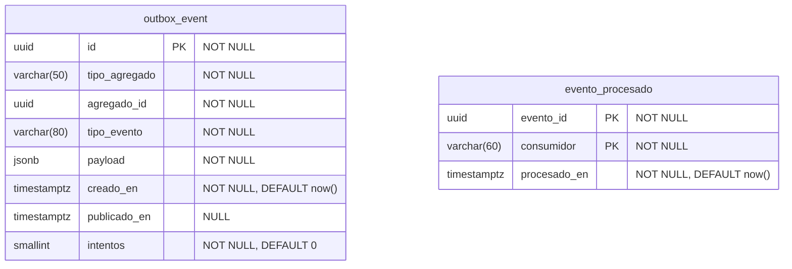

## Índice

0. [Ficha del proyecto](#0-ficha-del-proyecto)
1. [Descripción general del producto](#1-descripción-general-del-producto)
2. [Arquitectura del sistema](#2-arquitectura-del-sistema)
3. [Modelo de datos](#3-modelo-de-datos)
4. [Especificación de la API](#4-especificación-de-la-api)
5. [Historias de usuario](#5-historias-de-usuario)
6. [Tickets de trabajo](#6-tickets-de-trabajo)
7. [Pull requests](#7-pull-requests)

---

## 0. Ficha del proyecto

### **0.1. Tu nombre completo:**
Omar Andrés Álvarez Cardozo
### **0.2. Nombre del proyecto:**
JobFlash
### **0.3. Descripción breve del proyecto:**
El proyecto consiste en desarrollar una plataforma de software que conecta a empleadores con personas disponibles para trabajar de inmediato y dispuestas a desplazarse hasta el lugar de trabajo, incluso desde otra ciudad. Combina dos modelos conocidos: la red de perfiles profesionales y ofertas de empleo, al estilo de LinkedIn, y la conexión en tiempo real entre oferta y demanda, al estilo de Uber.
El empleador publica una necesidad (un empleo o un servicio puntual), el sistema identifica a los aspirantes con las habilidades requeridas y disponibilidad, les envía una notificación y ambas partes pueden establecer contacto y coordinar el desplazamiento. Las habilidades de cada aspirante se respaldan con certificaciones y mecanismos de verificación, para que el empleador contrate con confianza.
### **0.4. URL del proyecto:**
https://github.com/Omar-Usb/AI4Devs-finalproject

### 0.5. URL o archivo comprimido del repositorio

> Puedes tenerlo alojado en público o en privado, en cuyo caso deberás compartir los accesos de manera segura. Puedes enviarlos a [alvaro@lidr.co](mailto:alvaro@lidr.co) usando algún servicio como [onetimesecret](https://onetimesecret.com/). También puedes compartir por correo un archivo zip con el contenido


---------------

## 1. Descripción general del producto
Descripción del Proyecto: Plataforma de Conexión Laboral con Movilidad

Nombre provisional: JobFlash


JobFlash es un sistema de software (aplicación web y aplicación móvil) que conecta a empleadores, sean empresas o personas naturales, con personas que buscan trabajo y que están disponibles para desplazarse hasta el lugar donde se necesita el servicio, incluso si viven en otra ciudad.

La plataforma combina dos modelos conocidos:

El modelo de red profesional (como LinkedIn): los aspirantes crean un perfil con su experiencia, sus habilidades (skills) y sus certificaciones. Los empleadores publican vacantes, buscan perfiles y revisan hojas de vida.
El modelo de servicio bajo demanda (como Uber): cuando un empleador necesita personal de forma inmediata o para una fecha concreta, el sistema busca aspirantes disponibles que cumplan el perfil y les envía una notificación en tiempo real. Ellos pueden aceptar, y las dos partes se contactan para coordinar el desplazamiento y el inicio del trabajo.

El elemento que diferencia la plataforma es la veracidad de la información: cada skill que registra un aspirante puede respaldarse con certificaciones y pasar por mecanismos de verificación. Así el empleador puede buscar por skills y confiar en lo que ve.

Planteamiento del problema:
Los portales de empleo tradicionales sirven para procesos de selección largos, pero no resuelven la necesidad de conseguir personal calificado en horas o pocos días.
Las aplicaciones de servicios bajo demanda resuelven la inmediatez, pero suelen cubrir pocos oficios y no muestran de forma confiable la formación ni la experiencia del trabajador.
Muchos trabajadores calificados (técnicos, operarios, personal de salud, logística, eventos, construcción, agro, etc.) están dispuestos a viajar a otra ciudad por un trabajo, pero no tienen un canal para que los encuentren.
Los empleadores no pueden comprobar con facilidad que un certificado o una experiencia declarada sea real, lo que genera desconfianza y costos de verificación.
Las personas naturales que necesitan contratar un servicio puntual no tienen herramientas para hacerlo de forma formal y segura.

### 1.1. Objetivos
#### 1.1.1 Objetivo general

Desarrollar un sistema de información que permita a empleadores (empresas o personas naturales) encontrar, verificar y contactar en tiempo real a aspirantes calificados y disponibles para desplazarse al lugar de trabajo, incluso entre ciudades. El sistema integrará funciones de red profesional, de solicitud de servicios bajo demanda y de verificación de competencias.

#### 1.1.2 Objetivos específicos
Diseñar un módulo de registro y gestión de empleadores que distinga entre empresa (persona jurídica) y persona natural.
Diseñar un módulo de registro de aspirantes donde puedan publicar su perfil, sus skills, sus certificaciones, su experiencia y su disponibilidad geográfica.
Implementar mecanismos de verificación de identidad, de certificaciones y de experiencia que asignen un nivel de confianza a cada skill.
Construir un motor de búsqueda y emparejamiento (matching) que filtre por skills, nivel de verificación, ubicación, disposición a viajar, disponibilidad y reputación.
Implementar un sistema de notificaciones en tiempo real tipo "solicitud de servicio", en el que el aspirante pueda aceptar o rechazar una oferta.
Proveer canales de comunicación seguros (chat interno y llamada enmascarada) para coordinar el desplazamiento y las condiciones del trabajo.
Implementar un sistema de calificaciones y reputación de doble vía.
Garantizar la protección de datos personales conforme a la normativa vigente.
### 1.2. Alcance
#### 1.2.1 Incluido en el alcance
Aplicación web para empleadores y administradores.
Aplicación móvil (Android y iOS) para aspirantes y empleadores.
Registro, autenticación y gestión de perfiles.
Gestión de skills, certificaciones y verificación.
Publicación de vacantes tradicionales y de solicitudes inmediatas.
Búsqueda avanzada de perfiles y motor de matching.
Notificaciones push, por correo y dentro de la aplicación.
Chat interno entre empleador y aspirante.
Geolocalización, cálculo de distancias y estimación de tiempos de desplazamiento.
Registro de llegada (check-in) y de finalización del servicio.
Calificaciones y reseñas mutuas.
Panel de administración y moderación.
Reportes y estadísticas básicas.
### 1.2.2 Fuera del alcance (versión inicial)
Venta de pasajes o reservas de transporte y hospedaje dentro de la plataforma (se puede integrar en fases posteriores).
Liquidación de nómina y pago de seguridad social del trabajador.
Contratos laborales con validez legal firmados electrónicamente (fase posterior).
Pruebas psicotécnicas avanzadas.
### 1.3 Actores del sistema
+------------------------+--------------------------------------------------------+
| ACTOR                  | DESCRIPCIÓN                                            |
+------------------------+--------------------------------------------------------+
| Aspirante              | Persona que busca empleo o quiere prestar un servicio. |
|                        | Registra su perfil, skills y disponibilidad.           |
+------------------------+--------------------------------------------------------+
| Empleador Empresa      | Persona jurídica registrada con NIT. Puede tener       |
|                        | varios usuarios internos (reclutadores).               |
+------------------------+--------------------------------------------------------+
| Empleador Persona      | Persona natural que necesita contratar un trabajo o    |
| Natural                | servicio puntual.                                      |
+------------------------+--------------------------------------------------------+
| Reclutador             | Usuario que pertenece a una empresa y gestiona         |
|                        | vacantes y búsquedas en nombre de ella.                |
+------------------------+--------------------------------------------------------+
| Verificador            | Usuario interno o aliado que revisa documentos y       |
|                        | valida certificaciones.                                |
+------------------------+--------------------------------------------------------+
| Entidad Certificadora  | Institución externa (universidad, SENA, gremio, etc.)  |
| (externa)              | que confirma la validez de un certificado.             |
+------------------------+--------------------------------------------------------+
| Administrador          | Gestiona la plataforma, usuarios, catálogos, reportes  |
|                        | y resolución de disputas.                              |
+------------------------+--------------------------------------------------------+
### 1.4. Diagrama de contexto
                       +-----------------------------------+
                       |                                   |
  +--------------+     |                                   |     +--------------+
  |  EMPLEADOR   |<--->|           JobFlash.               |<--->|  ASPIRANTE   |
  | Empresa o    |     |                                   |     | (trabajador) |
  | Persona Nat. |     |  Perfiles - Skills - Verificación |     +--------------+
  +--------------+     |  Matching - Notificaciones - Chat |
                       |  Desplazamiento - Reputación      |
                       |                                   |
                       +-----------------------------------+
                          ^          ^          ^        ^
                          |          |          |        |
          +---------------+    +-----+----+  +--+-----+  +-------------+
          |                    |          |  |        |                |
  +---------------+   +----------------+ +-----------+ +----------------+
  | Entidades     |   | Servicios de   | | Servicios | | Administrador  |
  | certificadoras|   | mapas y        | | de notif. | | / Verificador  |
  | (validación)  |   | geolocalización| | push/SMS  | |                |
  +---------------+   +----------------+ +-----------+ +----------------+
### 1.5. Descripción de los módulos
#### 1.5.1 Módulo de Empleadores

Permite que un empleador se registre y gestione sus necesidades de personal.

Tipos de registro:

Empresa: razón social, NIT, certificado de existencia y representación legal, sector económico, dirección, sedes, representante legal y usuarios reclutadores.
Persona natural: nombre, documento de identidad, teléfono, dirección y verificación de identidad.

Funcionalidades:

Crear y editar el perfil del empleador (logo, descripción, sedes).
Verificación del empleador (validación del NIT o del documento) para generar confianza en los aspirantes.
Gestionar usuarios internos con roles (solo empresas).
Definir perfiles requeridos: elegir skills de un catálogo, nivel mínimo de verificación, años de experiencia y certificaciones obligatorias.
Publicar ofertas en dos modalidades:
Vacante tradicional: proceso con postulaciones, revisión de hojas de vida y selección (estilo LinkedIn).
Solicitud inmediata o programada: se necesita una o varias personas para una fecha, hora y lugar concretos, con notificación en tiempo real a los candidatos (estilo Uber).
Indicar las condiciones del desplazamiento: si cubre el transporte, viáticos u hospedaje, o si el aspirante debe asumirlos.
Buscar perfiles directamente por skills y enviar invitaciones.
Guardar candidatos favoritos y listas de talento.
Ver la información verificada del aspirante y sus soportes.
Calificar al aspirante al terminar el trabajo.

#### 1.5.2 Módulo de Aspirantes

Permite que una persona se registre y muestre su perfil laboral.

Funcionalidades:

Registro con correo o teléfono y validación por código (OTP).
Verificación de identidad: foto del documento y selfie con prueba de vida.
Perfil profesional: foto, presentación, experiencia laboral, formación académica, idiomas y referencias.
Registro de skills: elegir del catálogo, indicar nivel (básico, intermedio, avanzado, experto) y años de experiencia, y adjuntar soportes.
Carga de certificaciones (PDF, imagen, enlace o código de verificación).
Disponibilidad:
Estado "Disponible ahora" (activar o desactivar, como un conductor de Uber).
Calendario de disponibilidad por días y horarios.
Ciudad de residencia y ciudades o radio en kilómetros a los que está dispuesto a viajar.
Disposición a pernoctar fuera de su ciudad.
Medio de transporte propio (si aplica).
Expectativa de remuneración (por hora, por día, por servicio o mensual).
Recibir notificaciones de solicitudes que coinciden con su perfil y aceptarlas o rechazarlas.
Postularse a vacantes tradicionales.
Historial de trabajos realizados y calificaciones recibidas.
Calificar al empleador al terminar el trabajo.

#### 1.5.3 Módulo de Skills y Verificación (veracidad)

Es el núcleo de confianza de la plataforma. Cada skill de un aspirante tiene un nivel de verificación que el empleador puede ver y usar como filtro.

+--------+---------------------------+---------------------------------------------+
| NIVEL  | NOMBRE                    | CÓMO SE OBTIENE                             |
+--------+---------------------------+---------------------------------------------+
|   0    | Declarado                 | El aspirante registra el skill sin soporte. |
+--------+---------------------------+---------------------------------------------+
|   1    | Identidad verificada      | La identidad de la persona fue validada     |
|        |                           | (documento + selfie con prueba de vida).    |
+--------+---------------------------+---------------------------------------------+
|   2    | Soporte documental        | Se cargó un certificado y un verificador    |
|        |                           | revisó que fuera coherente y legible.       |
+--------+---------------------------+---------------------------------------------+
|   3    | Validado con la fuente    | La entidad emisora confirmó el certificado  |
|        |                           | (código QR, API, consulta pública o correo  |
|        |                           | institucional), o un empleador anterior     |
|        |                           | confirmó la experiencia.                    |
+--------+---------------------------+---------------------------------------------+
|   4    | Comprobado en plataforma  | El aspirante aprobó una prueba práctica o   |
|        |                           | teórica en la plataforma, o tiene trabajos  |
|        |                           | calificados positivamente con ese skill.    |
+--------+---------------------------+---------------------------------------------+

Mecanismos de veracidad propuestos:

Verificación de identidad: foto del documento y selfie con prueba de vida, con comparación facial automática.
Revisión documental: detección de alteraciones en documentos (metadatos, inconsistencias) y revisión manual por un verificador.
Validación con la fuente: lectura de códigos QR o de verificación en certificados, integración con portales de consulta de entidades educativas cuando existan, y envío de solicitud de confirmación a la entidad emisora.
Referencias laborales confirmadas: el aspirante indica un contacto de un empleo anterior; el sistema le envía un formulario de confirmación.
Evaluaciones en plataforma: pruebas cortas por skill (teóricas o con evidencia en video o fotos de trabajos realizados).
Reputación acumulada: cada trabajo terminado y bien calificado refuerza el skill usado.
Avales cruzados: empleadores que contrataron a la persona pueden avalar skills concretos.
Vigencia: las certificaciones con fecha de vencimiento (por ejemplo, trabajo en alturas o manipulación de alimentos) se marcan como vencidas y se notifica al aspirante para que las renueve.
Sanciones: si se detecta un documento falso, el perfil se suspende y el caso queda registrado.

#### 1.5.4 Módulo de Búsqueda y Matching
Búsqueda de perfiles por: skill (uno o varios), nivel de verificación mínimo, nivel de dominio, años de experiencia, ciudad actual, disposición a viajar a la ciudad del trabajo, disponibilidad en la fecha, calificación promedio y rango de remuneración.
Motor de emparejamiento que calcula una puntuación de compatibilidad para ordenar los candidatos:
  PUNTUACIÓN = (Coincidencia de skills      x  peso_1)
             + (Nivel de verificación        x  peso_2)
             + (Reputación / calificación    x  peso_3)
             + (Cercanía o tiempo de viaje   x  peso_4)
             + (Disponibilidad en la fecha   x  peso_5)
             + (Tasa de aceptación histórica x  peso_6)

  Los pesos son configurables por el administrador y pueden ajustarse
  según el tipo de oferta (inmediata o tradicional).

#### 1.5.5 Módulo de Solicitudes en Tiempo Real (modelo tipo Uber)

Es la funcionalidad que diferencia el sistema. Funciona así:

El empleador crea una solicitud: skills requeridos, cantidad de personas, lugar (dirección y coordenadas), fecha y hora de inicio, duración estimada, remuneración y condiciones de desplazamiento.
El sistema identifica a los aspirantes compatibles que están disponibles y que pueden llegar a tiempo, incluso desde otras ciudades.
Envía notificaciones por oleadas: primero a los mejor puntuados y más cercanos; si no hay suficientes aceptaciones en el tiempo límite, amplía el radio y la lista.
El aspirante ve un resumen de la oferta (lugar, pago, duración, ayuda de transporte, calificación del empleador) y la acepta o la rechaza dentro de un tiempo límite.
El empleador recibe la lista de quienes aceptaron, revisa los perfiles y confirma. Opcionalmente puede configurar la asignación automática al primero que acepte.
Se abre un canal de comunicación (chat y llamada enmascarada) para coordinar el viaje.
El aspirante marca "En camino" y puede compartir su ubicación de forma temporal y voluntaria hasta llegar.
Al llegar hace check-in por geolocalización (o con código QR del empleador).
Al terminar, ambas partes confirman la finalización y se califican.

#### 1.5.6 Módulo de Desplazamiento y Logística
Ubicación en el mapa en tiempo real del aspirante y el lugar de trabajo.
Ingreso aproximado del tiempo estimado de viaje entre la ciudad del aspirante y el lugar del trabajo.
Indicación de quién asume el transporte, la alimentación y el hospedaje.
Registro del auxilio de desplazamiento acordado.
Seguimiento opcional del trayecto ("En camino", "Llegué").
Información de referencia sobre rutas y medios de transporte (sin venta de pasajes en la versión inicial).
Botón de emergencia y opción de compartir el viaje con un contacto de confianza.

#### 1.5.7 Módulo de Comunicación
Chat interno entre empleador y aspirante, habilitado solo después de un match o una invitación aceptada.
Llamadas enmascaradas, para no exponer los números personales.
Envío de ubicación, documentos e imágenes dentro del chat.
Plantillas de mensajes rápidos.
Registro de conversaciones como soporte en caso de disputas.

#### 1.5.8 Módulo de Calificaciones y Reputación
Calificación de 1 a 5 estrellas con comentario, de doble vía (empleador a aspirante y aspirante a empleador).
Criterios específicos: puntualidad, calidad del trabajo, actitud, cumplimiento del pago y condiciones ofrecidas.
Insignias (por ejemplo, "Puntual", "Top en su skill", "Empleador confiable").
Indicadores: tasa de aceptación, tasa de cancelación y trabajos completados.
Reporte de comportamientos inadecuados.

#### 1.5.9 Módulo de Notificaciones
Notificaciones push en el celular para solicitudes inmediatas.
Correo electrónico y SMS como respaldo.
Notificaciones dentro de la aplicación (bandeja de mensajes).
Preferencias configurables por el usuario (horarios y tipos de aviso).

#### 1.5.10 Módulo de Pagos (opcional, fase posterior)
Pago del servicio a través de la plataforma con pasarela de pagos.
Retención del dinero hasta confirmar la finalización (custodia o escrow).
Comisión de la plataforma.
Historial de pagos y comprobantes.

#### 1.5.11 Módulo de Administración
Gestión de usuarios, roles y permisos.
Gestión del catálogo de skills, categorías y certificaciones reconocidas.
Cola de verificación de documentos.
Moderación de perfiles, ofertas y reseñas.
Gestión de reportes y disputas.
Configuración de parámetros (pesos del matching, tiempos límite, radios de búsqueda).
Tablero de estadísticas e indicadores.

### 1.6. Diagrama de módulos
+==============================================================================+
|                                JobFlash                                      |
+==============================================================================+
|                                                                              |
|  +------------------+   +------------------+   +--------------------------+  |
|  |   EMPLEADORES    |   |    ASPIRANTES    |   |  SKILLS Y VERIFICACIÓN   |  |
|  | - Registro       |   | - Registro       |   | - Catálogo de skills     |  |
|  | - Perfil empresa |   | - Perfil laboral |   | - Certificaciones        |  |
|  | - Reclutadores   |   | - Skills         |   | - Niveles de confianza   |  |
|  | - Ofertas        |   | - Disponibilidad |   | - Validación con fuente  |  |
|  +--------+---------+   +--------+---------+   +------------+-------------+  |
|           |                      |                          |                |
|           +----------------------+--------------------------+                |
|                                  |                                           |
|                    +-------------v--------------+                            |
|                    |   BÚSQUEDA Y MATCHING      |                            |
|                    +-------------+--------------+                            |
|                                  |                                           |
|        +-------------------------+--------------------------+                |
|        |                         |                          |                |
|  +-----v-------------+  +--------v----------+  +------------v-----------+    |
|  | SOLICITUDES EN    |  |  COMUNICACIÓN     |  |  DESPLAZAMIENTO Y      |    |
|  | TIEMPO REAL       |  | - Chat            |  |  LOGÍSTICA             |    |
|  | - Oleadas         |  | - Llamada         |  | - Distancias           |    |
|  | - Aceptar/Rechaz. |  |   enmascarada     |  | - Check-in             |    |
|  +-------------------+  +-------------------+  +------------------------+    |
|                                                                              |
|  +-------------------+  +-------------------+  +------------------------+    |
|  | CALIFICACIONES Y  |  |  NOTIFICACIONES   |  |  PAGOS (fase futura)   |    |
|  | REPUTACIÓN        |  |                   |  |                        |    |
|  +-------------------+  +-------------------+  +------------------------+    |
|                                                                              |
|  +------------------------------------------------------------------------+  |
|  |                         ADMINISTRACIÓN                                 |  |
|  +------------------------------------------------------------------------+  |
+==============================================================================+


---

## 2. Arquitectura del Sistema
### 2.1. Diagrama de arquitectura:
#### 2.1.1. Vista general (contenedores y tecnologías)
 +------------------------------------------------------------------------------+
 |                                  CLIENTES                                    |
 |                                                                              |
 |  +---------------------------+   +---------------------------+               |
 |  | Web App (React + TS)      |   | App móvil / PWA (React)   |               |
 |  | Empleador / Reclutador /  |   | Aspirante / Empleador     |               |
 |  | Administrador             |   | persona natural           |               |
 |  | Leaflet + react-leaflet   |   | Leaflet + Geolocation API |               |
 |  +-------------+-------------+   +-------------+-------------+               |
 +----------------|-------------------------------|-----------------------------+
                  |   HTTPS (REST) + WSS (WebSocket) / OIDC + PKCE
                  v                               v
 +------------------------------------------------------------------------------+
 |  EDGE                                                                        |
 |  +-------------------+    +--------------------------------------------+     |
 |  | Keycloak (IAM)    |<-->| API Gateway (Kong OSS)                     |     |
 |  | OIDC / OAuth 2.0  |    | Validación JWT, rate limit, CORS, routing  |     |
 |  +-------------------+    +---------------------+----------------------+     |
 +-------------------------------------------------|----------------------------+
                                                   |
     +----------+----------+----------+----------+-+--------+----------+
     |          |          |          |          |          |          |
     v          v          v          v          v          v          v
 +--------+ +--------+ +--------+ +--------+ +--------+ +--------+ +--------+
 |ms-     | |ms-     | |ms-     | |ms-     | |ms-     | |ms-     | |ms-     |
 |perfiles| |skills  | |ofertas | |matching| |notifica| |mensaje-| |reputa- |
 |        | |verific.| |        | |        | |ciones  | |ria     | |cion    |
 +---+----+ +---+----+ +---+----+ +---+----+ +---+----+ +---+----+ +---+----+
     |          |          |          |          |          |          |
     |          |          |          |          |          |          |
     |          |          |          |          |          |          |
 +---v----------v----------v----------v----------v----------v----------v--------+
 |                    BUS DE EVENTOS: Apache Kafka (SmallRye)                   |
 +------------------------------------------------------------------------------+
     |          |          |          |          |          |          |
 +---v----------v----------v----------v----------v----------v----------v--------+
 |  DATOS                                                                       |
 |  +----------------------------------+  +------------+  +------------------+  |
 |  | PostgreSQL 16 + PostGIS          |  | Redis      |  | MinIO (S3)       |  |
 |  | 1 base de datos por microservicio|  | presencia, |  | certificados y   |  |
 |  | (db_perfiles, db_ofertas, ...)   |  | caché, TTL |  | documentos       |  |
 |  +----------------------------------+  +------------+  +------------------+  |
 +------------------------------------------------------------------------------+
     |                                                       |
 +---v-------------------------------------------------------v------------------+
 |  SERVICIOS EXTERNOS                                                          |
 |  Teselas de mapa (OSM/MapTiler) | Geocodificación (Nominatim/Photon)         |
 |  Rutas y ETA (OSRM/OpenRouteService) | FCM (push) | SMTP | SMS | Biometría   |
 +------------------------------------------------------------------------------+

  * Cada ms-*: Java 21 + Quarkus + Clean Architecture, con su propia base de datos.

#### 2.1.2. Arquitectura interna de cada microservicio (Clean Architecture)

La estructura es la que propone Bancolombia en Clean Architecture: aislando los detalles y en su plugin Scaffold Clean Architecture: un proyecto Gradle multimódulo con tres capas (Dominio, Infraestructura y Aplicación). Las dependencias apuntan siempre hacia el dominio.

 +==========================================================================+
 |  APLICACIÓN  (applications/app-service)  -- único módulo con Quarkus     |
 |  Arranque, configuración, ensamblado (CDI @Produces de casos de uso)     |
 +==========================================================================+
        |  conoce a todos los módulos y los compone
        v
 +--------------------------------------------------------------------------+
 |  INFRAESTRUCTURA                                                         |
 |                                                                          |
 |  entry-points/                          driven-adapters/                 |
 |  +----------------------------+         +-----------------------------+  |
 |  | rest-api (Quarkus REST)    |         | postgres-repository         |  |
 |  | websocket (WebSockets Next)|         |   (Hibernate ORM + Panache) |  |
 |  | kafka-consumer             |         | kafka-producer (outbox)     |  |
 |  | DTO <-> modelo de dominio  |         | rest-client (REST Client)   |  |
 |  +-------------+--------------+         | redis-adapter / s3-adapter  |  |
 |                |                        +--------------+--------------+  |
 |  helpers/  (utilidades transversales: mapeo, logging, etc.)              |
 +----------------|---------------------------------------|-----------------+
                  | invoca                                | implementa
                  v                                       v
 +--------------------------------------------------------------------------+
 |  DOMINIO  (Java puro, sin dependencias de framework)                     |
 |                                                                          |
 |  domain/usecase   ---- usa ---->   domain/model                          |
 |  CrearSolicitudUseCase             Solicitud, Ubicacion, SkillRequerido  |
 |  ResponderSolicitudUseCase         gateways/ (puertos = interfaces)      |
 |                                      SolicitudRepository                 |
 |                                      EventPublisher                      |
 +--------------------------------------------------------------------------+

  Regla de dependencia:
  app-service --> entry-points --> usecase --> model <-- driven-adapters
#### 2.1.3. Comunicación entre servicios (síncrona y por eventos)
  SÍNCRONO (REST, solo consultas del cliente a través del Gateway)
  ----------------------------------------------------------------
  Cliente --> Gateway --> ms-X        (no hay cadenas REST entre microservicios
                                       en los flujos críticos)

  ASÍNCRONO (Kafka, patrón Transactional Outbox)
  ----------------------------------------------
   PRODUCTOR              TÓPICO                         CONSUMIDORES
   -----------            ----------------------------   ----------------------
   ms-perfiles     -->    perfil.actualizado        -->  ms-matching
   ms-perfiles     -->    disponibilidad.cambiada   -->  ms-matching
   ms-skills       -->    skill.verificado          -->  ms-matching, ms-perfiles
   ms-ofertas      -->    solicitud.creada          -->  ms-matching
   ms-matching     -->    candidatos.seleccionados  -->  ms-notificaciones,
                                                         ms-ofertas
   ms-ofertas      -->    solicitud.respondida      -->  ms-matching,
                                                         ms-notificaciones
   ms-ofertas      -->    servicio.finalizado       -->  ms-reputacion,
                                                         ms-mensajeria
   ms-reputacion   -->    reputacion.actualizada    -->  ms-matching

  Outbox: el caso de uso guarda la entidad y el evento en la misma transacción
  de PostgreSQL (tabla outbox_event). Un publicador lo envía a Kafka después.
  Así se garantiza al menos una entrega sin transacciones distribuidas. Los
  consumidores son idempotentes (tabla processed_event con el event_id).
#### 2.1.4. Patrones aplicados y justificación
+-----------------------------+------------------------------------------------------+
| PATRÓN                      | POR QUÉ SE ELIGE                                     |
+-----------------------------+------------------------------------------------------+
| Microservicios              | Los dominios evolucionan y escalan distinto: el      |
|                             | matching y las notificaciones tienen picos en tiempo |
|                             | real; perfiles y skills tienen carga transaccional   |
|                             | estable.                                             |
+-----------------------------+------------------------------------------------------+
| Clean Architecture          | Aísla las reglas de negocio (verificación, matching, |
| (hexagonal / puertos y      | estados de la solicitud) de los detalles técnicos.   |
| adaptadores)                | Se puede cambiar Kafka, el proveedor de mapas o el   |
|                             | de biometría sin tocar el dominio.                   |
+-----------------------------+------------------------------------------------------+
| Event-Driven + Outbox       | Desacopla los servicios y permite el flujo "por      |
|                             | oleadas" sin bloqueos. Tolera la caída temporal de   |
|                             | un consumidor.                                       |
+-----------------------------+------------------------------------------------------+
| Database per Service        | Cada servicio es dueño de sus datos; se evita el     |
|                             | acoplamiento por esquema compartido.                 |
+-----------------------------+------------------------------------------------------+
| API Gateway                 | Un único punto de entrada para autenticación, límite |
|                             | de peticiones, CORS y enrutamiento.                  |
+-----------------------------+------------------------------------------------------+
| CQRS ligero (ms-matching)   | ms-matching mantiene una proyección de lectura       |
|                             | (perfil + skills + ubicación + reputación) indexada  |
|                             | con PostGIS, alimentada por eventos, para búsquedas  |
|                             | rápidas.                                             |
+-----------------------------+------------------------------------------------------+

Beneficios principales

Escalado selectivo: solo se replican ms-matching, ms-notificaciones y ms-mensajeria en horas pico.
Dominio testeable y estable: los módulos model y usecase son Java puro y se prueban sin levantar Quarkus, base de datos ni Kafka.
Rendimiento y costo: Quarkus arranca rápido y consume poca memoria (y menos aún con compilación nativa). Con Java 21 y los hilos virtuales (@RunOnVirtualThread) se puede escribir código imperativo, más simple que el reactivo, con alta concurrencia de E/S.
Resiliencia: si ms-notificaciones falla, las solicitudes se siguen creando y los eventos esperan en Kafka.
Sin licencias de pago: todo el stack (PostgreSQL/PostGIS, Kafka, Keycloak, Kong OSS, Leaflet, MinIO, Redis) es de código abierto.

Sacrificios y déficits

Complejidad operativa: más piezas que desplegar y monitorear. Exige Kubernetes, observabilidad distribuida y CI/CD maduro desde el inicio.
Consistencia eventual: por ejemplo, un skill recién verificado tarda unos segundos en aparecer en las búsquedas.
Más código repetitivo: se necesitan mapeadores DTO, dominio y entidad, y una interfaz por cada puerto.
Sin generador para Quarkus: el scaffold de Bancolombia solo genera proyectos con Spring Boot o WebFlux. La estructura de módulos se replica a mano (o con una plantilla propia) y se valida con pruebas de ArchUnit.
Curva de aprendizaje: el equipo debe dominar Quarkus, Kafka, PostGIS y OIDC.
Recomendación: para el MVP se puede arrancar con menos servicios (por ejemplo, fusionar ms-perfiles con ms-skills-verificacion) y separarlos después, ya que la estructura en capas facilita esa separación.

### 2.2. Descripción de componentes principales:
Frontend
+--------------------------+---------------------------------------------------------+
| COMPONENTE               | TECNOLOGÍA Y RESPONSABILIDAD                            |
+--------------------------+---------------------------------------------------------+
| Web App                  | React 18+ con TypeScript y Vite. React Router           |
|                          | (navegación), TanStack Query (caché y estado del        |
|                          | servidor), React Hook Form + Zod (formularios y         |
|                          | validación), oidc-client-ts (login OIDC con PKCE).      |
+--------------------------+---------------------------------------------------------+
| App móvil                | MVP como PWA (misma base React, instalable, Web Push y  |
|                          | Geolocation API). Si se requiere seguimiento en segundo |
|                          | plano, se migra a React Native reutilizando hooks y     |
|                          | clientes de API.                                        |
+--------------------------+---------------------------------------------------------+
| Componente GIS           | Leaflet + react-leaflet (ver recomendación abajo).      |
+--------------------------+---------------------------------------------------------+
| Tiempo real              | Cliente WebSocket nativo con reconexión automática para |
|                          | ofertas entrantes, chat y estado "En camino".           |
+--------------------------+---------------------------------------------------------+

Recomendación GIS: Leaflet + react-leaflet

Por qué: es gratuita (BSD-2), liviana (unos 40 KB), muy madura, con amplia documentación y miles de plugins. Funciona en todos los navegadores, también en móviles. react-leaflet la expone como componentes React (<MapContainer>, <Marker>, <Circle>), así que la integración es directa.
Uso en el sistema: ubicación del trabajo al crear la solicitud, radio de búsqueda (<Circle>), agrupación de candidatos (react-leaflet-cluster) y seguimiento del aspirante "En camino".
Mapas base (teselas): en desarrollo se pueden usar las teselas de OpenStreetMap, pero su política de uso no permite tráfico de producción intensivo. En producción hay dos opciones: un proveedor con plan gratuito (MapTiler o Stadia Maps) o un servidor propio de teselas. Para Leaflet solo cambia la URL de la capa.
Servicios complementarios gratuitos: geocodificación con Nominatim o Photon (alojados por el proyecto, porque la instancia pública limita las peticiones) y rutas y tiempos de viaje con OSRM u OpenRouteService.
Alternativa: MapLibre GL JS, si más adelante se necesitan teselas vectoriales, mapas 3D o estilos avanzados. Es más potente, pero también más compleja.
tsx
// Ejemplo: ubicación del trabajo y radio de búsqueda
<MapContainer center={[4.711, -74.072]} zoom={12} className="h-96">
  <TileLayer url={import.meta.env.VITE_TILES_URL} attribution="© OpenStreetMap" />
  <Marker position={trabajo} />
  <Circle center={trabajo} radius={radioKm * 1000} />
</MapContainer>
Backend (microservicios Java 21 + Quarkus)
+-------------------------+-----------------------------------------------------------+
| MICROSERVICIO           | RESPONSABILIDAD                                           |
+-------------------------+-----------------------------------------------------------+
| ms-perfiles             | Aspirantes y empleadores (empresa o persona natural),     |
|                         | reclutadores, disponibilidad, ciudades destino y estado   |
|                         | "Disponible ahora".                                       |
+-------------------------+-----------------------------------------------------------+
| ms-skills-verificacion  | Catálogo de skills, skills del aspirante, certificaciones |
|                         | (en MinIO), niveles de verificación 0-4, cola del         |
|                         | verificador, vigencias y validación con la fuente.        |
+-------------------------+-----------------------------------------------------------+
| ms-ofertas              | Vacantes tradicionales, postulaciones y solicitudes       |
|                         | inmediatas con su máquina de estados (PUBLICADA ->        |
|                         | NOTIFICANDO -> ASIGNADA -> EN_CURSO -> FINALIZADA).       |
+-------------------------+-----------------------------------------------------------+
| ms-matching             | Proyección de lectura con PostGIS, cálculo de puntuación, |
|                         | selección por oleadas y ampliación del radio.             |
|                         | Calcula tiempos de viaje con OSRM.                        |
+-------------------------+-----------------------------------------------------------+
| ms-notificaciones       | Push (FCM / Web Push), correo, SMS y WebSocket.           |
|                         | Preferencias del usuario y reintentos.                    |
+-------------------------+-----------------------------------------------------------+
| ms-mensajeria           | Chat entre las partes (WebSockets Next), habilitado solo  |
|                         | con match confirmado. Historial como soporte de disputas. |
+-------------------------+-----------------------------------------------------------+
| ms-reputacion           | Calificaciones de doble vía, insignias, tasas de          |
|                         | aceptación y cancelación.                                 |
+-------------------------+-----------------------------------------------------------+

Extensiones de Quarkus comunes a todos los servicios:

quarkus-rest + quarkus-rest-jackson: API REST.
quarkus-hibernate-orm-panache + quarkus-jdbc-postgresql: persistencia.
quarkus-flyway: migraciones de base de datos.
quarkus-messaging-kafka: eventos.
quarkus-oidc: validación de tokens.
quarkus-smallrye-health, quarkus-micrometer-registry-prometheus y quarkus-opentelemetry: observabilidad.
quarkus-smallrye-fault-tolerance: @Retry, @CircuitBreaker y @Timeout.
quarkus-hibernate-validator: validación de entradas.
Datos
PostgreSQL 16: una base de datos por servicio dentro del mismo clúster gestionado en el MVP. Cada servicio tiene su propio usuario, sin acceso a las bases de los demás.
PostGIS (en db_matching y db_ofertas): columnas geography(Point,4326) con índice GiST. Ejemplo de la consulta base del matching:
sql
SELECT c.aspirante_id, ST_Distance(c.ubicacion, :punto) AS distancia_m
FROM   candidato_proyeccion c
WHERE  c.disponible_ahora = true
  AND  c.skills @> :skills_requeridos            -- arreglo con índice GIN
  AND  c.nivel_verificacion_min >= :nivel_min
  AND  ST_DWithin(c.ubicacion, :punto, :radio_m)  -- índice GiST
ORDER  BY puntuacion DESC, distancia_m
LIMIT  :tamano_oleada;
Redis: presencia de los aspirantes conectados, estado efímero de cada oleada, caché del catálogo de skills y contadores para el límite de peticiones.
MinIO (compatible con S3): certificados y documentos, cifrados en reposo. Se accede solo mediante URLs prefirmadas de corta duración.
Plataforma
Keycloak: gestión de identidades. Roles: ASPIRANTE, EMPLEADOR, RECLUTADOR, VERIFICADOR y ADMIN.
Kong OSS: API Gateway.
Apache Kafka (modo KRaft): bus de eventos. El esquema de los eventos se documenta con AsyncAPI.
### 2.3. Descripción de alto nivel del proyecto y estructura de ficheros

Es un monorepositorio con el frontend, los microservicios y la infraestructura como código. Cada microservicio replica la estructura multimódulo del scaffold de Bancolombia (applications, domain, infrastructure, deployment), adaptada a Quarkus.

jobFlash/
|-- frontend/
|   `-- web-app/                       # React + TypeScript + Vite
|       |-- src/
|       |   |-- app/                   # Router, providers, configuración OIDC
|       |   |-- features/              # Organización por funcionalidad
|       |   |   |-- auth/
|       |   |   |-- perfil-aspirante/
|       |   |   |-- skills/
|       |   |   |-- ofertas/
|       |   |   |-- solicitudes-tiempo-real/
|       |   |   |-- mapa/              # Componentes Leaflet reutilizables
|       |   |   `-- chat/
|       |   |-- shared/                # UI común, hooks, cliente HTTP y WebSocket
|       |   `-- main.tsx
|       |-- tests/e2e/                 # Playwright
|       `-- Dockerfile                 # Build estático servido por Nginx
|
|-- services/
|   |-- ms-ofertas/                    # (todos los ms-* siguen esta estructura)
|   |   |-- applications/
|   |   |   `-- app-service/           # Único módulo con plugin Quarkus
|   |   |       |-- src/main/java/co/com/jobFlash/
|   |   |       |   |-- MainApplication.java
|   |   |       |   `-- config/UseCasesConfig.java   # @Produces de casos de uso
|   |   |       `-- src/main/resources/
|   |   |           |-- application.properties
|   |   |           `-- db/migration/                # Scripts Flyway V1__*.sql
|   |   |-- domain/
|   |   |   |-- model/                 # Entidades, objetos de valor y gateways
|   |   |   |   `-- src/main/java/co/com/jobFlash/model/
|   |   |   |       `-- solicitud/
|   |   |   |           |-- Solicitud.java
|   |   |   |           |-- EstadoSolicitud.java
|   |   |   |           `-- gateways/
|   |   |   |               |-- SolicitudRepository.java
|   |   |   |               `-- EventPublisher.java
|   |   |   `-- usecase/               # Casos de uso (Java puro)
|   |   |       `-- src/main/java/co/com/jobFlash/usecase/
|   |   |           |-- crearsolicitud/CrearSolicitudUseCase.java
|   |   |           `-- respondersolicitud/ResponderSolicitudUseCase.java
|   |   |-- infrastructure/
|   |   |   |-- entry-points/
|   |   |   |   |-- rest-api/          # Recursos Quarkus REST + DTOs
|   |   |   |   `-- kafka-consumer/    # @Incoming de eventos
|   |   |   |-- driven-adapters/
|   |   |   |   |-- postgres-repository/   # Panache, entidades JPA, mappers
|   |   |   |   `-- kafka-producer/        # Outbox + @Outgoing
|   |   |   `-- helpers/
|   |   |       `-- commons/           # Mapeo, manejo de errores, logging
|   |   |-- deployment/
|   |   |   `-- Dockerfile             # JVM o nativo (Mandrel)
|   |   |-- build.gradle
|   |   |-- main.gradle                # Convenciones comunes de los módulos
|   |   `-- settings.gradle
|   |-- ms-perfiles/
|   |-- ms-skills-verificacion/
|   |-- ms-matching/
|   |-- ms-notificaciones/
|   |-- ms-mensajeria/
|   `-- ms-reputacion/
|
|-- contracts/
|   |-- openapi/                       # Contratos REST por servicio
|   `-- asyncapi/                      # Contratos de eventos Kafka
|
|-- infra/
|   |-- docker-compose/                # Entorno local completo
|   |-- helm/                          # Chart base + values por servicio y entorno
|   |-- argocd/                        # Aplicaciones GitOps
|   `-- terraform/                     # Clúster, base de datos gestionada, red
|
|-- .github/workflows/                 # Pipelines CI/CD
`-- docs/                              # Documentación y ADRs

Notas de implementación con Quarkus:

domain/model y domain/usecase son módulos java-library sin dependencias de Quarkus ni de Jakarta. Los casos de uso se exponen como beans desde app-service/config/UseCasesConfig con @Produces @ApplicationScoped. Es el mismo papel que el scaffold asigna a app-service.
Los módulos de infrastructure sí usan anotaciones CDI. Para que Quarkus descubra sus beans en tiempo de compilación hay que generar un índice Jandex en cada módulo (con el plugin Jandex de Gradle) o declararlos con quarkus.index-dependency.*.
La regla de dependencia se verifica en el pipeline con ArchUnit (ver 2.6).
2.4. Infraestructura y despliegue
2.4.1. Diagrama de infraestructura
                               Internet
                                  |
                       +----------v-----------+
                       |  DNS + CDN / WAF     |   (Cloudflare u otro equivalente)
                       +----------+-----------+
                                  |
 +--------------------------------|------------------------------------------------+
 | NUBE (VPC)                     |                                                |
 |                    +-----------v-----------+                                    |
 |                    | Load Balancer (L7)    |                                    |
 |                    +-----------+-----------+                                    |
 |                                |                                                |
 |  +-----------------------------|----------------------------------------------+ |
 |  | KUBERNETES (gestionado)      v                                             | |
 |  |                                                                            | |
 |  |  ns: edge         [Ingress NGINX] -> [Kong Gateway x2] [Keycloak x2]       | |
 |  |                                                                            | |
 |  |  ns: frontend     [web-app (Nginx estático) x2]                            | |
 |  |                                                                            | |
 |  |  ns: services     [ms-perfiles x2]   [ms-skills x2]     [ms-ofertas x2]    | |
 |  |                   [ms-matching x2-6 HPA]   [ms-notificaciones x2-6 HPA]    | |
 |  |                   [ms-mensajeria x2-4 HPA] [ms-reputacion x2]              | |
 |  |                                                                            | |
 |  |  ns: messaging    [Kafka KRaft x3 (operador Strimzi)]  [Redis]             | |
 |  |                                                                            | |
 |  |  ns: observ.      [Prometheus] [Grafana] [Loki] [Tempo] [OTel Collector]   | |
 |  |                                                                            | |
 |  |  ns: geo          [OSRM] [Nominatim/Photon] (opcional: servidor teselas)   | |
 |  +----------------------------------------------------------------------------+ |
 |                                                                                 |
 |  SUBRED PRIVADA (sin acceso público)                                            |
 |  +-------------------------------------+  +-------------------------------+     |
 |  | PostgreSQL 16 + PostGIS gestionado  |  | Almacenamiento S3 / MinIO     |     |
 |  | Alta disponibilidad, backups, PITR  |  | Cifrado SSE, versionado       |     |
 |  +-------------------------------------+  +-------------------------------+     |
 |                                                                                 |
 |  Secret Manager / Vault   |   Registro de contenedores (GHCR)                   |
 +---------------------------------------------------------------------------------+

 Entornos: dev (local con docker-compose y Quarkus Dev Services) -> qa -> prod.
 Cada entorno es un namespace o clúster independiente.

### 2.4.2. Proceso de despliegue (CI/CD con GitOps)
  Desarrollador
      |  git push / Pull Request
      v
 +-------------------------------- CI: GitHub Actions ---------------------------+
 |  1. Detecta qué servicios cambiaron (filtro por ruta del monorepositorio)     |
 |  2. Build Gradle + pruebas unitarias + ArchUnit                               |
 |  3. Pruebas de integración (@QuarkusTest + Testcontainers)                    |
 |  4. Análisis estático y cobertura (SonarQube, umbral >= 80% en el dominio)    |
 |  5. Análisis de dependencias (OWASP Dependency-Check / Dependabot)            |
 |  6. Build de imagen (JVM o nativa) + escaneo de vulnerabilidades (Trivy)      |
 |  7. Firma de imagen (cosign) y push a GHCR con tag = SHA del commit           |
 |  8. Actualiza el tag de la imagen en infra/helm/values-<entorno>.yaml         |
 +-------------------------------------------------------------------------------+
      |  merge a main
      v
 +-------------------------------- CD: Argo CD ----------------------------------+
 |  9.  Detecta el cambio en el repositorio y sincroniza el clúster (qa)         |
 |  10. Flyway aplica las migraciones al iniciar el servicio                     |
 |  11. Pruebas de humo y E2E (Playwright) contra qa                             |
 |  12. Promoción a prod con aprobación manual (PR a values-prod)                |
 |  13. Rolling update con readiness/liveness (/q/health) y rollback             |
 |      automático si fallan los health checks                                   |
 +-------------------------------------------------------------------------------+
Migraciones compatibles hacia atrás: se usa el patrón expand/contract (primero se agregan columnas y estructuras, y lo viejo se elimina en un despliegue posterior) para no romper la versión anterior durante el rolling update.
Configuración: valores específicos de cada entorno en ConfigMaps. Los secretos se inyectan desde Vault o el Secret Manager, nunca desde el repositorio.

### 2.5. Seguridad
+----+-------------------------------+--------------------------------------------------+
| #  | PRÁCTICA                      | IMPLEMENTACIÓN                                   |
+----+-------------------------------+--------------------------------------------------+
| 1  | Autenticación centralizada    | Keycloak con OIDC. El frontend usa               |
|    |                               | Authorization Code + PKCE (sin secretos en el    |
|    |                               | navegador). Access token corto (5 min) y refresh |
|    |                               | token rotativo. MFA obligatorio para VERIFICADOR |
|    |                               | y ADMIN.                                         |
+----+-------------------------------+--------------------------------------------------+
| 2  | Validación de tokens en cada  | Kong valida el JWT y además cada servicio lo     |
|    | capa (zero trust)             | vuelve a validar con quarkus-oidc (firma,        |
|    |                               | emisor, audiencia y expiración).                 |
+----+-------------------------------+--------------------------------------------------+
| 3  | Autorización por rol y por    | @RolesAllowed en entry-points. La verificación de|
|    | propiedad del recurso         | propiedad ("solo el empleador dueño ve los       |
|    |                               | postulantes de su oferta") va en el caso de uso, |
|    |                               | porque es regla de negocio.                      |
+----+-------------------------------+--------------------------------------------------+
| 4  | Privacidad de la ubicación    | Antes del match solo se expone la distancia      |
|    |                               | aproximada, nunca coordenadas. El seguimiento en |
|    |                               | vivo se activa solo en estado EN_DESPLAZAMIENTO  |
|    |                               | y se borra al finalizar.                         |
+----+-------------------------------+--------------------------------------------------+
| 5  | Protección de datos           | Datos de contacto ocultos hasta el match y       |
|    | personales (Ley 1581 de 2012) | llamada enmascarada. Consentimiento registrado   |
|    |                               | con versión y fecha. Los datos biométricos se    |
|    |                               | tratan como sensibles. Derechos ARCO (acceso,    |
|    |                               | rectificación, cancelación y oposición) por      |
|    |                               | endpoint.                                        |
+----+-------------------------------+--------------------------------------------------+
| 6  | Cifrado                       | TLS 1.2+ en tránsito (incluido el tráfico        |
|    |                               | interno; opcional mTLS con un service mesh).     |
|    |                               | Cifrado en reposo en PostgreSQL y S3. Columnas   |
|    |                               | sensibles (número de documento) cifradas en la   |
|    |                               | aplicación.                                      |
+----+-------------------------------+--------------------------------------------------+
| 7  | Gestión de documentos         | Carga directa a S3 con URL prefirmada (PUT,      |
|    |                               | 5 min), con tipo MIME y tamaño validados. Se     |
|    |                               | revisan con antivirus (ClamAV) antes de quedar   |
|    |                               | disponibles. Descarga solo con URL prefirmada    |
|    |                               | GET.                                             |
+----+-------------------------------+--------------------------------------------------+
| 8  | Validación de entradas        | Bean Validation en los DTOs, consultas           |
|    | (OWASP Top 10)                | parametrizadas con JPA/Panache y respuestas de   |
|    |                               | error sin detalles internos. En el frontend,     |
|    |                               | escapado por defecto de React y validación con   |
|    |                               | Zod.                                             |
+----+-------------------------------+--------------------------------------------------+
| 9  | Protección del borde          | Rate limiting en Kong (por IP y por usuario),    |
|    |                               | WAF, CORS restringido a los dominios propios y   |
|    |                               | cabeceras CSP, HSTS y X-Content-Type-Options.    |
+----+-------------------------------+--------------------------------------------------+
| 10 | Gestión de secretos           | Vault o Secret Manager con rotación de           |
|    |                               | credenciales de base de datos. Escaneo de        |
|    |                               | secretos en el repositorio (gitleaks).           |
+----+-------------------------------+--------------------------------------------------+
| 11 | Cadena de suministro          | Dependabot, OWASP Dependency-Check, Trivy, firma |
|    |                               | de imágenes, imágenes base mínimas y contenedores|
|    |                               | sin root (runAsNonRoot).                         |
+----+-------------------------------+--------------------------------------------------+
| 12 | Auditoría y detección         | Log de auditoría inmutable para verificaciones,  |
|    |                               | cambios de estado y accesos a documentos. Alertas|
|    |                               | ante patrones anómalos (muchas cuentas desde un  |
|    |                               | mismo dispositivo, documentos repetidos).        |
+----+-------------------------------+--------------------------------------------------+

Ejemplo de configuración OIDC y autorización en un microservicio:

properties
# application.properties (ms-ofertas)
quarkus.oidc.auth-server-url=${OIDC_ISSUER}       # https://auth.jobFlash.co/realms/jobFlash
quarkus.oidc.client-id=ms-ofertas
quarkus.oidc.token.audience=ms-ofertas
quarkus.http.cors.origins=https://app.jobFlash.co
java
@Path("/solicitudes")
public class SolicitudResource {

    @POST
    @RolesAllowed({"EMPLEADOR", "RECLUTADOR"})
    public Response crear(@Valid CrearSolicitudRequest req, @Context SecurityIdentity id) {
        Solicitud s = crearSolicitudUseCase.ejecutar(mapper.toCommand(req, id.getPrincipal().getName()));
        return Response.status(CREATED).entity(mapper.toResponse(s)).build();
    }
}
### 2.6. Tests
+-----------------------+---------------------------+---------------------------------------+
| TIPO                  | HERRAMIENTA               | EJEMPLOS                              |
+-----------------------+---------------------------+---------------------------------------+
| Unitarias de dominio  | JUnit 5, AssertJ          | Solicitud no pasa de NOTIFICANDO a    |
|                       |                           | EN_CURSO sin estar ASIGNADA. El nivel |
|                       |                           | de verificación sube a 3 solo con     |
|                       |                           | confirmación de la fuente. Una        |
|                       |                           | certificación vencida baja el nivel.  |
+-----------------------+---------------------------+---------------------------------------+
| Unitarias de casos    | JUnit 5, Mockito (mocks   | ResponderSolicitudUseCase rechaza una |
| de uso                | de gateways)              | aceptación fuera del tiempo límite.   |
|                       |                           | Al crear una solicitud se publica     |
|                       |                           | exactamente un evento                 |
|                       |                           | solicitud.creada.                     |
+-----------------------+---------------------------+---------------------------------------+
| Arquitectura          | ArchUnit                  | domain.model no depende de ningún     |
|                       |                           | paquete io.quarkus, jakarta o         |
|                       |                           | infrastructure. usecase solo depende  |
|                       |                           | de model.                             |
+-----------------------+---------------------------+---------------------------------------+
| Integración           | @QuarkusTest, Dev         | El repositorio Panache con PostGIS    |
|                       | Services / Testcontainers | devuelve candidatos dentro del radio, |
|                       | (PostGIS, Kafka, Redis)   | ordenados por distancia. Outbox: si   |
|                       |                           | falla la transacción, no se publica   |
|                       |                           | el evento.                            |
+-----------------------+---------------------------+---------------------------------------+
| API REST              | REST Assured              | POST /solicitudes devuelve 401 sin    |
|                       |                           | token, 403 con rol ASPIRANTE y 201    |
|                       |                           | con rol EMPLEADOR.                    |
+-----------------------+---------------------------+---------------------------------------+
| Contrato              | Pact (REST), validación   | El evento candidatos.seleccionados    |
|                       | de esquemas AsyncAPI      | que produce ms-matching cumple lo     |
|                       |                           | que espera ms-notificaciones.         |
+-----------------------+---------------------------+---------------------------------------+
| Frontend              | Vitest, React Testing     | El formulario de solicitud valida     |
|                       | Library, MSW              | radio y fecha. El mapa muestra el     |
|                       |                           | círculo con el radio elegido.         |
+-----------------------+---------------------------+---------------------------------------+
| End-to-end            | Playwright                | Flujo completo: el empleador crea la  |
|                       |                           | solicitud, el aspirante la acepta, el |
|                       |                           | empleador confirma y se habilita el   |
|                       |                           | chat.                                 |
+-----------------------+---------------------------+---------------------------------------+
| Rendimiento           | k6, Gatling               | 1.000 aspirantes conectados por       |
|                       |                           | WebSocket: la notificación llega en   |
|                       |                           | menos de 5 s (p95). La búsqueda       |
|                       |                           | responde en menos de 2 s (p95).       |
+-----------------------+---------------------------+---------------------------------------+
| Resiliencia           | Testcontainers + Toxiproxy| Con Kafka caído, la solicitud se crea |
|                       |                           | y el evento se entrega al recuperarse.|
|                       |                           | Un evento duplicado no notifica dos   |
|                       |                           | veces (idempotencia).                 |
+-----------------------+---------------------------+---------------------------------------+
| Seguridad             | OWASP ZAP (DAST),         | Sin IDOR: un aspirante no accede a la |
|                       | SonarQube (SAST)          | certificación de otro cambiando el    |
|                       |                           | id. Cabeceras de seguridad presentes. |
+-----------------------+---------------------------+---------------------------------------+

Ejemplo de prueba de arquitectura:

java
@AnalyzeClasses(packages = "co.com.jobFlash")
class CleanArchitectureTest {
    @ArchTest
    static final ArchRule dominio_aislado = noClasses()
        .that().resideInAPackage("..model..")
        .should().dependOnClassesThat()
        .resideInAnyPackage("..infrastructure..", "io.quarkus..", "jakarta..");
}
Anexo: Diagrama de secuencia — Solicitud inmediata (flujo tipo Uber)
 Empleador     Kong     ms-ofertas  PostgreSQL     Kafka    ms-matching  ms-notif.   Aspirante
  (React)     Gateway                (PostGIS)                           (WS/FCM)      (PWA)
     |           |           |           |           |           |           |           |
     | POST /solicitudes (JWT)           |           |           |           |           |
     |---------->|           |           |           |           |           |           |
     |           | JWT válido, reenvía   |           |           |           |           |
     |           |---------->|           |           |           |           |           |
     |           |           |[CrearSolicitudUseCase]|           |           |           |
     |           |           | INSERT solicitud + outbox (1 TX)  |           |           |
     |           |           |---------->|           |           |           |           |
     | 201 {id, estado: NOTIFICANDO}     |           |           |           |           |
     |<- - - - - - - - - - - |           |           |           |           |           |
     |           |           |           |           |           |           |           |
     |           |           | solicitud.creada (outbox)         |           |           |
     |           |           |---------------------->|           |           |           |
     |           |           |           |           | solicitud.creada      |           |
     |           |           |           |           |---------->|           |           |
     |           |           |           | ST_DWithin + filtros  |           |           |
     |           |           |           |<----------------------|           |           |
     |           |           |           | candidatos ordenados  |           |           |
     |           |           |           | - - - - - - - - - - ->|           |           |
     |           |           |           |           |           |[oleada 1 + vencimiento]
     |           |           |           |           | candidatos.seleccionados          |
     |           |           |           |           |<----------|           |           |
     |           |           |           |           | candidatos.seleccionados          |
     |           |           |           |           |---------------------->|           |
     |           |           |           |           |           |       push/WS: oferta |
     |           |           |           |           |           |           |---------->|
     |           |           |           |           |           |           |           |
     |           | POST /solicitudes/{id}/respuestas {ACEPTA}    |           |           |
     |           |<----------------------------------------------------------------------|
     |           | reenvía   |           |           |           |           |           |
     |           |---------->|           |           |           |           |           |
     |           |           |[ResponderSolicitudUseCase: plazo, cupo, @Version]         |
     |           |           | UPDATE + outbox (1 TX)|           |           |           |
     |           |           |---------->|           |           |           |           |
     |           |           | solicitud.respondida  |           |           |           |
     |           |           |---------------------->|           |           |           |
     |           |           |           |           | solicitud.respondida (descuenta cupo)
     |           |           |           |           |---------->|           |           |
     |           |           |           |           | solicitud.respondida  |           |
     |           |           |           |           |---------------------->|           |
     | WS: un candidato aceptó           |           |           |           |           |
     |<----------------------------------------------------------------------|           |
     |           |           |           |           |           |           |           |
     | POST /solicitudes/{id}/confirmacion           |           |           |           |
     |---------->|           |           |           |           |           |           |
     |           | reenvía   |           |           |           |           |           |
     |           |---------->|           |           |           |           |           |
     |           |           |[estado = ASIGNADA]    |           |           |           |
     |           |           | solicitud.asignada    |           |           |           |
     |           |           |---------------------->|           |           |           |
     |           |           |           |           | solicitud.asignada    |           |
     |           |           |           |           |---------------------->|           |
     |           |           |           |           |           |      push: confirmado |
     |           |           |           |           |           |           |---------->|
     |           |           |           |           |           |           |           |
 == alt: vence la oleada sin completar cupos ===============================================
     |           |           |           |           |  [amplía radio, oleada 2 (se repite)]
 == alt: sin candidatos tras la última oleada ==============================================
     |           |           |           |           | solicitud.sin_candidatos          |
     |           |           |           |           |<----------|           |           |
     |           |           | solicitud.sin_candidatos          |           |           |
     |           |           |<----------------------|           |           |           |
     |           |           |[estado = EXPIRADA]    |           |           |           |
     |           |           |           |           | solicitud.sin_candidatos          |
     |           |           |           |           |---------------------->|           |
     | WS: no se encontraron candidatos  |           |           |           |           |
     |<----------------------------------------------------------------------|           |
 == fin alt ================================================================================
     |           |           |           |           |           |           |           |


---

## 3. Modelo de Datos

### **3.1. Diagrama del modelo de datos:**

El modelo sigue la arquitectura definida en la sección 2: **una base de datos por
microservicio** en PostgreSQL 16 con la extensión PostGIS. Cada base usa uno o varios esquemas
con el mismo nombre del dominio. Las relaciones dentro de una misma base son claves foráneas
físicas. Las relaciones entre microservicios son **referencias lógicas**: se guarda el `uuid`
de la otra entidad y su consistencia se mantiene con eventos de Kafka, sin constraint físico.

**Convenciones del modelo**

```
+--------------------------+--------------------------------------------------------------------+
| ASPECTO                  | CONVENCIÓN                                                         |
+--------------------------+--------------------------------------------------------------------+
| Nombres                  | snake_case en español, tablas en singular.                         |
| Claves primarias         | uuid (gen_random_uuid()) en entidades de negocio: no son           |
|                          | predecibles (evita enumeración/IDOR) y se generan sin coordinar    |
|                          | servicios. Catálogos pequeños: smallint/integer IDENTITY.          |
| Fechas                   | timestamptz (UTC). date solo para fechas sin hora.                 |
| Dinero                   | numeric(14,2) + moneda char(3) ISO 4217. Nunca float.              |
| Coordenadas              | geography(Point,4326) de PostGIS (WGS84, distancias en metros),    |
|                          | con índice GiST.                                                   |
| Enumeraciones            | varchar + CHECK IN (...): agregar un valor es una migración simple |
|                          | (los tipos ENUM de PostgreSQL son más rígidos).                    |
| Auditoría                | creado_en y actualizado_en (timestamptz NOT NULL DEFAULT now()) en |
|                          | las tablas de negocio; actualizado_en se mantiene con un trigger.  |
| Concurrencia             | Columna version (bloqueo optimista) en oferta y asignacion.        |
| Datos sensibles          | Documento de identidad cifrado en la aplicación + hash HMAC para   |
|                          | unicidad. Archivos en S3/MinIO; en la base solo metadatos.         |
| Borrado                  | No se borran personas: se anonimizan (anonimizado_en).             |
| Extensiones              | postgis, pg_trgm (búsqueda por similitud de texto).                |
| Migraciones              | Flyway, un historial por microservicio.                            |
+--------------------------+--------------------------------------------------------------------+
```

En los diagramas, las líneas continuas (`--`) son FK físicas y las punteadas (`..`) son
referencias lógicas entre microservicios. En las tablas de la sección 3.2, la clave `FKL`
indica una FK lógica.

#### 3.1.1. Vista general de entidades y relaciones

```mermaid
erDiagram
    persona ||--o| usuario : "posee cuenta"
    usuario ||--o{ usuario_rol : "recibe"
    rol ||--o{ usuario_rol : "se asigna en"
    empleador |o--o{ usuario_rol : "limita ambito de"
    rol ||--o{ rol_permiso : "agrupa"
    permiso ||--o{ rol_permiso : "pertenece a"
    usuario ||--o{ consentimiento : "otorga"
    pais ||--o{ departamento : "contiene"
    departamento ||--o{ municipio : "contiene"
    tipo_documento ||--o{ persona : "identifica"
    tipo_documento ||--o{ organizacion : "identifica"
    municipio |o--o{ persona : "lugar de nacimiento"
    pais ||--o{ persona : "pais de nacimiento"
    persona ||--o{ direccion_persona : "tiene 0..3"
    municipio ||--o{ direccion_persona : "ubica"
    persona ||--o{ verificacion_identidad : "se verifica en"
    usuario |o--o{ verificacion_identidad : "revisa"
    persona ||--o| aspirante : "es"
    aspirante ||--o{ aspirante_municipio_destino : "viaja a"
    municipio ||--o{ aspirante_municipio_destino : "es destino de"
    aspirante ||--o{ disponibilidad : "declara"
    aspirante ||--o{ experiencia_laboral : "registra"
    aspirante ||--o{ formacion_academica : "registra"
    persona |o--o| empleador : "actua como"
    organizacion |o--o| empleador : "actua como"
    persona |o--o{ organizacion : "representa legalmente"
    empleador ||--o{ sede : "opera en"
    municipio ||--o{ sede : "ubica"
    categoria_skill |o--o{ categoria_skill : "subcategoria"
    categoria_skill ||--o{ skill : "agrupa"
    skill ||--o{ skill_aspirante : "declarado como"
    aspirante ||..o{ skill_aspirante : "posee"
    skill_aspirante ||--o{ certificacion : "respaldado por"
    entidad_certificadora |o--o{ certificacion : "emite"
    documento |o--o{ certificacion : "soporta"
    skill_aspirante ||--o{ verificacion : "evidenciado por"
    certificacion |o--o{ verificacion : "validada en"
    usuario ||..o{ documento : "carga"
    empleador ||..o{ oferta : "publica"
    sede ||..o{ oferta : "lugar de"
    oferta ||--|{ oferta_skill : "requiere"
    skill ||..o{ oferta_skill : "requerido en"
    oferta ||--o{ postulacion : "recibe"
    aspirante ||..o{ postulacion : "participa en"
    postulacion ||--o| asignacion : "se confirma como"
    oferta ||--o{ asignacion : "genera"
    oferta ||--o{ historial_estado : "registra"
    asignacion |o--o{ historial_estado : "registra"
    empleador ||..o{ candidato_favorito : "guarda"
    aspirante ||..o{ candidato_favorito : "es guardado en"
    aspirante ||..o| candidato_proyeccion : "se proyecta en"
    oferta ||..o| busqueda : "se busca en"
    busqueda ||--|{ oleada : "ejecuta"
    oleada ||--|{ oleada_candidato : "notifica a"
    asignacion ||..o{ calificacion : "se califica en"
    calificacion ||--o{ calificacion_criterio : "detalla"
    usuario ||..o{ resumen_reputacion : "resume"
    insignia ||--o{ usuario_insignia : "se otorga en"
    usuario ||..o{ usuario_insignia : "obtiene"
    usuario ||..o{ reporte : "reporta o es reportado"
    postulacion ||..o| conversacion : "habilita"
    conversacion ||--o{ mensaje : "contiene"
    usuario ||..o{ dispositivo : "registra"
    usuario ||..o{ preferencia_notificacion : "configura"
    usuario ||..o{ notificacion : "recibe"
```



#### 3.1.2. db_perfiles: seguridad y catálogo

```mermaid
erDiagram
    persona ||--o| usuario : "posee cuenta"
    usuario ||--o{ usuario_rol : "recibe"
    rol ||--o{ usuario_rol : "se asigna en"
    empleador |o--o{ usuario_rol : "limita ambito de"
    rol ||--o{ rol_permiso : "agrupa"
    permiso ||--o{ rol_permiso : "pertenece a"
    usuario ||--o{ consentimiento : "otorga"
    pais ||--o{ departamento : "contiene"
    departamento ||--o{ municipio : "contiene"
    tipo_documento ||--o{ persona : "identifica"
    tipo_documento ||--o{ organizacion : "identifica"
    municipio |o--o{ persona : "lugar de nacimiento"
    pais ||--o{ persona : "pais de nacimiento"
    municipio ||--o{ direccion_persona : "ubica"
    usuario |o--o{ verificacion_identidad : "revisa"
    municipio ||--o{ aspirante_municipio_destino : "es destino de"
    municipio ||--o{ sede : "ubica"
    usuario ||..o{ documento : "carga"
    usuario ||..o{ resumen_reputacion : "resume"
    usuario ||..o{ usuario_insignia : "obtiene"
    usuario ||..o{ reporte : "reporta o es reportado"
    usuario ||..o{ dispositivo : "registra"
    usuario ||..o{ preferencia_notificacion : "configura"
    usuario ||..o{ notificacion : "recibe"
    usuario {
        uuid id PK "NOT NULL, DEFAULT gen_random_uuid()"
        uuid persona_id FK, UK "NOT NULL, -> perfiles.persona(id)"
        uuid keycloak_sub UK "NOT NULL"
        varchar(254) correo UK "NOT NULL, UNIQUE (lower(correo))"
        boolean correo_verificado "NOT NULL, DEFAULT false"
        boolean telefono_verificado "NOT NULL, DEFAULT false"
        varchar(15) estado "NOT NULL, CHECK IN (PENDIENTE, ACTIVO, BLOQUEADO, SUSPENDIDO, ELIMINADO); DEF..."
        boolean mfa_habilitado "NOT NULL, DEFAULT false"
        timestamptz ultimo_ingreso_en "NULL"
        timestamptz creado_en "NOT NULL, DEFAULT now()"
        timestamptz actualizado_en "NOT NULL, DEFAULT now()"
    }
    rol {
        smallint id PK "NOT NULL, GENERATED ALWAYS AS IDENTITY"
        varchar(30) codigo UK "NOT NULL"
        varchar(60) nombre "NOT NULL"
        varchar(255) descripcion "NULL"
        varchar(12) ambito "NOT NULL, CHECK IN (GLOBAL, EMPLEADOR)"
    }
    permiso {
        smallint id PK "NOT NULL, GENERATED ALWAYS AS IDENTITY"
        varchar(60) codigo UK "NOT NULL"
        varchar(30) modulo "NOT NULL"
        varchar(255) descripcion "NULL"
    }
    rol_permiso {
        smallint rol_id PK, FK "NOT NULL, -> seguridad.rol(id) ON DELETE CASCADE"
        smallint permiso_id PK, FK "NOT NULL, -> seguridad.permiso(id) ON DELETE CASCADE"
    }
    usuario_rol {
        uuid id PK "NOT NULL, DEFAULT gen_random_uuid()"
        uuid usuario_id FK "NOT NULL, -> seguridad.usuario(id)"
        smallint rol_id FK "NOT NULL, -> seguridad.rol(id)"
        uuid empleador_id FK "NULL, -> perfiles.empleador(id)"
        uuid asignado_por_id FK "NULL, -> seguridad.usuario(id)"
        timestamptz vigente_desde "NOT NULL, DEFAULT now()"
        timestamptz vigente_hasta "NULL, CHECK (vigente_hasta > vigente_desde)"
        timestamptz creado_en "NOT NULL, DEFAULT now()"
        timestamptz actualizado_en "NOT NULL, DEFAULT now()"
    }
    consentimiento {
        uuid id PK "NOT NULL, DEFAULT gen_random_uuid()"
        uuid usuario_id FK "NOT NULL, -> seguridad.usuario(id)"
        varchar(25) tipo "NOT NULL, CHECK IN (TERMINOS, TRATAMIENTO_DATOS, DATOS_BIOMETRICOS, UBICACION..."
        varchar(20) version_documento "NOT NULL"
        boolean otorgado "NOT NULL"
        timestamptz registrado_en "NOT NULL, DEFAULT now()"
        inet ip_origen "NULL"
        varchar(255) user_agent "NULL"
    }
    auditoria {
        bigint id PK "NOT NULL, GENERATED ALWAYS AS IDENTITY"
        uuid usuario_id "NULL"
        varchar(60) accion "NOT NULL"
        varchar(60) entidad "NOT NULL"
        varchar(64) entidad_id "NOT NULL"
        jsonb datos "NULL"
        inet ip_origen "NULL"
        timestamptz ocurrido_en "NOT NULL, DEFAULT now()"
    }
    pais {
        smallint id PK "NOT NULL"
        char(2) codigo_iso2 UK "NOT NULL"
        varchar(80) nombre "NOT NULL"
        varchar(5) indicativo "NULL"
    }
    departamento {
        integer id PK "NOT NULL"
        smallint pais_id FK "NOT NULL, -> catalogo.pais(id)"
        varchar(10) codigo "NOT NULL"
        varchar(100) nombre "NOT NULL"
    }
    municipio {
        integer id PK "NOT NULL"
        integer departamento_id FK "NOT NULL, -> catalogo.departamento(id)"
        varchar(10) codigo "NOT NULL"
        varchar(100) nombre "NOT NULL"
        geography(Point,4326) centroide "NULL"
    }
    tipo_documento {
        smallint id PK "NOT NULL"
        varchar(5) codigo UK "NOT NULL"
        varchar(60) nombre "NOT NULL"
        varchar(8) aplica_a "NOT NULL, CHECK IN (PERSONA, EMPRESA)"
    }
```

#### 3.1.3. db_perfiles: perfiles (aspirantes, empleadores, organizaciones y sedes)

```mermaid
erDiagram
    persona ||--o| usuario : "posee cuenta"
    empleador |o--o{ usuario_rol : "limita ambito de"
    tipo_documento ||--o{ persona : "identifica"
    tipo_documento ||--o{ organizacion : "identifica"
    municipio |o--o{ persona : "lugar de nacimiento"
    pais ||--o{ persona : "pais de nacimiento"
    persona ||--o{ direccion_persona : "tiene 0..3"
    municipio ||--o{ direccion_persona : "ubica"
    persona ||--o{ verificacion_identidad : "se verifica en"
    usuario |o--o{ verificacion_identidad : "revisa"
    persona ||--o| aspirante : "es"
    aspirante ||--o{ aspirante_municipio_destino : "viaja a"
    municipio ||--o{ aspirante_municipio_destino : "es destino de"
    aspirante ||--o{ disponibilidad : "declara"
    aspirante ||--o{ experiencia_laboral : "registra"
    aspirante ||--o{ formacion_academica : "registra"
    persona |o--o| empleador : "actua como"
    organizacion |o--o| empleador : "actua como"
    persona |o--o{ organizacion : "representa legalmente"
    empleador ||--o{ sede : "opera en"
    municipio ||--o{ sede : "ubica"
    aspirante ||..o{ skill_aspirante : "posee"
    empleador ||..o{ oferta : "publica"
    sede ||..o{ oferta : "lugar de"
    aspirante ||..o{ postulacion : "participa en"
    empleador ||..o{ candidato_favorito : "guarda"
    aspirante ||..o{ candidato_favorito : "es guardado en"
    aspirante ||..o| candidato_proyeccion : "se proyecta en"
    persona {
        uuid id PK "NOT NULL, DEFAULT gen_random_uuid()"
        smallint tipo_documento_id FK "NOT NULL, -> catalogo.tipo_documento(id)"
        bytea documento_cifrado "NOT NULL"
        char(64) documento_hash "NOT NULL"
        varchar(4) documento_ultimos4 "NOT NULL"
        varchar(100) nombres "NOT NULL"
        varchar(100) apellidos "NOT NULL"
        date fecha_nacimiento "NOT NULL"
        integer municipio_nacimiento_id FK "NULL, -> catalogo.municipio(id)"
        smallint pais_nacimiento_id FK "NOT NULL, -> catalogo.pais(id)"
        smallint nacionalidad_id FK "NOT NULL, -> catalogo.pais(id)"
        varchar(16) telefono "NOT NULL, CHECK formato E.164 '^\+[1-9][0-9]{6,14}$'"
        varchar(16) telefono_alterno "NULL, CHECK formato E.164"
        varchar(254) correo_contacto "NULL"
        varchar(500) foto_object_key "NULL"
        varchar(15) estado_identidad "NOT NULL, CHECK IN (NO_VERIFICADA, EN_PROCESO, VERIFICADA, RECHAZADA); DEFAUL..."
        timestamptz anonimizado_en "NULL"
        timestamptz creado_en "NOT NULL, DEFAULT now()"
        timestamptz actualizado_en "NOT NULL, DEFAULT now()"
    }
    direccion_persona {
        uuid id PK "NOT NULL, DEFAULT gen_random_uuid()"
        uuid persona_id FK "NOT NULL, -> perfiles.persona(id) ON DELETE CASCADE"
        smallint orden "NOT NULL, CHECK (orden BETWEEN 1 AND 3)"
        varchar(15) tipo "NOT NULL, CHECK IN (RESIDENCIA, TRABAJO, CORRESPONDENCIA, OTRA)"
        varchar(200) direccion "NOT NULL"
        varchar(100) complemento "NULL"
        varchar(100) barrio "NULL"
        integer municipio_id FK "NOT NULL, -> catalogo.municipio(id)"
        varchar(10) codigo_postal "NULL"
        geography(Point,4326) coordenada "NULL"
        varchar(12) origen_coordenada "NULL, CHECK IN (GPS, GEOCODIFICADA, MANUAL)"
        boolean es_principal "NOT NULL, DEFAULT false"
        timestamptz creado_en "NOT NULL, DEFAULT now()"
        timestamptz actualizado_en "NOT NULL, DEFAULT now()"
    }
    verificacion_identidad {
        uuid id PK "NOT NULL, DEFAULT gen_random_uuid()"
        uuid persona_id FK "NOT NULL, -> perfiles.persona(id)"
        varchar(50) proveedor "NOT NULL"
        varchar(100) referencia_externa UK "NULL"
        uuid doc_frente_id FK "NULL, FK logica, -> skills.documento(id)"
        uuid doc_reverso_id FK "NULL, FK logica, -> skills.documento(id)"
        uuid selfie_id FK "NULL, FK logica, -> skills.documento(id)"
        varchar(16) resultado "NOT NULL, CHECK IN (PENDIENTE, APROBADA, RECHAZADA, REVISION_MANUAL); DEFAULT..."
        numeric(5,4) puntaje_coincidencia "NULL, CHECK (puntaje_coincidencia BETWEEN 0 AND 1)"
        boolean prueba_vida_ok "NULL"
        uuid revisado_por_id FK "NULL, -> seguridad.usuario(id)"
        varchar(255) motivo_rechazo "NULL"
        timestamptz solicitada_en "NOT NULL, DEFAULT now()"
        timestamptz resuelta_en "NULL"
        timestamptz creado_en "NOT NULL, DEFAULT now()"
        timestamptz actualizado_en "NOT NULL, DEFAULT now()"
    }
    aspirante {
        uuid id PK "NOT NULL, DEFAULT gen_random_uuid()"
        uuid persona_id FK, UK "NOT NULL, -> perfiles.persona(id)"
        varchar(8) tipo_perfil "NOT NULL, CHECK IN (EMPLEO, SERVICIO, AMBOS); DEFAULT AMBOS"
        varchar(120) titular "NULL"
        varchar(2000) resumen "NULL"
        numeric(4,1) anios_experiencia "NOT NULL, CHECK (>= 0); DEFAULT 0"
        boolean disponible_ahora "NOT NULL, DEFAULT false"
        geography(Point,4326) ubicacion_actual "NULL"
        timestamptz ubicacion_fecha "NULL"
        integer radio_viaje_km "NOT NULL, CHECK (BETWEEN 0 AND 2000); DEFAULT 30"
        boolean viaja_otra_ciudad "NOT NULL, DEFAULT false"
        boolean acepta_pernoctar "NOT NULL, DEFAULT false"
        varchar(10) transporte_propio "NOT NULL, CHECK IN (NINGUNO, BICICLETA, MOTO, CARRO, OTRO); DEFAULT NINGUNO"
        varchar(5) licencia_conduccion "NULL"
        numeric(14,2) aspiracion_monto "NULL, CHECK (>= 0)"
        varchar(8) aspiracion_unidad "NULL, CHECK IN (HORA, DIA, SERVICIO, MES)"
        char(3) moneda "NOT NULL, DEFAULT 'COP'"
        boolean visible "NOT NULL, DEFAULT true"
        varchar(10) estado "NOT NULL, CHECK IN (BORRADOR, ACTIVO, PAUSADO, SUSPENDIDO); DEFAULT BORRADOR"
        timestamptz creado_en "NOT NULL, DEFAULT now()"
        timestamptz actualizado_en "NOT NULL, DEFAULT now()"
    }
    aspirante_municipio_destino {
        uuid aspirante_id PK, FK "NOT NULL, -> perfiles.aspirante(id) ON DELETE CASCADE"
        integer municipio_id PK, FK "NOT NULL, -> catalogo.municipio(id)"
    }
    disponibilidad {
        uuid id PK "NOT NULL, DEFAULT gen_random_uuid()"
        uuid aspirante_id FK "NOT NULL, -> perfiles.aspirante(id) ON DELETE CASCADE"
        varchar(10) tipo "NOT NULL, CHECK IN (RECURRENTE, PUNTUAL)"
        smallint dia_semana "NULL, CHECK (BETWEEN 1 AND 7)"
        date fecha "NULL"
        time hora_inicio "NOT NULL"
        time hora_fin "NOT NULL, CHECK (hora_fin > hora_inicio)"
        timestamptz creado_en "NOT NULL, DEFAULT now()"
        timestamptz actualizado_en "NOT NULL, DEFAULT now()"
    }
    experiencia_laboral {
        uuid id PK "NOT NULL, DEFAULT gen_random_uuid()"
        uuid aspirante_id FK "NOT NULL, -> perfiles.aspirante(id) ON DELETE CASCADE"
        varchar(150) empresa_nombre "NOT NULL"
        varchar(120) cargo "NOT NULL"
        varchar(2000) descripcion "NULL"
        integer municipio_id FK "NULL, -> catalogo.municipio(id)"
        date fecha_inicio "NOT NULL"
        date fecha_fin "NULL, CHECK (fecha_fin >= fecha_inicio)"
        boolean es_actual "NOT NULL, DEFAULT false"
        varchar(150) referencia_nombre "NULL"
        varchar(16) referencia_telefono "NULL"
        varchar(254) referencia_correo "NULL"
        varchar(12) estado_verificacion "NOT NULL, CHECK IN (NO_VERIFICADA, PENDIENTE, CONFIRMADA, RECHAZADA); DEFAULT..."
        timestamptz creado_en "NOT NULL, DEFAULT now()"
        timestamptz actualizado_en "NOT NULL, DEFAULT now()"
    }
    formacion_academica {
        uuid id PK "NOT NULL, DEFAULT gen_random_uuid()"
        uuid aspirante_id FK "NOT NULL, -> perfiles.aspirante(id) ON DELETE CASCADE"
        varchar(16) nivel "NOT NULL, CHECK IN (BASICA, MEDIA, TECNICA, TECNOLOGICA, PROFESIONAL, ESPECIA..."
        varchar(150) titulo "NOT NULL"
        varchar(150) institucion "NOT NULL"
        uuid entidad_cert_id FK "NULL, FK logica, -> skills.entidad_certificadora(id)"
        date fecha_inicio "NULL"
        date fecha_fin "NULL, CHECK (fecha_fin >= fecha_inicio)"
        boolean en_curso "NOT NULL, DEFAULT false"
        uuid documento_id FK "NULL, FK logica, -> skills.documento(id)"
        timestamptz creado_en "NOT NULL, DEFAULT now()"
        timestamptz actualizado_en "NOT NULL, DEFAULT now()"
    }
    empleador {
        uuid id PK "NOT NULL, DEFAULT gen_random_uuid()"
        varchar(16) tipo "NOT NULL, CHECK IN (PERSONA_NATURAL, EMPRESA)"
        uuid persona_id FK, UK "NULL, -> perfiles.persona(id)"
        uuid organizacion_id FK, UK "NULL, -> perfiles.organizacion(id)"
        boolean verificado "NOT NULL, DEFAULT false"
        timestamptz verificado_en "NULL"
        varchar(10) estado "NOT NULL, CHECK IN (PENDIENTE, ACTIVO, SUSPENDIDO); DEFAULT PENDIENTE"
        timestamptz creado_en "NOT NULL, DEFAULT now()"
        timestamptz actualizado_en "NOT NULL, DEFAULT now()"
    }
    organizacion {
        uuid id PK "NOT NULL, DEFAULT gen_random_uuid()"
        smallint tipo_documento_id FK "NOT NULL, -> catalogo.tipo_documento(id)"
        varchar(15) nit "NOT NULL"
        char(1) digito_verificacion "NOT NULL"
        varchar(200) razon_social "NOT NULL"
        varchar(200) nombre_comercial "NULL"
        varchar(12) tipo_sociedad "NULL, CHECK IN (SAS, LTDA, SA, ESAL, COOPERATIVA, OTRA)"
        varchar(6) actividad_ciiu "NULL"
        varchar(16) telefono "NOT NULL"
        varchar(254) correo "NOT NULL"
        varchar(255) sitio_web "NULL"
        uuid representante_legal_id FK "NULL, -> perfiles.persona(id)"
        varchar(500) logo_object_key "NULL"
        uuid camara_comercio_doc_id FK "NULL, FK logica, -> skills.documento(id)"
        timestamptz creado_en "NOT NULL, DEFAULT now()"
        timestamptz actualizado_en "NOT NULL, DEFAULT now()"
    }
    sede {
        uuid id PK "NOT NULL, DEFAULT gen_random_uuid()"
        uuid empleador_id FK "NOT NULL, -> perfiles.empleador(id)"
        varchar(120) nombre "NOT NULL"
        varchar(18) tipo_sede "NOT NULL, CHECK IN (PRINCIPAL, OFICINA, FABRICA, PLANTA_PRODUCCION, BODEGA, O..."
        varchar(200) direccion "NOT NULL"
        varchar(100) complemento "NULL"
        varchar(100) barrio "NULL"
        integer municipio_id FK "NOT NULL, -> catalogo.municipio(id)"
        geography(Point,4326) coordenada "NOT NULL"
        integer radio_geocerca_m "NOT NULL, CHECK (BETWEEN 20 AND 2000); DEFAULT 150"
        varchar(16) telefono "NULL"
        varchar(150) contacto_nombre "NULL"
        varchar(16) contacto_telefono "NULL"
        varchar(500) instrucciones_acceso "NULL"
        boolean activa "NOT NULL, DEFAULT true"
        timestamptz creado_en "NOT NULL, DEFAULT now()"
        timestamptz actualizado_en "NOT NULL, DEFAULT now()"
    }
```

#### 3.1.4. db_skills: skills y verificación

```mermaid
erDiagram
    categoria_skill |o--o{ categoria_skill : "subcategoria"
    categoria_skill ||--o{ skill : "agrupa"
    skill ||--o{ skill_aspirante : "declarado como"
    aspirante ||..o{ skill_aspirante : "posee"
    skill_aspirante ||--o{ certificacion : "respaldado por"
    entidad_certificadora |o--o{ certificacion : "emite"
    documento |o--o{ certificacion : "soporta"
    skill_aspirante ||--o{ verificacion : "evidenciado por"
    certificacion |o--o{ verificacion : "validada en"
    usuario ||..o{ documento : "carga"
    skill ||..o{ oferta_skill : "requerido en"
    categoria_skill {
        integer id PK "NOT NULL, GENERATED ALWAYS AS IDENTITY"
        integer padre_id FK "NULL, -> skills.categoria_skill(id)"
        varchar(100) nombre "NOT NULL"
        varchar(255) descripcion "NULL"
        boolean activa "NOT NULL, DEFAULT true"
        timestamptz creado_en "NOT NULL, DEFAULT now()"
        timestamptz actualizado_en "NOT NULL, DEFAULT now()"
    }
    skill {
        integer id PK "NOT NULL, GENERATED ALWAYS AS IDENTITY"
        integer categoria_id FK "NOT NULL, -> skills.categoria_skill(id)"
        varchar(40) codigo UK "NOT NULL"
        varchar(120) nombre "NOT NULL"
        varchar(500) descripcion "NULL"
        text[] palabras_clave "NULL"
        boolean requiere_certificacion "NOT NULL, DEFAULT false"
        smallint vigencia_meses "NULL, CHECK (> 0)"
        boolean activo "NOT NULL, DEFAULT true"
        timestamptz creado_en "NOT NULL, DEFAULT now()"
        timestamptz actualizado_en "NOT NULL, DEFAULT now()"
    }
    entidad_certificadora {
        uuid id PK "NOT NULL, DEFAULT gen_random_uuid()"
        varchar(200) nombre "NOT NULL"
        varchar(15) nit UK "NULL"
        varchar(20) tipo "NOT NULL, CHECK IN (UNIVERSIDAD, INSTITUCION_TECNICA, SENA, GREMIO, EMPRESA, ..."
        smallint pais_id FK "NOT NULL, FK logica, -> catalogo.pais(id)"
        varchar(8) mecanismo_validacion "NOT NULL, CHECK IN (NINGUNO, MANUAL, CORREO, QR, API); DEFAULT MANUAL"
        varchar(500) url_consulta "NULL"
        varchar(254) correo_validacion "NULL"
        boolean activa "NOT NULL, DEFAULT true"
        timestamptz creado_en "NOT NULL, DEFAULT now()"
        timestamptz actualizado_en "NOT NULL, DEFAULT now()"
    }
    skill_aspirante {
        uuid id PK "NOT NULL, DEFAULT gen_random_uuid()"
        uuid aspirante_id FK "NOT NULL, FK logica, -> perfiles.aspirante(id)"
        integer skill_id FK "NOT NULL, -> skills.skill(id)"
        varchar(10) nivel_dominio "NOT NULL, CHECK IN (BASICO, INTERMEDIO, AVANZADO, EXPERTO)"
        numeric(4,1) anios_experiencia "NOT NULL, CHECK (BETWEEN 0 AND 70); DEFAULT 0"
        smallint nivel_verificacion "NOT NULL, CHECK (BETWEEN 0 AND 4); DEFAULT 0"
        varchar(500) descripcion "NULL"
        integer trabajos_completados "NOT NULL, DEFAULT 0"
        varchar(10) estado "NOT NULL, CHECK IN (ACTIVO, VENCIDO, SUSPENDIDO); DEFAULT ACTIVO"
        timestamptz creado_en "NOT NULL, DEFAULT now()"
        timestamptz actualizado_en "NOT NULL, DEFAULT now()"
    }
    documento {
        uuid id PK "NOT NULL, DEFAULT gen_random_uuid()"
        uuid propietario_id FK "NOT NULL, FK logica, -> seguridad.usuario(id)"
        varchar(20) tipo "NOT NULL, CHECK IN (CERTIFICADO, DOC_IDENTIDAD, SELFIE, CAMARA_COMERCIO, DIPL..."
        varchar(500) object_key UK "NOT NULL"
        varchar(255) nombre_original "NULL"
        varchar(50) mime_type "NOT NULL, CHECK IN ('application/pdf', 'image/jpeg', 'image/png')"
        bigint tamano_bytes "NOT NULL, CHECK (tamano_bytes BETWEEN 1 AND 10485760)"
        char(64) hash_sha256 "NOT NULL"
        varchar(10) estado_antivirus "NOT NULL, CHECK IN (PENDIENTE, LIMPIO, INFECTADO); DEFAULT PENDIENTE"
        timestamptz cargado_en "NOT NULL, DEFAULT now()"
    }
    certificacion {
        uuid id PK "NOT NULL, DEFAULT gen_random_uuid()"
        uuid skill_aspirante_id FK "NOT NULL, -> skills.skill_aspirante(id) ON DELETE CASCADE"
        uuid entidad_cert_id FK "NULL, -> skills.entidad_certificadora(id)"
        varchar(200) entidad_nombre_libre "NULL"
        varchar(200) nombre "NOT NULL"
        varchar(100) codigo_verificacion "NULL"
        date fecha_emision "NOT NULL"
        date fecha_vencimiento "NULL, CHECK (fecha_vencimiento >= fecha_emision)"
        uuid documento_id FK "NULL, -> skills.documento(id)"
        varchar(500) url_verificacion "NULL"
        varchar(20) estado_validacion "NOT NULL, CHECK IN (PENDIENTE, EN_REVISION, VALIDADA_DOCUMENTAL, VALIDADA_FUE..."
        timestamptz creado_en "NOT NULL, DEFAULT now()"
        timestamptz actualizado_en "NOT NULL, DEFAULT now()"
    }
    verificacion {
        uuid id PK "NOT NULL, DEFAULT gen_random_uuid()"
        uuid skill_aspirante_id FK "NOT NULL, -> skills.skill_aspirante(id) ON DELETE CASCADE"
        uuid certificacion_id FK "NULL, -> skills.certificacion(id)"
        varchar(12) tipo "NOT NULL, CHECK IN (DOCUMENTAL, FUENTE, REFERENCIA, EVALUACION, AVAL, REPUTAC..."
        smallint nivel_otorgado "NULL, CHECK (BETWEEN 0 AND 4)"
        varchar(10) resultado "NOT NULL, CHECK IN (PENDIENTE, APROBADA, RECHAZADA); DEFAULT PENDIENTE"
        uuid verificador_id FK "NULL, FK logica, -> seguridad.usuario(id)"
        jsonb evidencia "NULL"
        varchar(1000) observaciones "NULL"
        timestamptz solicitada_en "NOT NULL, DEFAULT now()"
        timestamptz resuelta_en "NULL"
        timestamptz creado_en "NOT NULL, DEFAULT now()"
        timestamptz actualizado_en "NOT NULL, DEFAULT now()"
    }
```

#### 3.1.5. db_ofertas: ofertas, postulaciones y asignaciones

```mermaid
erDiagram
    empleador ||..o{ oferta : "publica"
    sede ||..o{ oferta : "lugar de"
    oferta ||--|{ oferta_skill : "requiere"
    skill ||..o{ oferta_skill : "requerido en"
    oferta ||--o{ postulacion : "recibe"
    aspirante ||..o{ postulacion : "participa en"
    postulacion ||--o| asignacion : "se confirma como"
    oferta ||--o{ asignacion : "genera"
    oferta ||--o{ historial_estado : "registra"
    asignacion |o--o{ historial_estado : "registra"
    empleador ||..o{ candidato_favorito : "guarda"
    aspirante ||..o{ candidato_favorito : "es guardado en"
    oferta ||..o| busqueda : "se busca en"
    asignacion ||..o{ calificacion : "se califica en"
    postulacion ||..o| conversacion : "habilita"
    oferta {
        uuid id PK "NOT NULL, DEFAULT gen_random_uuid()"
        uuid empleador_id FK "NOT NULL, FK logica, -> perfiles.empleador(id)"
        uuid sede_id FK "NOT NULL, FK logica, -> perfiles.sede(id)"
        uuid creada_por_id FK "NOT NULL, FK logica, -> seguridad.usuario(id)"
        varchar(10) modalidad "NOT NULL, CHECK IN (VACANTE, INMEDIATA, PROGRAMADA)"
        varchar(150) titulo "NOT NULL"
        text descripcion "NOT NULL, CHECK (length(descripcion) <= 5000)"
        varchar(20) tipo_vinculacion "NOT NULL, CHECK IN (TERMINO_INDEFINIDO, TERMINO_FIJO, OBRA_LABOR, PRESTACION_..."
        smallint cupos "NOT NULL, CHECK (BETWEEN 1 AND 500); DEFAULT 1"
        smallint cupos_cubiertos "NOT NULL, CHECK (BETWEEN 0 AND cupos); DEFAULT 0"
        timestamptz inicio_en "NULL"
        numeric(6,1) duracion_horas "NULL, CHECK (> 0)"
        timestamptz cierre_en "NULL"
        numeric(14,2) remuneracion "NOT NULL, CHECK (> 0)"
        varchar(8) remuneracion_unidad "NOT NULL, CHECK IN (HORA, DIA, SERVICIO, MES)"
        char(3) moneda "NOT NULL, DEFAULT 'COP'"
        boolean cubre_transporte "NOT NULL, DEFAULT false"
        boolean cubre_alimentacion "NOT NULL, DEFAULT false"
        boolean cubre_hospedaje "NOT NULL, DEFAULT false"
        numeric(14,2) auxilio_transporte "NULL, CHECK (>= 0)"
        geography(Point,4326) ubicacion "NOT NULL"
        integer municipio_id FK "NOT NULL, FK logica, -> catalogo.municipio(id)"
        integer radio_inicial_km "NOT NULL, CHECK (> 0); DEFAULT 20"
        integer radio_maximo_km "NOT NULL, CHECK (radio_maximo_km >= radio_inicial_km); DEFAULT 300"
        integer plazo_respuesta_seg "NOT NULL, CHECK (BETWEEN 60 AND 86400); DEFAULT 300"
        boolean asignacion_automatica "NOT NULL, DEFAULT false"
        varchar(15) estado "NOT NULL, CHECK IN (BORRADOR, PUBLICADA, NOTIFICANDO, CON_ACEPTADOS, ASIGNADA..."
        timestamptz publicada_en "NULL"
        integer version "NOT NULL, DEFAULT 0"
        timestamptz creado_en "NOT NULL, DEFAULT now()"
        timestamptz actualizado_en "NOT NULL, DEFAULT now()"
    }
    oferta_skill {
        uuid oferta_id PK, FK "NOT NULL, -> ofertas.oferta(id) ON DELETE CASCADE"
        integer skill_id PK, FK "NOT NULL, FK logica, -> skills.skill(id)"
        varchar(10) nivel_dominio_min "NOT NULL, CHECK IN (BASICO, INTERMEDIO, AVANZADO, EXPERTO)"
        smallint nivel_verificacion_min "NOT NULL, CHECK (BETWEEN 0 AND 4); DEFAULT 0"
        numeric(4,1) anios_experiencia_min "NOT NULL, DEFAULT 0"
        boolean obligatorio "NOT NULL, DEFAULT true"
        smallint peso "NOT NULL, CHECK (BETWEEN 1 AND 10); DEFAULT 5"
    }
    postulacion {
        uuid id PK "NOT NULL, DEFAULT gen_random_uuid()"
        uuid oferta_id FK "NOT NULL, -> ofertas.oferta(id)"
        uuid aspirante_id FK "NOT NULL, FK logica, -> perfiles.aspirante(id)"
        varchar(11) origen "NOT NULL, CHECK IN (POSTULACION, INVITACION, OLEADA)"
        smallint numero_oleada "NULL"
        numeric(6,3) puntuacion_match "NULL"
        varchar(15) estado "NOT NULL, CHECK IN (NOTIFICADO, POSTULADO, VISTO, ACEPTADO, RECHAZADO, EXPIRA..."
        timestamptz notificado_en "NULL"
        timestamptz responder_antes_de "NULL"
        timestamptz respondido_en "NULL"
        varchar(1000) mensaje "NULL"
        varchar(255) motivo_rechazo "NULL"
        timestamptz creado_en "NOT NULL, DEFAULT now()"
        timestamptz actualizado_en "NOT NULL, DEFAULT now()"
    }
    asignacion {
        uuid id PK "NOT NULL, DEFAULT gen_random_uuid()"
        uuid postulacion_id FK, UK "NOT NULL, -> ofertas.postulacion(id)"
        uuid oferta_id FK "NOT NULL, -> ofertas.oferta(id)"
        uuid aspirante_id FK "NOT NULL, FK logica, -> perfiles.aspirante(id)"
        varchar(18) estado "NOT NULL, CHECK IN (ASIGNADA, EN_DESPLAZAMIENTO, EN_CURSO, FINALIZADA, CANCEL..."
        numeric(14,2) monto_acordado "NOT NULL, CHECK (> 0)"
        numeric(14,2) auxilio_acordado "NULL, CHECK (>= 0)"
        timestamptz confirmada_en "NOT NULL, DEFAULT now()"
        timestamptz en_camino_en "NULL"
        timestamptz checkin_en "NULL"
        geography(Point,4326) checkin_ubicacion "NULL"
        varchar(8) checkin_metodo "NULL, CHECK IN (GEOCERCA, QR, MANUAL)"
        timestamptz finalizada_en "NULL"
        boolean fin_confirmado_empleador "NOT NULL, DEFAULT false"
        boolean fin_confirmado_aspirante "NOT NULL, DEFAULT false"
        varchar(9) cancelada_por "NULL, CHECK IN (EMPLEADOR, ASPIRANTE, SISTEMA)"
        varchar(255) motivo_cancelacion "NULL"
        integer version "NOT NULL, DEFAULT 0"
        timestamptz creado_en "NOT NULL, DEFAULT now()"
        timestamptz actualizado_en "NOT NULL, DEFAULT now()"
    }
    historial_estado {
        bigint id PK "NOT NULL, GENERATED ALWAYS AS IDENTITY"
        uuid oferta_id FK "NOT NULL, -> ofertas.oferta(id)"
        uuid asignacion_id FK "NULL, -> ofertas.asignacion(id)"
        varchar(18) estado_anterior "NULL"
        varchar(18) estado_nuevo "NOT NULL"
        uuid cambiado_por_id FK "NULL, FK logica, -> seguridad.usuario(id)"
        varchar(255) motivo "NULL"
        timestamptz ocurrido_en "NOT NULL, DEFAULT now()"
    }
    candidato_favorito {
        uuid empleador_id PK, FK "NOT NULL, FK logica, -> perfiles.empleador(id)"
        uuid aspirante_id PK, FK "NOT NULL, FK logica, -> perfiles.aspirante(id)"
        varchar(60) lista "NOT NULL, DEFAULT 'General'"
        varchar(500) nota "NULL"
        uuid guardado_por_id FK "NOT NULL, FK logica, -> seguridad.usuario(id)"
        timestamptz guardado_en "NOT NULL, DEFAULT now()"
    }
```

#### 3.1.6. db_matching: proyección de candidatos y oleadas

```mermaid
erDiagram
    aspirante ||..o| candidato_proyeccion : "se proyecta en"
    oferta ||..o| busqueda : "se busca en"
    busqueda ||--|{ oleada : "ejecuta"
    oleada ||--|{ oleada_candidato : "notifica a"
    candidato_proyeccion {
        uuid aspirante_id PK, FK "NOT NULL, FK logica, -> perfiles.aspirante(id)"
        uuid usuario_id FK "NOT NULL, FK logica, -> seguridad.usuario(id)"
        boolean disponible_ahora "NOT NULL"
        geography(Point,4326) ubicacion "NULL"
        integer municipio_residencia_id "NULL"
        integer radio_viaje_km "NOT NULL"
        boolean viaja_otra_ciudad "NOT NULL"
        integer[] municipios_destino "NULL"
        integer[] skills "NOT NULL, DEFAULT '{}'"
        jsonb skills_detalle "NOT NULL"
        smallint nivel_identidad "NOT NULL, DEFAULT 0"
        numeric(3,2) calificacion_promedio "NULL"
        numeric(5,4) tasa_aceptacion "NULL"
        numeric(5,4) tasa_cancelacion "NULL"
        boolean visible "NOT NULL"
        timestamptz ultimo_evento_en "NOT NULL"
    }
    busqueda {
        uuid oferta_id PK, FK "NOT NULL, FK logica, -> ofertas.oferta(id)"
        geography(Point,4326) ubicacion "NOT NULL"
        integer municipio_id "NOT NULL"
        jsonb criterios "NOT NULL"
        smallint cupos_pendientes "NOT NULL, CHECK (>= 0)"
        integer radio_actual_km "NOT NULL"
        integer radio_maximo_km "NOT NULL"
        varchar(10) estado "NOT NULL, CHECK IN (ACTIVA, COMPLETA, AGOTADA, CANCELADA); DEFAULT ACTIVA"
        timestamptz iniciada_en "NOT NULL, DEFAULT now()"
    }
    oleada {
        uuid id PK "NOT NULL, DEFAULT gen_random_uuid()"
        uuid oferta_id FK "NOT NULL, -> matching.busqueda(oferta_id) ON DELETE CASCADE"
        smallint numero "NOT NULL, CHECK (>= 1)"
        integer radio_km "NOT NULL"
        timestamptz enviada_en "NOT NULL, DEFAULT now()"
        timestamptz vence_en "NOT NULL, CHECK (vence_en > enviada_en)"
        varchar(10) estado "NOT NULL, CHECK IN (ACTIVA, VENCIDA, COMPLETADA, CANCELADA); DEFAULT ACTIVA"
    }
    oleada_candidato {
        uuid oleada_id PK, FK "NOT NULL, -> matching.oleada(id) ON DELETE CASCADE"
        uuid aspirante_id PK, FK "NOT NULL, FK logica, -> perfiles.aspirante(id)"
        numeric(6,3) puntuacion "NOT NULL"
        numeric(8,2) distancia_km "NOT NULL"
        integer eta_minutos "NULL"
    }
```

#### 3.1.7. db_reputacion, db_mensajeria y db_notificaciones

```mermaid
erDiagram
    asignacion ||..o{ calificacion : "se califica en"
    calificacion ||--o{ calificacion_criterio : "detalla"
    usuario ||..o{ resumen_reputacion : "resume"
    insignia ||--o{ usuario_insignia : "se otorga en"
    usuario ||..o{ usuario_insignia : "obtiene"
    usuario ||..o{ reporte : "reporta o es reportado"
    postulacion ||..o| conversacion : "habilita"
    conversacion ||--o{ mensaje : "contiene"
    usuario ||..o{ dispositivo : "registra"
    usuario ||..o{ preferencia_notificacion : "configura"
    usuario ||..o{ notificacion : "recibe"
    calificacion {
        uuid id PK "NOT NULL, DEFAULT gen_random_uuid()"
        uuid asignacion_id FK "NOT NULL, FK logica, -> ofertas.asignacion(id)"
        uuid evaluador_id FK "NOT NULL, FK logica, -> seguridad.usuario(id)"
        uuid evaluado_id FK "NOT NULL, FK logica, -> seguridad.usuario(id)"
        varchar(9) rol_evaluado "NOT NULL, CHECK IN (ASPIRANTE, EMPLEADOR)"
        smallint puntaje "NOT NULL, CHECK (BETWEEN 1 AND 5)"
        varchar(1000) comentario "NULL"
        boolean visible "NOT NULL, DEFAULT true"
        timestamptz creado_en "NOT NULL, DEFAULT now()"
        timestamptz actualizado_en "NOT NULL, DEFAULT now()"
    }
    calificacion_criterio {
        uuid calificacion_id PK, FK "NOT NULL, -> reputacion.calificacion(id) ON DELETE CASCADE"
        varchar(18) criterio PK "NOT NULL, CHECK IN (PUNTUALIDAD, CALIDAD, ACTITUD, SEGURIDAD, CUMPLIMIENTO_PA..."
        smallint puntaje "NOT NULL, CHECK (BETWEEN 1 AND 5)"
    }
    resumen_reputacion {
        uuid usuario_id PK, FK "NOT NULL, FK logica, -> seguridad.usuario(id)"
        varchar(9) rol PK "NOT NULL, CHECK IN (ASPIRANTE, EMPLEADOR)"
        numeric(3,2) promedio "NOT NULL, DEFAULT 0"
        integer total_calificaciones "NOT NULL, DEFAULT 0"
        integer servicios_completados "NOT NULL, DEFAULT 0"
        numeric(5,4) tasa_aceptacion "NULL"
        numeric(5,4) tasa_cancelacion "NULL"
        timestamptz actualizado_en "NOT NULL, DEFAULT now()"
    }
    insignia {
        smallint id PK "NOT NULL, GENERATED ALWAYS AS IDENTITY"
        varchar(30) codigo UK "NOT NULL"
        varchar(60) nombre "NOT NULL"
        varchar(255) descripcion "NULL"
        jsonb regla "NOT NULL"
    }
    usuario_insignia {
        uuid usuario_id PK, FK "NOT NULL, FK logica, -> seguridad.usuario(id)"
        smallint insignia_id PK, FK "NOT NULL, -> reputacion.insignia(id)"
        timestamptz otorgada_en "NOT NULL, DEFAULT now()"
    }
    reporte {
        uuid id PK "NOT NULL, DEFAULT gen_random_uuid()"
        uuid reportante_id FK "NOT NULL, FK logica, -> seguridad.usuario(id)"
        uuid reportado_id FK "NOT NULL, FK logica, -> seguridad.usuario(id)"
        uuid asignacion_id FK "NULL, FK logica, -> ofertas.asignacion(id)"
        varchar(16) motivo "NOT NULL, CHECK IN (FRAUDE, DOCUMENTO_FALSO, ACOSO, INCUMPLIMIENTO, SEGURIDAD..."
        text descripcion "NOT NULL, CHECK (length(descripcion) <= 4000)"
        varchar(11) estado "NOT NULL, CHECK IN (ABIERTO, EN_REVISION, RESUELTO, DESCARTADO); DEFAULT ABIERTO"
        uuid resuelto_por_id FK "NULL, FK logica, -> seguridad.usuario(id)"
        varchar(1000) resolucion "NULL"
        timestamptz creado_en "NOT NULL, DEFAULT now()"
        timestamptz actualizado_en "NOT NULL, DEFAULT now()"
    }
    conversacion {
        uuid id PK "NOT NULL, DEFAULT gen_random_uuid()"
        uuid postulacion_id UK, FK "NOT NULL, FK logica, -> ofertas.postulacion(id)"
        uuid empleador_usuario_id FK "NOT NULL, FK logica, -> seguridad.usuario(id)"
        uuid aspirante_usuario_id FK "NOT NULL, FK logica, -> seguridad.usuario(id)"
        varchar(9) estado "NOT NULL, CHECK IN (ABIERTA, CERRADA, BLOQUEADA); DEFAULT ABIERTA"
        timestamptz cerrada_en "NULL"
        timestamptz creado_en "NOT NULL, DEFAULT now()"
        timestamptz actualizado_en "NOT NULL, DEFAULT now()"
    }
    mensaje {
        uuid id PK "NOT NULL"
        uuid conversacion_id FK "NOT NULL, -> mensajeria.conversacion(id)"
        uuid remitente_id FK "NOT NULL, FK logica, -> seguridad.usuario(id)"
        varchar(9) tipo "NOT NULL, CHECK IN (TEXTO, UBICACION, DOCUMENTO, IMAGEN, SISTEMA)"
        text contenido "NULL, CHECK (length(contenido) <= 4000)"
        varchar(500) adjunto_object_key "NULL"
        geography(Point,4326) ubicacion "NULL"
        timestamptz enviado_en "NOT NULL, DEFAULT now()"
        timestamptz leido_en "NULL"
    }
    dispositivo {
        uuid id PK "NOT NULL, DEFAULT gen_random_uuid()"
        uuid usuario_id FK "NOT NULL, FK logica, -> seguridad.usuario(id)"
        varchar(7) plataforma "NOT NULL, CHECK IN (ANDROID, IOS, WEB)"
        varchar(512) token_push UK "NOT NULL"
        boolean activo "NOT NULL, DEFAULT true"
        timestamptz ultimo_uso_en "NULL"
        timestamptz creado_en "NOT NULL, DEFAULT now()"
        timestamptz actualizado_en "NOT NULL, DEFAULT now()"
    }
    preferencia_notificacion {
        uuid usuario_id PK, FK "NOT NULL, FK logica, -> seguridad.usuario(id)"
        varchar(40) tipo PK "NOT NULL"
        varchar(6) canal PK "NOT NULL, CHECK IN (PUSH, EMAIL, SMS, IN_APP)"
        boolean habilitado "NOT NULL, DEFAULT true"
        time silencio_desde "NULL"
        time silencio_hasta "NULL"
    }
    notificacion {
        uuid id PK "NOT NULL, DEFAULT gen_random_uuid()"
        uuid usuario_id FK "NOT NULL, FK logica, -> seguridad.usuario(id)"
        varchar(40) tipo "NOT NULL"
        varchar(6) canal "NOT NULL, CHECK IN (PUSH, EMAIL, SMS, IN_APP)"
        varchar(150) titulo "NOT NULL"
        varchar(1000) cuerpo "NOT NULL"
        jsonb datos "NULL"
        uuid evento_origen_id "NULL"
        varchar(9) estado "NOT NULL, CHECK IN (PENDIENTE, ENVIADA, ENTREGADA, FALLIDA, LEIDA); DEFAULT P..."
        smallint intentos "NOT NULL, DEFAULT 0"
        timestamptz enviada_en "NULL"
        timestamptz leida_en "NULL"
        timestamptz creado_en "NOT NULL, DEFAULT now()"
        timestamptz actualizado_en "NOT NULL, DEFAULT now()"
    }
```

#### 3.1.8. Tablas técnicas comunes (en cada base de datos)



---

### **3.2. Descripción de entidades principales:**

**Distribución de esquemas por base de datos y microservicio**

```
+------------------+---------------------+--------------------------+-----------------------------------+
| ESQUEMA          | BASE DE DATOS       | MICROSERVICIO            | TABLAS                            |
+------------------+---------------------+--------------------------+-----------------------------------+
| seguridad        | db_perfiles         | ms-perfiles              | usuario, rol, permiso,            |
|                  |                     |                          | rol_permiso, usuario_rol,         |
|                  |                     |                          | consentimiento, auditoria         |
+------------------+---------------------+--------------------------+-----------------------------------+
| catalogo         | db_perfiles         | ms-perfiles              | pais, departamento, municipio,    |
|                  |                     |                          | tipo_documento                    |
+------------------+---------------------+--------------------------+-----------------------------------+
| perfiles         | db_perfiles         | ms-perfiles              | persona, direccion_persona,       |
|                  |                     |                          | verificacion_identidad,           |
|                  |                     |                          | aspirante,                        |
|                  |                     |                          | aspirante_municipio_destino,      |
|                  |                     |                          | disponibilidad,                   |
|                  |                     |                          | experiencia_laboral,              |
|                  |                     |                          | formacion_academica, empleador,   |
|                  |                     |                          | organizacion, sede                |
+------------------+---------------------+--------------------------+-----------------------------------+
| skills           | db_skills           | ms-skills-verificacion   | categoria_skill, skill,           |
|                  |                     |                          | entidad_certificadora,            |
|                  |                     |                          | skill_aspirante, documento,       |
|                  |                     |                          | certificacion, verificacion       |
+------------------+---------------------+--------------------------+-----------------------------------+
| ofertas          | db_ofertas          | ms-ofertas               | oferta, oferta_skill,             |
|                  |                     |                          | postulacion, asignacion,          |
|                  |                     |                          | historial_estado,                 |
|                  |                     |                          | candidato_favorito                |
+------------------+---------------------+--------------------------+-----------------------------------+
| matching         | db_matching         | ms-matching              | candidato_proyeccion, busqueda,   |
|                  |                     |                          | oleada, oleada_candidato          |
+------------------+---------------------+--------------------------+-----------------------------------+
| reputacion       | db_reputacion       | ms-reputacion            | calificacion,                     |
|                  |                     |                          | calificacion_criterio,            |
|                  |                     |                          | resumen_reputacion, insignia,     |
|                  |                     |                          | usuario_insignia, reporte         |
+------------------+---------------------+--------------------------+-----------------------------------+
| mensajeria       | db_mensajeria       | ms-mensajeria            | conversacion, mensaje             |
+------------------+---------------------+--------------------------+-----------------------------------+
| notificaciones   | db_notificaciones   | ms-notificaciones        | dispositivo,                      |
|                  |                     |                          | preferencia_notificacion,         |
|                  |                     |                          | notificacion                      |
+------------------+---------------------+--------------------------+-----------------------------------+
| comun            | (todas)             | (todos)                  | outbox_event, evento_procesado    |
+------------------+---------------------+--------------------------+-----------------------------------+
```

Leyenda de las tablas: `NULL` = NO indica NOT NULL. `CLAVE`: PK = clave primaria,
FK = clave foránea física, FKL = clave foránea lógica (otro microservicio), UK = único.

#### 3.2.1. Esquema `seguridad` (db_perfiles)

Cuentas de usuario, roles, permisos, consentimientos y auditoría.

**`seguridad.usuario`**: Cuenta de acceso al sistema. La autenticación (contraseña, MFA) la gestiona Keycloak; esta tabla guarda el vínculo con la persona y el estado de la cuenta. Toda cuenta pertenece a una persona natural, incluidos los reclutadores de una empresa.

```
+---------------------+--------------+------+-------+----------------------------------------------+
| COLUMNA             | TIPO         | NULL | CLAVE | DESCRIPCIÓN / RESTRICCIONES                  |
+---------------------+--------------+------+-------+----------------------------------------------+
| id                  | uuid         | NO   | PK    | DEFAULT gen_random_uuid()                    |
| persona_id          | uuid         | NO   | FK/UK | -> perfiles.persona(id). Una persona tiene   |
|                     |              |      |       | como máximo una cuenta.                      |
| keycloak_sub        | uuid         | NO   | UK    | Claim 'sub' del token emitido por Keycloak.  |
| correo              | varchar(254) | NO   | UK    | UNIQUE (lower(correo)). Correo de inicio de  |
|                     |              |      |       | sesión.                                      |
| correo_verificado   | boolean      | NO   |       | DEFAULT false                                |
| telefono_verificado | boolean      | NO   |       | DEFAULT false                                |
| estado              | varchar(15)  | NO   |       | CHECK IN (PENDIENTE, ACTIVO, BLOQUEADO,      |
|                     |              |      |       | SUSPENDIDO, ELIMINADO); DEFAULT PENDIENTE    |
| mfa_habilitado      | boolean      | NO   |       | DEFAULT false. Obligatorio para roles        |
|                     |              |      |       | VERIFICADOR y ADMIN.                         |
| ultimo_ingreso_en   | timestamptz  | SÍ   |       |                                              |
| creado_en           | timestamptz  | NO   |       | DEFAULT now(). Columna de auditoría.         |
| actualizado_en      | timestamptz  | NO   |       | DEFAULT now(); actualizada por trigger.      |
+---------------------+--------------+------+-------+----------------------------------------------+
```

Relaciones:

- `perfiles.persona` (1) a (0..1) `seguridad.usuario`: posee cuenta (FK física).
- `seguridad.usuario` (1) a (0..N) `seguridad.usuario_rol`: recibe (FK física).
- `seguridad.usuario` (1) a (0..N) `seguridad.consentimiento`: otorga (FK física).
- `seguridad.usuario` (0..1) a (0..N) `perfiles.verificacion_identidad`: revisa (FK física).
- `seguridad.usuario` (1) a (0..N) `skills.documento`: carga (lógica, entre microservicios).
- `seguridad.usuario` (1) a (0..N) `reputacion.resumen_reputacion`: resume (lógica, entre microservicios).
- `seguridad.usuario` (1) a (0..N) `reputacion.usuario_insignia`: obtiene (lógica, entre microservicios).
- `seguridad.usuario` (1) a (0..N) `reputacion.reporte`: reporta o es reportado (lógica, entre microservicios).
- `seguridad.usuario` (1) a (0..N) `notificaciones.dispositivo`: registra (lógica, entre microservicios).
- `seguridad.usuario` (1) a (0..N) `notificaciones.preferencia_notificacion`: configura (lógica, entre microservicios).
- `seguridad.usuario` (1) a (0..N) `notificaciones.notificacion`: recibe (lógica, entre microservicios).

Restricciones e índices adicionales:

- `UNIQUE INDEX ux_usuario_correo ON (lower(correo))`

**`seguridad.rol`**: Catálogo de roles. Se sincroniza con los roles del realm de Keycloak.

```
+-------------+--------------+------+-------+------------------------------------------------------+
| COLUMNA     | TIPO         | NULL | CLAVE | DESCRIPCIÓN / RESTRICCIONES                          |
+-------------+--------------+------+-------+------------------------------------------------------+
| id          | smallint     | NO   | PK    | GENERATED ALWAYS AS IDENTITY                         |
| codigo      | varchar(30)  | NO   | UK    | ASPIRANTE, EMPLEADOR, ADMIN_ORGANIZACION,            |
|             |              |      |       | RECLUTADOR, VERIFICADOR, ADMIN.                      |
| nombre      | varchar(60)  | NO   |       |                                                      |
| descripcion | varchar(255) | SÍ   |       |                                                      |
| ambito      | varchar(12)  | NO   |       | CHECK IN (GLOBAL, EMPLEADOR). EMPLEADOR = el rol se  |
|             |              |      |       | otorga dentro de un empleador concreto (p. ej.       |
|             |              |      |       | RECLUTADOR de la empresa X).                         |
+-------------+--------------+------+-------+------------------------------------------------------+
```

Relaciones:

- `seguridad.rol` (1) a (0..N) `seguridad.usuario_rol`: se asigna en (FK física).
- `seguridad.rol` (1) a (0..N) `seguridad.rol_permiso`: agrupa (FK física).

**`seguridad.permiso`**: Permisos atómicos que usan los servicios para autorizar acciones.

```
+-------------+--------------+------+-------+------------------------------------------------------+
| COLUMNA     | TIPO         | NULL | CLAVE | DESCRIPCIÓN / RESTRICCIONES                          |
+-------------+--------------+------+-------+------------------------------------------------------+
| id          | smallint     | NO   | PK    | GENERATED ALWAYS AS IDENTITY                         |
| codigo      | varchar(60)  | NO   | UK    | Formato recurso:accion, p. ej. oferta:crear,         |
|             |              |      |       | certificacion:validar.                               |
| modulo      | varchar(30)  | NO   |       | Microservicio o módulo dueño del permiso.            |
| descripcion | varchar(255) | SÍ   |       |                                                      |
+-------------+--------------+------+-------+------------------------------------------------------+
```

Relaciones:

- `seguridad.permiso` (1) a (0..N) `seguridad.rol_permiso`: pertenece a (FK física).

**`seguridad.rol_permiso`**: Tabla puente N:M entre roles y permisos.

```
+------------+----------+------+-------+-----------------------------------------------------------+
| COLUMNA    | TIPO     | NULL | CLAVE | DESCRIPCIÓN / RESTRICCIONES                               |
+------------+----------+------+-------+-----------------------------------------------------------+
| rol_id     | smallint | NO   | PK/FK | -> seguridad.rol(id) ON DELETE CASCADE                    |
| permiso_id | smallint | NO   | PK/FK | -> seguridad.permiso(id) ON DELETE CASCADE                |
+------------+----------+------+-------+-----------------------------------------------------------+
```

Relaciones:

- `seguridad.rol` (1) a (0..N) `seguridad.rol_permiso`: agrupa (FK física).
- `seguridad.permiso` (1) a (0..N) `seguridad.rol_permiso`: pertenece a (FK física).

**`seguridad.usuario_rol`**: Asignación de roles a usuarios, opcionalmente limitada a un empleador (empresa). Así se modelan los reclutadores y administradores de cada empresa.

```
+-----------------+-------------+------+-------+---------------------------------------------------+
| COLUMNA         | TIPO        | NULL | CLAVE | DESCRIPCIÓN / RESTRICCIONES                       |
+-----------------+-------------+------+-------+---------------------------------------------------+
| id              | uuid        | NO   | PK    | DEFAULT gen_random_uuid()                         |
| usuario_id      | uuid        | NO   | FK    | -> seguridad.usuario(id)                          |
| rol_id          | smallint    | NO   | FK    | -> seguridad.rol(id)                              |
| empleador_id    | uuid        | SÍ   | FK    | -> perfiles.empleador(id). Obligatorio si         |
|                 |             |      |       | rol.ambito = EMPLEADOR; NULL si es GLOBAL         |
|                 |             |      |       | (validado por trigger).                           |
| asignado_por_id | uuid        | SÍ   | FK    | -> seguridad.usuario(id)                          |
| vigente_desde   | timestamptz | NO   |       | DEFAULT now()                                     |
| vigente_hasta   | timestamptz | SÍ   |       | CHECK (vigente_hasta > vigente_desde)             |
| creado_en       | timestamptz | NO   |       | DEFAULT now(). Columna de auditoría.              |
| actualizado_en  | timestamptz | NO   |       | DEFAULT now(); actualizada por trigger.           |
+-----------------+-------------+------+-------+---------------------------------------------------+
```

Relaciones:

- `seguridad.usuario` (1) a (0..N) `seguridad.usuario_rol`: recibe (FK física).
- `seguridad.rol` (1) a (0..N) `seguridad.usuario_rol`: se asigna en (FK física).
- `perfiles.empleador` (0..1) a (0..N) `seguridad.usuario_rol`: limita ambito de (FK física).

Restricciones e índices adicionales:

- `UNIQUE NULLS NOT DISTINCT (usuario_id, rol_id, empleador_id)  -- PostgreSQL 15+`
- `INDEX (empleador_id) WHERE empleador_id IS NOT NULL`

**`seguridad.consentimiento`**: Registro probatorio de autorizaciones del titular (Ley 1581 de 2012). Cada aceptación o revocación es una fila nueva.

```
+-------------------+--------------+------+-------+------------------------------------------------+
| COLUMNA           | TIPO         | NULL | CLAVE | DESCRIPCIÓN / RESTRICCIONES                    |
+-------------------+--------------+------+-------+------------------------------------------------+
| id                | uuid         | NO   | PK    | DEFAULT gen_random_uuid()                      |
| usuario_id        | uuid         | NO   | FK    | -> seguridad.usuario(id)                       |
| tipo              | varchar(25)  | NO   |       | CHECK IN (TERMINOS, TRATAMIENTO_DATOS,         |
|                   |              |      |       | DATOS_BIOMETRICOS, UBICACION, COMUNICACIONES)  |
| version_documento | varchar(20)  | NO   |       | Versión de la política aceptada.               |
| otorgado          | boolean      | NO   |       | true = aceptó; false = revocó.                 |
| registrado_en     | timestamptz  | NO   |       | DEFAULT now()                                  |
| ip_origen         | inet         | SÍ   |       |                                                |
| user_agent        | varchar(255) | SÍ   |       |                                                |
+-------------------+--------------+------+-------+------------------------------------------------+
```

Relaciones:

- `seguridad.usuario` (1) a (0..N) `seguridad.consentimiento`: otorga (FK física).

Restricciones e índices adicionales:

- `INDEX (usuario_id, tipo, registrado_en DESC)`

**`seguridad.auditoria`**: Bitácora inmutable (solo INSERT) de acciones sensibles: verificaciones, cambios de rol, acceso a documentos. Particionada por mes.

```
+-------------+-------------+------+-------+-------------------------------------------------------+
| COLUMNA     | TIPO        | NULL | CLAVE | DESCRIPCIÓN / RESTRICCIONES                           |
+-------------+-------------+------+-------+-------------------------------------------------------+
| id          | bigint      | NO   | PK    | GENERATED ALWAYS AS IDENTITY                          |
| usuario_id  | uuid        | SÍ   |       | Sin FK para conservar el registro aunque se anonimice |
|             |             |      |       | la cuenta.                                            |
| accion      | varchar(60) | NO   |       | p. ej. DOCUMENTO_DESCARGADO, ROL_ASIGNADO.            |
| entidad     | varchar(60) | NO   |       |                                                       |
| entidad_id  | varchar(64) | NO   |       |                                                       |
| datos       | jsonb       | SÍ   |       | Antes/después o contexto, sin datos sensibles en      |
|             |             |      |       | claro.                                                |
| ip_origen   | inet        | SÍ   |       |                                                       |
| ocurrido_en | timestamptz | NO   |       | DEFAULT now()                                         |
+-------------+-------------+------+-------+-------------------------------------------------------+
```

Restricciones e índices adicionales:

- `PARTITION BY RANGE (ocurrido_en)`
- `INDEX (entidad, entidad_id)`
- `REVOKE UPDATE, DELETE para el rol de la aplicación`


#### 3.2.2. Esquema `catalogo` (db_perfiles)

Datos de referencia (geografía DIVIPOLA, tipos de documento). Se replican como solo lectura a los demás servicios.

**`catalogo.pais`**: Países (ISO 3166-1).

```
+-------------+-------------+------+-------+-------------------------------------------------------+
| COLUMNA     | TIPO        | NULL | CLAVE | DESCRIPCIÓN / RESTRICCIONES                           |
+-------------+-------------+------+-------+-------------------------------------------------------+
| id          | smallint    | NO   | PK    |                                                       |
| codigo_iso2 | char(2)     | NO   | UK    |                                                       |
| nombre      | varchar(80) | NO   |       |                                                       |
| indicativo  | varchar(5)  | SÍ   |       | Indicativo telefónico, p. ej. +57.                    |
+-------------+-------------+------+-------+-------------------------------------------------------+
```

Relaciones:

- `catalogo.pais` (1) a (0..N) `catalogo.departamento`: contiene (FK física).
- `catalogo.pais` (1) a (0..N) `perfiles.persona`: pais de nacimiento (FK física).

**`catalogo.departamento`**: Divisiones de primer nivel (en Colombia, departamentos DIVIPOLA).

```
+---------+--------------+------+-------+----------------------------------------------------------+
| COLUMNA | TIPO         | NULL | CLAVE | DESCRIPCIÓN / RESTRICCIONES                              |
+---------+--------------+------+-------+----------------------------------------------------------+
| id      | integer      | NO   | PK    |                                                          |
| pais_id | smallint     | NO   | FK    | -> catalogo.pais(id)                                     |
| codigo  | varchar(10)  | NO   |       | Código DANE.                                             |
| nombre  | varchar(100) | NO   |       |                                                          |
+---------+--------------+------+-------+----------------------------------------------------------+
```

Relaciones:

- `catalogo.pais` (1) a (0..N) `catalogo.departamento`: contiene (FK física).
- `catalogo.departamento` (1) a (0..N) `catalogo.municipio`: contiene (FK física).

Restricciones e índices adicionales:

- `UNIQUE (pais_id, codigo)`

**`catalogo.municipio`**: Municipios o ciudades. Base para direcciones, ciudades destino y búsquedas.

```
+-----------------+-----------------------+------+-------+-----------------------------------------+
| COLUMNA         | TIPO                  | NULL | CLAVE | DESCRIPCIÓN / RESTRICCIONES             |
+-----------------+-----------------------+------+-------+-----------------------------------------+
| id              | integer               | NO   | PK    |                                         |
| departamento_id | integer               | NO   | FK    | -> catalogo.departamento(id)            |
| codigo          | varchar(10)           | NO   |       | Código DIVIPOLA.                        |
| nombre          | varchar(100)          | NO   |       |                                         |
| centroide       | geography(Point,4326) | SÍ   |       | Usado cuando no hay coordenada exacta.  |
+-----------------+-----------------------+------+-------+-----------------------------------------+
```

Relaciones:

- `catalogo.departamento` (1) a (0..N) `catalogo.municipio`: contiene (FK física).
- `catalogo.municipio` (0..1) a (0..N) `perfiles.persona`: lugar de nacimiento (FK física).
- `catalogo.municipio` (1) a (0..N) `perfiles.direccion_persona`: ubica (FK física).
- `catalogo.municipio` (1) a (0..N) `perfiles.aspirante_municipio_destino`: es destino de (FK física).
- `catalogo.municipio` (1) a (0..N) `perfiles.sede`: ubica (FK física).

Restricciones e índices adicionales:

- `UNIQUE (departamento_id, codigo)`
- `INDEX GIN (nombre gin_trgm_ops) para autocompletar`

**`catalogo.tipo_documento`**: Tipos de documento de identificación.

```
+----------+-------------+------+-------+----------------------------------------------------------+
| COLUMNA  | TIPO        | NULL | CLAVE | DESCRIPCIÓN / RESTRICCIONES                              |
+----------+-------------+------+-------+----------------------------------------------------------+
| id       | smallint    | NO   | PK    |                                                          |
| codigo   | varchar(5)  | NO   | UK    | CC, CE, TI, PPT, PA, NIT.                                |
| nombre   | varchar(60) | NO   |       |                                                          |
| aplica_a | varchar(8)  | NO   |       | CHECK IN (PERSONA, EMPRESA)                              |
+----------+-------------+------+-------+----------------------------------------------------------+
```

Relaciones:

- `catalogo.tipo_documento` (1) a (0..N) `perfiles.persona`: identifica (FK física).
- `catalogo.tipo_documento` (1) a (0..N) `perfiles.organizacion`: identifica (FK física).


#### 3.2.3. Esquema `perfiles` (db_perfiles)

Personas, aspirantes, empleadores, organizaciones y sedes.

**`perfiles.persona`**: Datos básicos de cualquier persona natural: aspirante, empleador persona natural, reclutador, representante legal o verificador.

```
+-------------------------+--------------+------+-------+------------------------------------------+
| COLUMNA                 | TIPO         | NULL | CLAVE | DESCRIPCIÓN / RESTRICCIONES              |
+-------------------------+--------------+------+-------+------------------------------------------+
| id                      | uuid         | NO   | PK    | DEFAULT gen_random_uuid()                |
| tipo_documento_id       | smallint     | NO   | FK    | -> catalogo.tipo_documento(id)           |
| documento_cifrado       | bytea        | NO   |       | Número de documento cifrado en la        |
|                         |              |      |       | aplicación (AES-256-GCM).                |
| documento_hash          | char(64)     | NO   |       | HMAC-SHA256 del número normalizado;      |
|                         |              |      |       | permite unicidad y búsqueda exacta sin   |
|                         |              |      |       | descifrar.                               |
| documento_ultimos4      | varchar(4)   | NO   |       | Para mostrar el documento enmascarado.   |
| nombres                 | varchar(100) | NO   |       |                                          |
| apellidos               | varchar(100) | NO   |       |                                          |
| fecha_nacimiento        | date         | NO   |       | Mayoría de edad validada en el dominio.  |
| municipio_nacimiento_id | integer      | SÍ   | FK    | -> catalogo.municipio(id). Lugar de      |
|                         |              |      |       | nacimiento (si es en el país).           |
| pais_nacimiento_id      | smallint     | NO   | FK    | -> catalogo.pais(id)                     |
| nacionalidad_id         | smallint     | NO   | FK    | -> catalogo.pais(id)                     |
| telefono                | varchar(16)  | NO   |       | CHECK formato E.164                      |
|                         |              |      |       | '^\+[1-9][0-9]{6,14}$'                   |
| telefono_alterno        | varchar(16)  | SÍ   |       | CHECK formato E.164                      |
| correo_contacto         | varchar(254) | SÍ   |       |                                          |
| foto_object_key         | varchar(500) | SÍ   |       | Clave del objeto en S3/MinIO.            |
| estado_identidad        | varchar(15)  | NO   |       | CHECK IN (NO_VERIFICADA, EN_PROCESO,     |
|                         |              |      |       | VERIFICADA, RECHAZADA); DEFAULT          |
|                         |              |      |       | NO_VERIFICADA                            |
| anonimizado_en          | timestamptz  | SÍ   |       | Derecho de supresión: se borran los      |
|                         |              |      |       | datos personales y se conserva la fila.  |
| creado_en               | timestamptz  | NO   |       | DEFAULT now(). Columna de auditoría.     |
| actualizado_en          | timestamptz  | NO   |       | DEFAULT now(); actualizada por trigger.  |
+-------------------------+--------------+------+-------+------------------------------------------+
```

Relaciones:

- `perfiles.persona` (1) a (0..1) `seguridad.usuario`: posee cuenta (FK física).
- `catalogo.tipo_documento` (1) a (0..N) `perfiles.persona`: identifica (FK física).
- `catalogo.municipio` (0..1) a (0..N) `perfiles.persona`: lugar de nacimiento (FK física).
- `catalogo.pais` (1) a (0..N) `perfiles.persona`: pais de nacimiento (FK física).
- `perfiles.persona` (1) a (0..N) `perfiles.direccion_persona`: tiene 0..3 (FK física).
- `perfiles.persona` (1) a (0..N) `perfiles.verificacion_identidad`: se verifica en (FK física).
- `perfiles.persona` (1) a (0..1) `perfiles.aspirante`: es (FK física).
- `perfiles.persona` (0..1) a (0..1) `perfiles.empleador`: actua como (FK física).
- `perfiles.persona` (0..1) a (0..N) `perfiles.organizacion`: representa legalmente (FK física).

Restricciones e índices adicionales:

- `UNIQUE (tipo_documento_id, documento_hash)`
- `INDEX GIN ((nombres || ' ' || apellidos) gin_trgm_ops)`

**`perfiles.direccion_persona`**: Hasta tres direcciones por persona con su coordenada. Equivale a direccion1..3 y coordenadaDir1..3 (orden = 1, 2, 3), sin columnas repetidas y con un índice espacial común.

```
+-------------------+-----------------------+------+-------+---------------------------------------+
| COLUMNA           | TIPO                  | NULL | CLAVE | DESCRIPCIÓN / RESTRICCIONES           |
+-------------------+-----------------------+------+-------+---------------------------------------+
| id                | uuid                  | NO   | PK    | DEFAULT gen_random_uuid()             |
| persona_id        | uuid                  | NO   | FK    | -> perfiles.persona(id) ON DELETE     |
|                   |                       |      |       | CASCADE                               |
| orden             | smallint              | NO   |       | CHECK (orden BETWEEN 1 AND 3). 1 =    |
|                   |                       |      |       | direccion1, 2 = direccion2, 3 =       |
|                   |                       |      |       | direccion3.                           |
| tipo              | varchar(15)           | NO   |       | CHECK IN (RESIDENCIA, TRABAJO,        |
|                   |                       |      |       | CORRESPONDENCIA, OTRA)                |
| direccion         | varchar(200)          | NO   |       | Dirección normalizada, p. ej. Calle   |
|                   |                       |      |       | 26 # 68-35.                           |
| complemento       | varchar(100)          | SÍ   |       | Torre, apartamento, piso.             |
| barrio            | varchar(100)          | SÍ   |       |                                       |
| municipio_id      | integer               | NO   | FK    | -> catalogo.municipio(id)             |
| codigo_postal     | varchar(10)           | SÍ   |       |                                       |
| coordenada        | geography(Point,4326) | SÍ   |       | coordenadaDirN (longitud, latitud).   |
| origen_coordenada | varchar(12)           | SÍ   |       | CHECK IN (GPS, GEOCODIFICADA, MANUAL) |
| es_principal      | boolean               | NO   |       | DEFAULT false                         |
| creado_en         | timestamptz           | NO   |       | DEFAULT now(). Columna de auditoría.  |
| actualizado_en    | timestamptz           | NO   |       | DEFAULT now(); actualizada por        |
|                   |                       |      |       | trigger.                              |
+-------------------+-----------------------+------+-------+---------------------------------------+
```

Relaciones:

- `perfiles.persona` (1) a (0..N) `perfiles.direccion_persona`: tiene 0..3 (FK física).
- `catalogo.municipio` (1) a (0..N) `perfiles.direccion_persona`: ubica (FK física).

Restricciones e índices adicionales:

- `UNIQUE (persona_id, orden)  -- garantiza un máximo de 3 direcciones`
- `UNIQUE INDEX (persona_id) WHERE es_principal  -- una sola dirección principal`
- `INDEX GIST (coordenada)`

Vista de compatibilidad con los campos solicitados (direccion1..3 y coordenadaDir1..3):

```sql
CREATE VIEW perfiles.v_persona_direcciones AS
SELECT p.id AS persona_id,
       max(d.direccion) FILTER (WHERE d.orden = 1)  AS direccion1,
       max(d.direccion) FILTER (WHERE d.orden = 2)  AS direccion2,
       max(d.direccion) FILTER (WHERE d.orden = 3)  AS direccion3,
       (array_agg(d.coordenada) FILTER (WHERE d.orden = 1))[1] AS coordenada_dir1,
       (array_agg(d.coordenada) FILTER (WHERE d.orden = 2))[1] AS coordenada_dir2,
       (array_agg(d.coordenada) FILTER (WHERE d.orden = 3))[1] AS coordenada_dir3
FROM perfiles.persona p
LEFT JOIN perfiles.direccion_persona d ON d.persona_id = p.id
GROUP BY p.id;
```

**`perfiles.verificacion_identidad`**: Cada intento de verificación de identidad (documento + selfie con prueba de vida) con un proveedor biométrico.

```
+----------------------+--------------+------+-------+---------------------------------------------+
| COLUMNA              | TIPO         | NULL | CLAVE | DESCRIPCIÓN / RESTRICCIONES                 |
+----------------------+--------------+------+-------+---------------------------------------------+
| id                   | uuid         | NO   | PK    | DEFAULT gen_random_uuid()                   |
| persona_id           | uuid         | NO   | FK    | -> perfiles.persona(id)                     |
| proveedor            | varchar(50)  | NO   |       |                                             |
| referencia_externa   | varchar(100) | SÍ   | UK    | Id de la transacción en el proveedor.       |
| doc_frente_id        | uuid         | SÍ   | FKL   | -> skills.documento(id)                     |
| doc_reverso_id       | uuid         | SÍ   | FKL   | -> skills.documento(id)                     |
| selfie_id            | uuid         | SÍ   | FKL   | -> skills.documento(id). Dato biométrico    |
|                      |              |      |       | (sensible).                                 |
| resultado            | varchar(16)  | NO   |       | CHECK IN (PENDIENTE, APROBADA, RECHAZADA,   |
|                      |              |      |       | REVISION_MANUAL); DEFAULT PENDIENTE         |
| puntaje_coincidencia | numeric(5,4) | SÍ   |       | CHECK (puntaje_coincidencia BETWEEN 0 AND   |
|                      |              |      |       | 1)                                          |
| prueba_vida_ok       | boolean      | SÍ   |       |                                             |
| revisado_por_id      | uuid         | SÍ   | FK    | -> seguridad.usuario(id). Verificador en    |
|                      |              |      |       | revisión manual.                            |
| motivo_rechazo       | varchar(255) | SÍ   |       |                                             |
| solicitada_en        | timestamptz  | NO   |       | DEFAULT now()                               |
| resuelta_en          | timestamptz  | SÍ   |       |                                             |
| creado_en            | timestamptz  | NO   |       | DEFAULT now(). Columna de auditoría.        |
| actualizado_en       | timestamptz  | NO   |       | DEFAULT now(); actualizada por trigger.     |
+----------------------+--------------+------+-------+---------------------------------------------+
```

Relaciones:

- `perfiles.persona` (1) a (0..N) `perfiles.verificacion_identidad`: se verifica en (FK física).
- `seguridad.usuario` (0..1) a (0..N) `perfiles.verificacion_identidad`: revisa (FK física).

Restricciones e índices adicionales:

- `INDEX (persona_id, solicitada_en DESC)`

**`perfiles.aspirante`**: Perfil laboral de una persona que busca empleo o presta servicios, con sus condiciones de disponibilidad y desplazamiento.

```
+---------------------+-----------------------+------+-------+-------------------------------------+
| COLUMNA             | TIPO                  | NULL | CLAVE | DESCRIPCIÓN / RESTRICCIONES         |
+---------------------+-----------------------+------+-------+-------------------------------------+
| id                  | uuid                  | NO   | PK    | DEFAULT gen_random_uuid()           |
| persona_id          | uuid                  | NO   | FK/UK | -> perfiles.persona(id). Relación   |
|                     |                       |      |       | 1:1 con persona.                    |
| tipo_perfil         | varchar(8)            | NO   |       | CHECK IN (EMPLEO, SERVICIO, AMBOS); |
|                     |                       |      |       | DEFAULT AMBOS                       |
| titular             | varchar(120)          | SÍ   |       | Encabezado del perfil, p. ej.       |
|                     |                       |      |       | Soldador TIG certificado.           |
| resumen             | varchar(2000)         | SÍ   |       |                                     |
| anios_experiencia   | numeric(4,1)          | NO   |       | CHECK (>= 0); DEFAULT 0             |
| disponible_ahora    | boolean               | NO   |       | DEFAULT false. Interruptor tipo     |
|                     |                       |      |       | Uber.                               |
| ubicacion_actual    | geography(Point,4326) | SÍ   |       | Última ubicación reportada con      |
|                     |                       |      |       | disponible_ahora = true.            |
| ubicacion_fecha     | timestamptz           | SÍ   |       |                                     |
| radio_viaje_km      | integer               | NO   |       | CHECK (BETWEEN 0 AND 2000); DEFAULT |
|                     |                       |      |       | 30                                  |
| viaja_otra_ciudad   | boolean               | NO   |       | DEFAULT false                       |
| acepta_pernoctar    | boolean               | NO   |       | DEFAULT false                       |
| transporte_propio   | varchar(10)           | NO   |       | CHECK IN (NINGUNO, BICICLETA, MOTO, |
|                     |                       |      |       | CARRO, OTRO); DEFAULT NINGUNO       |
| licencia_conduccion | varchar(5)            | SÍ   |       | Categoría: A2, B1, C1, etc.         |
| aspiracion_monto    | numeric(14,2)         | SÍ   |       | CHECK (>= 0)                        |
| aspiracion_unidad   | varchar(8)            | SÍ   |       | CHECK IN (HORA, DIA, SERVICIO, MES) |
| moneda              | char(3)               | NO   |       | DEFAULT 'COP'. ISO 4217.            |
| visible             | boolean               | NO   |       | DEFAULT true. Aparece en búsquedas  |
|                     |                       |      |       | de empleadores.                     |
| estado              | varchar(10)           | NO   |       | CHECK IN (BORRADOR, ACTIVO,         |
|                     |                       |      |       | PAUSADO, SUSPENDIDO); DEFAULT       |
|                     |                       |      |       | BORRADOR                            |
| creado_en           | timestamptz           | NO   |       | DEFAULT now(). Columna de           |
|                     |                       |      |       | auditoría.                          |
| actualizado_en      | timestamptz           | NO   |       | DEFAULT now(); actualizada por      |
|                     |                       |      |       | trigger.                            |
+---------------------+-----------------------+------+-------+-------------------------------------+
```

Relaciones:

- `perfiles.persona` (1) a (0..1) `perfiles.aspirante`: es (FK física).
- `perfiles.aspirante` (1) a (0..N) `perfiles.aspirante_municipio_destino`: viaja a (FK física).
- `perfiles.aspirante` (1) a (0..N) `perfiles.disponibilidad`: declara (FK física).
- `perfiles.aspirante` (1) a (0..N) `perfiles.experiencia_laboral`: registra (FK física).
- `perfiles.aspirante` (1) a (0..N) `perfiles.formacion_academica`: registra (FK física).
- `perfiles.aspirante` (1) a (0..N) `skills.skill_aspirante`: posee (lógica, entre microservicios).
- `perfiles.aspirante` (1) a (0..N) `ofertas.postulacion`: participa en (lógica, entre microservicios).
- `perfiles.aspirante` (1) a (0..N) `ofertas.candidato_favorito`: es guardado en (lógica, entre microservicios).
- `perfiles.aspirante` (1) a (0..1) `matching.candidato_proyeccion`: se proyecta en (lógica, entre microservicios).

Restricciones e índices adicionales:

- `CHECK ((aspiracion_monto IS NULL) = (aspiracion_unidad IS NULL))`
- `INDEX GIST (ubicacion_actual) WHERE disponible_ahora`

**`perfiles.aspirante_municipio_destino`**: Ciudades a las que el aspirante está dispuesto a desplazarse (N:M).

```
+--------------+---------+------+-------+----------------------------------------------------------+
| COLUMNA      | TIPO    | NULL | CLAVE | DESCRIPCIÓN / RESTRICCIONES                              |
+--------------+---------+------+-------+----------------------------------------------------------+
| aspirante_id | uuid    | NO   | PK/FK | -> perfiles.aspirante(id) ON DELETE CASCADE              |
| municipio_id | integer | NO   | PK/FK | -> catalogo.municipio(id)                                |
+--------------+---------+------+-------+----------------------------------------------------------+
```

Relaciones:

- `perfiles.aspirante` (1) a (0..N) `perfiles.aspirante_municipio_destino`: viaja a (FK física).
- `catalogo.municipio` (1) a (0..N) `perfiles.aspirante_municipio_destino`: es destino de (FK física).

**`perfiles.disponibilidad`**: Franjas de disponibilidad del aspirante: recurrentes (por día de la semana) o puntuales (por fecha).

```
+----------------+-------------+------+-------+----------------------------------------------------+
| COLUMNA        | TIPO        | NULL | CLAVE | DESCRIPCIÓN / RESTRICCIONES                        |
+----------------+-------------+------+-------+----------------------------------------------------+
| id             | uuid        | NO   | PK    | DEFAULT gen_random_uuid()                          |
| aspirante_id   | uuid        | NO   | FK    | -> perfiles.aspirante(id) ON DELETE CASCADE        |
| tipo           | varchar(10) | NO   |       | CHECK IN (RECURRENTE, PUNTUAL)                     |
| dia_semana     | smallint    | SÍ   |       | CHECK (BETWEEN 1 AND 7). ISO 8601: 1 = lunes.      |
| fecha          | date        | SÍ   |       |                                                    |
| hora_inicio    | time        | NO   |       |                                                    |
| hora_fin       | time        | NO   |       | CHECK (hora_fin > hora_inicio). Los turnos que     |
|                |             |      |       | cruzan la medianoche se registran en dos franjas.  |
| creado_en      | timestamptz | NO   |       | DEFAULT now(). Columna de auditoría.               |
| actualizado_en | timestamptz | NO   |       | DEFAULT now(); actualizada por trigger.            |
+----------------+-------------+------+-------+----------------------------------------------------+
```

Relaciones:

- `perfiles.aspirante` (1) a (0..N) `perfiles.disponibilidad`: declara (FK física).

Restricciones e índices adicionales:

- `CHECK ((tipo = 'RECURRENTE' AND dia_semana IS NOT NULL AND fecha IS NULL) OR (tipo = 'PUNTUAL' AND fecha IS NOT NULL AND dia_semana IS NULL))`
- `INDEX (aspirante_id, tipo)`

**`perfiles.experiencia_laboral`**: Historial laboral del aspirante. La referencia de contacto permite confirmar la experiencia (verificación de nivel 3).

```
+---------------------+---------------+------+-------+---------------------------------------------+
| COLUMNA             | TIPO          | NULL | CLAVE | DESCRIPCIÓN / RESTRICCIONES                 |
+---------------------+---------------+------+-------+---------------------------------------------+
| id                  | uuid          | NO   | PK    | DEFAULT gen_random_uuid()                   |
| aspirante_id        | uuid          | NO   | FK    | -> perfiles.aspirante(id) ON DELETE CASCADE |
| empresa_nombre      | varchar(150)  | NO   |       |                                             |
| cargo               | varchar(120)  | NO   |       |                                             |
| descripcion         | varchar(2000) | SÍ   |       |                                             |
| municipio_id        | integer       | SÍ   | FK    | -> catalogo.municipio(id)                   |
| fecha_inicio        | date          | NO   |       |                                             |
| fecha_fin           | date          | SÍ   |       | CHECK (fecha_fin >= fecha_inicio)           |
| es_actual           | boolean       | NO   |       | DEFAULT false                               |
| referencia_nombre   | varchar(150)  | SÍ   |       |                                             |
| referencia_telefono | varchar(16)   | SÍ   |       |                                             |
| referencia_correo   | varchar(254)  | SÍ   |       |                                             |
| estado_verificacion | varchar(12)   | NO   |       | CHECK IN (NO_VERIFICADA, PENDIENTE,         |
|                     |               |      |       | CONFIRMADA, RECHAZADA); DEFAULT             |
|                     |               |      |       | NO_VERIFICADA                               |
| creado_en           | timestamptz   | NO   |       | DEFAULT now(). Columna de auditoría.        |
| actualizado_en      | timestamptz   | NO   |       | DEFAULT now(); actualizada por trigger.     |
+---------------------+---------------+------+-------+---------------------------------------------+
```

Relaciones:

- `perfiles.aspirante` (1) a (0..N) `perfiles.experiencia_laboral`: registra (FK física).

Restricciones e índices adicionales:

- `CHECK (NOT es_actual OR fecha_fin IS NULL)`

**`perfiles.formacion_academica`**: Estudios formales y cursos del aspirante.

```
+-----------------+--------------+------+-------+--------------------------------------------------+
| COLUMNA         | TIPO         | NULL | CLAVE | DESCRIPCIÓN / RESTRICCIONES                      |
+-----------------+--------------+------+-------+--------------------------------------------------+
| id              | uuid         | NO   | PK    | DEFAULT gen_random_uuid()                        |
| aspirante_id    | uuid         | NO   | FK    | -> perfiles.aspirante(id) ON DELETE CASCADE      |
| nivel           | varchar(16)  | NO   |       | CHECK IN (BASICA, MEDIA, TECNICA, TECNOLOGICA,   |
|                 |              |      |       | PROFESIONAL, ESPECIALIZACION, MAESTRIA,          |
|                 |              |      |       | DOCTORADO, CURSO)                                |
| titulo          | varchar(150) | NO   |       |                                                  |
| institucion     | varchar(150) | NO   |       |                                                  |
| entidad_cert_id | uuid         | SÍ   | FKL   | -> skills.entidad_certificadora(id)              |
| fecha_inicio    | date         | SÍ   |       |                                                  |
| fecha_fin       | date         | SÍ   |       | CHECK (fecha_fin >= fecha_inicio)                |
| en_curso        | boolean      | NO   |       | DEFAULT false                                    |
| documento_id    | uuid         | SÍ   | FKL   | -> skills.documento(id). Diploma o acta de       |
|                 |              |      |       | grado.                                           |
| creado_en       | timestamptz  | NO   |       | DEFAULT now(). Columna de auditoría.             |
| actualizado_en  | timestamptz  | NO   |       | DEFAULT now(); actualizada por trigger.          |
+-----------------+--------------+------+-------+--------------------------------------------------+
```

Relaciones:

- `perfiles.aspirante` (1) a (0..N) `perfiles.formacion_academica`: registra (FK física).

**`perfiles.empleador`**: Rol empleador. Puede ser una persona natural o una empresa (organización); un CHECK garantiza que sea exactamente uno de los dos.

```
+-----------------+-------------+------+-------+---------------------------------------------------+
| COLUMNA         | TIPO        | NULL | CLAVE | DESCRIPCIÓN / RESTRICCIONES                       |
+-----------------+-------------+------+-------+---------------------------------------------------+
| id              | uuid        | NO   | PK    | DEFAULT gen_random_uuid()                         |
| tipo            | varchar(16) | NO   |       | CHECK IN (PERSONA_NATURAL, EMPRESA)               |
| persona_id      | uuid        | SÍ   | FK/UK | -> perfiles.persona(id)                           |
| organizacion_id | uuid        | SÍ   | FK/UK | -> perfiles.organizacion(id)                      |
| verificado      | boolean     | NO   |       | DEFAULT false. Documento o NIT validado.          |
| verificado_en   | timestamptz | SÍ   |       |                                                   |
| estado          | varchar(10) | NO   |       | CHECK IN (PENDIENTE, ACTIVO, SUSPENDIDO); DEFAULT |
|                 |             |      |       | PENDIENTE                                         |
| creado_en       | timestamptz | NO   |       | DEFAULT now(). Columna de auditoría.              |
| actualizado_en  | timestamptz | NO   |       | DEFAULT now(); actualizada por trigger.           |
+-----------------+-------------+------+-------+---------------------------------------------------+
```

Relaciones:

- `perfiles.empleador` (0..1) a (0..N) `seguridad.usuario_rol`: limita ambito de (FK física).
- `perfiles.persona` (0..1) a (0..1) `perfiles.empleador`: actua como (FK física).
- `perfiles.organizacion` (0..1) a (0..1) `perfiles.empleador`: actua como (FK física).
- `perfiles.empleador` (1) a (0..N) `perfiles.sede`: opera en (FK física).
- `perfiles.empleador` (1) a (0..N) `ofertas.oferta`: publica (lógica, entre microservicios).
- `perfiles.empleador` (1) a (0..N) `ofertas.candidato_favorito`: guarda (lógica, entre microservicios).

Restricciones e índices adicionales:

- `CHECK ((tipo = 'PERSONA_NATURAL' AND persona_id IS NOT NULL AND organizacion_id IS NULL) OR (tipo = 'EMPRESA' AND organizacion_id IS NOT NULL AND persona_id IS NULL))`

Ejemplo de la restricción de exclusividad:

```sql
ALTER TABLE perfiles.empleador ADD CONSTRAINT ck_empleador_tipo CHECK (
  (tipo = 'PERSONA_NATURAL' AND persona_id IS NOT NULL AND organizacion_id IS NULL) OR
  (tipo = 'EMPRESA'         AND organizacion_id IS NOT NULL AND persona_id IS NULL));
```

**`perfiles.organizacion`**: Persona jurídica (empresa, fábrica, cooperativa, etc.) que actúa como empleador.

```
+------------------------+--------------+------+-------+-------------------------------------------+
| COLUMNA                | TIPO         | NULL | CLAVE | DESCRIPCIÓN / RESTRICCIONES               |
+------------------------+--------------+------+-------+-------------------------------------------+
| id                     | uuid         | NO   | PK    | DEFAULT gen_random_uuid()                 |
| tipo_documento_id      | smallint     | NO   | FK    | -> catalogo.tipo_documento(id).           |
|                        |              |      |       | Normalmente NIT.                          |
| nit                    | varchar(15)  | NO   |       | Sin dígito de verificación ni puntos.     |
| digito_verificacion    | char(1)      | NO   |       |                                           |
| razon_social           | varchar(200) | NO   |       |                                           |
| nombre_comercial       | varchar(200) | SÍ   |       |                                           |
| tipo_sociedad          | varchar(12)  | SÍ   |       | CHECK IN (SAS, LTDA, SA, ESAL,            |
|                        |              |      |       | COOPERATIVA, OTRA)                        |
| actividad_ciiu         | varchar(6)   | SÍ   |       | Código CIIU de la actividad principal.    |
| telefono               | varchar(16)  | NO   |       |                                           |
| correo                 | varchar(254) | NO   |       |                                           |
| sitio_web              | varchar(255) | SÍ   |       |                                           |
| representante_legal_id | uuid         | SÍ   | FK    | -> perfiles.persona(id)                   |
| logo_object_key        | varchar(500) | SÍ   |       |                                           |
| camara_comercio_doc_id | uuid         | SÍ   | FKL   | -> skills.documento(id). Certificado de   |
|                        |              |      |       | existencia y representación legal.        |
| creado_en              | timestamptz  | NO   |       | DEFAULT now(). Columna de auditoría.      |
| actualizado_en         | timestamptz  | NO   |       | DEFAULT now(); actualizada por trigger.   |
+------------------------+--------------+------+-------+-------------------------------------------+
```

Relaciones:

- `catalogo.tipo_documento` (1) a (0..N) `perfiles.organizacion`: identifica (FK física).
- `perfiles.organizacion` (0..1) a (0..1) `perfiles.empleador`: actua como (FK física).
- `perfiles.persona` (0..1) a (0..N) `perfiles.organizacion`: representa legalmente (FK física).

Restricciones e índices adicionales:

- `UNIQUE (tipo_documento_id, nit)`
- `INDEX GIN (razon_social gin_trgm_ops)`

**`perfiles.sede`**: Lugares (empresa, fábrica, planta, obra, finca, residencia, etc.) donde el empleador requiere personal. Su coordenada es el origen de las búsquedas geográficas y la geocerca del check-in.

```
+----------------------+-----------------------+------+-------+------------------------------------+
| COLUMNA              | TIPO                  | NULL | CLAVE | DESCRIPCIÓN / RESTRICCIONES        |
+----------------------+-----------------------+------+-------+------------------------------------+
| id                   | uuid                  | NO   | PK    | DEFAULT gen_random_uuid()          |
| empleador_id         | uuid                  | NO   | FK    | -> perfiles.empleador(id)          |
| nombre               | varchar(120)          | NO   |       | p. ej. Planta Funza.               |
| tipo_sede            | varchar(18)           | NO   |       | CHECK IN (PRINCIPAL, OFICINA,      |
|                      |                       |      |       | FABRICA, PLANTA_PRODUCCION,        |
|                      |                       |      |       | BODEGA, OBRA, FINCA, PUNTO_VENTA,  |
|                      |                       |      |       | RESIDENCIA, OTRO)                  |
| direccion            | varchar(200)          | NO   |       |                                    |
| complemento          | varchar(100)          | SÍ   |       |                                    |
| barrio               | varchar(100)          | SÍ   |       |                                    |
| municipio_id         | integer               | NO   | FK    | -> catalogo.municipio(id)          |
| coordenada           | geography(Point,4326) | NO   |       |                                    |
| radio_geocerca_m     | integer               | NO   |       | CHECK (BETWEEN 20 AND 2000);       |
|                      |                       |      |       | DEFAULT 150. Radio válido para el  |
|                      |                       |      |       | check-in.                          |
| telefono             | varchar(16)           | SÍ   |       |                                    |
| contacto_nombre      | varchar(150)          | SÍ   |       | Persona que recibe al trabajador.  |
| contacto_telefono    | varchar(16)           | SÍ   |       |                                    |
| instrucciones_acceso | varchar(500)          | SÍ   |       | Portería, elementos de protección  |
|                      |                       |      |       | exigidos, parqueo.                 |
| activa               | boolean               | NO   |       | DEFAULT true                       |
| creado_en            | timestamptz           | NO   |       | DEFAULT now(). Columna de          |
|                      |                       |      |       | auditoría.                         |
| actualizado_en       | timestamptz           | NO   |       | DEFAULT now(); actualizada por     |
|                      |                       |      |       | trigger.                           |
+----------------------+-----------------------+------+-------+------------------------------------+
```

Relaciones:

- `perfiles.empleador` (1) a (0..N) `perfiles.sede`: opera en (FK física).
- `catalogo.municipio` (1) a (0..N) `perfiles.sede`: ubica (FK física).
- `perfiles.sede` (1) a (0..N) `ofertas.oferta`: lugar de (lógica, entre microservicios).

Restricciones e índices adicionales:

- `UNIQUE (empleador_id, nombre)`
- `UNIQUE INDEX (empleador_id) WHERE tipo_sede = 'PRINCIPAL'`
- `INDEX GIST (coordenada)`


#### 3.2.4. Esquema `skills` (db_skills)

Catálogo de skills, skills del aspirante, certificaciones, documentos y verificaciones.

**`skills.categoria_skill`**: Árbol de categorías de skills (p. ej. Construcción > Soldadura).

```
+----------------+--------------+------+-------+---------------------------------------------------+
| COLUMNA        | TIPO         | NULL | CLAVE | DESCRIPCIÓN / RESTRICCIONES                       |
+----------------+--------------+------+-------+---------------------------------------------------+
| id             | integer      | NO   | PK    | GENERATED ALWAYS AS IDENTITY                      |
| padre_id       | integer      | SÍ   | FK    | -> skills.categoria_skill(id). NULL = categoría   |
|                |              |      |       | raíz.                                             |
| nombre         | varchar(100) | NO   |       |                                                   |
| descripcion    | varchar(255) | SÍ   |       |                                                   |
| activa         | boolean      | NO   |       | DEFAULT true                                      |
| creado_en      | timestamptz  | NO   |       | DEFAULT now(). Columna de auditoría.              |
| actualizado_en | timestamptz  | NO   |       | DEFAULT now(); actualizada por trigger.           |
+----------------+--------------+------+-------+---------------------------------------------------+
```

Relaciones:

- `skills.categoria_skill` (0..1) a (0..N) `skills.categoria_skill`: subcategoria (autorrelación, FK física).
- `skills.categoria_skill` (1) a (0..N) `skills.skill`: agrupa (FK física).

Restricciones e índices adicionales:

- `UNIQUE NULLS NOT DISTINCT (padre_id, nombre)`

**`skills.skill`**: Catálogo administrable de habilidades.

```
+------------------------+--------------+------+-------+-------------------------------------------+
| COLUMNA                | TIPO         | NULL | CLAVE | DESCRIPCIÓN / RESTRICCIONES               |
+------------------------+--------------+------+-------+-------------------------------------------+
| id                     | integer      | NO   | PK    | GENERATED ALWAYS AS IDENTITY              |
| categoria_id           | integer      | NO   | FK    | -> skills.categoria_skill(id)             |
| codigo                 | varchar(40)  | NO   | UK    | p. ej. SOLDADURA_TIG.                     |
| nombre                 | varchar(120) | NO   |       |                                           |
| descripcion            | varchar(500) | SÍ   |       |                                           |
| palabras_clave         | text[]       | SÍ   |       | Sinónimos para la búsqueda.               |
| requiere_certificacion | boolean      | NO   |       | DEFAULT false                             |
| vigencia_meses         | smallint     | SÍ   |       | CHECK (> 0). p. ej. trabajo en alturas:   |
|                        |              |      |       | 12 meses.                                 |
| activo                 | boolean      | NO   |       | DEFAULT true                              |
| creado_en              | timestamptz  | NO   |       | DEFAULT now(). Columna de auditoría.      |
| actualizado_en         | timestamptz  | NO   |       | DEFAULT now(); actualizada por trigger.   |
+------------------------+--------------+------+-------+-------------------------------------------+
```

Relaciones:

- `skills.categoria_skill` (1) a (0..N) `skills.skill`: agrupa (FK física).
- `skills.skill` (1) a (0..N) `skills.skill_aspirante`: declarado como (FK física).
- `skills.skill` (1) a (0..N) `ofertas.oferta_skill`: requerido en (lógica, entre microservicios).

Restricciones e índices adicionales:

- `INDEX GIN (palabras_clave)`
- `INDEX GIN (nombre gin_trgm_ops)`

**`skills.entidad_certificadora`**: Instituciones que emiten certificados (universidades, SENA, gremios, etc.) y su mecanismo de validación.

```
+----------------------+--------------+------+-------+---------------------------------------------+
| COLUMNA              | TIPO         | NULL | CLAVE | DESCRIPCIÓN / RESTRICCIONES                 |
+----------------------+--------------+------+-------+---------------------------------------------+
| id                   | uuid         | NO   | PK    | DEFAULT gen_random_uuid()                   |
| nombre               | varchar(200) | NO   |       |                                             |
| nit                  | varchar(15)  | SÍ   | UK    |                                             |
| tipo                 | varchar(20)  | NO   |       | CHECK IN (UNIVERSIDAD, INSTITUCION_TECNICA, |
|                      |              |      |       | SENA, GREMIO, EMPRESA, ENTE_GUBERNAMENTAL,  |
|                      |              |      |       | OTRA)                                       |
| pais_id              | smallint     | NO   | FKL   | -> catalogo.pais(id)                        |
| mecanismo_validacion | varchar(8)   | NO   |       | CHECK IN (NINGUNO, MANUAL, CORREO, QR,      |
|                      |              |      |       | API); DEFAULT MANUAL                        |
| url_consulta         | varchar(500) | SÍ   |       |                                             |
| correo_validacion    | varchar(254) | SÍ   |       |                                             |
| activa               | boolean      | NO   |       | DEFAULT true                                |
| creado_en            | timestamptz  | NO   |       | DEFAULT now(). Columna de auditoría.        |
| actualizado_en       | timestamptz  | NO   |       | DEFAULT now(); actualizada por trigger.     |
+----------------------+--------------+------+-------+---------------------------------------------+
```

Relaciones:

- `skills.entidad_certificadora` (0..1) a (0..N) `skills.certificacion`: emite (FK física).

**`skills.skill_aspirante`**: Skill declarado por un aspirante, con su nivel de dominio y el nivel de verificación vigente (0 a 4).

```
+----------------------+--------------+------+-------+---------------------------------------------+
| COLUMNA              | TIPO         | NULL | CLAVE | DESCRIPCIÓN / RESTRICCIONES                 |
+----------------------+--------------+------+-------+---------------------------------------------+
| id                   | uuid         | NO   | PK    | DEFAULT gen_random_uuid()                   |
| aspirante_id         | uuid         | NO   | FKL   | -> perfiles.aspirante(id)                   |
| skill_id             | integer      | NO   | FK    | -> skills.skill(id)                         |
| nivel_dominio        | varchar(10)  | NO   |       | CHECK IN (BASICO, INTERMEDIO, AVANZADO,     |
|                      |              |      |       | EXPERTO)                                    |
| anios_experiencia    | numeric(4,1) | NO   |       | CHECK (BETWEEN 0 AND 70); DEFAULT 0         |
| nivel_verificacion   | smallint     | NO   |       | CHECK (BETWEEN 0 AND 4); DEFAULT 0. Se      |
|                      |              |      |       | recalcula a partir de las verificaciones    |
|                      |              |      |       | aprobadas y vigentes.                       |
| descripcion          | varchar(500) | SÍ   |       |                                             |
| trabajos_completados | integer      | NO   |       | DEFAULT 0. Alimentado por eventos de        |
|                      |              |      |       | reputación (nivel 4).                       |
| estado               | varchar(10)  | NO   |       | CHECK IN (ACTIVO, VENCIDO, SUSPENDIDO);     |
|                      |              |      |       | DEFAULT ACTIVO                              |
| creado_en            | timestamptz  | NO   |       | DEFAULT now(). Columna de auditoría.        |
| actualizado_en       | timestamptz  | NO   |       | DEFAULT now(); actualizada por trigger.     |
+----------------------+--------------+------+-------+---------------------------------------------+
```

Relaciones:

- `skills.skill` (1) a (0..N) `skills.skill_aspirante`: declarado como (FK física).
- `perfiles.aspirante` (1) a (0..N) `skills.skill_aspirante`: posee (lógica, entre microservicios).
- `skills.skill_aspirante` (1) a (0..N) `skills.certificacion`: respaldado por (FK física).
- `skills.skill_aspirante` (1) a (0..N) `skills.verificacion`: evidenciado por (FK física).

Restricciones e índices adicionales:

- `UNIQUE (aspirante_id, skill_id)`
- `INDEX (skill_id, nivel_verificacion)`

**`skills.documento`**: Metadatos de los archivos cargados en S3/MinIO: certificados, documentos de identidad, selfies, cámara de comercio y evidencias.

```
+------------------+--------------+------+-------+-------------------------------------------------+
| COLUMNA          | TIPO         | NULL | CLAVE | DESCRIPCIÓN / RESTRICCIONES                     |
+------------------+--------------+------+-------+-------------------------------------------------+
| id               | uuid         | NO   | PK    | DEFAULT gen_random_uuid()                       |
| propietario_id   | uuid         | NO   | FKL   | -> seguridad.usuario(id)                        |
| tipo             | varchar(20)  | NO   |       | CHECK IN (CERTIFICADO, DOC_IDENTIDAD, SELFIE,   |
|                  |              |      |       | CAMARA_COMERCIO, DIPLOMA, EVIDENCIA, OTRO)      |
| object_key       | varchar(500) | NO   | UK    | Ruta en el bucket. Nunca se expone; se accede   |
|                  |              |      |       | con URL prefirmada.                             |
| nombre_original  | varchar(255) | SÍ   |       |                                                 |
| mime_type        | varchar(50)  | NO   |       | CHECK IN ('application/pdf', 'image/jpeg',      |
|                  |              |      |       | 'image/png')                                    |
| tamano_bytes     | bigint       | NO   |       | CHECK (tamano_bytes BETWEEN 1 AND 10485760).    |
|                  |              |      |       | Máximo 10 MB.                                   |
| hash_sha256      | char(64)     | NO   |       | Un mismo archivo en cuentas distintas es señal  |
|                  |              |      |       | de fraude.                                      |
| estado_antivirus | varchar(10)  | NO   |       | CHECK IN (PENDIENTE, LIMPIO, INFECTADO);        |
|                  |              |      |       | DEFAULT PENDIENTE                               |
| cargado_en       | timestamptz  | NO   |       | DEFAULT now()                                   |
+------------------+--------------+------+-------+-------------------------------------------------+
```

Relaciones:

- `skills.documento` (0..1) a (0..N) `skills.certificacion`: soporta (FK física).
- `seguridad.usuario` (1) a (0..N) `skills.documento`: carga (lógica, entre microservicios).

Restricciones e índices adicionales:

- `INDEX (hash_sha256)`
- `INDEX (propietario_id, tipo)`

**`skills.certificacion`**: Certificado que respalda un skill del aspirante.

```
+----------------------+--------------+------+-------+---------------------------------------------+
| COLUMNA              | TIPO         | NULL | CLAVE | DESCRIPCIÓN / RESTRICCIONES                 |
+----------------------+--------------+------+-------+---------------------------------------------+
| id                   | uuid         | NO   | PK    | DEFAULT gen_random_uuid()                   |
| skill_aspirante_id   | uuid         | NO   | FK    | -> skills.skill_aspirante(id) ON DELETE     |
|                      |              |      |       | CASCADE                                     |
| entidad_cert_id      | uuid         | SÍ   | FK    | -> skills.entidad_certificadora(id)         |
| entidad_nombre_libre | varchar(200) | SÍ   |       | Cuando la entidad no está en el catálogo.   |
| nombre               | varchar(200) | NO   |       | Nombre del certificado o curso.             |
| codigo_verificacion  | varchar(100) | SÍ   |       | Código o folio impreso o en el QR.          |
| fecha_emision        | date         | NO   |       |                                             |
| fecha_vencimiento    | date         | SÍ   |       | CHECK (fecha_vencimiento >= fecha_emision)  |
| documento_id         | uuid         | SÍ   | FK    | -> skills.documento(id)                     |
| url_verificacion     | varchar(500) | SÍ   |       |                                             |
| estado_validacion    | varchar(20)  | NO   |       | CHECK IN (PENDIENTE, EN_REVISION,           |
|                      |              |      |       | VALIDADA_DOCUMENTAL, VALIDADA_FUENTE,       |
|                      |              |      |       | RECHAZADA, VENCIDA); DEFAULT PENDIENTE      |
| creado_en            | timestamptz  | NO   |       | DEFAULT now(). Columna de auditoría.        |
| actualizado_en       | timestamptz  | NO   |       | DEFAULT now(); actualizada por trigger.     |
+----------------------+--------------+------+-------+---------------------------------------------+
```

Relaciones:

- `skills.skill_aspirante` (1) a (0..N) `skills.certificacion`: respaldado por (FK física).
- `skills.entidad_certificadora` (0..1) a (0..N) `skills.certificacion`: emite (FK física).
- `skills.documento` (0..1) a (0..N) `skills.certificacion`: soporta (FK física).
- `skills.certificacion` (0..1) a (0..N) `skills.verificacion`: validada en (FK física).

Restricciones e índices adicionales:

- `CHECK (entidad_cert_id IS NOT NULL OR entidad_nombre_libre IS NOT NULL)`
- `UNIQUE (entidad_cert_id, codigo_verificacion)  -- evita reutilizar un mismo certificado`
- `INDEX (fecha_vencimiento) WHERE fecha_vencimiento IS NOT NULL  -- tarea de vencimientos`

**`skills.verificacion`**: Cada evidencia que sube o baja el nivel de un skill: revisión documental, confirmación de la fuente, referencia, evaluación, aval de un empleador o reputación.

```
+--------------------+---------------+------+-------+----------------------------------------------+
| COLUMNA            | TIPO          | NULL | CLAVE | DESCRIPCIÓN / RESTRICCIONES                  |
+--------------------+---------------+------+-------+----------------------------------------------+
| id                 | uuid          | NO   | PK    | DEFAULT gen_random_uuid()                    |
| skill_aspirante_id | uuid          | NO   | FK    | -> skills.skill_aspirante(id) ON DELETE      |
|                    |               |      |       | CASCADE                                      |
| certificacion_id   | uuid          | SÍ   | FK    | -> skills.certificacion(id)                  |
| tipo               | varchar(12)   | NO   |       | CHECK IN (DOCUMENTAL, FUENTE, REFERENCIA,    |
|                    |               |      |       | EVALUACION, AVAL, REPUTACION)                |
| nivel_otorgado     | smallint      | SÍ   |       | CHECK (BETWEEN 0 AND 4)                      |
| resultado          | varchar(10)   | NO   |       | CHECK IN (PENDIENTE, APROBADA, RECHAZADA);   |
|                    |               |      |       | DEFAULT PENDIENTE                            |
| verificador_id     | uuid          | SÍ   | FKL   | -> seguridad.usuario(id). Verificador        |
|                    |               |      |       | interno o empleador que avala.               |
| evidencia          | jsonb         | SÍ   |       | Respuesta de la API de la entidad, puntaje   |
|                    |               |      |       | de la prueba, etc.                           |
| observaciones      | varchar(1000) | SÍ   |       |                                              |
| solicitada_en      | timestamptz   | NO   |       | DEFAULT now()                                |
| resuelta_en        | timestamptz   | SÍ   |       |                                              |
| creado_en          | timestamptz   | NO   |       | DEFAULT now(). Columna de auditoría.         |
| actualizado_en     | timestamptz   | NO   |       | DEFAULT now(); actualizada por trigger.      |
+--------------------+---------------+------+-------+----------------------------------------------+
```

Relaciones:

- `skills.skill_aspirante` (1) a (0..N) `skills.verificacion`: evidenciado por (FK física).
- `skills.certificacion` (0..1) a (0..N) `skills.verificacion`: validada en (FK física).

Restricciones e índices adicionales:

- `INDEX (resultado, solicitada_en) WHERE resultado = 'PENDIENTE'  -- cola del verificador`
- `CHECK (tipo NOT IN ('DOCUMENTAL', 'FUENTE') OR certificacion_id IS NOT NULL)`


#### 3.2.5. Esquema `ofertas` (db_ofertas)

Vacantes y solicitudes, postulaciones, asignaciones e historial de estados.

**`ofertas.oferta`**: Necesidad de personal publicada por un empleador: vacante tradicional (tipo LinkedIn) o solicitud inmediata o programada (tipo Uber).

```
+-----------------------+-----------------------+------+-------+-----------------------------------+
| COLUMNA               | TIPO                  | NULL | CLAVE | DESCRIPCIÓN / RESTRICCIONES       |
+-----------------------+-----------------------+------+-------+-----------------------------------+
| id                    | uuid                  | NO   | PK    | DEFAULT gen_random_uuid()         |
| empleador_id          | uuid                  | NO   | FKL   | -> perfiles.empleador(id)         |
| sede_id               | uuid                  | NO   | FKL   | -> perfiles.sede(id)              |
| creada_por_id         | uuid                  | NO   | FKL   | -> seguridad.usuario(id)          |
| modalidad             | varchar(10)           | NO   |       | CHECK IN (VACANTE, INMEDIATA,     |
|                       |                       |      |       | PROGRAMADA)                       |
| titulo                | varchar(150)          | NO   |       |                                   |
| descripcion           | text                  | NO   |       | CHECK (length(descripcion) <=     |
|                       |                       |      |       | 5000)                             |
| tipo_vinculacion      | varchar(20)           | NO   |       | CHECK IN (TERMINO_INDEFINIDO,     |
|                       |                       |      |       | TERMINO_FIJO, OBRA_LABOR,         |
|                       |                       |      |       | PRESTACION_SERVICIOS, POR_DIAS)   |
| cupos                 | smallint              | NO   |       | CHECK (BETWEEN 1 AND 500);        |
|                       |                       |      |       | DEFAULT 1                         |
| cupos_cubiertos       | smallint              | NO   |       | CHECK (cupos_cubiertos BETWEEN 0  |
|                       |                       |      |       | AND cupos);                       |
|                       |                       |      |       | DEFAULT 0                         |
| inicio_en             | timestamptz           | SÍ   |       | Fecha y hora de inicio            |
|                       |                       |      |       | (obligatoria si no es VACANTE).   |
| duracion_horas        | numeric(6,1)          | SÍ   |       | CHECK (> 0)                       |
| cierre_en             | timestamptz           | SÍ   |       | Cierre de postulaciones           |
|                       |                       |      |       | (vacantes).                       |
| remuneracion          | numeric(14,2)         | NO   |       | CHECK (> 0)                       |
| remuneracion_unidad   | varchar(8)            | NO   |       | CHECK IN (HORA, DIA, SERVICIO,    |
|                       |                       |      |       | MES)                              |
| moneda                | char(3)               | NO   |       | DEFAULT 'COP'                     |
| cubre_transporte      | boolean               | NO   |       | DEFAULT false                     |
| cubre_alimentacion    | boolean               | NO   |       | DEFAULT false                     |
| cubre_hospedaje       | boolean               | NO   |       | DEFAULT false                     |
| auxilio_transporte    | numeric(14,2)         | SÍ   |       | CHECK (>= 0)                      |
| ubicacion             | geography(Point,4326) | NO   |       | Copia de la coordenada de la sede |
|                       |                       |      |       | al publicar.                      |
| municipio_id          | integer               | NO   | FKL   | -> catalogo.municipio(id)         |
| radio_inicial_km      | integer               | NO   |       | CHECK (> 0); DEFAULT 20           |
| radio_maximo_km       | integer               | NO   |       | CHECK (radio_maximo_km >=         |
|                       |                       |      |       | radio_inicial_km); DEFAULT 300    |
| plazo_respuesta_seg   | integer               | NO   |       | CHECK (BETWEEN 60 AND 86400);     |
|                       |                       |      |       | DEFAULT 300. Tiempo que tiene el  |
|                       |                       |      |       | aspirante para aceptar.           |
| asignacion_automatica | boolean               | NO   |       | DEFAULT false. Asigna al primero  |
|                       |                       |      |       | que acepte.                       |
| estado                | varchar(15)           | NO   |       | CHECK IN (BORRADOR, PUBLICADA,    |
|                       |                       |      |       | NOTIFICANDO, CON_ACEPTADOS,       |
|                       |                       |      |       | ASIGNADA, EN_CURSO, FINALIZADA,   |
|                       |                       |      |       | CERRADA, EXPIRADA, CANCELADA);    |
|                       |                       |      |       | DEFAULT BORRADOR                  |
| publicada_en          | timestamptz           | SÍ   |       |                                   |
| version               | integer               | NO   |       | DEFAULT 0. Bloqueo optimista      |
|                       |                       |      |       | (@Version).                       |
| creado_en             | timestamptz           | NO   |       | DEFAULT now(). Columna de         |
|                       |                       |      |       | auditoría.                        |
| actualizado_en        | timestamptz           | NO   |       | DEFAULT now(); actualizada por    |
|                       |                       |      |       | trigger.                          |
+-----------------------+-----------------------+------+-------+-----------------------------------+
```

Relaciones:

- `perfiles.empleador` (1) a (0..N) `ofertas.oferta`: publica (lógica, entre microservicios).
- `perfiles.sede` (1) a (0..N) `ofertas.oferta`: lugar de (lógica, entre microservicios).
- `ofertas.oferta` (1) a (1..N) `ofertas.oferta_skill`: requiere (FK física).
- `ofertas.oferta` (1) a (0..N) `ofertas.postulacion`: recibe (FK física).
- `ofertas.oferta` (1) a (0..N) `ofertas.asignacion`: genera (FK física).
- `ofertas.oferta` (1) a (0..N) `ofertas.historial_estado`: registra (FK física).
- `ofertas.oferta` (1) a (0..1) `matching.busqueda`: se busca en (lógica, entre microservicios).

Restricciones e índices adicionales:

- `CHECK (modalidad = 'VACANTE' OR inicio_en IS NOT NULL)`
- `INDEX (empleador_id, estado)`
- `INDEX (estado, inicio_en)`
- `INDEX GIST (ubicacion)`

**`ofertas.oferta_skill`**: Skills requeridos por la oferta y su nivel mínimo (el perfil requerido).

```
+------------------------+--------------+------+--------+------------------------------------------+
| COLUMNA                | TIPO         | NULL | CLAVE  | DESCRIPCIÓN / RESTRICCIONES              |
+------------------------+--------------+------+--------+------------------------------------------+
| oferta_id              | uuid         | NO   | PK/FK  | -> ofertas.oferta(id) ON DELETE CASCADE  |
| skill_id               | integer      | NO   | PK/FKL | -> skills.skill(id)                      |
| nivel_dominio_min      | varchar(10)  | NO   |        | CHECK IN (BASICO, INTERMEDIO, AVANZADO,  |
|                        |              |      |        | EXPERTO)                                 |
| nivel_verificacion_min | smallint     | NO   |        | CHECK (BETWEEN 0 AND 4); DEFAULT 0       |
| anios_experiencia_min  | numeric(4,1) | NO   |        | DEFAULT 0                                |
| obligatorio            | boolean      | NO   |        | DEFAULT true. false = deseable (suma     |
|                        |              |      |        | puntuación).                             |
| peso                   | smallint     | NO   |        | CHECK (BETWEEN 1 AND 10); DEFAULT 5      |
+------------------------+--------------+------+--------+------------------------------------------+
```

Relaciones:

- `ofertas.oferta` (1) a (1..N) `ofertas.oferta_skill`: requiere (FK física).
- `skills.skill` (1) a (0..N) `ofertas.oferta_skill`: requerido en (lógica, entre microservicios).

**`ofertas.postulacion`**: Relación de un aspirante con una oferta: postulación voluntaria, invitación del empleador o notificación por oleada, con su respuesta.

```
+--------------------+---------------+------+-------+----------------------------------------------+
| COLUMNA            | TIPO          | NULL | CLAVE | DESCRIPCIÓN / RESTRICCIONES                  |
+--------------------+---------------+------+-------+----------------------------------------------+
| id                 | uuid          | NO   | PK    | DEFAULT gen_random_uuid()                    |
| oferta_id          | uuid          | NO   | FK    | -> ofertas.oferta(id)                        |
| aspirante_id       | uuid          | NO   | FKL   | -> perfiles.aspirante(id)                    |
| origen             | varchar(11)   | NO   |       | CHECK IN (POSTULACION, INVITACION, OLEADA)   |
| numero_oleada      | smallint      | SÍ   |       | Solo si origen = OLEADA.                     |
| puntuacion_match   | numeric(6,3)  | SÍ   |       | Puntuación calculada por ms-matching.        |
| estado             | varchar(15)   | NO   |       | CHECK IN (NOTIFICADO, POSTULADO, VISTO,      |
|                    |               |      |       | ACEPTADO, RECHAZADO, EXPIRADO,               |
|                    |               |      |       | PRESELECCIONADO, CONFIRMADO, DESCARTADO,     |
|                    |               |      |       | RETIRADO)                                    |
| notificado_en      | timestamptz   | SÍ   |       |                                              |
| responder_antes_de | timestamptz   | SÍ   |       | notificado_en + plazo_respuesta_seg.         |
| respondido_en      | timestamptz   | SÍ   |       |                                              |
| mensaje            | varchar(1000) | SÍ   |       | Mensaje del aspirante al postularse.         |
| motivo_rechazo     | varchar(255)  | SÍ   |       |                                              |
| creado_en          | timestamptz   | NO   |       | DEFAULT now(). Columna de auditoría.         |
| actualizado_en     | timestamptz   | NO   |       | DEFAULT now(); actualizada por trigger.      |
+--------------------+---------------+------+-------+----------------------------------------------+
```

Relaciones:

- `ofertas.oferta` (1) a (0..N) `ofertas.postulacion`: recibe (FK física).
- `perfiles.aspirante` (1) a (0..N) `ofertas.postulacion`: participa en (lógica, entre microservicios).
- `ofertas.postulacion` (1) a (0..1) `ofertas.asignacion`: se confirma como (FK física).
- `ofertas.postulacion` (1) a (0..1) `mensajeria.conversacion`: habilita (lógica, entre microservicios).

Restricciones e índices adicionales:

- `UNIQUE (oferta_id, aspirante_id)`
- `CHECK ((origen = 'OLEADA') = (numero_oleada IS NOT NULL))`
- `INDEX (aspirante_id, estado)`
- `INDEX (oferta_id, estado)`

**`ofertas.asignacion`**: Servicio confirmado: un aspirante asignado a una oferta, con el ciclo de desplazamiento, check-in y finalización.

```
+--------------------------+-----------------------+------+-------+--------------------------------+
| COLUMNA                  | TIPO                  | NULL | CLAVE | DESCRIPCIÓN / RESTRICCIONES    |
+--------------------------+-----------------------+------+-------+--------------------------------+
| id                       | uuid                  | NO   | PK    | DEFAULT gen_random_uuid()      |
| postulacion_id           | uuid                  | NO   | FK/UK | -> ofertas.postulacion(id).    |
|                          |                       |      |       | Relación 1:0..1.               |
| oferta_id                | uuid                  | NO   | FK    | -> ofertas.oferta(id).         |
|                          |                       |      |       | Redundante, para consultas sin |
|                          |                       |      |       | JOIN.                          |
| aspirante_id             | uuid                  | NO   | FKL   | -> perfiles.aspirante(id)      |
| estado                   | varchar(18)           | NO   |       | CHECK IN (ASIGNADA,            |
|                          |                       |      |       | EN_DESPLAZAMIENTO, EN_CURSO,   |
|                          |                       |      |       | FINALIZADA, CANCELADA,         |
|                          |                       |      |       | NO_PRESENTADO); DEFAULT        |
|                          |                       |      |       | ASIGNADA                       |
| monto_acordado           | numeric(14,2)         | NO   |       | CHECK (> 0)                    |
| auxilio_acordado         | numeric(14,2)         | SÍ   |       | CHECK (>= 0)                   |
| confirmada_en            | timestamptz           | NO   |       | DEFAULT now()                  |
| en_camino_en             | timestamptz           | SÍ   |       |                                |
| checkin_en               | timestamptz           | SÍ   |       |                                |
| checkin_ubicacion        | geography(Point,4326) | SÍ   |       |                                |
| checkin_metodo           | varchar(8)            | SÍ   |       | CHECK IN (GEOCERCA, QR,        |
|                          |                       |      |       | MANUAL)                        |
| finalizada_en            | timestamptz           | SÍ   |       |                                |
| fin_confirmado_empleador | boolean               | NO   |       | DEFAULT false                  |
| fin_confirmado_aspirante | boolean               | NO   |       | DEFAULT false                  |
| cancelada_por            | varchar(9)            | SÍ   |       | CHECK IN (EMPLEADOR,           |
|                          |                       |      |       | ASPIRANTE, SISTEMA)            |
| motivo_cancelacion       | varchar(255)          | SÍ   |       |                                |
| version                  | integer               | NO   |       | DEFAULT 0                      |
| creado_en                | timestamptz           | NO   |       | DEFAULT now(). Columna de      |
|                          |                       |      |       | auditoría.                     |
| actualizado_en           | timestamptz           | NO   |       | DEFAULT now(); actualizada por |
|                          |                       |      |       | trigger.                       |
+--------------------------+-----------------------+------+-------+--------------------------------+
```

Relaciones:

- `ofertas.postulacion` (1) a (0..1) `ofertas.asignacion`: se confirma como (FK física).
- `ofertas.oferta` (1) a (0..N) `ofertas.asignacion`: genera (FK física).
- `ofertas.asignacion` (0..1) a (0..N) `ofertas.historial_estado`: registra (FK física).
- `ofertas.asignacion` (1) a (0..N) `reputacion.calificacion`: se califica en (lógica, entre microservicios).

Restricciones e índices adicionales:

- `CHECK (estado <> 'CANCELADA' OR cancelada_por IS NOT NULL)`
- `CHECK (checkin_en IS NULL OR checkin_en >= confirmada_en)`
- `INDEX (aspirante_id, estado)`
- `INDEX (oferta_id)`

**`ofertas.historial_estado`**: Bitácora de transiciones de estado de ofertas y asignaciones (trazabilidad y disputas).

```
+-----------------+--------------+------+-------+--------------------------------------------------+
| COLUMNA         | TIPO         | NULL | CLAVE | DESCRIPCIÓN / RESTRICCIONES                      |
+-----------------+--------------+------+-------+--------------------------------------------------+
| id              | bigint       | NO   | PK    | GENERATED ALWAYS AS IDENTITY                     |
| oferta_id       | uuid         | NO   | FK    | -> ofertas.oferta(id)                            |
| asignacion_id   | uuid         | SÍ   | FK    | -> ofertas.asignacion(id)                        |
| estado_anterior | varchar(18)  | SÍ   |       |                                                  |
| estado_nuevo    | varchar(18)  | NO   |       |                                                  |
| cambiado_por_id | uuid         | SÍ   | FKL   | -> seguridad.usuario(id). NULL = sistema.        |
| motivo          | varchar(255) | SÍ   |       |                                                  |
| ocurrido_en     | timestamptz  | NO   |       | DEFAULT now()                                    |
+-----------------+--------------+------+-------+--------------------------------------------------+
```

Relaciones:

- `ofertas.oferta` (1) a (0..N) `ofertas.historial_estado`: registra (FK física).
- `ofertas.asignacion` (0..1) a (0..N) `ofertas.historial_estado`: registra (FK física).

Restricciones e índices adicionales:

- `INDEX (oferta_id, ocurrido_en)`

**`ofertas.candidato_favorito`**: Listas de talento: aspirantes guardados por un empleador.

```
+-----------------+--------------+------+--------+-------------------------------------------------+
| COLUMNA         | TIPO         | NULL | CLAVE  | DESCRIPCIÓN / RESTRICCIONES                     |
+-----------------+--------------+------+--------+-------------------------------------------------+
| empleador_id    | uuid         | NO   | PK/FKL | -> perfiles.empleador(id)                       |
| aspirante_id    | uuid         | NO   | PK/FKL | -> perfiles.aspirante(id)                       |
| lista           | varchar(60)  | NO   |        | DEFAULT 'General'                               |
| nota            | varchar(500) | SÍ   |        |                                                 |
| guardado_por_id | uuid         | NO   | FKL    | -> seguridad.usuario(id)                        |
| guardado_en     | timestamptz  | NO   |        | DEFAULT now()                                   |
+-----------------+--------------+------+--------+-------------------------------------------------+
```

Relaciones:

- `perfiles.empleador` (1) a (0..N) `ofertas.candidato_favorito`: guarda (lógica, entre microservicios).
- `perfiles.aspirante` (1) a (0..N) `ofertas.candidato_favorito`: es guardado en (lógica, entre microservicios).


#### 3.2.6. Esquema `matching` (db_matching)

Proyección de lectura de candidatos, búsquedas activas y oleadas.

**`matching.candidato_proyeccion`**: Vista materializada propia (CQRS): una fila por aspirante con todo lo que necesita el matching. Se alimenta de eventos de perfiles, skills y reputación.

```
+-------------------------+-----------------------+------+--------+--------------------------------+
| COLUMNA                 | TIPO                  | NULL | CLAVE  | DESCRIPCIÓN / RESTRICCIONES    |
+-------------------------+-----------------------+------+--------+--------------------------------+
| aspirante_id            | uuid                  | NO   | PK/FKL | -> perfiles.aspirante(id)      |
| usuario_id              | uuid                  | NO   | FKL    | -> seguridad.usuario(id).      |
|                         |                       |      |        | Destinatario de las            |
|                         |                       |      |        | notificaciones.                |
| disponible_ahora        | boolean               | NO   |        |                                |
| ubicacion               | geography(Point,4326) | SÍ   |        | Ubicación actual o dirección   |
|                         |                       |      |        | principal.                     |
| municipio_residencia_id | integer               | SÍ   |        |                                |
| radio_viaje_km          | integer               | NO   |        |                                |
| viaja_otra_ciudad       | boolean               | NO   |        |                                |
| municipios_destino      | integer[]             | SÍ   |        |                                |
| skills                  | integer[]             | NO   |        | DEFAULT '{}'. Ids de skill     |
|                         |                       |      |        | para filtrar con @>.           |
| skills_detalle          | jsonb                 | NO   |        | [{skill_id, nivel_dominio,     |
|                         |                       |      |        | nivel_verificacion, anios}]    |
| nivel_identidad         | smallint              | NO   |        | DEFAULT 0                      |
| calificacion_promedio   | numeric(3,2)          | SÍ   |        |                                |
| tasa_aceptacion         | numeric(5,4)          | SÍ   |        |                                |
| tasa_cancelacion        | numeric(5,4)          | SÍ   |        |                                |
| visible                 | boolean               | NO   |        |                                |
| ultimo_evento_en        | timestamptz           | NO   |        | Descarta eventos más antiguos  |
|                         |                       |      |        | que llegan fuera de orden.     |
+-------------------------+-----------------------+------+--------+--------------------------------+
```

Relaciones:

- `perfiles.aspirante` (1) a (0..1) `matching.candidato_proyeccion`: se proyecta en (lógica, entre microservicios).

Restricciones e índices adicionales:

- `INDEX GIST (ubicacion) WHERE disponible_ahora AND visible`
- `INDEX GIN (skills)`
- `INDEX GIN (municipios_destino)`

**`matching.busqueda`**: Estado de búsqueda de una solicitud mientras está NOTIFICANDO.

```
+------------------+-----------------------+------+--------+---------------------------------------+
| COLUMNA          | TIPO                  | NULL | CLAVE  | DESCRIPCIÓN / RESTRICCIONES           |
+------------------+-----------------------+------+--------+---------------------------------------+
| oferta_id        | uuid                  | NO   | PK/FKL | -> ofertas.oferta(id)                 |
| ubicacion        | geography(Point,4326) | NO   |        |                                       |
| municipio_id     | integer               | NO   |        |                                       |
| criterios        | jsonb                 | NO   |        | Skills, niveles mínimos y pesos       |
|                  |                       |      |        | (copia de oferta_skill).              |
| cupos_pendientes | smallint              | NO   |        | CHECK (>= 0)                          |
| radio_actual_km  | integer               | NO   |        |                                       |
| radio_maximo_km  | integer               | NO   |        |                                       |
| estado           | varchar(10)           | NO   |        | CHECK IN (ACTIVA, COMPLETA, AGOTADA,  |
|                  |                       |      |        | CANCELADA); DEFAULT ACTIVA            |
| iniciada_en      | timestamptz           | NO   |        | DEFAULT now()                         |
+------------------+-----------------------+------+--------+---------------------------------------+
```

Relaciones:

- `ofertas.oferta` (1) a (0..1) `matching.busqueda`: se busca en (lógica, entre microservicios).
- `matching.busqueda` (1) a (1..N) `matching.oleada`: ejecuta (FK física).

**`matching.oleada`**: Cada ronda de notificación de una búsqueda.

```
+------------+-------------+------+-------+--------------------------------------------------------+
| COLUMNA    | TIPO        | NULL | CLAVE | DESCRIPCIÓN / RESTRICCIONES                            |
+------------+-------------+------+-------+--------------------------------------------------------+
| id         | uuid        | NO   | PK    | DEFAULT gen_random_uuid()                              |
| oferta_id  | uuid        | NO   | FK    | -> matching.busqueda(oferta_id) ON DELETE CASCADE      |
| numero     | smallint    | NO   |       | CHECK (>= 1)                                           |
| radio_km   | integer     | NO   |       |                                                        |
| enviada_en | timestamptz | NO   |       | DEFAULT now()                                          |
| vence_en   | timestamptz | NO   |       | CHECK (vence_en > enviada_en). Programado con Quartz.  |
| estado     | varchar(10) | NO   |       | CHECK IN (ACTIVA, VENCIDA, COMPLETADA, CANCELADA);     |
|            |             |      |       | DEFAULT ACTIVA                                         |
+------------+-------------+------+-------+--------------------------------------------------------+
```

Relaciones:

- `matching.busqueda` (1) a (1..N) `matching.oleada`: ejecuta (FK física).
- `matching.oleada` (1) a (1..N) `matching.oleada_candidato`: notifica a (FK física).

Restricciones e índices adicionales:

- `UNIQUE (oferta_id, numero)`

**`matching.oleada_candidato`**: Candidatos notificados en cada oleada; evita volver a notificar al mismo aspirante.

```
+--------------+--------------+------+--------+----------------------------------------------------+
| COLUMNA      | TIPO         | NULL | CLAVE  | DESCRIPCIÓN / RESTRICCIONES                        |
+--------------+--------------+------+--------+----------------------------------------------------+
| oleada_id    | uuid         | NO   | PK/FK  | -> matching.oleada(id) ON DELETE CASCADE           |
| aspirante_id | uuid         | NO   | PK/FKL | -> perfiles.aspirante(id)                          |
| puntuacion   | numeric(6,3) | NO   |        |                                                    |
| distancia_km | numeric(8,2) | NO   |        |                                                    |
| eta_minutos  | integer      | SÍ   |        | Tiempo estimado de viaje (OSRM).                   |
+--------------+--------------+------+--------+----------------------------------------------------+
```

Relaciones:

- `matching.oleada` (1) a (1..N) `matching.oleada_candidato`: notifica a (FK física).

Restricciones e índices adicionales:

- `INDEX (aspirante_id)`


#### 3.2.7. Esquema `reputacion` (db_reputacion)

Calificaciones, resumen de reputación, insignias y reportes.

**`reputacion.calificacion`**: Calificación de doble vía al finalizar una asignación.

```
+----------------+---------------+------+-------+--------------------------------------------------+
| COLUMNA        | TIPO          | NULL | CLAVE | DESCRIPCIÓN / RESTRICCIONES                      |
+----------------+---------------+------+-------+--------------------------------------------------+
| id             | uuid          | NO   | PK    | DEFAULT gen_random_uuid()                        |
| asignacion_id  | uuid          | NO   | FKL   | -> ofertas.asignacion(id)                        |
| evaluador_id   | uuid          | NO   | FKL   | -> seguridad.usuario(id)                         |
| evaluado_id    | uuid          | NO   | FKL   | -> seguridad.usuario(id)                         |
| rol_evaluado   | varchar(9)    | NO   |       | CHECK IN (ASPIRANTE, EMPLEADOR)                  |
| puntaje        | smallint      | NO   |       | CHECK (BETWEEN 1 AND 5)                          |
| comentario     | varchar(1000) | SÍ   |       |                                                  |
| visible        | boolean       | NO   |       | DEFAULT true. false si moderación la oculta.     |
| creado_en      | timestamptz   | NO   |       | DEFAULT now(). Columna de auditoría.             |
| actualizado_en | timestamptz   | NO   |       | DEFAULT now(); actualizada por trigger.          |
+----------------+---------------+------+-------+--------------------------------------------------+
```

Relaciones:

- `ofertas.asignacion` (1) a (0..N) `reputacion.calificacion`: se califica en (lógica, entre microservicios).
- `reputacion.calificacion` (1) a (0..N) `reputacion.calificacion_criterio`: detalla (FK física).

Restricciones e índices adicionales:

- `UNIQUE (asignacion_id, evaluador_id)  -- una calificación por parte`
- `CHECK (evaluador_id <> evaluado_id)`
- `INDEX (evaluado_id, rol_evaluado)`

**`reputacion.calificacion_criterio`**: Puntaje por criterio de una calificación.

```
+-----------------+-------------+------+-------+---------------------------------------------------+
| COLUMNA         | TIPO        | NULL | CLAVE | DESCRIPCIÓN / RESTRICCIONES                       |
+-----------------+-------------+------+-------+---------------------------------------------------+
| calificacion_id | uuid        | NO   | PK/FK | -> reputacion.calificacion(id) ON DELETE CASCADE  |
| criterio        | varchar(18) | NO   | PK    | CHECK IN (PUNTUALIDAD, CALIDAD, ACTITUD,          |
|                 |             |      |       | SEGURIDAD, CUMPLIMIENTO_PAGO, CONDICIONES)        |
| puntaje         | smallint    | NO   |       | CHECK (BETWEEN 1 AND 5)                           |
+-----------------+-------------+------+-------+---------------------------------------------------+
```

Relaciones:

- `reputacion.calificacion` (1) a (0..N) `reputacion.calificacion_criterio`: detalla (FK física).

**`reputacion.resumen_reputacion`**: Agregado precalculado por usuario y rol; se publica como evento reputacion.actualizada.

```
+-----------------------+--------------+------+--------+-------------------------------------------+
| COLUMNA               | TIPO         | NULL | CLAVE  | DESCRIPCIÓN / RESTRICCIONES               |
+-----------------------+--------------+------+--------+-------------------------------------------+
| usuario_id            | uuid         | NO   | PK/FKL | -> seguridad.usuario(id)                  |
| rol                   | varchar(9)   | NO   | PK     | CHECK IN (ASPIRANTE, EMPLEADOR)           |
| promedio              | numeric(3,2) | NO   |        | DEFAULT 0                                 |
| total_calificaciones  | integer      | NO   |        | DEFAULT 0                                 |
| servicios_completados | integer      | NO   |        | DEFAULT 0                                 |
| tasa_aceptacion       | numeric(5,4) | SÍ   |        |                                           |
| tasa_cancelacion      | numeric(5,4) | SÍ   |        |                                           |
| actualizado_en        | timestamptz  | NO   |        | DEFAULT now()                             |
+-----------------------+--------------+------+--------+-------------------------------------------+
```

Relaciones:

- `seguridad.usuario` (1) a (0..N) `reputacion.resumen_reputacion`: resume (lógica, entre microservicios).

**`reputacion.insignia`**: Catálogo de insignias (Puntual, Top en su skill, Empleador confiable...).

```
+-------------+--------------+------+-------+------------------------------------------------------+
| COLUMNA     | TIPO         | NULL | CLAVE | DESCRIPCIÓN / RESTRICCIONES                          |
+-------------+--------------+------+-------+------------------------------------------------------+
| id          | smallint     | NO   | PK    | GENERATED ALWAYS AS IDENTITY                         |
| codigo      | varchar(30)  | NO   | UK    |                                                      |
| nombre      | varchar(60)  | NO   |       |                                                      |
| descripcion | varchar(255) | SÍ   |       |                                                      |
| regla       | jsonb        | NO   |       | Condición de otorgamiento, p. ej. {min_servicios:    |
|             |              |      |       | 10, min_puntualidad: 4.5}.                           |
+-------------+--------------+------+-------+------------------------------------------------------+
```

Relaciones:

- `reputacion.insignia` (1) a (0..N) `reputacion.usuario_insignia`: se otorga en (FK física).

**`reputacion.usuario_insignia`**: Insignias obtenidas por cada usuario.

```
+-------------+-------------+------+--------+------------------------------------------------------+
| COLUMNA     | TIPO        | NULL | CLAVE  | DESCRIPCIÓN / RESTRICCIONES                          |
+-------------+-------------+------+--------+------------------------------------------------------+
| usuario_id  | uuid        | NO   | PK/FKL | -> seguridad.usuario(id)                             |
| insignia_id | smallint    | NO   | PK/FK  | -> reputacion.insignia(id)                           |
| otorgada_en | timestamptz | NO   |        | DEFAULT now()                                        |
+-------------+-------------+------+--------+------------------------------------------------------+
```

Relaciones:

- `reputacion.insignia` (1) a (0..N) `reputacion.usuario_insignia`: se otorga en (FK física).
- `seguridad.usuario` (1) a (0..N) `reputacion.usuario_insignia`: obtiene (lógica, entre microservicios).

**`reputacion.reporte`**: Denuncias de comportamiento inadecuado, fraude o riesgo de seguridad.

```
+-----------------+---------------+------+-------+-------------------------------------------------+
| COLUMNA         | TIPO          | NULL | CLAVE | DESCRIPCIÓN / RESTRICCIONES                     |
+-----------------+---------------+------+-------+-------------------------------------------------+
| id              | uuid          | NO   | PK    | DEFAULT gen_random_uuid()                       |
| reportante_id   | uuid          | NO   | FKL   | -> seguridad.usuario(id)                        |
| reportado_id    | uuid          | NO   | FKL   | -> seguridad.usuario(id)                        |
| asignacion_id   | uuid          | SÍ   | FKL   | -> ofertas.asignacion(id)                       |
| motivo          | varchar(16)   | NO   |       | CHECK IN (FRAUDE, DOCUMENTO_FALSO, ACOSO,       |
|                 |               |      |       | INCUMPLIMIENTO, SEGURIDAD, OTRO)                |
| descripcion     | text          | NO   |       | CHECK (length(descripcion) <= 4000)             |
| estado          | varchar(11)   | NO   |       | CHECK IN (ABIERTO, EN_REVISION, RESUELTO,       |
|                 |               |      |       | DESCARTADO); DEFAULT ABIERTO                    |
| resuelto_por_id | uuid          | SÍ   | FKL   | -> seguridad.usuario(id)                        |
| resolucion      | varchar(1000) | SÍ   |       |                                                 |
| creado_en       | timestamptz   | NO   |       | DEFAULT now(). Columna de auditoría.            |
| actualizado_en  | timestamptz   | NO   |       | DEFAULT now(); actualizada por trigger.         |
+-----------------+---------------+------+-------+-------------------------------------------------+
```

Relaciones:

- `seguridad.usuario` (1) a (0..N) `reputacion.reporte`: reporta o es reportado (lógica, entre microservicios).

Restricciones e índices adicionales:

- `CHECK (reportante_id <> reportado_id)`
- `INDEX (estado)`
- `INDEX (reportado_id)`


#### 3.2.8. Esquema `mensajeria` (db_mensajeria)

Conversaciones y mensajes entre empleador y aspirante.

**`mensajeria.conversacion`**: Canal de chat entre el empleador y el aspirante, habilitado tras un match o una invitación aceptada.

```
+----------------------+-------------+------+--------+---------------------------------------------+
| COLUMNA              | TIPO        | NULL | CLAVE  | DESCRIPCIÓN / RESTRICCIONES                 |
+----------------------+-------------+------+--------+---------------------------------------------+
| id                   | uuid        | NO   | PK     | DEFAULT gen_random_uuid()                   |
| postulacion_id       | uuid        | NO   | UK/FKL | -> ofertas.postulacion(id)                  |
| empleador_usuario_id | uuid        | NO   | FKL    | -> seguridad.usuario(id)                    |
| aspirante_usuario_id | uuid        | NO   | FKL    | -> seguridad.usuario(id)                    |
| estado               | varchar(9)  | NO   |        | CHECK IN (ABIERTA, CERRADA, BLOQUEADA);     |
|                      |             |      |        | DEFAULT ABIERTA                             |
| cerrada_en           | timestamptz | SÍ   |        |                                             |
| creado_en            | timestamptz | NO   |        | DEFAULT now(). Columna de auditoría.        |
| actualizado_en       | timestamptz | NO   |        | DEFAULT now(); actualizada por trigger.     |
+----------------------+-------------+------+--------+---------------------------------------------+
```

Relaciones:

- `ofertas.postulacion` (1) a (0..1) `mensajeria.conversacion`: habilita (lógica, entre microservicios).
- `mensajeria.conversacion` (1) a (0..N) `mensajeria.mensaje`: contiene (FK física).

Restricciones e índices adicionales:

- `INDEX (empleador_usuario_id)`
- `INDEX (aspirante_usuario_id)`

**`mensajeria.mensaje`**: Mensajes del chat. Se conservan como soporte en disputas según la política de retención.

```
+--------------------+-----------------------+------+-------+--------------------------------------+
| COLUMNA            | TIPO                  | NULL | CLAVE | DESCRIPCIÓN / RESTRICCIONES          |
+--------------------+-----------------------+------+-------+--------------------------------------+
| id                 | uuid                  | NO   | PK    | UUIDv7, ordenable por tiempo.        |
| conversacion_id    | uuid                  | NO   | FK    | -> mensajeria.conversacion(id)       |
| remitente_id       | uuid                  | NO   | FKL   | -> seguridad.usuario(id)             |
| tipo               | varchar(9)            | NO   |       | CHECK IN (TEXTO, UBICACION,          |
|                    |                       |      |       | DOCUMENTO, IMAGEN, SISTEMA)          |
| contenido          | text                  | SÍ   |       | CHECK (length(contenido) <= 4000)    |
| adjunto_object_key | varchar(500)          | SÍ   |       |                                      |
| ubicacion          | geography(Point,4326) | SÍ   |       |                                      |
| enviado_en         | timestamptz           | NO   |       | DEFAULT now()                        |
| leido_en           | timestamptz           | SÍ   |       |                                      |
+--------------------+-----------------------+------+-------+--------------------------------------+
```

Relaciones:

- `mensajeria.conversacion` (1) a (0..N) `mensajeria.mensaje`: contiene (FK física).

Restricciones e índices adicionales:

- `CHECK (tipo <> 'TEXTO' OR contenido IS NOT NULL)`
- `CHECK (tipo <> 'UBICACION' OR ubicacion IS NOT NULL)`
- `INDEX (conversacion_id, enviado_en DESC)`


#### 3.2.9. Esquema `notificaciones` (db_notificaciones)

Dispositivos, preferencias y notificaciones enviadas.

**`notificaciones.dispositivo`**: Dispositivos registrados para notificaciones push (FCM / Web Push).

```
+----------------+--------------+------+-------+---------------------------------------------------+
| COLUMNA        | TIPO         | NULL | CLAVE | DESCRIPCIÓN / RESTRICCIONES                       |
+----------------+--------------+------+-------+---------------------------------------------------+
| id             | uuid         | NO   | PK    | DEFAULT gen_random_uuid()                         |
| usuario_id     | uuid         | NO   | FKL   | -> seguridad.usuario(id)                          |
| plataforma     | varchar(7)   | NO   |       | CHECK IN (ANDROID, IOS, WEB)                      |
| token_push     | varchar(512) | NO   | UK    |                                                   |
| activo         | boolean      | NO   |       | DEFAULT true. Se desactiva si FCM informa que el  |
|                |              |      |       | token es inválido.                                |
| ultimo_uso_en  | timestamptz  | SÍ   |       |                                                   |
| creado_en      | timestamptz  | NO   |       | DEFAULT now(). Columna de auditoría.              |
| actualizado_en | timestamptz  | NO   |       | DEFAULT now(); actualizada por trigger.           |
+----------------+--------------+------+-------+---------------------------------------------------+
```

Relaciones:

- `seguridad.usuario` (1) a (0..N) `notificaciones.dispositivo`: registra (lógica, entre microservicios).

Restricciones e índices adicionales:

- `INDEX (usuario_id) WHERE activo`

**`notificaciones.preferencia_notificacion`**: Preferencias por tipo de notificación y canal.

```
+----------------+-------------+------+--------+---------------------------------------------------+
| COLUMNA        | TIPO        | NULL | CLAVE  | DESCRIPCIÓN / RESTRICCIONES                       |
+----------------+-------------+------+--------+---------------------------------------------------+
| usuario_id     | uuid        | NO   | PK/FKL | -> seguridad.usuario(id)                          |
| tipo           | varchar(40) | NO   | PK     | p. ej. OFERTA_NUEVA, CHAT_MENSAJE.                |
| canal          | varchar(6)  | NO   | PK     | CHECK IN (PUSH, EMAIL, SMS, IN_APP)               |
| habilitado     | boolean     | NO   |        | DEFAULT true                                      |
| silencio_desde | time        | SÍ   |        |                                                   |
| silencio_hasta | time        | SÍ   |        |                                                   |
+----------------+-------------+------+--------+---------------------------------------------------+
```

Relaciones:

- `seguridad.usuario` (1) a (0..N) `notificaciones.preferencia_notificacion`: configura (lógica, entre microservicios).

**`notificaciones.notificacion`**: Notificaciones generadas y su estado de entrega.

```
+------------------+---------------+------+-------+------------------------------------------------+
| COLUMNA          | TIPO          | NULL | CLAVE | DESCRIPCIÓN / RESTRICCIONES                    |
+------------------+---------------+------+-------+------------------------------------------------+
| id               | uuid          | NO   | PK    | DEFAULT gen_random_uuid()                      |
| usuario_id       | uuid          | NO   | FKL   | -> seguridad.usuario(id)                       |
| tipo             | varchar(40)   | NO   |       |                                                |
| canal            | varchar(6)    | NO   |       | CHECK IN (PUSH, EMAIL, SMS, IN_APP)            |
| titulo           | varchar(150)  | NO   |       |                                                |
| cuerpo           | varchar(1000) | NO   |       |                                                |
| datos            | jsonb         | SÍ   |       | oferta_id, enlace profundo, etc.               |
| evento_origen_id | uuid          | SÍ   |       | Id del evento Kafka que la originó.            |
| estado           | varchar(9)    | NO   |       | CHECK IN (PENDIENTE, ENVIADA, ENTREGADA,       |
|                  |               |      |       | FALLIDA, LEIDA); DEFAULT PENDIENTE             |
| intentos         | smallint      | NO   |       | DEFAULT 0                                      |
| enviada_en       | timestamptz   | SÍ   |       |                                                |
| leida_en         | timestamptz   | SÍ   |       |                                                |
| creado_en        | timestamptz   | NO   |       | DEFAULT now(). Columna de auditoría.           |
| actualizado_en   | timestamptz   | NO   |       | DEFAULT now(); actualizada por trigger.        |
+------------------+---------------+------+-------+------------------------------------------------+
```

Relaciones:

- `seguridad.usuario` (1) a (0..N) `notificaciones.notificacion`: recibe (lógica, entre microservicios).

Restricciones e índices adicionales:

- `UNIQUE (evento_origen_id, usuario_id, canal)  -- idempotencia ante eventos duplicados`
- `INDEX (usuario_id, creado_en DESC)`


#### 3.2.10. Tablas técnicas comunes (en todas las bases de datos)

Estas tablas se crean en el esquema de cada microservicio (p. ej. `ofertas.outbox_event`).

**`comun.outbox_event`**: Patrón Transactional Outbox: se escribe en la misma transacción que el cambio de negocio y un publicador lo envía a Kafka.

```
+---------------+-------------+------+-------+-----------------------------------------------------+
| COLUMNA       | TIPO        | NULL | CLAVE | DESCRIPCIÓN / RESTRICCIONES                         |
+---------------+-------------+------+-------+-----------------------------------------------------+
| id            | uuid        | NO   | PK    | event_id que viaja en el mensaje.                   |
| tipo_agregado | varchar(50) | NO   |       | p. ej. Oferta.                                      |
| agregado_id   | uuid        | NO   |       | Se usa como key del mensaje Kafka (orden por        |
|               |             |      |       | agregado).                                          |
| tipo_evento   | varchar(80) | NO   |       | p. ej. solicitud.creada.                            |
| payload       | jsonb       | NO   |       |                                                     |
| creado_en     | timestamptz | NO   |       | DEFAULT now()                                       |
| publicado_en  | timestamptz | SÍ   |       |                                                     |
| intentos      | smallint    | NO   |       | DEFAULT 0                                           |
+---------------+-------------+------+-------+-----------------------------------------------------+
```

Restricciones e índices adicionales:

- `INDEX (creado_en) WHERE publicado_en IS NULL`

**`comun.evento_procesado`**: Idempotencia de consumidores: registra los eventos ya aplicados.

```
+--------------+-------------+------+-------+------------------------------------------------------+
| COLUMNA      | TIPO        | NULL | CLAVE | DESCRIPCIÓN / RESTRICCIONES                          |
+--------------+-------------+------+-------+------------------------------------------------------+
| evento_id    | uuid        | NO   | PK    |                                                      |
| consumidor   | varchar(60) | NO   | PK    | Nombre del consumidor (canal SmallRye).              |
| procesado_en | timestamptz | NO   |       | DEFAULT now()                                        |
+--------------+-------------+------+-------+------------------------------------------------------+
```


---

## 4. Especificación de la API

Se crea OppenApi en la carpeta docs

---

## 5. Historias de Usuario

> Documenta 3 de las historias de usuario principales utilizadas durante el desarrollo, teniendo en cuenta las buenas prácticas de producto al respecto.

**Historia de Usuario 1**

**Historia de Usuario 2**

**Historia de Usuario 3**

---

## 6. Tickets de Trabajo

> Documenta 3 de los tickets de trabajo principales del desarrollo, uno de backend, uno de frontend, y uno de bases de datos. Da todo el detalle requerido para desarrollar la tarea de inicio a fin teniendo en cuenta las buenas prácticas al respecto. 

**Ticket 1**

**Ticket 2**

**Ticket 3**

---

## 7. Pull Requests

> Documenta 3 de las Pull Requests realizadas durante la ejecución del proyecto

**Pull Request 1**

**Pull Request 2**

**Pull Request 3**

